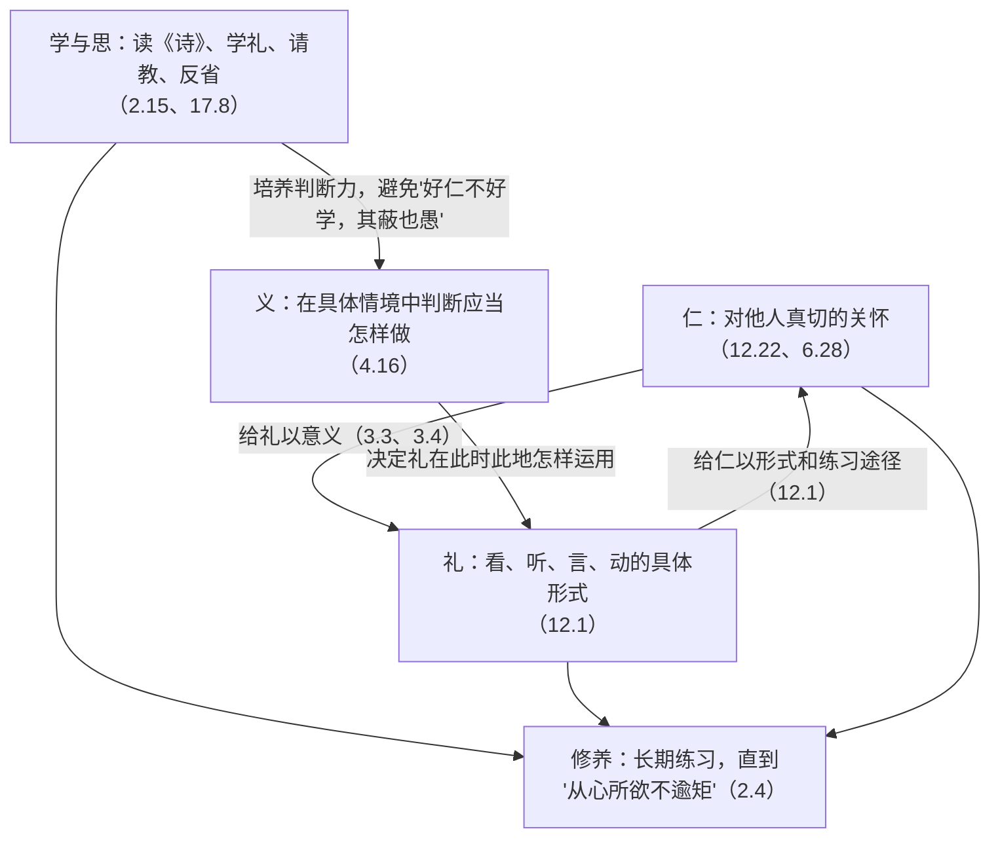
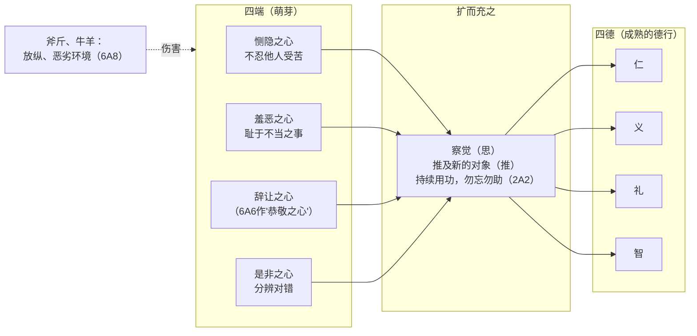
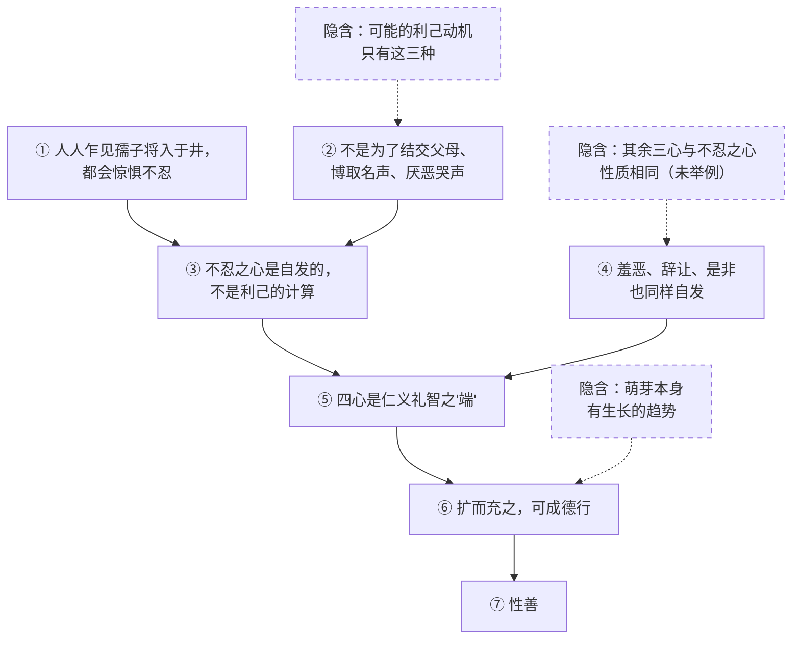
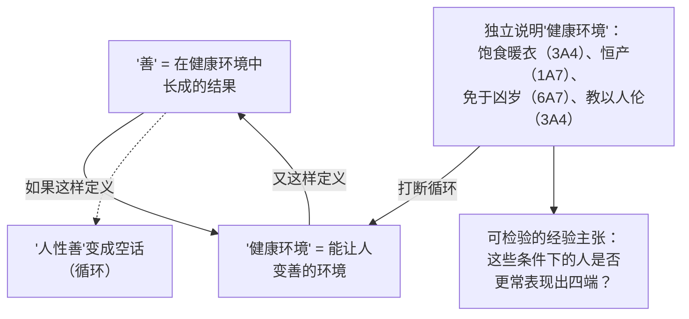
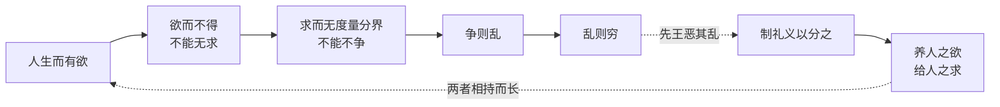
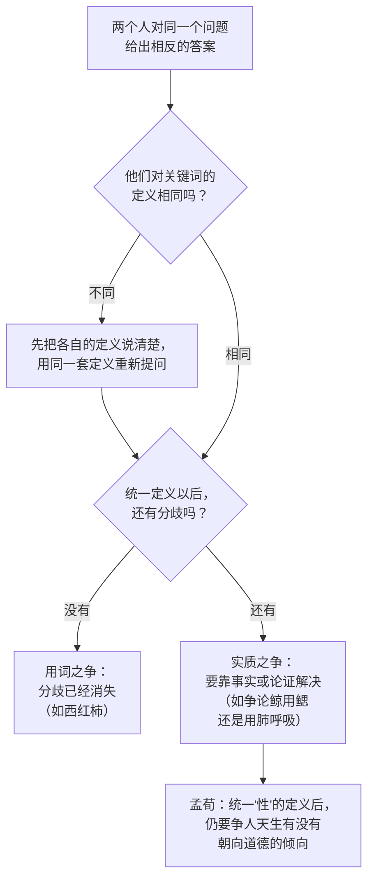
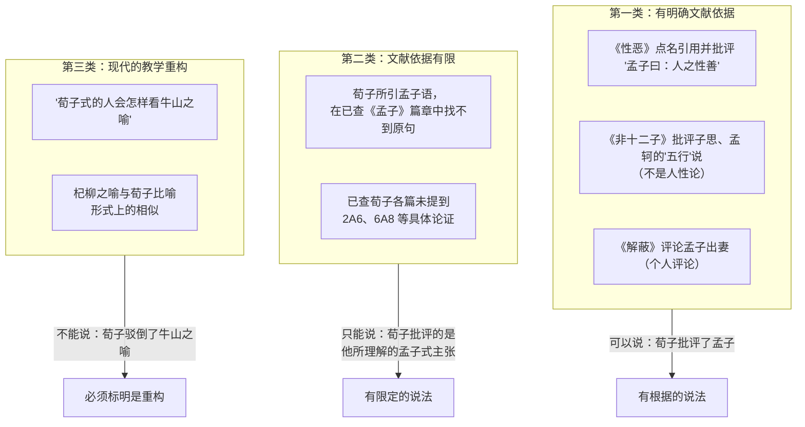

# CN1　孔子、孟子与荀子：修养、礼与人性

*Confucius, Mencius, Xunzi: Cultivation, Ritual and Human Nature*

> **状态：Phase 2 样章草稿（DRAFT），第三稿（在第二稿基础上补充例子、图示，并把学术出处移入注释），尚未经产品负责人和规划 AI 审定。** 本章是一个教学内容样本，用来检验"深度课程"的写法；它不是最终课程。核对范围与未核对事项见文末《来源与权利说明》。

---

## 本章导读：一个问题，三种回答

先从一个很普通的经验说起。我们大多知道应该诚实、应该体谅别人，可真到了要紧关头，常常做不到。知道和做到之间，好像隔着一段很长的路。那么，一个人究竟怎样才能在道德上变好？靠天生的好心肠，靠别人的教导，靠规矩的约束，还是靠自己一遍遍地反省和练习？

这一章就围绕这个问题展开：**一个人怎样才能在道德上变好？天性、礼、教育、反思和长期修养，各自起什么作用？**

孔子、孟子和荀子是同一个思想传统里先后出现的三个人，他们都认真思考过这个问题，却给出了很不一样的回答。孔子把重心放在礼和学习上；孟子相信人心里本来就有善的萌芽，修养是让它长大；荀子则认为，人天生的欲望如果放任不管，只会带来争夺，善要靠后天长期的努力才能得到。三种回答放在一起，问题本身就变得清楚多了。

读这一章时，有几件事请留意。

我们读的是论证，不是名人传记。每读一段原文，都要追问：这段话想证明什么？它靠哪些没有说出来的前提？可以怎样反驳？它对回答我们的核心问题有什么帮助？

古人说了什么、后来的学者怎么理解、本章自己怎么整理，这三者要分开。正文会随时交代："原文是这样说的""这是一种学者的解读""下面是我们为了讲清楚而做的整理"。凡是"整理"出来的论证步骤，都是我们的工作，不是古人的原话。

原文保留中文维基文库所载的繁体字形，讲解用简体。白话解释都是本章自己的理解，只是帮你读懂原文的拐杖，不是权威译文。《论语》的章号依理雅各（James Legge）《中国经典》第一卷（1893 年第二版）的分章；《孟子》用通行的"卷数 + A/B + 章号"（如 2A6 指《公孙丑上》第六章）；《荀子》用篇名。

原典的篇名和章号直接写在引文后面，方便你随时翻查；学者的研究、版本差异和其他细节放在带编号的注释里，集中列在文末，不打断正文。注释和《来源与权利说明》也解释了文中用到的缩写。

正文中有一些表格和图示。它们大多是本章为了教学画出的整理，不是古人自己画的图；每张图下面都会说明它表达什么、在哪里可能简化了原文。

文中有几处"想一想"，每一处有几道选择题。请先自己想清楚、作出选择，看过反馈和解析再往下读。它们不计分，只是让你亲手做一次论证的重构和评价。

---

## 一、历史基础：周的遗产与早期儒者

孔子生活在公元前六世纪到前五世纪之交。传统说法是他生于公元前 551 年、卒于公元前 479 年；这两个年份来自后世的记载，不必当作精确的史实。那时周王室的权威正在衰落，各地诸侯越来越像独立的国家。孔子出生在鲁国附近，年轻时就以熟悉周代的礼仪而出名。

要理解孔子为什么那么看重"礼"，得先知道周人留下了什么。按照《诗》《书》里反映的观念，统治者是因为有德行才得到"天"的支持的，政治的成败和统治者的品德连在一起。学界通常把这叫作"天命"观念。孔子接过了这种想法，但把重心移到了个人身上：好的政治，要从统治者自己的品德做起。

孔子明确说过他认同周的制度：

> 子曰：「周監於二代，郁郁乎文哉！吾從周。」（《论语》3.14）

"二代"指夏和商，"郁郁乎文哉"是说礼乐制度丰富而有文采。整句话的意思是：周借鉴了前两代的经验，礼乐制度丰富灿烂，我选择跟随周。请注意，孔子没有说周礼完美无缺，他说的是周礼在传承中积累了文采，值得学习。

"儒"这个字比孔子还早，最初大概是指熟悉礼乐的专门人员。至于这个传统具体起源于什么职业，学者说法不一，有人认为与古代乐师一类的官职有关，但这并非定论。我们只需记住：孔子面对的是一个早已存在礼乐实践的世界，他的新意在于为这套实践找到新的理由。

这三位思想家的书是怎么来的，也会影响我们对"他们到底说过什么"有多大把握。

传统上认为，《论语》是孔子的弟子和再传弟子编成的，是了解孔子最可靠的材料。近几十年来，有学者提出了疑问：书中有前后不一致的地方；在公元前二世纪以前，很少有人引用它；出土文献里还发现了一些和《论语》相似、却不全归于孔子的语录。所以有人推测，《论语》是从一大批孔子相关的语录里挑选编成的。[^1]这些疑问针对的是《论语》"最早、最权威"的地位，并不是否认孔子这个人存在。孔子生平的许多细节来自司马迁《史记》中带有教化色彩的故事，也不宜直接拿来解释他的哲学。所以，本章讨论的对象是"《论语》里的孔子"。

《孟子》一般认为由孟子的弟子或再传弟子整理而成，共七篇，每篇分上下，今天的本子经过东汉赵岐的整理和注释。孟子大约生活在公元前四世纪，出生时孔子已去世约一百年。他是邹国（今山东一带）人。据说他曾向孔子之孙子思的门人学习，后来游历各国向君主进言，并曾在齐国任职。

荀子活动于公元前三世纪，大约生于公元前 310 年前后，去世应在公元前 238 年之后；早年曾在齐国的学术中心求学。《荀子》一书由西汉刘向整理而成。学者一般认为书中各篇大多是荀子本人的作品，但篇章的划分未必可靠，有的篇章像完整的论文，有的则像是零散段落拼在一起。我们后面要读的《性恶》篇也有类似的问题，连篇名是不是出自荀子本人都说不准。[^2]所以读《性恶》时要留有余地，最好拿《礼论》《正名》《劝学》《解蔽》等篇互相印证。

后来的人喜欢把这几位排成一条师徒相传的线。唐代杨倞为《荀子》作序时写道：「蓋周公制作之，仲尼祖述之，荀、孟贊成之」，意思是周公创制礼乐，孔子继承和阐述，荀子、孟子帮助完成。这种说法影响很大，但它是唐代人心目中的儒学谱系，不是战国时期的直接证据。我们能确认的联系其实有限：三人都重视《诗》《书》和礼的传统；孟子据说与子思一系有渊源；荀子在书里明确点名批评过孟子的某些主张（第五节会仔细看）。至于谁具体回应了谁的哪一个论证，需要一条一条找文献根据，不能预先假定。

---

## 二、孔子：仁、礼与学习

### 仁：为什么不能一句话定义

如果你翻开《论语》想找"仁"的定义，会发现孔子每次的说法都不太一样：

> 樊遲問「仁」。子曰：「愛人。」（《论语》12.22）
>
> 夫仁者，己欲立而立人，己欲達而達人。能近取譬，可謂仁之方也已。（《论语》6.28，子曰）
>
> 子曰：「仁遠乎哉？我欲仁，斯仁至矣。」（《论语》7.29）

第一句最简单：仁就是爱人。第二句说得具体些：自己想站得稳，也帮别人站稳；自己想行得通，也帮别人行得通。"能近取譬"，就是从身边切近的事情去推想别人的处境，这是实践仁的方法。第三句最出人意料：仁离我们远吗？只要我想要仁，仁就来了。

三句话角度不同，说的却是同一种品质：对他人真切的关怀，以及把自己的感受推及别人的能力。第三句还透露出一个重要的意思：仁的起点就在每个人手边，修养不用等待什么外力，"我想要"就可以开始。

"仁"很难找到一个准确的现代对应词。英文常译作 benevolence（仁慈）、humaneness（人道）或 goodness（善），每个译法都只抓住了一部分。中文里我们也不妨暂时不急于给它下定义，而是看它在具体对话中怎样被使用。顺便一提，《论语》里"己所不欲，勿施于人"一类的话（如 12.2），常被拿来和西方的"黄金律"相比。有学者提醒，这种对比可能受到了后来比较眼光的影响，个别相关段落是不是《论语》原有也有争议。我们这里只把它看作"由己推人"的一种说法。

### 克己复礼：仁和礼是什么关系

仁是一种内心的关怀，礼是一套外在的规矩，两者怎么连在一起？最集中的一段是颜渊问仁：

> 顏淵問「仁」。子曰：「克己復禮爲仁。一日克己復禮，天下歸仁焉，爲仁由己，而由人乎哉？」顏淵曰：「請問其目。」子曰：「非禮勿視，非禮勿聽，非禮勿言，非禮勿動。」（《论语》12.1）

用今天的话说：颜渊问什么是仁。孔子说，约束自己、回到礼上来，就是仁。哪一天做到了，天下人都会称许你的仁。做到仁全靠自己，难道靠别人吗？颜渊又问具体该怎么做。孔子说：不合礼的不看，不合礼的不听，不合礼的不说，不合礼的不做。

"克己"一般理解为约束、克制自己（历代注家对这两个字还有别的解释，本章取最朴素的理解）。"目"是具体条目。这里的"礼"也不只是典礼仪式，而是规范一个人怎么看、怎么听、怎么说话、怎么行动的整套方式，有点像我们说的"待人接物的分寸"，但比它更郑重。

把这段话整理成论证（这是本章的整理）：

1. 仁要通过"克己复礼"来实现。
2. 礼给出了具体的行为方式：看、听、说、做都有合礼与不合礼之分。
3. 实行这些方式，要靠自己主动去做（"为仁由己"），别人代替不了。
4. 所以，修养就是在礼的具体形式中，自己主动约束、反复练习的过程。

读到这里，你可能会觉得别扭：礼明明是社会传下来的规矩，怎么能说"由己"？如果只是照章办事，那和被迫服从有什么不同？《论语》自己就给了线索：

> 子曰：「人而不仁，如禮何？人而不仁，如樂何？」（《论语》3.3）
>
> 林放問禮之本。子曰：「大哉問！禮，與其奢也，寧儉；喪，與其易也，寧戚。」（《论语》3.4）
>
> 子曰：「禮云禮云，玉帛云乎哉？樂云樂云！鐘鼓云乎哉？」（《论语》17.11）

第一句说：一个人如果没有仁，礼对他有什么用？乐对他又有什么用？第二句是有人问礼的根本是什么，孔子称赞这是个大问题，然后说：礼与其铺张，不如节俭；办丧事与其样样周到，不如真正悲伤。第三句说：礼呀礼呀，难道只是玉器丝帛吗？乐呀乐呀，难道只是钟鼓吗？

三句话合起来，意思很清楚：礼的价值来自真诚的心意，不在于排场和器物。这就是一种常见的解读：仁和礼互相依赖，仁给礼以意义，礼给仁以形式和练习的途径。打个比方，礼像钢琴的指法练习，仁像演奏者对音乐的感受。只有指法没有感受，弹出来是机械的；只有感受没有指法，又弹不成曲子。"由己"和"依礼"所以能同时成立：礼是练习的材料，真诚是练习的灵魂。

再看两个今天的例子，它们分别照亮这个关系的一面。

第一个是葬礼。一场葬礼可以办得极尽排场，请很多人、花很多钱，主人却心不在焉；也可以办得简朴，家人却真正在悲伤中送别亲人。孔子说"丧，与其易也，宁戚"，选的正是后一种。这个例子说明：形式离开了心意，就只剩空壳。

第二个是道歉。一个孩子打了同学，被老师要求说"对不起"。一开始，他也许只是嘴上应付。可如果大人耐心地让他看到对方的委屈，一次次要求他认真道歉，他慢慢会懂得这句话的分量，后来做错事时，会自己想去道歉。这个例子说明另一面：心意也需要形式来培养，"对不起"这个现成的说法，给了孩子一个练习体谅别人的入口。

两个例子都有局限。今天的道歉和葬礼只是"礼"的一小部分。在孔子那里，礼是一整套规定身份、场合和举止的周代礼制，远比现代的礼貌复杂，也带有等级秩序的内容。我们借现代例子，只是为了看清"形式"和"心意"怎样互相成就，不是说孔子的礼就等于今天的礼貌。

回到核心问题，孔子的第一个回答就是：变好不是凭空发个愿，而是在礼的具体训练里，把关怀他人的心意落实成行动。

### 义：在具体情境里做该做的事

> 子曰：「君子喻於義，小人喻於利。」（《论语》4.16）

君子明白的是什么事应该做，小人明白的是什么事对自己有利。"义"大致可以理解为"应当如此"的行事标准，常常和拒绝不正当的好处、承担公共责任联系在一起。它与"利"相对，但并不是说君子从不考虑利益，而是说当利益和应当做的事冲突时，君子知道该站在哪一边。

义和礼的分工可以这样理解：礼提供一般的行为形式，义则要求人在具体情境中判断怎样做才恰当。规则不可能把所有情况都写进去，所以修养不能只是背规矩，还得学会判断。至于义和仁怎样分工，孟子后来有更多发挥。

《孟子》里有一段对话，把"规矩"和"判断"的关系说得特别清楚。这是孟子的话，不是孔子的，但它讲的正是孔子留下的这个问题：

> 淳于髡曰：「男女授受不親，禮與？」孟子曰：「禮也。」曰：「嫂溺則援之以手乎？」曰：「嫂溺不援，是豺狼也。男女授受不親，禮也。嫂溺援之以手者，權也。」（《孟子》4A17）

淳于髡问：男女之间不亲手递接东西，这是礼吗？孟子说：是礼。淳于髡又问：那么嫂子掉进水里，要伸手去拉她吗？孟子说：嫂子落水而不去拉，那是豺狼。男女不亲手递接东西，是礼；嫂子落水伸手去拉，是"权"。"权"本义是秤锤，引申为在具体情况中掂量轻重。

这个例子有三层意思。第一，礼是真实的规范，孟子没有因为有例外就说礼不重要。第二，规范背后有它要保护的东西，当拘守规范会让人见死不救时，坚持条文反而违背了规范的本意。第三，做出这种判断需要一种能力，它不是从条文里查出来的。今天的例子也不少见：医院规定探视时间，可一位病人病危，家属半夜赶到，值班护士放他们进去，没有人会说她"不守规矩"。不过请注意，"权"很容易被滥用，人人都可以说自己是在"变通"。所以儒家始终把"权"和长期的学习、修养连在一起：只有真正懂得规矩为什么存在的人，才有资格判断何时可以变通。

### 学与思：为什么只有好心还不够

孔子用一段很有名的话回顾自己的一生：

> 子曰：「吾十有五而志于學；三十而立；四十而不惑；五十而知天命；六十而耳順；七十而從心所欲，不踰矩。」（《论语》2.4）

我十五岁立志学习，三十岁能站得住，四十岁不再困惑，五十岁懂得了天命，六十岁听什么都能明白其中的道理，七十岁随心所欲也不越出规矩。这里最值得注意的是开头和结尾：修养是从立志学习开始的，一直到七十岁，内心的意愿和外在的规矩才终于合二为一。换句话说，孔子把变好看成一件一辈子的事。

学习之外还要思考：

> 子曰：「學而不思則罔，思而不學則殆。」（《论语》2.15）

只学习不思考，就会迷惘，学来的东西用不上；只思考不学习，就会危险，容易走偏。（"罔"和"殆"的确切含义，注家有不同说法。）道理不难理解：光是照单全收，学到的东西成不了自己的判断；光凭自己想，不吸收前人的经验，又容易钻牛角尖。所以修养需要两个来源：向外学习，读《诗》、学礼、请教老师；向内反思，检查自己。

孔子还说过，几种我们通常认为是美德的品质，如果不配合学习，都会出毛病。第一条就是：

> 好仁不好學，其蔽也愚；……（《论语》17.8）

喜欢仁爱却不爱学习，毛病是愚笨。生活中不难找到例子：一个心地很好的人，因为缺乏判断力，被人骗了，或者好心办了坏事。可见善良的意愿不能自动保证好的行动，判断力要靠学习来获得。

那么孔子心目中的"好学"是什么样子？他称赞学生颜回好学，举的表现是「不遷怒，不貳過」（《论语》6.2；另有版本编为 6.3），也就是不把怒气撒到别人身上，同样的错误不犯第二次。可见"好学"不只是读书，更是不断地改正自己。颜回这样形容老师的教法：

> 夫子循循然善誘人：博我以文，約我以禮。（《论语》9.10，颜渊语；另有版本编为 9.11）

老师一步一步地善于引导人，用典籍开阔我的眼界，用礼来约束我的行为。学问和规矩是一起进行的。

孔子还概括过一条完整的培养路径：

> 子曰：「興於詩，立於禮，成於樂。」（《论语》8.8）

由《诗》激发情感，靠礼站立得住，在乐中完成人格。有学者把这看作孔子培养方法的缩影：礼乐的训练塑造情感、调节欲望，为道德反思留出空间。

### 一张图：仁、礼、义、学怎样连在一起

读到这里，我们已经见过孔子修养论的几个关键词。下面这张图把它们的关系画出来。**这是本章的教学整理，不是《论语》里的现成框架**；箭头旁的说明都对应上文读过的章节。

这张图想说明三件事。第一，仁和礼之间是双向的箭头：没有一方可以单独完成修养。第二，义和学插在中间：光有好心和规矩还不够，还需要靠学习获得的判断力。第三，所有箭头最后都指向"修养"这个长期过程，而不是一次性的结果。

图也有它的简化之处。孔子从没有把这几个概念排成一个系统；"仁"在《论语》里有时几乎是全部美德的总称，范围比图中这个方框大得多。所以请把图当成帮助记忆的地图，而不是孔子思想的定义。

### 个人品德与政治秩序

在孔子看来，修养从来不只是私人的事，它和政治连在一起。

> 子曰：「道之以政，齊之以刑，民免而無恥；道之以德，齊之以禮，有恥且格。」（《论语》2.3）

"道"在这里读作"导"，是引导的意思；"政"是政令，"刑"是刑罚，"免"是逃避惩罚，"格"一般理解为归于正道。整句的意思是：用政令来引导百姓，用刑罚来整顿百姓，百姓只求免于受罚，却没有羞耻心；用德行来引导百姓，用礼来整顿百姓，百姓不但有羞耻心，而且会自觉走上正道。（有学者根据出土文献认为这里的"耻"可能读作"止"，指有所节制。这只是一种校读意见，本章仍取通行理解。）

整理成论证（本章的整理）：

1. 只靠政令和刑罚，百姓会设法躲避惩罚，但不会产生羞耻之心。
2. 用德行引导、用礼规范，百姓会生出羞耻之心，并自觉向善。
3. 有羞耻之心、自觉向善，比仅仅避免惩罚更好。
4. 所以，好的统治应当主要依靠德与礼，而不是只靠政令和刑罚。

用一个今天的设想来看这两条路的区别（这是本章设计的教学例子）。一所学校想让学生不在考试中作弊。第一种办法是装满监控、加重处罚：学生确实不太敢作弊了，可一旦监控坏了、老师走开了，有人马上就会动歪念头，他们在意的是"别被抓住"。第二种办法是老师自己处处守信、公平评分，学校把诚信当作班级里人人看重的荣誉，学生之间也互相看着：作弊的人会觉得在同学面前抬不起头。到那时，即使没有监控，大多数人也不会作弊，因为他们自己觉得那样做可耻。

| | 道之以政，齐之以刑 | 道之以德，齐之以礼 |
|---|---|---|
| 主要手段 | 政令、刑罚 | 在上者的德行示范、礼的规范 |
| 人们关心的问题 | 怎样不被惩罚（"免"） | 怎样做才不可耻（"耻"） |
| 没人监督时 | 容易越轨 | 仍可能自我约束 |
| 孔子的评价 | "民免而无耻" | "有耻且格" |

这个例子和这张表能帮你看清孔子比较的是什么：不是"要不要规则"，而是规则怎样进入人心。但例子也有限度。孔子说的是治理一个国家的百姓，不是一所学校；他心目中的"德"首先是统治者本人的德行，"礼"也是一整套社会秩序，不只是校规和班风。另外，这个例子是我们设想的，现实中监控和荣誉感往往同时起作用。活动 A 会请你进一步检验孔子的这两个经验判断。

孔子还有一个更形象的说法。鲁国的执政者季康子问他：杀掉坏人来成全好人，怎么样？

> 季康子問政於孔子曰：「如殺無道，以就有道，何如？」孔子對曰：「子爲政，焉用殺？子欲善，而民善矣。君子之德，風；小人之德，草；草上之風，必偃。」（《论语》12.19）

孔子回答：您治理国家，何必杀人？您自己想向善，百姓就会向善。在上位者的品德像风，百姓的品德像草，风吹过草上，草一定随风倒伏。这里的"君子""小人"主要指地位的高低，而不完全是道德评价。

这种由近及远的思路，在有子的一句话里说得更清楚：

> 君子務本，本立而道生；孝弟也者，其爲仁之本與？（《论语》1.2，有子曰）

君子致力于根本，根本立住了，道路就生出来了。孝顺父母、敬爱兄长，大概就是仁的根本吧。意思是：从家庭中最自然的亲情出发，再推广到社会和政治。这条思路引出了后面会反复出现的两个问题：对亲人的爱，怎样推广为对陌生人的关怀？对亲人的责任和对公众的正义发生冲突时，又该怎么办？第二个问题会在第六节讨论。

> **想一想（活动 A）：找出最薄弱的前提。** 上面整理出的论证里，第 1 步和第 2 步其实都是经验性的判断：前者说"政与刑养不出羞耻心"，后者说"德与礼能养出羞耻心"。请你设想一个具体情形，让其中一个判断不成立，再往下读。
>
> *提示：* 只说"德礼之外也需要法律"并不构成挑战，因为孔子的论证并没有主张取消刑罚，它比较的是哪一种方式能培养出羞耻心。真正的挑战有两个方向。一是找出法律本身培养出了真实羞耻心的情形：比如一个社会长期公正、透明地执法，人们渐渐把规则当成自己的标准，即使没人看见，也会为违规感到羞愧。如果这种情形可能，第 1 步就太绝对了。二是找出德与礼只换来表面服从的情形：比如统治者举止端正、礼仪周全，百姓却只学会了在人前做做样子，或者只对"失礼"感到难堪，对伤害别人反而无动于衷。如果这样，第 2 步就不能保证成立，还得追问：什么样的礼，在什么条件下，才能养出真正的羞耻心？

### 孔子留下的问题：人性

孔子直接谈人性的话不多，后世最常引用的是这一句：

> 子曰：「性相近也，習相遠也。」（《论语》17.2）

人的天性彼此相近，后天的习染和练习使人相差很远。这句话把重心放在"习"上：人天生差不多，后来的差别主要是实践造成的。（本章没有核查《论语》中所有出现"性"字的段落，所以只说这是最常被引用的一条。）

可这句话留下了一个悬而未决的问题：那个"相近"的起点究竟是什么样子？是倾向于善，还是只是一堆需要管束的欲望？"习"又应该怎样塑造它？孟子和荀子正好给出了两种方向相反的回答。

---

## 三、孟子：人性善与扩充

### 先弄清楚"性善"是什么意思

一听"人性善"，很多人会理解成"人生下来就是好人"。这其实是误解。要弄清孟子的意思，最好从他和告子的辩论读起，因为"性善"正是在这场争论中提出来的。

告子先打了个比方：

> 告子曰：「性，猶杞柳也；義，猶桮棬也。以人性為仁義，猶以杞柳為桮棬。」孟子曰：「子能順杞柳之性，而以為桮棬乎？將戕賊杞柳，而後以為桮棬也？」（《孟子》6A1）

杞柳是一种柳条，桮棬是用柳条编成的杯盘。告子说：人性像柳条，仁义像杯盘，把人性做成仁义，就像把柳条编成杯盘。言下之意，仁义是在人性这块原料上加工出来的。孟子反问：你是顺着柳条的本性把它编成杯盘，还是要先砍削、损伤它，才能编成？如果要损伤，那把人性做成仁义，岂不也要伤害人？孟子的担心是：如果人们相信仁义是违背人性的东西，就会把仁义看成祸害。

告子又换了个比方，说人性像水，在东边开个口子就往东流，在西边开个口子就往西流，本身无所谓善不善。孟子回答：

> 人性之善也，猶水之就下也。（《孟子》6A2）

水确实不分东西，可难道也不分上下吗？人性趋向善，就像水总是往低处流。孟子接着说，拍打水，可以让它跳过额头；堵住它逼它倒流，可以让它流上山。但那是外力造成的，不是水本来的趋向。人做坏事也是这样。

从这两段交锋可以看出，孟子说的"性"，不是人某一时刻的实际状态，而是人在正常、健康的条件下会发展成的样子。这里有一个对理解孟子很关键的学术解读（来自汉学家葛瑞汉等人的研究[^3]）：在孟子那个时代，说某个东西的"性"，指的是它在适合自己的环境中会长成的样子。比如说，结果子是橘树的"性"，哪怕大多数橘子种子根本没能发芽，更不用说结果。同样，会说话是人的"性"，哪怕有人因为疾病或从小与世隔绝而没有学会说话。

孟子自己的总结在 6A6：

> 乃若其情則可以為善矣，乃所謂善也。若夫為不善，非才之罪也。（《孟子》6A6）

"情"在这里大致指"实际的样子"（也有注家理解为情感），"才"指天生的资质。这句话是说：就人实际的样子来看，人是可以为善的，这就是我所说的"善"；至于有人做了坏事，那不是天生资质的过错。

值得注意，"性善"这个说法本身在今本《孟子》里只出现在少数几处（如 3A1 和 6A6）。后世常说的"人性本善"，带有宋代以后理学家的解释色彩，并不是孟子的原话。

所以，孟子的主张可以比较稳妥地这样表述：人天生就有一些初步的道德倾向，在适当的培养下会发展成完整的德行；一个人做坏事，是这些倾向受到了损害或没能发展起来，而不是因为他根本没有。

### 四端：从一个思想实验开始

孟子最有名的正面论证在 2A6：

> 今人乍見孺子將入於井，皆有怵惕惻隱之心；非所以內交於孺子之父母也，非所以要譽於鄉黨朋友也，非惡其聲而然也。由是觀之，無惻隱之心，非人也。無羞惡之心，非人也。無辭讓之心，非人也。無是非之心，非人也。惻隱之心，仁之端也；羞惡之心，義之端也；辭讓之心，禮之端也；是非之心，智之端也。……凡有四端於我者，知皆擴而充之矣，若火之始然，泉之始達。（《孟子》2A6）

先看大意。假如一个人忽然看见一个小孩快要掉进井里，都会产生惊惧和不忍的心情。这不是因为想跟孩子的父母攀交情，不是为了在乡亲朋友中博个好名声，也不是因为讨厌孩子的哭声。由此看来，没有不忍之心的，不算人；没有羞耻和厌恶之心的，不算人；没有推让之心的，不算人；没有分辨是非之心的，不算人。不忍之心是仁的开端，羞恶之心是义的开端，辞让之心是礼的开端，是非之心是智的开端。凡是有这四种开端的人，只要懂得把它们扩大、充实起来，就会像火刚刚燃起、泉水刚刚涌出一样，越来越旺，越流越远。

几个词需要解释一下。"恻隐"是看到别人受苦时的不忍与怜悯；"内交"是结交；"要誉"是博取名声；"端"本义是开头、萌芽，所以"四端"就是四颗道德的嫩芽。这个比喻很重要：嫩芽是真实存在的，但它还不是大树，需要培育才能长大。（"端"这个说法集中出现在 2A6。在 6A6 里，孟子直接说这几种心"就是"仁义礼智，没有用"端"字；两处讲礼的那一项也略有不同，2A6 说"辞让之心"，6A6 说"恭敬之心"。）

孟子只为恻隐之心举了孩子落井的例子。另外三种心是什么样子，可以借几个情形来体会。前一个出自《孟子》本身，后两个是本章设想的日常例子，只用来帮助理解，不是孟子的论证：

- **羞恶之心。** 孟子在 6A10 讲过下面这个情形（他原本用它说明人有"所惡有甚於死者"，本章借它来体会羞恶之心）：「一簞食，一豆羹，得之則生，弗得則死。嘑爾而與之，行道之人弗受；蹴爾而與之，乞人不屑也。」一小筐饭、一碗汤，得到就能活，得不到就会死；可如果吆喝着施舍，过路的人也不肯接受；用脚踢过去给，连乞丐都不屑要。宁可挨饿也不受侮辱，这就是羞恶之心：对屈辱和不当之事本能地抗拒。
- **辞让之心。** 公交车上有位老人站在旁边，很多人会自然地觉得"这个座位该让出去"，坐着反而不自在。
- **是非之心。** 小孩子分糖时，看到别人多拿了，会马上喊"不公平"，虽然他还说不出什么是公平。

这三个例子都只说明"萌芽"大概的样子，不能证明这些反应是天生的。辞让和是非的例子尤其可能部分来自后天教养，这正是下文会讨论的那个难题。

下面这张图是本章根据 2A6 和 6A6 画的教学示意，表示每一种萌芽经过"扩而充之"长成哪一种德行。图中的"扩充"一栏是本章的概括，不是孟子的原话：

读图时要注意两点。第一，左边的萌芽是人人都有的，右边的德行却不是：从左到右的这条路，需要人自己去走，也需要合适的环境。第二，图把四条线画得一样整齐，这是为了好看；孟子并没有说四种德行是分别、平行地长成的，《孟子》中仁与义、义与礼常常互相牵连。

整理成论证（本章的整理）：

1. 任何人突然看到小孩将要掉进井里，都会产生惊惧和不忍。
2. 这种反应不是为了讨好孩子父母，不是为了博取名声，也不是因为讨厌哭声。
3. 所以，这种反应不是出于利己的考虑，而是直接、自发的。
4. 类似的自发反应还有羞恶、辞让、是非。
5. 这四种自发倾向是仁、义、礼、智的开端，人拥有它们，就像拥有四肢一样自然。
6. 这些开端经过"扩而充之"，可以长成完整的德行。
7. 所以，人天生具有走向善的倾向，这就是"性善"。

这个论证有几个没说出来的前提。第 2 步默认，能想到的利己解释只有这三种。第 4 步默认，其他三种心也和不忍之心一样是自发的，可孟子只为不忍之心举了例子。第 6 步默认，这些萌芽本身有生长的趋势。

把明说的步骤和隐含的前提画在一起，就能看出哪里最容易受到攻击（本章的教学重构，虚线框是隐含前提）：

这张图说明：结论⑦要成立，三条虚线都得撑住。下面这段的反驳，分别就是在攻击 H1（不忍之心可能另有利己来源）、⑤（这些反应也许是很早教出来的，而不是天生的萌芽），以及①的"人皆有之"。H2 和 H3 则是第 4 步和第 6 步各自需要另外论证的地方。

最直接的反驳是：不忍之心也许另有利己的来源，比如人只是想摆脱自己看到惨状时的难受；或者，这种反应是从小被教育出来的，并不是天生的萌芽。另外，"人皆有之"是个全称的断言，一个思想实验似乎撑不起这么大的结论。孟子可以回应：我说的只是"端"，是萌芽，不是成品；萌芽可能很弱，也可能被压伤，但不等于没有。这个回应很聪明，可它又引出一个新问题：用什么方法，才能分清"天生的萌芽"和"很早就学会的反应"？

不过，这个论证的意义不只在于证明。孟子同时也在唤起读者自己的经验：你读到孩子快掉进井里那一句时，心里是不是也紧了一下？他想让你从自己身上认出那颗萌芽。

### 心：会感受，也会思考

孟子说的"心"，和我们今天把"心"当成情感、把"脑"当成思考的习惯不太一样。在他那里，心既是感受的地方，也是思考和反省的地方。英文常把它译作 heart-mind（心—思），就是想同时保留这两层意思。

> 耳目之官不思，而蔽於物。物交物，則引之而已矣。心之官則思；思則得之，不思則不得也。（《孟子》6A15）

耳朵、眼睛这些器官不会思考，容易被外物遮蔽；外物和感官一接触，感官就被牵着走了。心这个器官的职能是思考，思考就能有所得，不思考就得不到。要注意，在古代中国的语境里，耳目常常不只是指"看和听"，更指声色等感官欲望。所以这里是说：欲望会自动被外物吸引，道德的心却需要主动去"思"才能起作用。

6A6 也说：

> 仁義禮智，非由外鑠我也，我固有之也，弗思耳矣。（《孟子》6A6）

"铄"本义是熔化金属，这里引申为从外面熔铸进来。仁义礼智不是从外面熔铸给我的，是我本来就有的，只是没有去思考罢了。

所以，孟子说的"内在"并不是让人躺着等善自己长出来。萌芽需要心去察觉、去珍惜，还要靠行动去扩展。这样就避开了一种常见的误读，以为孟子主张人只要顺其自然就能成为圣人。

### 牛山之喻：为什么善会"消失"

既然人人都有善的萌芽，现实中为什么还有那么多坏人？孟子用牛山打了个比方：

> 牛山之木嘗美矣。……是其日夜之所息，雨露之所潤，非無萌蘗之生焉，牛羊又從而牧之，是以若彼濯濯也。人見其濯濯也，以為未嘗有材焉，此豈山之性也哉？雖存乎人者，豈無仁義之心哉？其所以放其良心者，亦猶斧斤之於木也。旦旦而伐之，可以為美乎？……人見其禽獸也，而以為未嘗有才焉者，是豈人之情也哉？故茍得其養，無物不長；茍失其養，無物不消。（《孟子》6A8，节引）

牛山是齐国都城附近的一座山。大意是：牛山上的树木曾经很茂盛。因为它在大都市的郊外，人们天天拿斧头去砍，还能茂盛吗？山日日夜夜仍在生长，雨露滋润着它，并不是没有新芽长出来，可牛羊又跟着来放牧，所以变得光秃秃的。人们看见它光秃秃的样子，就以为它从来没有长过树木，这难道是山的本性吗？人也一样，人身上难道没有仁义之心吗？一个人丢失了良心，就像斧头对待树木一样，天天砍伐，还能美好吗？人们看见他像禽兽一样，就以为他从来没有过善良的资质，这难道是人的实情吗？所以，只要得到养护，没有什么东西不生长；一旦失去养护，没有什么东西不消亡。

"濯濯"是光秃秃的样子，"萌蘖"是新长出的嫩芽，"斧斤"是斧头，"放"是丢失，"良心"是本来具有的善心。

整理成论证（本章的整理）：

1. 牛山曾经林木茂盛，后来变得光秃。
2. 人们看见光秃的山，就以为它从来没长过树。
3. 但山之所以光秃，是因为被斧头砍伐、被牛羊啃食；它其实每天都还在萌发新芽。
4. 所以，山现在光秃，不能证明山的本性就是没有树木。
5. 人也一样：人有仁义之心，却天天被各种不良的行为"砍伐"。
6. 所以，看到一个人像禽兽，不能证明他从来没有善的资质。
7. 任何东西得到养护就会成长，失去养护就会消亡。

这个论证的力量全在类比上。孟子默认：人的善心像山上的嫩芽一样，自己有恢复和生长的趋势；人的恶行也像山的光秃一样，主要是外在的伤害（环境、习惯、自己的放纵）造成的。他还提到"平旦之气"，说人在清晨休息之后，好恶会稍稍接近正常，这是他给出的一条经验线索。

要看清这个类比到底主张了什么，可以把同一个事实放到三种解释下面比较。设想一个在动荡、贫困中长大的少年，成了街头的打手（这是本章设想的情形）：

| 解释者 | 怎样说明他变坏 | 对应的比喻 | 补救的方向 |
|---|---|---|---|
| 孟子 | 善的萌芽本来就有，被环境和放纵一天天"砍伐"了 | 牛山被斧斤、牛羊所伤（6A8） | 停止伤害，保障生计和教育，让他自己察觉（"思"）、推广（"推"）并持续培养本来就有的萌芽（6A15、1A7、2A2、3A4） |
| 告子 | 人性本身无善无恶，是环境把他引向了这一边 | 水往决口的方向流（6A2） | 换一个"决口"，把他引向另一边 |
| 荀子 | 顺着天生的欲望走，又没有礼义的约束，必然走向争夺 | 木料要经过墨线校正才会直（"木受繩則直"，《荀子·劝学》，见第四节） | 用老师和礼法从外面加以矫正和培养 |

三种解释都承认环境很重要，分歧在于环境起的是什么作用：孟子说环境"伤害或养护"一个本来就有的方向，告子说环境"决定"方向，荀子说环境必须"建立"一个人性里本来没有的方向。所以单凭"这个少年确实是环境造成的"这一事实，分不出三者的对错。同样要注意，"需要长期努力"也分不出孟子和荀子：孟子同样要求"思"、要求"推"，要求"必有事焉"地持续用功，也要求先保障生计、再设立教育；荀子也承认人天生有认识和学习的能力。两人的分歧在于修养**培养的是什么**：孟子认为，修养是让一个本来就有的道德方向（四端）在适当条件下生长、扩充；荀子认为，道德方向本身要靠刻意的努力，通过学习礼义才建立起来，天性提供的只是欲望和学习的能力。告子则不同于两人：他认为人性本身没有方向，向哪边发展完全由"决口"开在哪里决定。至于什么样的证据能把这几种解释区分开，第五节还会回到这个问题；光看到少年在好环境中经过长期学习变好了，并不足以判定谁对。

这里有一个值得认真对待的疑问：这样解释，几乎任何恶行都可以说成是"被砍伐了"。如果一个人坏到了极点，孟子说那是砍得太狠；如果一个人在好环境中也变坏了，孟子可以说那是他自己没有"思"。那么，还有什么样的事实能让孟子承认自己错了？

这个疑问是对的，但要小心别从它直接跳到"所以孟子的理论没有价值"。哲学家波普尔（Karl Popper）提出过一个著名的标准：一个理论如果原则上不可能被任何观察推翻，就不算是科学的经验理论。[^4]这个标准对检验经验性的假说很有用，但孟子的人性论不只是一个经验假说。它至少包含三种成分：一是概念上的主张，即"性"指的是一个东西在健康环境中的发展方向（就像前面橘树的例子）；二是规范上的主张，即哪些发展算"健康"、算"善"；三才是经验上的主张，比如人普遍会对他人的苦难感到不忍，又比如人在饥寒中较难保持善心。不能被某一个观察直接推翻，不等于这个理论没有内容；概念分析和规范论证本来就不靠单个实验来检验。

真正的难点在另一个地方。斯坦福哲学百科的孟子条目指出，这种人性观有陷入恶性循环的危险：如果我们把"善"定义为在健康环境中长成的结果，又把"健康的环境"定义为能让人变善的环境，那么"人性善"就变成了一句空话。葛瑞汉认为这是对孟子的致命反驳。不过条目的作者并不同意就此打住。他认为，孟子关于人性、德行、修养和政治的种种主张，是一张互相支撑的信念之网，其中既有诉诸我们直觉的部分（比如对别人的苦难感到不忍是正常的），也有经验性的主张（比如人在物质匮乏时较少表现出同情）。这样的理论可能是错的，但不能被轻易地斥为天真的循环论证。[^5]

于是，评价牛山之喻的合理问题应该是：

- "健康的环境"能不能不靠道德结果来独立说明？孟子其实给出过一些独立的条件：吃得饱、穿得暖、免于暴力的恐惧、受到教育（见下文 1A7、3A4）。
- 那些经验性的部分站得住吗？比如孟子说：「富歲，子弟多賴；兇歲，子弟多暴。非天之降才爾殊也，其所以陷溺其心者然也」（6A7）。"凶岁，子弟多暴"意思清楚：荒年里年轻人多半凶暴。难的是"赖"字。东汉赵岐注说"赖，善"，丰年时年轻人多半向善；宋代朱熹注作"赖，借也"，说丰年衣食充足，人有所依靠、有所顾惜，所以能为善。两种古注的结论一致：好年景让人向善，坏年景让人变坏。现代也有人把"赖"读作"懒"，理解为丰年时年轻人多半懒散（本章没有核对这种读法的具体出处）。照这种读法，丰年和荒年都会让人出毛病，只是毛病不同。不管取哪一种读法，孟子接下来的结论都一样：差别不是天生的资质不同，而是环境让他们的心陷了进去。这正是他论证需要的那一点。这一类关于环境影响的说法，是可以拿事实来检验的。
- 整套解释是否前后一致？和对手的理论相比，它能不能更好地说明我们的道德经验？

下图是本章画的示意，把"循环的危险"和孟子可能的出路放在一起。上半部分是上面那个条目所说的危险，下半部分是本章根据 1A7、3A4、6A7 整理的出路：

图的意思是：只要"健康环境"能用吃穿、安全、教育这些不依赖道德结果的条件来描述，循环就被打断了，孟子的理论就有了可以拿事实去检验的部分。不过要注意，"教以人伦"本身已经带着道德内容，所以这条出路并不完全干净，这也是活动 B 想让你思考的地方。

在这个意义上，牛山之喻不是一个孤立的论证。它和孩子落井的思想实验（2A6）、齐宣王不忍看牛被杀的故事（1A7），以及关于环境影响的观察（6A7）合在一起，构成了一个完整的解释。

> **想一想（活动 B）：重构并检验。** 请不看上文，自己把牛山之喻整理成"前提—结论"的形式。然后想一想：这个类比最依赖的是哪一个前提？请设想一个事实，如果它被证实，会削弱孟子的论证；再说说，孟子的理论中有没有哪一部分，是这种事实无法触及的？
>
> *提示：* 最关键的前提是"人的善心像山上的嫩芽一样，有自行恢复的趋势"。如果有可靠的证据表明，长期受虐待或被忽视的人，即使后来生活在安定、受教育的环境中，道德感也几乎无法恢复，这个前提就受到挑战。孟子也许会说，那是砍伐得太深，需要更长久的养护。这个回应本身不算错，但如果每次遇到反例都这样回答，又说不出"足够的养护"具体是什么，理论就会越来越空。另一方面，"性指健康环境中的发展方向"是一个概念上的主张，单靠这类事实推翻不了它；要评价它，得看这个概念是否有助于理解人，以及"健康"能否被独立地说明。

### 修养与政治：不急不弃，推己及人

孟子讲修养，有三个层面。

第一，不要强求，也不要放弃。孟子讲过一个宋国人揠苗助长的故事：那人嫌禾苗长得慢，一棵棵往上拔，回家还得意地说今天帮苗长高了，儿子跑去一看，苗全枯死了。孟子由此说：

> 必有事焉而勿正，心勿忘，勿助長也。（《孟子》2A2）

一定要持续地用功，但不要预先期待效果；心里不要忘记，也不要硬去助长。孟子还说，觉得没用而放弃的人，就像不给禾苗除草；硬去助长的人，就像拔苗。前一种是不耕耘，后一种是伤害。道德修养也是这样：既要持之以恒，又不能急于求成。

第二，推广。修养的核心方法是"推"：把已经有的善心，扩展到新的对象上去。

> 老吾老，以及人之老；幼吾幼，以及人之幼……古之人所以大過人者，無他焉，善推其所為而已矣。（《孟子》1A7）

尊敬我家的老人，并把这份心推及别人家的老人；爱护我家的孩子，并把这份心推及别人家的孩子。古人之所以远远超过一般人，没有别的，只是善于把自己的所作所为推广开去罢了。

这一章的背景是一段很有意思的对话。齐宣王看见有人牵着一头牛去杀了祭钟，不忍心看它哆嗦的样子，就叫人用羊换下了牛。孟子抓住这件事对他说：您对一头牛都有不忍之心，这份心足以推及百姓；您没能让百姓过上好日子，是"不为"，而不是"不能"。学者指出，"推"的关键在于认出新对象和原来关怀的对象之间的相似之处，进而产生同样的感受，并且真的去行动。至于"认出相似"和"被打动去行动"之间是怎么联系起来的，至今仍有讨论。知与行的关系，后来也成为受孟子影响的儒者长期争论的题目，明代王阳明的"知行合一"就是其中著名的一说。但那是一千多年后、在宋明理学的背景中提出的主张，不能看作孟子本人的意思，也不是专门回答上面这个问题的。这些留到 CN6 再细讲。

第三，条件。孟子并不天真。他说：

> 無恆產而有恆心者，惟士為能。（《孟子》1A7）

没有稳定的产业却能保持稳定的善心，只有"士"这样的少数人做得到。对一般百姓，必须先让他们衣食有着落，再加以教化。3A4 说：

> 人之有道也，飽食煖衣，逸居而無教，則近於禽獸。……教以人倫。（《孟子》3A4）

人的常情是：吃饱了，穿暖了，住得安逸了，却没有教育，就和禽兽差不多了。所以要教给他们人与人之间的伦常。

可见，孟子的政治主张和他的人性论是一体的。既然善只是萌芽，政治的任务就是为萌芽的生长创造条件：先保障生计，再设立教育。统治者自己的不忍之心，也要落实为「不忍人之政」（2A6），也就是不忍心看百姓受苦的政治。

---

## 四、荀子：性恶、伪与礼义

### 重新理解"性恶"

如果说"性善"容易被误解，"人之性恶"就更容易被误解了。很多人一听就以为荀子在说"人生来是坏人"。这不符合荀子的原意。要读懂他，得先弄清三个关键词："性""恶""伪"。

先说"性"。荀子下过一个定义：

> 生之所以然者謂之性。（《荀子·正名》）

生来就是这样的，叫作"性"。《性恶》篇说得更具体：

> 凡性者，天之就也，不可學，不可事；禮義者，聖人之所生也，人之所學而能，所事而成者也。（《荀子·性恶》）

"天之就"是天然形成的；"不可学，不可事"是不能靠学习、也不能靠人为努力得到的。礼义则相反，是圣人创造出来的，人要通过学习才能掌握，要通过努力才能做成。所以，荀子的"性"是指与生俱来、不用学就有的东西：欲望、好恶、感官的需求，也包括情感。

你会发现，荀子的"性"和孟子的"性"根本不是同一个意思。孟子看的是"会长成什么"，荀子看的是"生来就有什么"。有意思的是，斯坦福哲学百科的荀子条目提到，郭店出土、大约公元前 300 年的儒家文献《性自命出》，对"性"的用法和荀子很接近。这暗示在当时，荀子的用法也许并不奇怪，反倒是孟子的用法比较特别。[^6]

再说"恶"。荀子用"善"和"恶"来描述社会的状态：

> 凡古今天下之所謂善者，正理平治也；所謂惡者，偏險悖亂也。（《荀子·性恶》）

古往今来天下人所说的"善"，是端正合理、太平有序；所说的"恶"，是偏邪险恶、悖逆混乱。所以，"性恶"并不是说人天生残暴，而是说：如果顺着天生的欲望和好恶发展下去，不加节制，结果就会走向混乱。这个"恶"字很难翻译，英文有人译作 evil（邪恶），有人译作 bad（坏），上面那个荀子条目认为它的基本意思接近"令人厌恶的"。[^7]译作 evil 时，要知道荀子并没有西方宗教传统中那种"罪恶"的意思。

最后说"伪"。今天的"伪"是"虚假"的意思，比如"伪造""伪君子"。但在荀子这里，"伪"是"人"字旁加一个"为"，指的是人为的努力：

> 心慮而能為之動謂之偽；慮積焉，能習焉，而後成謂之偽。（《荀子·正名》）

心经过思虑，而后能付诸行动，叫作"伪"；思虑积累起来，能力经过反复练习，最后有所成就，也叫作"伪"。所以《性恶》里那句"其善者伪也"，意思不是"人的善是假的"，而是"人的善来自人为的努力"，不是天然长出来的。这是读荀子时最容易踩的一个坑：千万别用今天的"伪"去读古代的"伪"。

性和伪是什么关系？《礼论》里有一段说得很好：

> 性者、本始材朴也；偽者、文理隆盛也。無性則偽之無所加，無偽則性不能自美。（《荀子·礼论》，此句前原文有"故曰"二字）

性是原始的、未经加工的材料；伪是加在上面的文采与条理。没有性，伪就没有施加的对象；没有伪，性自己也不能变得美好。

这句话把荀子的立场说得很清楚：性不是要被消灭的敌人，而是需要被塑造的材料。你可以想想一块木头和一张桌子：木头不是坏东西，但它自己不会变成桌子。

再举一个今天的例子。一个孩子学写毛笔字：他天生有手、有眼，也有想写得快一点、随便一点的倾向，这是"性"；如果任由这种倾向，字就会越写越潦草、东倒西歪，这接近荀子说的"恶"，即没有条理、不成样子；他照着字帖一笔一画地临摹，老师纠正握笔，他天天练习，几年后写出一手端正的字，这一整个过程和结果就是"伪"。练出来的好字并不"虚假"，它是真实的，只是不是天生的。这个例子也有限度：写字只关乎技艺，荀子的"恶"说的却是社会的争夺和混乱，比字写得难看严重得多。

三个关键词，今天的意思和荀子的意思差别很大，可以并排对照：

| 关键词 | 今天常见的意思 | 荀子的意思 | 例子（本章设想） |
|---|---|---|---|
| 性 | 本性、个性 | 生来如此、不学就有的欲望、好恶和感官需求（"天之就也"） | 饿了想吃，累了想歇，想要好东西 |
| 恶 | 邪恶、凶恶 | 顺着欲望发展、不加节制所导致的偏险悖乱（与"正理平治"相对） | 一群饿极了的人抢一锅粥，谁力气大谁先吃 |
| 伪 | 虚假、伪装 | 经过思虑、积累和练习而成的人为努力（"慮積焉，能習焉"） | 练字、学礼、学会排队和分配 |

### 荀子的三个论证

《性恶》篇一开头就说：

> 人之性惡，其善者僞也。今人之性，生而有好利焉，順是，故争奪生而辭讓亡焉；生而有疾惡焉，順是，故殘賊生而忠信亡焉；生而有耳目之欲，有好聲色焉，順是，故淫亂生而禮義文理亡焉。然則從人之性，順人之情，必出於争奪，合於犯分亂理而歸於曓。故必將有師法之化，禮義之道，然後出於辭讓，合於文理，而歸於治。（《荀子·性恶》）

大意是：人的本性是恶的，人的善是人为努力的结果。人生来就喜欢利益，顺着这一点发展，争夺就产生了，谦让就消失了；人生来就有嫉妒和憎恨，顺着这一点发展，残害就产生了，忠诚守信就消失了；人生来就有耳目的欲望，喜欢美色和音乐，顺着这一点发展，淫乱就产生了，礼义和条理就消失了。这样看来，放纵人的本性、顺从人的情欲，必然会出现争夺，导致违反名分、扰乱秩序，最后归于暴乱。所以一定要有老师和法度的教化、礼义的引导，然后人们才会谦让，合乎条理，社会才能归于安定。

这里的"疾恶"是嫉妒、憎恨，"分"是名分、本分，"曓"同"暴"。

**第一个论证：顺性则乱。**（本章的整理）

1. 人生来就有好利之心、嫉妒憎恨，以及耳目声色的欲望。
2. 如果顺着这些天性发展，就会出现争夺、残害、淫乱，谦让、忠信和礼义就会消失。
3. 所以，顺着人的本性，必然走向争夺、违反名分、混乱和暴力。
4. 要得到安定，必须有老师和法度的教化、礼义的引导。
5. 所以，人的本性不是善的，善来自人为的努力。

**第二个论证：善行违背天性。** 荀子还观察到：

> 飢而欲飽，寒而欲煖，勞而欲休，此人之情性也。今人見長而不敢先食者，將有所讓也；勞而不敢求息者，將有所代也。夫子之讓乎父，弟之讓乎兄，子之代乎父，弟之代乎兄，此二行者，皆反於性而悖於情也。然而孝子之道，禮義之文理也。（《荀子·性恶》）

饿了想吃饱，冷了想穿暖，累了想休息，这是人的天性。可是一个人看到长辈，即使饿了也不敢先吃，因为要谦让；累了也不敢歇着，因为要替长辈做事。儿子让着父亲，弟弟让着哥哥，儿子替父亲干活，弟弟替哥哥干活，这两种行为都是违反天性、背离情欲的，然而这正是孝子之道，是礼义的条理。

荀子的结论是：礼义的行为和天性相反，所以不可能出自天性。这里隐含的前提是：天性就是这类自然欲望，出于天性的行为都应当顺着这些欲望。孟子当然会反对这个前提，因为在他看来，敬爱长辈的心也是天性的一部分。

**第三个论证：想要善，正说明缺少善。**

> 凡人之欲爲善者，爲性惡也。夫薄願厚，惡願美，狹願廣，貧願富，賤願貴，苟無之中者，必求於外。（《荀子·性恶》）

人之所以想要为善，正是因为本性恶。浅薄的想要深厚，丑陋的想要美好，狭小的想要宽广，贫穷的想要富有，卑贱的想要尊贵。凡是自己身上没有的，一定会向外去求。

这个推理有个隐含的前提：我们想要的东西，就是我们缺乏的东西。这个前提可以质疑。农夫会给已经长出来的幼苗浇水，一个已经有些耐心的人也会希望自己更有耐心。人想要的，常常是"已经有了，但还不够"的东西。

### 为什么需要礼和教育

如果性是需要塑造的材料，那么礼和教育起什么作用？荀子在《礼论》中这样追问礼的起源：

> 禮起於何也？曰：人生而有欲，欲而不得，則不能無求。求而無度量分界，則不能不爭；爭則亂，亂則窮。先王惡其亂也，故制禮義以分之，以養人之欲，給人之求。（《荀子·礼论》）

礼是怎么产生的？人生来就有欲望，想要却得不到，就不能不去追求；追求而没有限度和界限，就不能不争夺；争夺就会混乱，混乱就会陷入困境。古代的君王厌恶这种混乱，所以制定礼义来划分名分，以此调养人的欲望，满足人的需求。

整理成论证（本章的整理）：

1. 人生来有欲望，得不到就会去追求。
2. 追求没有尺度和界限，就会争夺；争夺导致混乱，混乱导致困穷。
3. 先王厌恶混乱，所以制定礼义，划分名分。
4. 所以礼的作用不是单纯压制欲望，而是"养"：让人的欲望和有限的物资互相调节，一起得到满足。

这条推理链本身是荀子的，下图只是把《礼论》这段原文的步骤按顺序画出来，节点里的字都取自原文：

《礼论》在这段之后紧接着说：「使欲必不窮於物，物必不屈於欲。兩者相持而長，是禮之所起也。」让欲望不至于因物资不足而落空，物资也不至于被欲望耗尽，两者互相支撑着一起增长。图中最后那条回到起点的虚线就是这个意思，不过把它画成一个循环，是本章的表达方式。礼不是把欲望一刀切断，而是让欲望得到有分寸的满足，于是同一份欲望不再导向争夺。可以用一个今天的例子体会"分"的作用：食堂里饭菜有限，大家都饿。没有任何规矩时，人人往前挤，力气小的吃不上，挤翻的饭菜谁也吃不到；排队、按份打饭以后，每个人都吃到了一份。排队没有让人不饿，它让饥饿得到了有秩序的满足。这个例子的限度在于，荀子的"分"还包括贵贱、长幼的等级差别，不只是平等的排队。

《礼论》里直接说："故礼者养也"，礼就是调养。这一点很重要。在荀子看来，礼不只是外在的约束，它也安顿和滋养人的欲望和情感。按荀子条目的解释，荀子认为礼要符合人之为人的特点，并且能培育人的情感和道德。[^8]比如丧礼，就为人的悲伤提供了恰当的表达形式：哭多久、穿什么、守丧多长时间，都有分寸，悲伤既不会被压抑，也不会失控。

教育的作用就更直接了。《劝学》是《荀子》的第一篇：

> 君子曰：學不可以已。靑，取之於藍而靑於藍；冰，水爲之而寒於水。木直中繩，輮以爲輪，其曲中規……故木受繩則直，金就礪則利，君子博學而日參省乎己，則知明而行無過矣。（《荀子·劝学》）

学习不能停止。靛青是从蓼蓝草中提取的，颜色却比蓼蓝更青；冰是水凝成的，却比水更冷。一根笔直合乎墨线的木头，用火烤弯做成车轮，它的弯度就合乎圆规了。所以木头经过墨线校正就会变直，刀剑在磨刀石上磨过就会锋利；君子广泛学习，并且每天反省自己，就会见识明达、行为没有过错。

"青出于蓝"这个成语就是从这里来的。在荀子眼里，学习是一种可以持续下去的改变：人可以变得和原来不一样，甚至超过原来的自己。环境同样重要：

> 蓬生麻中，不扶而直。（《荀子·劝学》）

蓬草本来容易长歪，可长在笔直的麻丛里，不用扶持也会长得挺直。

### 化性起伪：普通人能成为圣人吗

荀子给人的改变留了很大的空间：

> 故聖人化性而起僞，僞起而生禮義。（《荀子·性恶》）

圣人改变天性，发起人为的努力；人为的努力一旦开始，礼义就产生了。更重要的是，荀子认为圣人和普通人在天性上没有区别：

> 聖人之所以同於衆，其不異於衆者，性也；所以異而過衆者，僞也。（《荀子·性恶》）

圣人和众人相同、没有差别的地方，是天性；圣人和众人不同、并且超过众人的地方，是人为的努力。接着是一句很有名的话：

> 故塗之人可以爲禹則然，塗之人能爲禹則未必然也。（《荀子·性恶》）

"涂之人"就是路上的人，普通人；"禹"是传说中治水的圣王。这句话区分了"可以"和"能"：说普通人"可以"成为禹，是对的，因为人人都有这个可能；说普通人"能"成为禹，就不一定了，因为可能性不等于实际做到。荀子解释说，普通人都有认识仁义法度的资质，也有实行它们的条件，所以"可以"为禹；但能不能真的成为禹，要看他是否专心致志地学习、仔细地思考、日积月累地行善而不停止。

这和孟子的结论其实很接近：两人都认为每个人都有可能成为圣人。分歧在于，这种可能性从哪里来。

那么，一个本性中没有礼义的人，怎么可能认识并接受礼义？荀子的回答在《解蔽》篇：

> 人何以知道？曰：心。心何以知？曰：虛壹而靜。（《荀子·解蔽》）

人凭什么认识"道"，也就是正确的道路？靠心。心凭什么认识？靠"虚壹而静"。这四个字的意思大致是：不让已经知道的东西妨碍接受新的知识，这叫"虚"；不让对一件事的了解妨碍对另一件事的了解，这叫"壹"；不让胡思乱想扰乱判断，这叫"静"。

所以，荀子的"心"主要是一种认识规范、并且认可规范的能力。正是这种能力，让人能够走上改变天性的道路。荀子的心和孟子的心有重要的区别：孟子的心里本来就有道德的方向，荀子的心更像一个能够看清方向、做出选择的指挥者。

打个比方（本章的比方）：孟子的心像一枚指南针，里面本来就有一根指向南方的针，只是容易被磁铁（外物）干扰，需要定下来、仔细看（"思"）；荀子的心像一个看地图的领航员，它自己不带方向，但能读懂前人画好的地图（礼义），判断哪条路走得通，并下决心沿着走（"虚壹而静"）。

| | 孟子的心 | 荀子的心 |
|---|---|---|
| 本身有没有道德方向 | 有：四端就在心里（6A6） | 没有现成的方向，要靠认识"道"（《解蔽》） |
| 主要的工作 | "思"：察觉并保存本来就有的善 | 认识、评估并认可礼义 |
| 失败的原因 | "不思"，被耳目之欲牵引（6A15） | 被偏见和杂念遮蔽（"蔽"） |
| 比方 | 指南针 | 领航员 |

比方有它的限度。指南针的针是固定的，孟子的四端却只是萌芽，会长大，也会受伤；领航员读地图的说法，又容易让人以为荀子的心只管冷冰冰的计算，其实荀子也很重视礼对情感的安顿（见上文丧礼的例子）。

### 荀子理论的内部难题

荀子的理论有一个明显的难题：如果人的天性没有善，礼义是圣人制定的，而圣人和常人天性相同，那么圣人是怎么想出礼义来的？

荀子在文中给了一条线索：

> 聖人積思慮，習僞故，以生禮義而起法度。（《荀子·性恶》）

圣人积累思虑，熟习人为的事务，因此创造了礼义，建立了法度。这个回答的意思是：圣人的成就并不神秘，是长期努力积累的结果。可这又带来新的疑问：在还没有任何礼义可以参考的时候，最早的圣人是怎样知道什么样的礼义才合适的？一种学术解释是，礼义必须符合人的实际特点，并且为人标示出可行的道路。[^8]但请注意，这是学者的重构，荀子本人并没有给出完整的答案。

> **想一想（活动 C，上）：评价荀子的推理。** 荀子的第三个论证说"想变好，正说明本性不好"。这个推理成立吗？如果不成立，最大的漏洞在哪里？再想一想：孟子会怎样回应？
>
> *提示：* 这个推理依赖"我们想要的就是我们缺少的"。你可以用日常例子来检验：一个已经有些耐心的人，会不会想要更有耐心？如果会，说明欲望也可以指向"已有但不足"的东西。这样一来，第三个论证就不能单独证明"性恶"，不过荀子还可以依靠前两个论证。孟子大概会说：人想要变好，恰恰说明心里有向善的萌芽，否则根本不会生出这个愿望。

---

## 五、哲学分歧与概念分析

### 先比较，再判断

孟子和荀子常被简化成"一个说性善，一个说性恶"。读过原文以后，我们可以比较得更准确：

| 问题 | 孟子 | 荀子 |
|---|---|---|
| "性"指什么 | 人在适当条件下会发展成的样子，强调人区别于禽兽的道德倾向（6A6） | 生来如此、不用学就有的东西，包括欲望、好恶、感官需求（《正名》《性恶》） |
| 善与恶的标准 | 与"四端"和仁义礼智相连（2A6） | 看社会后果：正理平治为善，偏险悖乱为恶（《性恶》） |
| 道德从哪里来 | 内在的萌芽，经扩充而成（2A6、1A7） | 圣人制定的礼义与师法，经学习而转化（《礼论》《劝学》） |
| "心"的作用 | 感受与反思，通过"思"保持并扩展善端（6A15） | 认识并认可规范，"虚壹而静"以知道（《解蔽》） |
| 修养的方式 | 养护、推广、不助长，并保障生活条件（2A2、1A7、3A4） | 学习、礼的训练、积累与转化（《劝学》《性恶》） |
| 共同点 | 人人都可能成为善人 | 人人都可能成为善人（"涂之人可以为禹"） |

最后一行很重要。斯坦福哲学百科的孟子条目提到，学者常说孟荀二人是在"各说各话"，因为他们对"性"这个词的理解根本不同。不过条目也指出，两人之间仍可能有实质性的分歧：孟子认为人生来就有初步的道德倾向，荀子则似乎明确否认这一点，认为礼义出自圣人的人为努力。他们的比喻也反映了这个差别：孟子把修养比作照料一株嫩芽，让它顺着本性长大；荀子则把修养比作把弯木蒸烤矫直、把钝刀磨利。[^9]

### 同一个词，两种用法

下面用一个例子来看清这个差别。这是本章为教学设计的例子，不是两位思想家的原话。

设想一个小孩看见同伴摔倒，脸上露出不安的神情。

- 按孟子的用法，这种不安如果是不忍之心的萌芽，就属于"性"，因为它显示了人会往哪个方向发展。
- 按荀子的用法，"性"是不用学就有的东西。如果这种不安是长期教育培养出来的反应，它就属于"伪"；如果是天生的本能反应，它也可以算作"性"，但荀子会怀疑，这样一点反应能否撑起完整的礼义。

所以，同不同意"性善"，首先取决于你接受哪一种"性"的定义。从这个意义上说，两人的分歧有一部分是用词造成的。但分歧并没有因此消失。即使我们统一了定义，仍然要问：人天生到底有没有朝向道德的倾向？道德规范主要来自内在的发展，还是外部的塑造？这些才是实质性的问题。

"用词之争"和"实质之争"的区别，可以用两个日常例子体会：

- **西红柿是水果还是蔬菜？** 植物学家说它是果实，因为它由花发育而来、里面有种子；厨师说它是蔬菜，因为它用来做菜而不是当饭后水果。双方对西红柿本身的任何事实都没有分歧，只是"水果"一词的用法不同。把用法讲清楚，争论就结束了。这是纯粹的用词之争。
- **鲸是不是鱼？** 设想两个人为这个问题争了起来（本章设想的情形）。第一种情况：两人都同意鲸用肺呼吸、胎生、哺乳，只是一个人把"鱼"理解为"一切生活在水里的大动物"，另一个人按生物学的分类理解"鱼"。这时他们对鲸本身没有任何分歧，争的仍然只是"鱼"字怎么用，和西红柿的例子一样。第二种情况：两人对"鱼"的用法完全相同，可一个人认为鲸像鲨鱼一样用鳃呼吸，另一个人认为鲸用肺呼吸，要浮出水面换气。这时分歧就不在名称上了，而在一个可以观察、可以检验的事实上：去看看鲸怎样呼吸，就能判断谁对。只有第二种情况才是实质之争。

孟荀之争更像哪一种？两种成分都有。下面这张判断流程图是本章设计的，可以用来检验任何一场争论：

把孟荀之争放进这张图：第一步，两人对"性"的定义确实不同（孟子讲发展方向，荀子讲生来就有）；第二步，即使采用同一个定义，比如都用荀子的"生来就有、不用学"，仍然要问：不忍之心、敬长之心是不是生来就有的？这正是上面"摔倒的同伴"那个例子要逼出来的问题。所以说，孟荀的分歧一部分是用词之争，另一部分是实质之争，不能只用其中一种来概括。

> **想一想（活动 C，下）：用两种定义检验案例。** 对下面四个案例，请分别判断：孟子会不会把它算作"性"？荀子会不会？你们的判断分歧，哪些是定义造成的，哪些是对事实的看法造成的？（1）婴儿看到食物会伸手去抓；（2）小孩看到另一个孩子哭，会皱起眉头；（3）孝子在冬天先给父亲暖好被窝；（4）一个受过礼仪训练的人，在长辈面前自然而然地生出敬意。

### 文献上到底有没有"回应"

讲到孟荀之争，很多书会写成"荀子反驳孟子"，好像两人当面辩论过。这里要特别小心，把三类情况分开。

**第一类，有明确文献依据的。** 在《性恶》篇里，荀子确实点名提到孟子，并引用他的话加以批评：

> 孟子曰：「人之性善。」曰：是不然。（《荀子·性恶》）
>
> 孟子曰：「今人之性善，將皆失喪其性故也。」曰：若是，則過矣。（《荀子·性恶》）

前一句：孟子说"人的本性是善的"，我说不是这样。后一句：孟子说"人的本性是善的，人之所以变坏，都是因为丧失了本性"，我说，如果这样说，就错了。

此外，《非十二子》篇批评子思和孟轲，说他们「案往舊造說，謂之五行」，也就是依据古代的旧说编造出一套理论，称之为"五行"，又说「子思唱之，孟軻和之」，子思首倡，孟轲附和。请注意，这里批评的是所谓"五行"说，不是人性论；"五行"具体指什么，学界有讨论，本章不展开。《解蔽》篇也提到孟子，原文是「孟子惡敗而出妻，可謂能自彊矣，未及思也」，大意是孟子因为"恶败"而休了妻子，这算能够勉强自己，却还谈不上"思"（"恶败"具体指厌恶什么，本章没有查证注疏）。这只是对孟子个人的一则评论，与人性论无关。

**第二类，文献依据有限的。** 荀子引用的那几句孟子的话，比如"今人之性善，将皆失丧其性故也"，在我们查过的《孟子》篇章（梁惠王上、公孙丑上、滕文公上、离娄上、告子上、尽心上）里，没有找到完全相同的字句。这可能说明荀子是在转述或概括孟子一派的意思，也可能另有原因，我们无法确定。所以比较稳妥的说法是：荀子批评的是他所理解的、以"人之性善"为口号的孟子式主张。至于孟子那些细致的论证，比如孩子落井（2A6）和牛山之喻（6A8），在我们查过的荀子各篇（《劝学》《修身》《非十二子》《天论》《礼论》《解蔽》《正名》《性恶》及杨倞《荀子序》）中都没有被提到。

**第三类，现代学者的重构。** 孟子活动于公元前四世纪，荀子活动于公元前三世纪。研究者指出，《性恶》篇被写成与孟子的论辩，但孟子当时大概早已去世。[^10]所以，荀子读到孟子一派的说法是可能的，反过来却不可能，我们读过的《孟子》各篇也确实没有提到荀子。因此，历史上**并没有"荀子反驳牛山之喻"这样的文献记载**。

三类情况可以画成一张图。这张图是本章的整理，用来提醒自己：每一句关于"谁回应了谁"的说法，都要先确定它属于哪一层：

越往下，我们自己的推测成分越多。三类都有价值，第三类能帮我们看清两种理论的冲突点，但它们不能互相冒充。

但我们仍然可以设想：一个站在荀子立场上的人，会怎样看待牛山之喻？下面是我们的重构，不是历史上真实发生过的辩论：

- 荀子式的看法：山之所以光秃，是外力破坏造成的，这一点不必争。要争的是，山上是不是"本来就有树木，而且会自己恢复"。荀子大概会强调，人的善行需要老师、礼义这些外部的模范，放任不管（"顺其性"）不会让人恢复善良。《劝学》里"蓬生麻中，不扶而直"的例子也说明，环境的塑造作用极大。
- 孟子式的回应：人的善行并不完全是外加的。人人都会对别人的苦难感到不忍；礼义之所以能被人接受，也是因为人心里本来就有接受它的基础。
- 这两种解释都能说明同一个现象：人在坏环境中会变坏，在好环境中会变好。所以真正的问题变成：**什么样的证据，能把这两种解释区分开？**

还有一个有趣的对照：告子的杞柳之喻（人性像柳条，仁义像杯盘），和荀子"枸木必将待檃栝"（弯曲的木头要靠矫正工具才能变直）、"陶人埏埴而为器"（陶工揉捏黏土做成陶器）的比喻，在形式上很相似，而孟子在 6A1 里反对的正是这类比喻。但这只是我们今天回头看到的相似，**并不能说明荀子是在回答告子或孟子的这条反驳**。

> **想一想（活动 D，上）：区分三种关系。** 请用自己的话说明下面三种说法有什么区别，并各举一个例子：（1）"荀子明确引用并批评了孟子"；（2）"荀子的理论与孟子相冲突"；（3）"荀子驳倒了牛山之喻"。哪一种有文献根据？哪一种是我们的重构？哪一种缺乏依据？

---

## 六、伦理、社会与评价

### 三种修养观与社会秩序

三位思想家都认为，个人的道德和社会的秩序分不开，但各有侧重。

孔子强调榜样和礼：统治者的德行像风，礼让百姓懂得羞耻。孟子强调条件和推广：保障百姓的生计，设立教育，让善的萌芽得以生长，并把统治者对亲人的关怀推广到全体百姓。荀子强调制度和规范：礼义法度由先王制定，用来调节欲望、教化性情，让社会安定。

粗略地说，孟子更依赖人内在的道德倾向和对它的培养，荀子更依赖外在的规范和长期的塑造。这是一个常见的概括，但不应夸大：孟子也重视教育和制度（3A4），荀子也承认人有认识并接受礼义的能力。

### 三个值得认真对待的反驳

**对孔子的反驳：依靠榜样和礼，会不会让修养变成保守和服从？** 如果统治者自己就没有德行，那么"风吹草偃"还靠得住吗？

孔子自己的经历恰好让这个问题更加尖锐。据斯坦福哲学百科孔子条目的介绍，孔子成年后在鲁国做过官，起初受雇于贵族世家，不同的史料记载了他担任过的多种职务：《左传》说他担任过"司寇"，并曾受命协助鲁君办理接待齐国来客的礼仪；《孟子》说他做过管理仓库账目的"委吏"和管理牲畜的"乘田"；司马迁《史记》则又加上了中都宰、司空，甚至代理国相。条目也提醒，这些记载彼此并不一致，可能是后来各种传承把越来越有权威的孔子与自己的传统联系起来的结果。[^11]后来孔子离开鲁国，周游卫、宋、陈、蔡、楚等国，司马迁把这些故事写成了一连串君主不能赏识孔子德行的经历；晚年他离开仕途，专心教学。

所以，问题并不在于孔子有没有当过官，而在于：一个以榜样和礼为核心的政治理想，在执政者不愿接受时还能做什么？在司马迁的叙述里，孔子的道德感召力并没有让各国君主改变做法。

孔子一方的可能回应是：他从来没有要求盲目服从。礼的意义来自仁（3.3），一个没有仁心的统治者，即使礼仪周全，也不配得到尊重；而"由己"的修养本身就包含批判性的反思（2.15）。当君主无道时，有德之人可以拒绝合作、离开、教学，为将来保存"道"，孔子自己的一生就是这样的示范。但这个回应能否完全打消"保守"的担忧，仍然可以讨论。

**对孟子的反驳：善端的证据够不够？"性善"的说法会不会变成循环论证？** 前面讨论牛山之喻时已经看到，这里的关键不在于孟子的理论能不能被某一个观察直接推翻，而在于"健康的环境"和"善"能不能被分别、独立地说明，以及理论中那些经验性的部分是否站得住。孟子的支持者会指出，他的人性论、修养论和政治论是一张互相支撑的网，而且他确实给出了一些独立的条件（温饱、安全、教育）。批评者则可以追问：这些条件够不够具体，足以让理论承担被检验的风险？

**对荀子的反驳：如果天性中没有道德，圣人从哪里来？人又为什么愿意接受违背欲望的礼义？** 荀子的回答依赖三点：心的认识能力，礼的"养"的作用，以及圣人与常人天性相同的主张。但批评者可以追问：如果心天生就能认识并认可规范，这种能力本身是不是已经包含了某种道德倾向？如果是，孟荀之争或许可以被重新理解为"程度"之争：人天生的道德资源究竟有多少？

### 后世批判与回应（Critiques & Responses）：亲亲互隐

前面读的都是孔、孟、荀自己的论证。儒家伦理在现代也受到过系统的批评。这里选一个有清楚文献可查的例子，练习怎样公平地阅读一场争论：先看清被批评的到底是什么，再看双方实际在争什么。

**被批评的文本。** 《论语·子路》第十八章记载了一段对话：

> 葉公語孔子曰：「吾黨有直躬者，其父攘羊，而子證之。」孔子曰：「吾黨之直者異於是，父爲子隱，子爲父隱，直在其中矣。」（《论语》13.18）

叶公是楚国的一位地方长官。他对孔子说：我们那里有个正直的人，他父亲偷了羊，他出面作证。孔子说：我们那里的正直和这不一样，父亲为儿子隐瞒，儿子为父亲隐瞒，正直就在这里面。"攘羊"是把别人的羊据为己有，"证"是作证、检举，"隐"是隐瞒、不揭发。（文字上有一个小问题：维基文库页面在"直躬"处同时标出"德""直"两种写法，并注明李锐 2024 年的文章认为"直躬"可能应读作"德躬"。通行本作"直躬"，本章依通行本，这一点有待核查。）

上面提到的孔子条目这样解读这一章：孔子承认偷窃会损害社会秩序，但他认为那位作证的儿子并没有做到真正的"直"，因为真正的正直要在作证的义务和对亲人的特殊情分之间取得平衡；孔子是在把孝道放进一个更宽的道德框架里。[^12]

另一个经常被一起讨论的文本是《孟子·尽心上》第三十五章（7A35）。学生桃应问：假如舜做天子，皋陶做司法官，舜的父亲瞽瞍杀了人，该怎么办？孟子说，皋陶只要把他抓起来就是了（「執之而已矣」）；舜不会去阻止，但他会把放弃天下看得像扔掉一双破鞋一样，偷偷背着父亲逃走（「視棄天下，猶棄敝蹝也。竊負而逃」），到海边住下来，一辈子快快乐乐，忘了天下。此外还有《孟子·万章上》（5A3）中舜把作恶的弟弟象封到有庳的故事。斯坦福哲学百科的孟子条目指出，这两段（5A3 和 7A35）在当代争议很大：有人认为它们表明孟子乃至儒家主张一种助长腐败的任人唯亲，也有人给出了不同的解读。[^13]

**争论的经过。** 据邓晓芒的叙述[^14]，这一轮争论的导火索，是刘清平发表于《哲学研究》2002 年第 2 期的《美德还是腐败？——析〈孟子〉中有关舜的两个案例》；同年第 10 期，郭齐勇发表了商榷文章《也谈"子为父隐"与孟子论舜》。此后在刊物上公开辩难的文章有三十多篇，参与者也有三十多人。郭齐勇主编的《儒家伦理争鸣集——以"亲亲互隐"为中心》（湖北教育出版社，2004 年 11 月）收录了其中一部分文章。

文章来回较多，先把本章读到或提到的几篇按时间排一下（刊期依据邓晓芒、龚建平两文的自述和《儒家邮报》目录，未查原刊）：

| 时间 | 作者 | 文章 | 在争论中的位置 |
|---|---|---|---|
| 2002 年第 2 期《哲学研究》 | 刘清平 | 《美德还是腐败？——析〈孟子〉中有关舜的两个案例》 | 导火索（本章未读原文） |
| 2002 年第 10 期《哲学研究》 | 郭齐勇 | 《也谈"子为父隐"与孟子论舜》 | 第一篇商榷（本章未读原文） |
| 2004 年 11 月 | 郭齐勇主编 | 《儒家伦理争鸣集》 | 汇集部分文章（本章未读全书） |
| 2007 年第 1 期《学海》 | 邓晓芒 | 《再议"亲亲相隐"的腐败倾向》 | 评《争鸣集》（本章已读） |
| 2007 年第 2 期《学海》 | 龚建平 | 《"逻辑"是否可以取代"仁德"？》 | 回应邓晓芒（本章未读原文） |
| 2007 年第 4 期《学海》 | 邓晓芒 | 《就"亲亲互隐"问题答四儒生》 | 再答（本章未读原文） |
| 2007 年第 6 期《学海》 | 龚建平 | 《批判的前提——回邓晓芒教授》 | 再回应（本章已读） |

表中"本章已读"的只有两篇，下面的概括只依据这两篇。

**批评者的论证。** 武汉大学的邓晓芒在《学海》2007 年第 1 期发表了《再议"亲亲相隐"的腐败倾向》，评论这部《争鸣集》。爱思想网转载的版本由四个部分组成，每部分都以"评郭齐勇主编《儒家伦理争鸣集》"为副标题。他的主要论点如下：

1. 他认为辩护一方多处误读了柏拉图的《游叙弗伦篇》。有人以为苏格拉底非难游叙弗伦告发父亲，借此说明古希腊人也赞成"为亲属隐罪"。邓晓芒认为，苏格拉底质疑的是游叙弗伦为告发提出的理由，而不是告发这件事本身。
2. 关于历史评价，他愿意"姑且承认"，"亲亲互隐""窃负而逃"等做法从大局看在当时有其合理性和效用；但他认为这不能否认它本身是一条有腐败倾向的原则，而且按现代标准，"窃负而逃"就是典型的徇情枉法。
3. 他区分了中西两种"容隐"：现代西方法律给予近亲属的是拒绝作证的**权利**，中国古代的容隐则更近于维护尊卑伦常的**义务**，两者不能等量齐观。
4. 他把 13.18、7A35、5A3 三个案例放在一起分析。对于"舜放弃了天子之位，这本身就是代价"的辩护，他回应说，这个案子真正的冲突不是亲情与王位哪个重要，而是亲情与正义哪个重要；放弃王位不能抵偿一条人命。他也注意到，孔子说的是"异于是"，并没有否定叶公所说的那种正直，但他追问：在刑法之直与亲亲之直之间，孔孟究竟更看重哪一个？

**有记录的回应。** 四川大学古籍整理研究所网站转载了《批判的前提——回邓晓芒教授》一文（原载《学海》2007 年第 6 期，发表时有删节）[^15]。这篇文章回应的并不是上面那篇《再议》本身，而是一轮往复中较后的一篇：作者先在《学海》2007 年第 2 期发表了《"逻辑"是否可以取代"仁德"？——答邓晓芒先生对儒家"亲亲"伦理的质询》；邓晓芒在同刊 2007 年第 4 期以《就"亲亲互隐"问题答四儒生》作答；本文是对这篇答文的再回应。四川大学的页面没有署作者名。《儒家邮报》第 43 期（2007 年 12 月 18 日）在"答邓晓芒'答四儒生'"栏目下收录此文，署名龚建平。文中作者自述，他与郭齐勇合写的文章曾受到邓晓芒的批评，这与邓晓芒《再议》中提到的郭齐勇、龚建平合著《"德治"语境中的"亲亲相隐"》相合。因此本章采用"龚建平"这一署名，但尚未用《学海》的目录或期刊数据库加以确认。

这篇回应的主要论点有：

1. "批判"应当是在理解"何以可能"的基础上作出的价值评价：先要弄清"亲亲互隐"在伦理、文化、法律上的意义，再评判其正负价值。
2. 儒家伦理不能简单归结为"血亲伦理"，它的根本是"情理"，既不是心理学上的一般情感，也不是西方的"逻辑理性"。孟子讲的"心"也不只是对身体需要的感受，还包括作为主宰的"本心"。
3. 在当时的制度和社会结构下，"亲亲互隐"更有"成德"的倾向，而不只是腐败的倾向；而且，分析几个例证，并不足以证明一个关于整个儒家伦理的哲学结论。
4. 逻辑分析主要关心思想的前后一致，使用时应说明结论的适用范围；作者认为，邓文借"倾向"一词，在实际上支持了对儒家的全盘否定。

**双方实际在争什么。** 仔细读下来，双方并不是在争"孔子说过这些话没有"，而是在争几件更深的事：能不能、应不应该用现代的正义标准去评价古代的伦理实践？"亲亲相隐"应当被看作一条有腐败倾向的原则，还是一种在特定制度下有助于成就德行的安排？儒家伦理的核心究竟是血缘亲情，还是更宽的"情理"？以及，分析几个具体案例，能不能支撑对一个伦理传统的整体判断？

**阅读时的几点提醒。**

第一，13.18 和 7A35 不是同一回事。13.18 讲的是父子之间对一件偷羊的事不去揭发；7A35 讲的却是一位天子在父亲杀人之后放弃王位、背着父亲逃离司法。两者在事情的轻重、当事人的身份和行为的性质上都不一样：

| | 13.18 | 7A35 |
|---|---|---|
| 事情 | 父亲把别人的羊据为己有 | 父亲杀了人（桃应的假设） |
| 当事人 | 普通的父子 | 天子和他的父亲 |
| 行为 | 不去检举、作证（"隐"） | 放弃王位，背着父亲逃离司法（"竊負而逃"） |
| 司法一方 | 文中没有提到 | 皋陶照样抓人（"執之而已矣"） |

邓晓芒把三个案例放在一起分析，这本身是一种需要论证的做法：一个批评如果主要依靠 7A35 中"窃负而逃"的情节，就需要说明为什么可以把结论推广到 13.18。

第二，这场争论针对的是"亲亲相隐"这一具体主张及其制度含义，而不是对整个儒家传统的直接反驳。邓晓芒本人也承认这些做法在历史上有其合理的一面，他批评的焦点在于代价，以及今天是否还应当颂扬它；而回应者恰恰认为，邓文在实际效果上走向了全盘否定。这一点本身就是双方的分歧之一。

第三，双方文章的语气都相当激烈，带有不少讽刺和个人化的措辞。读这类争论时，要学会把论证和修辞分开：先找出对方真正的理由，再决定是否被说服。

**留给你的未决问题。** 当对亲人的责任与对第三者的正义发生冲突时，"隐"的界限应该划在哪里？不主动检举、拒绝出庭作证、帮助亲人逃亡，这三者在伦理上是同一类行为吗？这又和孟子的"推"有什么关系：从爱亲出发的情感，一定会推广为普遍的关怀吗，还是也可能凝固成偏私？

### 结论：回到核心问题

一个人怎样才能变好？

孔子说：在礼和学习的长期训练中，把对他人的关怀落实为行动，再通过反思让它变成自己的判断。修养从"由己"开始，却离不开礼和榜样。

孟子说：人生来就有初步的道德倾向，修养就是察觉它、养护它、推广它；政治则要为它的生长创造条件。

荀子说：人天生的欲望如果放任不管，就会导致争夺和混乱；善来自长期的学习和人为的努力；礼义不是单纯的压制，而是对欲望和情感的安顿与培养；而每一个普通人，都有成为圣人的可能。

三种回答有一个共同的信念：人是可以改变的，而这种改变需要时间、努力、他人的帮助和合适的制度。它们的分歧在于：改变的动力和方向，主要来自人的内心，还是来自外在的规范？

> **想一想（活动 D，下）：形成并捍卫你自己的判断。** 关于"一个人怎样变好"，你更接近孔子、孟子还是荀子？你也可以提出自己的混合立场。一个站得住的判断需要做到：（1）说明你说的"人性"指什么；（2）至少给出一个理由；（3）从对立的理论中选出你认为最有力的一个反驳，并想好你的回应；（4）说明什么样的证据或论证会让你改变看法。
>
> 最后可以自查：你的立场是不是只重复了其中一位的结论？你的回应是否真正针对了反驳的核心，而不是换了一个话题？

---

## 注释

**缩写与引用方式。** "SEP"指《斯坦福哲学百科》（*Stanford Encyclopedia of Philosophy*），是由斯坦福大学主办、学者撰写并定期修订的网络哲学百科，正文中直接称为"斯坦福哲学百科"或"条目"。原典引文后的出处，《论语》用"篇.章"（如 12.1，分章依理雅各本），《孟子》用"卷数 + A/B + 章号"（如 6A8 指《告子上》第八章），《荀子》用篇名。各条目的网址和阅读范围见下面《来源与权利说明》。

[^1]: 关于《论语》成书的疑问（前后不一致、公元前二世纪以前少有引用、出土文献中的相似语录），据 SEP *Confucius* 条目的概述。本章没有阅读这些研究的原著。

[^2]: 荀子的生卒年范围、《荀子》由刘向整理、篇章划分未必可靠、《性恶》篇名未必出自荀子本人，均据 SEP *Xunzi* 条目。

[^3]: 葛瑞汉（A. C. Graham）对先秦"性"字的解读，据 SEP *Mencius* 条目第 3 节"人性之善"的介绍。橘树和学说话的例子是本章为说明这一解读而设。葛瑞汉的原著本章没有阅读。

[^4]: 卡尔·波普尔（Karl Popper）的"可证伪性"标准，这里只作一般介绍，没有引用他的原著。

[^5]: 恶性循环的危险、葛瑞汉视之为致命反驳（条目注 11），以及条目作者"互相支撑的信念之网"的回应，均据 SEP *Mencius* 条目第 3 节及其注释。

[^6]: 郭店楚简《性自命出》的年代和用法，据 SEP *Xunzi* 条目。本章没有阅读郭店简原文。

[^7]: "恶"字的译法讨论（evil、bad 和"令人厌恶的"），据 SEP *Xunzi* 条目。

[^8]: 礼要符合人之为人的特点、培育情感与道德，以及礼义为人"标示"可行道路的解释，据 SEP *Xunzi* 条目的概述（第一稿依据，第二稿未逐句重读）。

[^9]: 孟荀"各说各话"的常见说法和实质分歧的可能，据 SEP *Mencius* 条目第 5 节对荀子批评的讨论。照料嫩芽的比喻见 2A2 和 6A8，矫直弯木、磨利钝刀的比喻见《荀子·劝学》（《性恶》也有"枸木必将待檃栝烝矫"之喻）。

[^10]: 《性恶》被写成与"大概早已去世"的孟子的论辩，据 SEP *Xunzi* 条目。

[^11]: 孔子仕宦的不同记载（《左传》《孟子》《史记》）以及条目对这些记载的提醒，均据 SEP *Confucius* 条目的生平部分。本章没有查对《左传》《史记》原文。

[^12]: 对 13.18 的这种解读，据 SEP *Confucius* 条目。

[^13]: 5A3 与 7A35 的当代争议，据 SEP *Mencius* 条目。5A3 的原文本章没有下载核对。

[^14]: 争论的起点、规模和《争鸣集》的出版信息，据邓晓芒《再议"亲亲相隐"的腐败倾向》（《学海》2007 年第 1 期）的爱思想网转载版。刘清平、郭齐勇两文原文本章未读。

[^15]: 《批判的前提——回邓晓芒教授》据四川大学古籍整理研究所网站的转载本阅读，页面未署作者名；署名"龚建平"的依据是《儒家邮报》第 43 期目录和文中作者的自述，详见下面《来源与权利说明》。

---

## 来源与权利说明

**本样章的性质。** 本文件为 Phase 2 单课样章草稿（第三稿），用来评估写法与核查流程。它不是最终课程，也没有经过领域专家审读。第三稿没有改动第二稿的论证和结论，只做了三件事：加入例子，加入表格和 Mermaid 图示，把正文中对 SEP 等学术来源的说明移到"注释"一节。

**第三稿新增的例子和图示。** 新增的例子分两类。一类出自原典：《孟子》4A17"嫂溺援之以手"（据中文维基文库《孟子·离娄上》，第三稿新下载核对）、6A10"一箪食，一豆羹"、《荀子·礼论》"两者相持而长"（均据已下载的篇章核对）。另一类是本章设想的日常例子（丧礼与真情、学会道歉、考试作弊、公交让座、分糖、街头少年、练毛笔字、抢粥与排队、指南针与领航员、西红柿与鲸），正文都标明了是设想，并说明了它们的限度。所有表格和图示都是本章的教学整理：仁礼义学关系图、四端扩充图、2A6 论证图、循环与出路图、礼的起源图、用词之争与实质之争判断图、文献关系三类图，以及若干对照表。只有礼的起源图的节点文字取自《礼论》原文，其余图中的连线和分类都是本章的概括，不是原典的结构。

**实际查阅的学术来源。**

- Stanford Encyclopedia of Philosophy 条目 *Confucius*（<https://plato.stanford.edu/entries/confucius/>）与 *Mencius*（<https://plato.stanford.edu/entries/mencius/>，含注释页）。**第二稿读取方式：** 直接下载网页全文后阅读相关章节。孔子条目重点阅读了生平部分（关于孔子在鲁国的仕宦、不同史料对其官职的记载、离鲁周游及晚年教学）、关于"黄金律"段落和 13.18 的讨论；孟子条目重点阅读了第 3 节"人性之善"（Graham 式解读、恶性循环的危险及条目作者的回应、注 11 关于 Graham 视之为决定性反驳）、关于 6A6 与 6A15 的讨论、第 5 节关于荀子与庄子的批评，以及关于 5A3 与 7A35 当代争议的段落。
- SEP *Xunzi*（<https://plato.stanford.edu/entries/xunzi/>）。第二稿直接下载全文，核对了以下几处：荀子生卒年范围、《荀子》成书与篇章划分、《性恶》被写成与"大概早已去世"的孟子的论辩、篇名未必出自荀子本人、"恶"的译法、郭店《性自命出》对"性"的用法。其余涉及荀子的解释（礼的"养"、丧礼、礼义"标示"道路等）沿用第一稿依据的 SEP 概述，未逐句重读。
- 邓晓芒：《再议"亲亲相隐"的腐败倾向》，《学海》2007 年第 1 期，爱思想网转载（<https://www.aisixiang.com/data/13581.html>，页面更新时间 2011-09-13）。第二稿直接下载网页全文阅读；转载版由四个部分组成，均以"评郭齐勇主编《儒家伦理争鸣集》"为副标题。
- 龚建平（署名依据见下）：《批判的前提——回邓晓芒教授》，原载《学海》2007 年第 6 期（发表时有删节），四川大学古籍整理研究所网站转载（<https://gj.scu.edu.cn/info/1040/1869.htm>，发布时间 2008-05-26）。第二稿直接下载网页全文阅读。页面未署作者名。
- 作者署名依据：《儒家邮报》第 43 期（2007-12-18）目录，儒家网（<https://www.rujiazg.com/article/1047>）。该期"答邓晓芒'答四儒生'"栏目列有本文，署名龚建平，同栏目还有丁为祥、胡治洪、陈乔见的文章。旁证是邓晓芒《再议》中提到郭齐勇、龚建平合著《"德治"语境中的"亲亲相隐"》，与回应文作者的自述相合。未查《学海》目录或期刊数据库。

**所用原典文本。** 《论语》《孟子》《荀子》以及杨倞《荀子序》，均取自中文维基文库（zh.wikisource.org）对应页面，于 2026-11-05 通过其公开接口读取：《论语》的学而、为政、八佾、里仁、雍也、述而、泰伯、子罕、颜渊、子路、卫灵公、阳货各篇；《孟子》的梁惠王上、公孙丑上、滕文公上、离娄上（第三稿新增）、告子上、尽心上；《荀子》的劝学、修身、非十二子、天论、礼论、解蔽、正名、性恶各篇及《荀子序》。这些页面没有标注所据底本，所以引文逐字依照文库页面，不保证与任何一种通行校注本逐字一致；正式出版前须与可靠的校注本（如朱熹《四书章句集注》、杨伯峻《论语译注》、王先谦《荀子集解》等）对勘。文库页面上的编者注和校勘注（如关于"直躬"的一条）只作提示，没有据此改动正文。本章正文中讲到而未直接引用的若干细节（如揠苗助长的故事、齐宣王以羊易牛、7A35 中"终身欣然，乐而忘天下"一句的大意、《性恶》中的"枸木""陶人"之喻），均据上述已下载篇章的原文概述；5A3 未下载，只依 SEP 提及。6A7"赖"字的两种古注，分别据中文维基文库《孟子註疏》卷十一（赵岐注"赖，善"，孙奭疏同）和《四書章句集註·孟子集注》卷十一（朱熹注"赖，借也"）核对；把"赖"读作"懒"的现代读法未找到具体出处。

**《论语》章号。** 第二稿改用一个明确的参考版本：理雅各（James Legge）英译《中国经典》第一卷《论语》（*The Chinese Classics*, Vol. 1, 2nd ed., 1893），据英文维基文库的转录本逐条核对了本章引用的二十章。其中十八章的编号与中文维基文库的分章相同。有两处不同，正文已注明：颜回"不迁怒，不贰过"，Legge 编为 6.2，中文维基文库编为 6.3；颜渊"博我以文，约我以礼"，Legge 编为 9.10，中文维基文库编为 9.11。原因是两本在这两篇中对前面章节的分合不同。第一稿中"6.28、7.29、15.23 在其他版本可能是 6.30、7.30、15.24"的说法是凭记忆写的，没有核实，第二稿已删去。另外，SEP 孔子条目引"己所不欲"时作 12.2，并另引 15.24，可见 SEP 用的是另一套分章，但条目没有说明依据哪个版本。《孟子》编号用通行的卷章号，已与文库页面的章序核对；《荀子》用篇名。

**引文核对。** 所有原典引文都从上述页面逐字摘出，并已用脚本与下载的文本核对，差异只在标点，以及"直躬/德躬"一处校注。

**译文与版权。** 正文中所有白话说明、词义解释和论证整理均为本章原创，不是任何现代译本或学术论著的转录；没有复制任何受版权保护的现代译文、注释或论著原文。引用的先秦两汉及唐代原典均为古代文本，不受版权限制；中文维基文库页面上的编者注、注解和排版未被复制。SEP 与几篇中文论文只用于理解和概述；概述两篇论文时，只保留了少量必要的原文措辞（如"姑且承认""成德""情理"等词语和文章标题），并用引号或书名号标明。

**未能使用或未读的材料。** 中国哲学书电子化计划（ctext.org）网站声明不允许抓取，本次未使用。未读的有：《四书章句集注》、杨伯峻《论语译注》、《荀子集解》；Graham 的相关论著及 SEP 引用的其他二手文献；刘清平、郭齐勇的原始文章，《儒家伦理争鸣集》全书，龚建平《"逻辑"是否可以取代"仁德"？》和邓晓芒《就"亲亲互隐"问题答四儒生》两文原文；《荀子》也未逐篇通读，只核对了上面列出的篇目。

**仍不确定或需后续核对的重要事项。**

1. 中文维基文库底本与通行校注本的文字差异；"克己""罔""殆""耻（止）""情"等词的传统注疏解释；6A7"赖"读作"懒"一说的出处。
2. 孔子、孟子、荀子的生卒年：本章只给出 SEP 中的传统年份或大致范围，未独立核实。孔子任职的具体情况，各种史料本身互相矛盾，本章按 SEP 列出几种记载，不判断哪一种属实。
3. 孟子"性"字的 Graham 式解读，"端"在 2A6 与 6A6 中的差异，"推"的心理机制：学界解释有分歧，本章的处理依据 SEP 和原文。
4. 荀子《性恶》篇的成篇与可靠性；荀子所引孟子之语与今本《孟子》不完全一致的原因；《非十二子》中"五行"的所指。
5. 亲亲互隐争论：争论起点和规模、各文刊期都依据邓晓芒、龚建平两文的自述，以及《儒家邮报》的目录，未查原刊；回应文的作者署名尚未用《学海》目录确认；本章对两文论点的概括是基于全文阅读的归纳，不是逐字转述。
6. 比较牛山之喻与荀子立场的部分，以及告子杞柳之喻与荀子比喻的对照，是教学性重构，正文已说明，不是历史上的对话。
7. 少数泛论（例如"儒"起源于礼乐专门人员，"周公制作之"出自唐人序文）属于学界假说或后世追述，正文已说明。
