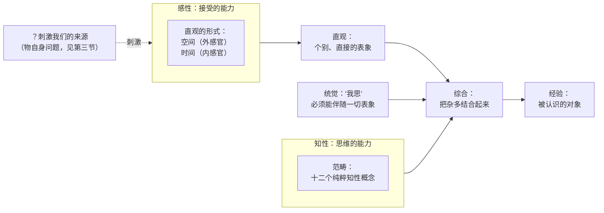
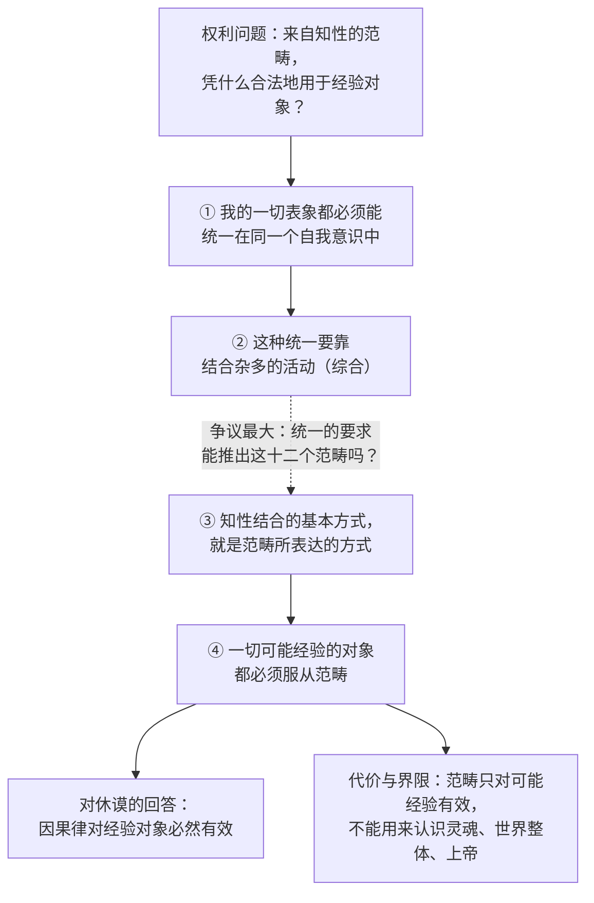
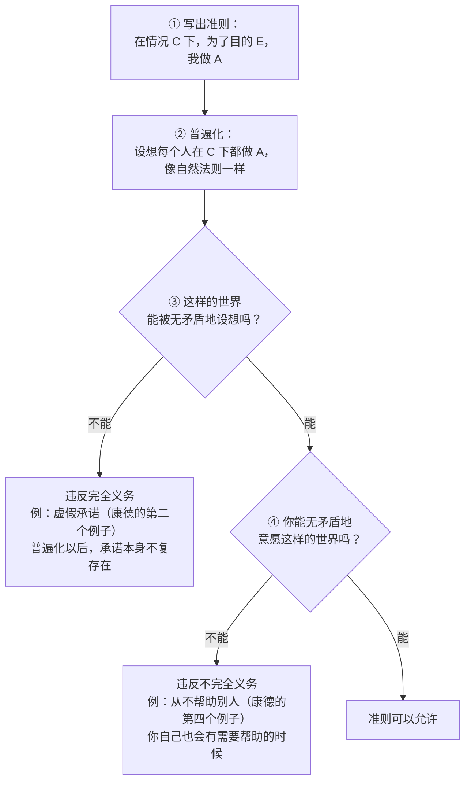
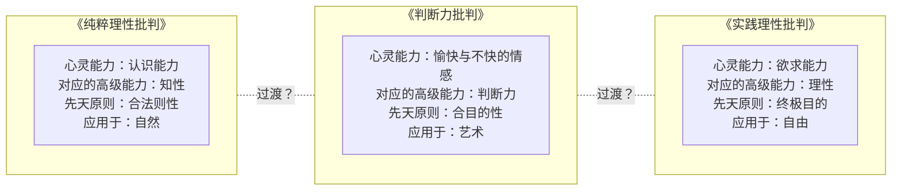

# EA4　康德：批判、自主与判断

*Kant: Critique, Autonomy and Judgment*

> **状态：Phase 2 样章草稿（DRAFT），第二稿（在第一稿基础上补充例子、表格和图示，并把页码和学术出处移入注释），尚未经产品负责人和规划 AI 审定。** 本章是"深度课程"的第二个教学样本，用来检验同一套写法能否处理一个单一而复杂的哲学体系。它不是最终课程。核对范围与未核对事项见文末《来源与权利说明》。

---

## 本章导读：三个问题，一个体系

设想你在夜里抬头看星空。你知道这些光点遵循引力定律运行，这种知识似乎牢不可破。可你同时又觉得，自己刚才决定出门散步、而不是继续刷手机，是"自己选的"，而不是像行星一样被定律推着走。等你看到天边一抹晚霞，脱口而出"真美"，你又隐约觉得：这句话不只是说"我喜欢"，好像别人也应该同意。

这三种经验，分别对应着康德一生追问的三个问题。他在《纯粹理性批判》接近结尾处写道：

> Alles Interesse meiner Vernunft (das speculative sowohl, als das praktische) vereinigt sich in folgenden drei Fragen: 1. Was kann ich wissen? 2. Was soll ich thun? 3. Was darf ich hoffen?（《纯粹理性批判》）[^1]
>
> 本章试译：我的理性的全部关切（思辨的和实践的）汇集于下面三个问题：一、我能知道什么？二、我应当做什么？三、我可以希望什么？

这一章的核心问题是：**人的理性能知道什么？一个有理性的人应当做什么？我们又怎样判断美与目的？** 第三个问题不在康德这段话里，它来自他后来写的第三部批判《判断力批判》。我们把它加进来，是因为康德后来认为，在"知道"和"应当"之间，还有一种判断活动需要单独考察。

请先记住一点：康德的三部批判不是同一个思想换三种说法。《纯粹理性批判》（1781 年第一版，1787 年第二版）问知识的条件和界限；《实践理性批判》（1788）以及之前的《道德形而上学奠基》（1785）问道德法则和自由；《判断力批判》（1790）问审美判断和自然中的目的。它们之间有联系，但每一部都有自己的问题、自己的论证和自己的困难。本章会说明它们怎样连接，也会指出连接在哪里是松动的、有争议的。

和 CN1 不同，这一章不是三位思想家之间的比较，而是读一个人建立的一整套体系。因此，读法也要变一变。

第一，**抓住每一步的问题。** 康德的文字以难读出名，术语密集，句子很长。迷路时，不妨回到这个问题：他此刻想证明什么？他要排除哪一种对手的立场？只要问题清楚，术语就只是工具。

第二，**分清三种东西。** 康德本人明确主张的东西、学者对他的解释（这里分歧常常很大）、本章为了教学而做的整理和比喻，三者要分开。正文会随时说明。尤其是比喻：本章会用一些日常例子帮你入门，但每个比喻都会交代它在哪里不准确。

第三，**原文与引用格式。** 德文原文取自普鲁士科学院版《康德全集》，这是学界的标准版本。为了不打断阅读，正文引文后只写出著作名；卷数、页码（包括《纯粹理性批判》通用的第一版"A"、第二版"B"页码）和学术文献的出处，都放在带编号的注释里，集中列在文末，注释开头也解释了这些缩写。德文的拼写保留十八世纪的旧式写法（如 Urtheil、thun）。所有中文译文都是本章自己的试译，只求帮助理解，不是权威译本；需要更可靠的译文时，请查阅文末列出的通行译本。

第四，**表格和图示。** 正文中有一些对照表和流程图，几乎都是本章为了教学画出的整理，不是康德的原图（唯一的例外是第五节末尾依据康德本人列表画出的三部批判结构图）。每张图下面都会说明它表达什么，以及它在哪里可能简化或误导。

第五，文中有几处"想一想"，请先动笔写下自己的答案，再往下读。

---

## 一、背景：康德面对的难题

### 一个时代的两种自信

康德（Immanuel Kant，1724—1804）一生几乎没有离开过东普鲁士的柯尼斯堡。他在那里的大学教书，讲授的课程从逻辑、形而上学到自然地理和人类学，范围很广。他早年的著作很多是关于自然科学的。直到五十七岁，他才出版了《纯粹理性批判》。

康德生活的十八世纪有两种自信。一种来自牛顿：用几条数学化的定律就能解释天体和地上物体的运动，自然像一台精确的机器。另一种来自更古老的形而上学传统：人有不朽的灵魂，人有自由意志，世界有一个作为最终根据的上帝，理性能够证明这些。

问题在于，这两种自信不太容易放在一起。如果自然中的一切都由定律决定，人的行为也是自然中的事件，那自由在哪里？如果形而上学真能证明灵魂和上帝，为什么两千年来哲学家们争论不休，始终达不成共识，而数学和物理学却在稳步前进？

康德在第一版序言里说，他的时代真正是一个"批判的时代"，一切都必须接受批判[^2]。"批判"在这里不是"挑毛病"的意思，而是"审查和划定界限"：在使用一种能力之前，先问这种能力能做到什么、不能做到什么。《纯粹理性批判》要审查的，就是理性本身。

### 理性主义与经验主义：两条路都走不通吗？

教科书常把康德之前的近代哲学分为两派。

**理性主义**（以笛卡尔、莱布尼茨和沃尔夫为代表）相信，理性单凭概念就能认识世界最根本的结构。在康德年轻时的德国大学里，莱布尼茨—沃尔夫一系的形而上学占主导地位，康德自己也是在这个传统中成长的。

**经验主义**（以洛克、贝克莱和休谟为代表）则认为，一切观念最终来自感觉经验，理性不能越过经验去认识什么。

这个分类有用，但很粗糙，各派内部差别很大。为了理解康德，我们只需要抓住一件事：在休谟手里，经验主义走到了一个让人不安的结论。

### 休谟的挑战：必然联系从哪里来？

想一想你怎么知道"火会烧伤手"。你见过很多次：手靠近火，然后感到灼痛。可你真的"看见"了火和灼痛之间的必然联系吗？休谟的回答是：没有。我们看到的只是两件事一次又一次地先后出现。所谓"必然"，是我们反复看到之后形成的习惯性期待，被我们投射到了事物上。

这个论证的厉害之处在于，它不只针对"火"。我们对因果的全部信念，包括科学定律，似乎都只能建立在习惯之上。经验能告诉我们"到目前为止都是如此"，却不能告诉我们"必然如此"。

康德承认，正是休谟的这个问题改变了他的思想方向。在 1783 年的《未来形而上学导论》里，他写道：

> Ich gestehe frei: die Erinnerung des David Hume war eben dasjenige, was mir vor vielen Jahren zuerst den dogmatischen Schlummer unterbrach und meinen Untersuchungen im Felde der speculativen Philosophie eine ganz andre Richtung gab.（《未来形而上学导论》序言）[^3]
>
> 本章试译：我坦白承认：正是大卫·休谟的提醒，在多年以前第一次打断了我独断论的迷梦，给我在思辨哲学领域的研究指出了一个全然不同的方向。

紧接着他又说，他远远没有接受休谟的结论。"独断论"指不先审查理性的能力和界限，就直接用纯粹概念去建立形而上学的做法。康德说休谟把他从这种"迷梦"里唤醒了，但他并没有因此变成休谟。

在《纯粹理性批判》第二版导言里，康德对休谟的评价更具体[^4]：休谟只盯着因果关系这一个命题，断定它不可能先天地成立，从而认为形而上学全是错觉；可如果他看到问题的全貌，就会发现，按他的论证，连纯粹数学也不可能成立，而这是他自己也不会接受的。

这里要提醒一句：康德在这些地方概括的是"他所理解的休谟"。休谟本人的立场是否真如康德所说，是另一个学术问题，本章不作判断。

### 不是"把两派加在一起"

常见的说法是：康德"综合了理性主义和经验主义"。这个说法不算全错，但很容易让人误解，以为康德从两边各取一半，拼成一个折中方案。

更准确的理解是：康德发现两派共享一个没有被审查的前提，然后改变了问题本身。这个前提是：**我们的知识必须去符合独立于我们而存在的对象。** 如果是这样，那么要么理性能够直接把握这些对象（理性主义的希望），要么我们只能从经验里一点点得到关于它们的消息，永远得不到必然性（休谟的结论）。

康德提议换一个方向来试：

> Man versuche es daher einmal, ob wir nicht in den Aufgaben der Metaphysik damit besser fortkommen, daß wir annehmen, die Gegenstände müssen sich nach unserem Erkenntniß richten ...（《纯粹理性批判》第二版序言）[^5]
>
> 本章试译：因此，让我们试一试：如果我们假定对象必须符合我们的认识，在形而上学的任务上是否会进展得更好……

他把这个想法比作哥白尼：假定整个星空围绕观察者旋转，天体运动就解释不好，于是哥白尼试着让观察者旋转，而让星星静止[^6]。这就是常说的康德的"哥白尼式革命"。

这个提议的意思不是"世界是我想出来的"。它的意思是：在我们能够经验到的任何对象身上，都必然带有我们认识能力本身的形式；正因为这些形式来自我们，我们才能先天地知道它们，也就是不必等经验来逐一验证。康德说得很直接：我们先天地认识到的，只是我们自己放进事物里去的东西[^7]。

可这个提议马上带来一个代价：如果我们能先天地知道的只是"对象怎样向我们显现"，那么对象"自身"是什么样子，就不在我们的认识范围之内了。这个代价有多大，第三节会专门讨论。

> **想一想（一）。** 请用自己的话说明：休谟的问题为什么威胁到的不只是形而上学，也包括自然科学？康德说休谟的论证会连纯粹数学一起推翻，你觉得休谟可能怎样回应？

---

## 二、知识如何可能

这一节是全章最技术性的部分。我们按康德自己的顺序，一步一步来，每一步先问一个问题，再引出术语。

### 第一步：知识都来自经验吗？

先看《纯粹理性批判》第二版导言的第一句话：

> Daß alle unsere Erkenntniß mit der Erfahrung anfange, daran ist gar kein Zweifel ... Wenn aber gleich alle unsere Erkenntniß mit der Erfahrung anhebt, so entspringt sie darum doch nicht eben alle aus der Erfahrung.[^8]
>
> 本章试译：我们的一切认识都从经验开始，这一点毫无疑问……但是，尽管我们的一切认识都随着经验开始，它们却并不因此都是从经验中产生的。

区别在"开始"和"产生"。在时间上，没有经验，我们的认识能力根本不会被唤起。但这不等于说，认识中的每一个成分都是从经验里得来的。康德接着推测：也许我们的经验知识本身就是一个复合物，一部分来自感官接受的印象，另一部分来自认识能力自己的贡献，只是我们平时分不清[^9]。

那么，怎样识别出"不是来自经验"的那部分？康德给了两个标志：

> Nothwendigkeit und Strenge Allgemeinheit sind also sichere Kennzeichen einer Erkenntniß a priori ...[^10]
>
> 本章试译：所以，必然性和严格的普遍性，是先天认识的可靠标志……

理由是：经验只能告诉我们事物是这样，不能告诉我们事物不可能是别样[^11]。经验能给的普遍性，只是"到目前为止我们观察到的都没有例外"；而"不允许任何可能的例外"这种严格的普遍性，经验给不了。

这就是**先天**（a priori）和**后天**（a posteriori）的区分。先天知识的有效性不依赖经验，后天知识的有效性依赖经验。注意，"先天"不是"天生"的意思，它说的不是知识在心理上什么时候出现，而是知识凭什么成立。

### 第二步：两种判断

第二个问题是：一个判断怎样才能"增加"我们的知识？

请比较两个句子：

- 所有单身汉都没有结婚。
- 所有单身汉都喜欢做饭。

第一句你不用做任何调查就知道它是真的，因为"没有结婚"已经包含在"单身汉"的意思里。第二句则完全不同：要知道它是真是假，你得去观察单身汉们（多半会发现它是假的）。

康德用主词和谓词的关系来说明这个区别：

> Entweder das Prädicat B gehört zum Subject A als etwas, was in diesem Begriffe A (versteckter Weise) enthalten ist; oder B liegt ganz außer dem Begriff A, ob es zwar mit demselben in Verknüpfung steht. Im ersten Fall nenne ich das Urtheil analytisch, in dem andern synthetisch.[^12]
>
> 本章试译：谓词 B 或者作为（隐含地）包含在概念 A 中的东西而属于主词 A；或者 B 完全在概念 A 之外，虽然它与 A 相联结。前一种情况我称这个判断为分析的，后一种情况称为综合的。

康德自己的例子是："一切物体都是有广延的"是分析判断，因为"占有空间"已经包含在物体的概念里；"一切物体都是有重量的"是综合判断，因为重量不在"物体"这个概念本身之中[^13]。他还给两者起了更好记的名字：分析判断是"说明性的"，只是把概念里已有的东西摆出来；综合判断是"扩展性的"，给概念加上新东西[^14]。

到这里，我们手上有两组区分：先天与后天（关于判断凭什么成立），分析与综合（关于判断有没有扩展知识）。

- 分析判断都是先天的：只要分析概念，不用看经验。
- 经验判断都是综合的[^15]：观察告诉我们的，总是概念之外的东西。

真正的问题在第四种组合：**有没有先天综合判断？** 也就是说，有没有既能扩展我们的知识，又不依赖经验、具有必然性的判断？

两组区分交叉，得到四种组合。下面这张表是本章的整理，标"康德例"的例子出自《纯粹理性批判》导言，其余是本章补充的：

| | 先天（成立不依赖经验） | 后天（成立依赖经验） |
|---|---|---|
| **分析**（谓词已包含在主词中，只起说明作用） | "一切物体都有广延"（康德例）；"所有单身汉都没有结婚" | 不存在：只靠分析概念就能成立的判断，用不着经验 |
| **综合**（谓词在主词之外，扩展知识） | 康德认为存在，这是全书的焦点："7+5=12"（康德例）；"在物质世界的一切变化中，物质的量保持不变"（康德例） | "一切物体都有重量"（康德例）；"所有单身汉都喜欢做饭" |

四格之中，"分析后天"一格是空的；"分析先天"和"综合后天"两格，谁都不会怀疑。争论全在"综合先天"这一格：既扩展知识，又不依赖经验，这怎么可能？在康德之前，理性主义者相信这一格里的知识可以单凭概念得到；按照康德对休谟的理解，休谟则认为，凡是真正扩展知识的，都只能来自经验，所以达不到严格的必然性。

用一个日常例子看看"严格的普遍性"和"经验的普遍性"有什么不同（本章的例子）。"太阳每天早上都会升起"，人类观察了几千年从无例外，可它仍然是后天综合判断：我们能毫无矛盾地设想明天太阳不再升起，它的普遍性只是"到目前为止没有例外"。"7+5=12"就不同了，我们设想不出一个 7 加 5 不等于 12 的情形。康德的问题是：后一种必然性既然不来自经验，又不来自概念分析，它是从哪里来的？

> **想一想（二）：分析还是综合？** 请判断下列句子是分析的还是综合的，是先天的还是后天的，并说明理由：（1）"三角形有三个角。"（2）"水在一个标准大气压下 100 摄氏度沸腾。"（3）"每一个事件都有原因。"（4）"红色是一种颜色。"
>
> 提示：第（3）句是全章的关键。它显然不是从"事件"这个概念里分析出来的（"事件"只是"发生了的事"，其中并不包含"被某物引起"），可是我们又觉得它不只是"到目前为止都是如此"。如果你也这么觉得，你就站在了康德问题的门口。第（4）句是一个有意留下的难题：有人认为它是分析的，也有人认为它表明分析与综合的界线并不像康德设想的那样清楚。这个界线后来在二十世纪受到过深刻的质疑，第六节会提到。

### 第三步：先天综合判断存在吗？

康德认为，先天综合判断不仅存在，而且我们一直在用。他最著名的例子是算术：

> Man sollte anfänglich zwar denken: daß der Satz 7+5 = 12 ein bloß analytischer Satz sei ... Allein wenn man es näher betrachtet, so findet man, daß der Begriff der Summe von 7 und 5 nichts weiter enthalte, als die Vereinigung beider Zahlen in eine einzige, wodurch ganz und gar nicht gedacht wird, welches diese einzige Zahl sei, die beide zusammenfaßt.[^16]
>
> 本章试译：人们起初或许会以为，7+5=12 这个命题只是一个分析命题……可是仔细考察就会发现，7 与 5 之和的概念所包含的，无非是把这两个数合成一个数，而这个把两者合在一起的数究竟是哪一个数，在其中根本没有被想到。

康德的意思是：你在"7 加 5"的概念里，只想到了"把两个数合起来"，并没有想到"12"。要得到 12，你得借助某种直观，比如数手指或者画点子，一个一个地把五个单位加到七上去[^17]。数字越大，这一点越明显：没有人能单凭分析"38976 加 45204"这个概念，就"看出"答案。可另一方面，7+5=12 又是必然的，不需要每次都去实验。所以它是先天综合判断。

康德认为，几何学的基本命题、自然科学的一些基本原理（例如"在物质世界的一切变化中，物质的量保持不变"），也都是先天综合判断；而形而上学，如果它可能的话，也必须由先天综合判断构成，因为它想扩展我们对事物的知识，又不想依赖经验[^18]。

于是，整部《纯粹理性批判》的总问题就出现了：

> ... in der Frage enthalten: Wie sind synthetische Urtheile a priori möglich?[^19]
>
> 本章试译：……包含在这个问题之中：先天综合判断是怎样可能的？

请注意问题的形式。康德不是问"先天综合判断存在吗"，他认为数学和自然科学已经表明它们存在。他问的是：它们**怎样**可能？凭什么我们能先天地扩展知识？只有回答了这个问题，才能判断形而上学能不能成为科学。

### 第四步：认识需要两种能力

先天综合判断怎样可能？康德的回答从一个关于人类认识结构的主张开始：人的认识有两个来源，**感性**（Sinnlichkeit）和**知性**（Verstand）。

感性是接受的能力：对象刺激我们，我们由此获得**直观**（Anschauung），也就是对个别对象的直接表象，比如眼前这一张桌子。知性是思考的能力：它运用**概念**（Begriff），把直观中给予的东西归到普遍的规则之下，比如"这是一张桌子""桌子是家具"。

康德的名言是：

> Ohne Sinnlichkeit würde uns kein Gegenstand gegeben und ohne Verstand keiner gedacht werden. Gedanken ohne Inhalt sind leer, Anschauungen ohne Begriffe sind blind.[^20]
>
> 本章试译：没有感性，就不会有对象被给予我们；没有知性，就不会有对象被思维。思维无内容是空的，直观无概念是盲的。

可以把这句话理解为同时针对前人的两种倾向（这是本章的解释，康德在此处没有点名）：一种倾向把感性看成模糊的思维，好像只要想得足够清楚，就不需要感性；另一种倾向把概念看成从感觉里抽象出来的，好像概念只是淡化了的感觉。按康德的看法，两者都不对：感性和知性是两种不同种类的能力，谁也不能代替谁，"知性不能直观任何东西，感官不能思维任何东西"[^21]，知识只有在两者结合时才能产生。

**一个教学比喻和它的限度。** 你可以把感性想象成一台摄像机接收到的画面，把知性想象成给画面加标注的人。没有画面，标注者无事可做；没有标注，画面只是一堆没有被认出来的色块。这个比喻能帮你记住"两者缺一不可"。但它在两个地方会误导：第一，摄像机的画面本身已经是"有组织的"图像，而康德认为，在被概念整理之前，直观中的"杂多"并不构成被认出的对象；第二，比喻让人以为标注是可有可无的附加物，而康德的论点恰恰是，没有概念的综合，我们根本经验不到"一个对象"。

下面这张图把这一节从第四步到第七步要讲的几个环节放在一起。它是本章的教学示意，不是康德画的图：

读这张图要注意三点。第一，箭头表示的是认识的**条件**，不是时间上的先后：康德并没有说我们先收到一堆直观，过一会儿再拿去加工。第二，最左边那个带问号的方框用虚线连接，因为"是什么在刺激我们"正是先验观念论最难的问题之一。第三，图把"综合"画成单独的一个方框，只是为了醒目。综合究竟由哪一种能力完成（想象力还是知性），学者们常指出两版《纯粹理性批判》的说法有所不同，这里不展开。

"思维无内容是空的，直观无概念是盲的"，可以借两个情形来体会（本章设想的例子）：

- **盲的直观。** 一个没学过医的人看 X 光片，眼睛接收到的东西和放射科医生一样多，却"看不出"什么：没有相应的概念，他看到的只是一片明暗。
- **空的思维。** 反过来，我们可以思考"灵魂是一个单纯的实体"这句话，概念用得清清楚楚，却没有任何直观能告诉我们它对不对。第三节会说明，康德认为传统形而上学的许多推理就是这样"空转"的。

两个例子都有限度。X 光片的例子涉及的是"肺""骨折"这类经验概念；康德最关心的是范畴，按照他的看法，缺少范畴的后果比"认不出来"严重得多：根本不会有一个被经验到的对象。第二个例子则提前用了第三节才会论证的结论。

### 第五步：空间和时间

现在看感性一边。康德问：在所有直观中，有没有什么东西不是来自具体的感觉，而是来自我们接受感觉的方式本身？

他的回答是空间和时间。下面用本章自己的话转述"先验感性论"中的一条论证思路（原文本章未摘引）：你可以想象一个空无一物的空间，却不能想象一个没有空间的外部物体；你可以想象一段什么也没发生的时间，却不能想象一个不在时间中的事件。康德由此认为，空间和时间不是从经验中抽象出来的概念，而是我们感性直观的**形式**：空间是"外感官"的形式，一切外部对象都在空间中被直观；时间是"内感官"的形式，我们自己的一切心理状态都在时间中被直观。

康德进一步主张（这是他最受争议的论点之一）：空间和时间不是独立于我们而存在的东西，也不是事物"自身"的属性或关系，而只是我们直观对象的形式[^22]。

为什么要这样主张？一个重要理由来自几何学。几何命题是先天综合的：我们知道三角形内角和等于两直角，不是靠测量无数个三角形。如果空间是独立于我们的存在，我们怎么可能先天地知道它的性质？如果空间是我们直观的形式，那么一切我们能够直观到的东西都必然符合几何学，这一点就可以理解了。

请注意，康德同时说，空间和时间具有**经验的实在性**：对一切可能经验的对象来说，空间和时间都是真实有效的。你不能说"桌子在空间中只是我的幻觉"。他否认的只是**先验的实在性**：空间和时间不属于事物自身。这个区分是第三节的核心。

### 第六步：范畴

再看知性一边。康德问：在我们用来整理经验的概念中，有没有一些不是来自经验，而是知性本身带来的？

"桌子""狗""红色"这些概念显然来自经验。但有一些概念很特别，例如"实体"（某种在变化中保持同一的东西）和"原因"（某种使另一事物必然随之发生的东西）。休谟已经指出，"必然联系"不能从经验中看出来。康德接受这一点，却得出相反的结论：既然它不来自经验，它就可能来自知性本身。

康德把这类概念称为**范畴**（Kategorie），即"纯粹知性概念"。他认为一共有十二个，分成四组[^23]：

- 量：单一性、复多性、全体性；
- 质：实在性、否定性、限定性；
- 关系：依存性与自存性（实体与偶性）、因果性与依存性（原因与结果）、共同性（主动者与受动者之间的交互作用）；
- 模态：可能性与不可能性、存在与不存在、必然性与偶然性。

这张表是怎么来的？康德说，它不是像亚里士多德那样"碰到一个算一个"凑出来的，而是从一个共同原则，即判断的能力，系统地推出来的[^24]。他的想法是：知性的基本活动是下判断，判断有几种基本的逻辑形式，每种形式都对应着一种把直观的杂多统一起来的方式，这些方式就是范畴。学界一般把这一步叫作范畴的"形而上学演绎"。这一步是否成功，从康德那时起就有很多怀疑：判断形式的分类是否完整？从判断形式过渡到范畴的根据是否充分？本章不展开，只请你记住：**十二个范畴这张表本身，是康德体系中较少被后人原样接受的部分。** 真正影响深远的，是下一步的问题。

### 第七步：先验演绎要证明什么？

假定我们承认范畴不来自经验，新的问题立刻出现：**凭什么这些来自我们知性的概念，可以合法地用在经验对象上？** 如果"原因"只是我们心中的一个概念，凭什么说自然中的事件必然服从因果律？

康德借用了法律上的说法：

> Die Rechtslehrer, wenn sie von Befugnissen und Anmaßungen reden, unterscheiden in einem Rechtshandel die Frage über das, was Rechtens ist (quid iuris), von der, die die Thatsache angeht (quid facti), und indem sie von beiden Beweis fordern, so nennen sie den erstern, der die Befugniß oder auch den Rechtsanspruch darthun soll, die Deduction.[^25]
>
> 本章试译：法学家谈到权限和权利要求时，在一桩诉讼中区分"什么是合法的"这个问题（权利问题）和涉及事实的问题（事实问题）；他们对两者都要求证明，并把前一种证明，即要证明权限或权利要求的证明，称为"演绎"。

所以，"演绎"在这里不是逻辑学里"从前提推出结论"的意思，而是"证明一种使用的正当性"。像"幸运""命运"这样的概念，我们平时随便使用，可一旦有人追问它们凭什么有效，我们就答不上来[^26]。康德要证明，范畴不属于这种情况。这就是**范畴的先验演绎**。

演绎的论证非常复杂，两版《纯粹理性批判》写法不同，第二版几乎完全重写了，学者对它的结构至今争论很多。本章只介绍它的核心思路，并且要说明：下面的四步整理是本章为了教学做的简化，不是康德原文的结构。

论证的起点是自我意识的统一：

> Das: Ich denke, muß alle meine Vorstellungen begleiten können; denn sonst würde etwas in mir vorgestellt werden, was gar nicht gedacht werden könnte ...[^27]
>
> 本章试译："我思"必须能够伴随我的一切表象；因为否则就会有某种根本不能被思维的东西在我之中被表象……

想一想你此刻的经验：你看到这一行字，听到窗外的声音，感到椅子的硬度。这些表象之所以都是"你的"，是因为它们能被同一个"我"意识为"我的"表象。如果某个表象完全不能和其他表象一起被我意识到，它对我来说就等于什么也不是。

教学整理：

1. 我的一切表象，都必须能够被统一在同一个自我意识之中（否则它们对我来说什么也不是）。
2. 这种统一不是现成给予的，而要靠一种把杂多结合起来的活动，即"综合"。
3. 知性进行这种结合的基本方式，就是范畴所表达的方式。
4. 所以，任何能够成为我的经验对象的东西，都必须服从范畴。范畴不是我们偶然套在经验上的框子，而是"有经验"本身的条件。

把这四步和它要回答的问题画成一张图。这是本章的教学重构，不是康德原文的结构；虚线标出的是争议最大的环节：

这张图有两个用处。一是看清演绎的结论有两个方向：它在回答休谟的同时，也划出了理论知识的边界，后者正是下一节的入口。二是看清批评可以从哪里下手：很多疑问集中在 ② 到 ③ 这一步，也就是从"必须有统一"过渡到"必须用这些范畴来统一"。

如果这个论证成立，休谟的问题就得到了一种全新的回答。因果律之所以对经验对象必然有效，不是因为我们从经验里学到了它，也不是因为我们有某种神秘的洞察力，而是因为：没有它，就没有我们所说的"客观经验"，只剩下一串主观的感觉序列。康德甚至说，在这个意义上，知性是自然的"立法者"[^28]。

可是，这个回答的范围是有限的：范畴只对**可能经验的对象**有效。它证明了因果律适用于我们能够经验到的一切，却没有证明它适用于超出一切可能经验的东西，比如灵魂、作为整体的世界、上帝。这正是下一节的主题。

**演绎是否成功？** 这是康德研究中最大的问题之一。常见的疑问有：第 1 步的"统一"是否真能推出第 3 步那样具体的范畴？从"我必须能把表象意识为我的"，能否推出"自然中的事件必须服从因果律"？二十世纪有学者尝试把演绎改写为一种不依赖先验观念论的"先验论证"，也有学者认为演绎离不开先验观念论。本章不判定哪一方是对的，只要求你能说出演绎**想要**证明什么。

> **想一想（三）：康德需要证明什么？** 假如你要说服一个休谟主义者，"每一个事件都有原因"不只是习惯，你认为最少需要证明哪几件事？请对照上面的四步整理，指出你认为最弱的一步，并说明理由。

---

## 三、先验观念论：显象、物自身与理论知识的界限

### 康德到底主张了什么？

上一节的结论带着一个代价：我们先天地知道的，只是对象怎样在我们的直观形式和范畴之下向我们显现。康德由此区分了**显象**（Erscheinung，常译"现象"）和**物自身**（Ding an sich selbst，或简称"物自体"）。

先把康德自己明确说过的几条列出来[^29]：

1. 空间和时间只是我们感性直观的形式，不是独立存在的东西，也不是物自身的属性或关系。
2. 我们在空间和时间中直观到的对象，都是显象，不是物自身。这一点也适用于我们自己：通过内省，我只认识到我怎样向自己显现，而不是我"自身"怎样。
3. 我们只能认识原则上可以被直观的对象，所以只能认识显象，不能认识物自身。
4. 但是，我们可以用范畴去**思维**物自身。
5. 物自身刺激我们，激活我们的感性。

康德把这套学说叫作**先验观念论**（transzendentaler Idealismus）。他在"第四谬误推理"中的定义大意是：一切显象都只应被看作表象，而不应被看作物自身；相应地，空间和时间只是我们直观的感性形式，而不是独立给予的规定，也不是作为物自身的对象的条件[^30]。

"先验"（transzendental）一词在这里的意思需要说明。在康德的用法里，它不是"超越的、神秘的"。他在导言中说，他把一切不是研究对象本身、而是研究我们认识对象的方式（就这种方式应当是先天可能的而言）的知识，称为"先验的"[^31]。先验观念论是一种关于认识条件的观念论，不是说世界只存在于我的头脑里。

### 先验观念论，也是经验实在论

康德坚持说，先验观念论和**经验实在论**是同一个立场的两面。在经验的层面上，桌子、山川、星辰都是真实的，它们在空间中，在我之外，有着我可以研究的属性。这里有真实与错觉的区分，梦和醒的区分，科学可以纠正日常知觉。只有在"先验"的层面上，也就是在追问"这些对象的存在是否完全独立于我们认识的一切条件"时，康德才说：它们是显象。

有一个帮助理解的例子，来自康德自己关于彩虹的讨论[^32]。在经验层面，我们会说：天上那道彩色的弧只是"显象"，"彩虹自身"是一群具有一定大小和位置的水滴。但康德提醒，这种日常的"显象—实在"区分，**不是**他说的先验区分。科学研究彩虹，发现了水滴、光的折射，这些仍然都在空间和时间中，所以仍然都是先验意义上的显象。科学可以无限深入，但它发现的永远是更多的显象，而不是物自身。

这个例子很重要，因为它能纠正一个常见误解：以为康德的物自身就是"现象背后的真实结构"，比如原子或者物理定律。不是。原子和定律都在康德所说的显象一边。

两种"显象与实在"的区分很容易混在一起，并排看会清楚一些（本章的整理）：

| | 经验的区分 | 先验的区分 |
|---|---|---|
| 例子 | 天上的彩色弧（"显象"）与一群水滴（"实在"） | 水滴、光线以及一切在空间和时间中的东西（显象）与物自身 |
| 两边都在空间和时间中吗 | 都在 | 只有一边在；物自身不在空间和时间中 |
| 科学能从一边走到另一边吗 | 能：气象学和光学正是这样做的 | 不能：科学走得再远，发现的仍是显象 |
| 由谁作出这个区分 | 日常知觉和科学研究 | 哲学对认识条件的反思 |

### 一个常用比喻，以及它为什么不准确

讲康德时，老师们常用"有色眼镜"来比喻：我们戴着一副摘不下来的眼镜看世界，空间、时间和范畴就是这副眼镜，所以我们只能看到世界经过眼镜的样子。

这个比喻抓住了一点：我们认识到的东西带有我们认识方式的痕迹，而这种痕迹不是可以随意去掉的偏差。但它至少在三个方面不符合康德的主张：

- 戴眼镜的人可以设想摘下眼镜，把两种看法比较一下；康德则认为，我们没有任何"不通过感性形式"的直观可以拿来比较。
- 眼镜给出的是一个已经完整、只是被染了色的图像；而在康德那里，没有感性形式和范畴，就根本没有"对象的图像"可言。
- 比喻暗示眼镜背后有一个和眼前景象一一对应的"真实景象"，物自身好像是同一幅画的未染色版本。这恰恰是学者们争论的问题，不能由一个比喻预先决定。

所以，这个比喻可以帮你入门，但请不要把它当作康德的论点。

今天还有一个常见的比喻：电脑桌面上的文件图标。我们拖动、打开、删除的都是图标，图标背后是硬盘上的电信号和磁化状态，我们从来没有直接"看见"它们。下面把两个比喻放在一起比较（两个都是教学比喻，不是康德的）：

| 比喻 | 抓住了什么 | 在哪里误导 |
|---|---|---|
| 有色眼镜 | 我们认识到的东西带着认识方式的痕迹，这种痕迹去不掉 | 暗示可以摘下眼镜作比较；暗示没有眼镜也有一幅完整的图像；暗示背后是"同一幅画的原色版" |
| 桌面图标 | 我们打交道的对象，是按照某种"界面"呈现的；界面不是随意的，有严格的规则 | 图标背后的电路仍然在空间和时间中，工程师可以打开机箱研究它，这正是彩虹例子里的**经验的**区分；物自身却原则上不能用任何办法打开来看 |

两个比喻的共同毛病是：它们都把"背后的东西"变成了另一个可以描述的对象，而康德说的恰恰是我们做不到这一点。用比喻记住"认识有条件"是有益的，用它来回答"物自身是什么"就不行了。

### 学者怎样理解"物自身"：几种主要解释

从 1781 年起，先验观念论的意思就一直有争议。第一篇书评（加尔韦与费德尔，1782）认为康德不过是贝克莱式的观念论者，把物体等同于观念。康德在《导论》和第二版中对此作了激烈的回应，坚持自己与贝克莱不同。

今天的解释大致可以分成几类（这里只作简化介绍，不判定哪一种正确）[^33]：

**现象主义的解读（常与"两个世界"说联系在一起）。** 显象在某种意义上是由我们的表象构成的；物自身则是在它们背后、不可认识的存在。按最常见的版本，两者是两类不同的东西。这种解读与康德许多说法的字面意思相符（比如他说显象"无非是表象"），在康德同时代和后来的德国观念论者中占主导地位。它的难处在于，它让康德和贝克莱的距离变得很难说清楚。（有学者指出，现象主义解读也有主张"同一对象"的版本，所以"现象主义"和"两个世界"并不完全是一回事[^34]。）

**"两个方面"的认识论解读。** 以美国学者阿利森（Henry Allison）为代表。显象和物自身不是两类东西，而是**同一些对象**的两种考察方式：一种是按照我们认识的条件来考察，另一种是抽掉这些条件来考察。按这种读法，"物自身"主要是一个提醒：空间和时间是我们认识的条件，而不是对象本身的条件。

**"两个方面"的形而上学解读。** 以兰顿（Rae Langton）为代表，主张显象和物自身是同一些事物的两组不同的**属性**：我们能够认识的，是事物的关系性属性；不能认识的，是它们内在的属性。

斯坦福哲学百科的相关条目还指出[^35]，这些分类本身也不像看起来那样清楚：有的解读可以有"同一对象"和"不同对象"两种版本，有的学者（如阿利森后来）认为自己的解读在这个问题上是中立的。条目最后的结论是：这场争论从 1781 年至今没有结束，也看不到很快结束的迹象。

本章的立场是：学习者首先要掌握康德**明确说过**的那些主张（上面的五条），并且知道"显象和物自身是什么关系"是一个开放的解释问题。如果有人告诉你"康德的意思其实就是……"，请问他：这是哪一种解读？

### 雅可比的反驳：进不去，也出不来

先验观念论最著名的早期批评来自雅可比（F. H. Jacobi）。他有一句常被引用的话，大意是[^36]：**没有物自身这个前提，我就进不了康德的体系；有了这个前提，我又不能留在里面。**

为什么"进不去"？因为康德说感性是被对象"刺激"而接受表象的能力。没有某种刺激我们的东西，感性就无从说起。

为什么"留不住"？因为康德又说，我们不能认识物自身，而且像"原因"这样的范畴，离开了直观就没有认识上的意义。可是"物自身刺激我们"这句话，不正是说物自身是我们感觉的原因吗？康德似乎在用一个他自己说不能这样用的概念。

更一般地说，康德似乎同时主张：物自身存在；我们对物自身一无所知；物自身不在空间和时间中；物自身刺激我们。除了第二条，其余三条好像都是关于物自身的知识，与"一无所知"相冲突。

为康德辩护的人通常从两个方向回应。一是区分"思维"和"认识"：康德明确说过，范畴在**思维**中不受感性条件的限制，只是要**认识**一个对象才需要直观[^37]。所以我们可以**思维**物自身是原因，只是不能**认识**它是。二是区分肯定的和否定的说法："物自身不在空间中"只是否定的，不给出任何肯定的知识。但研究者也指出[^38]，即使接受这些区分，康德凭什么有权利断言物自身存在并且刺激我们，仍然是一个没有完全解决的难题。

### 理论知识的界限：理性为什么会越界

如果范畴只对可能经验有效，那么传统形而上学的三大主题，即灵魂、作为整体的世界和上帝，就超出了理论知识的范围。《纯粹理性批判》的后半部分"先验辩证论"要说明的是：理性为什么会不断地越过这个界限，并且在越界时陷入错觉。

康德认为，这不是个别哲学家的失误，而是理性本身的倾向。理性总是追问"条件的条件"，想找到一个无条件的整体，这本来是推动知识前进的动力；但当它把这种追求当成对一个对象的认识时，就产生了"先验幻相"。例如，理性会以为可以证明灵魂是一个单纯而不朽的实体；会发现关于世界整体的一对对命题，比如"世界在时间上有开端"和"世界在时间上没有开端"，似乎都能被证明，这就是"二律背反"；还会以为能从概念出发证明上帝存在。康德逐一分析了这些推理，认为它们都不能成为知识。

但这不意味着这些观念毫无用处。康德认为，"世界整体""灵魂""上帝"这些理性的理念，在理论上可以起**调节性**的作用：它们像一个永远达不到、却指引方向的目标，推动我们把知识组织得越来越系统。它们不能起**构成性**的作用，也就是不能告诉我们对象实际上是什么样子。这对区分在第五节讨论《判断力批判》时还会出现。

### "限制知识，为信念腾出位置"

第二版序言里有一句常被引用的话：

> Ich mußte also das Wissen aufheben, um zum Glauben Platz zu bekommen ...[^39]
>
> 本章试译：所以，我必须限制（aufheben）知识，以便为信念腾出位置……

这里的动词 aufheben 很难译。它在德语里可以指"取消、废除"，也可以指"中止、悬置"，还可以指"提起、保存"。通行的剑桥版英译作 deny（否认），中文各译本的译法也不一致。本章译作"限制"，理由是：从上下文看，康德不是说要取消一切知识，而是说要取消理性**对超感官之物提出的知识要求**，因为这种要求如果成立，就会把一切都变成显象，使道德上的自由不可能[^40]。"Glauben"也不只是宗教意义上的"信仰"，在康德这里更接近一种出于实践理由的"信念"。这两个词的译法都是有争议的，请把这里的翻译当作一种解释。

这句话预告了从理论哲学到实践哲学的转折。理论理性不能证明我们是自由的，但也不能证明我们不是自由的。正因为显象不是物自身，"自然中的一切都由因果律决定"这条原理就只对显象有效，**为自由留下了一个在逻辑上可以思维的空间**。至于我们有什么理由相信自己真的是自由的，就要到道德哲学中去找了。

> **想一想（四）。** 请用不超过 200 字说明：康德为什么说"为自由留出空间"需要先验观念论？如果空间和时间是物自身的属性，自由会遇到什么问题？

---

## 四、道德哲学：善良意志、定言命令与自主

### 从"能知道什么"到"应当做什么"

先看一个所有人都熟悉的场景。你在考试中有机会偷看旁边同学的答案，监考老师刚好走开了。你没有偷看。为什么？

也许你怕被抓住；也许你觉得作弊会让自己学不到东西；也许你只是觉得"这样做不对"。前两种理由都依赖于结果和你的利益：如果确定不会被抓、确定不影响学习，它们就失去了力量。第三种理由好像不一样，它不依赖于这些条件。

康德的道德哲学就从这种区别出发。他在 1785 年的《道德形而上学奠基》（以下简称《奠基》）中给自己定的任务是：找出并确立道德的最高原则。他认为这个原则不能从经验中得到：经验只能告诉我们人们**实际上**怎样做，而道德告诉我们**应当**怎样做；道德法则如果真是法则，就必须对一切有理性者无条件地有效，经验给不了这种必然性。这与第一批判的思路相呼应：在理论领域，必然性来自理性的先天贡献；在实践领域，道德的必然性也只能来自理性。但请注意，两部书的论证方式很不一样，《奠基》并不是把第一批判的结论"应用"到道德上。

### 善良意志：唯一无条件的善

《奠基》第一章这样开头：

> Es ist überall nichts in der Welt, ja überhaupt auch außer derselben zu denken möglich, was ohne Einschränkung für gut könnte gehalten werden, als allein ein guter Wille.（《奠基》）[^41]
>
> 本章试译：在世界之中，甚至在世界之外，除了一个善良意志，不可能设想任何东西可以被无限制地看作是善的。

为什么？康德说，聪明、勇气、毅力都是好东西，可是落在一个恶的意志手里，它们会让恶变得更危险。一个冷静的恶人比一个冲动的恶人更可怕。权力、财富、健康，甚至幸福本身，如果没有善良意志来引导，也可能让人骄横。所以这些东西都只是"有条件地"好。

善良意志的价值则不取决于它做成了什么：

> ... so würde er wie ein Juwel doch für sich selbst glänzen, als etwas, das seinen vollen Werth in sich selbst hat.[^42]
>
> 本章试译：……它仍然会像一颗宝石那样，独自闪耀，作为某种在自身之中就具有全部价值的东西。

这句话的上下文很重要。康德说的是：即使由于命运不济，这个意志用尽了一切力所能及的手段，却什么也没有做成，它的价值也不会因此减少。注意他的限定：这里说的不是"一个空洞的愿望"，而是"用尽一切在我们能力之内的手段"[^43]。所以，康德并不是说"只要心是好的，做不做都无所谓"。他说的是：在你已经尽了全力之后，结果中不在你掌控之内的那部分，不影响你的意志的道德价值。

### 出于义务与合乎义务

什么样的意志是善良意志？康德用"义务"这个概念来说明。他区分了两种情况：一个行为**合乎义务**（pflichtmäßig），和一个行为**出于义务**（aus Pflicht）。

最著名的例子是商人：

> Z. B. es ist allerdings pflichtmäßig, daß der Krämer seinen unerfahrnen Käufer nicht übertheure ...[^44]
>
> 本章试译：例如，小商贩不向没有经验的顾客多要价，这当然是合乎义务的……

康德接着说，在生意兴隆的地方，聪明的商人也不会这样做，他对所有人一个价，连小孩子去买也不会吃亏。顾客得到了诚实的对待。但这不足以说明商人是出于义务和诚实的原则这样做的，因为他的利益本来就要求他这样做[^45]。这个行为合乎义务，却出于自利。

更难辨别的是另一种情况：一个人本来就喜欢做合乎义务的事。康德的例子是富有同情心的人，他们帮助别人，是因为看到别人快乐自己也快乐。康德说，这种行为无论多么合乎义务、多么可爱，也还没有真正的道德价值；它和其他爱好（比如对荣誉的爱好）属于同一类，值得称赞和鼓励，但不值得"敬重"（Hochschätzung）[^46]。他设想：如果这个人被自己的悲痛压得对别人的苦难无动于衷，却仍然挣扎着去帮助别人，不是出于爱好，而仅仅出于义务，这时，他的行为才第一次有了真正的道德价值[^47]。

由此，康德给出了义务的定义：

> Pflicht ist die Nothwendigkeit einer Handlung aus Achtung fürs Gesetz.[^48]
>
> 本章试译：义务是出于对法则的敬重而行动的必然性。

回头看前面的例子。康德在讲商人之前，其实先列出了几种情况[^49]，可以整理成一张表：

| 情形 | 合乎义务吗 | 动机 | 康德的评价 | 今天的例子（本章设想） |
|---|---|---|---|---|
| 一、违背义务 | 否 | 不论什么动机 | 根本不必问它是否出于义务 | 捡到钱包据为己有 |
| 二、合乎义务，出于私利 | 是 | 自利（如商人的生意经） | 既不出于义务，也不出于直接的爱好，"仅仅出于自利的意图" | 归还钱包，只是为了拿酬金 |
| 三、合乎义务，又有直接的爱好 | 是 | 直接的爱好（如同情者的快乐） | 值得称赞和鼓励，但还没有真正的道德价值 | 归还钱包，因为喜欢看到失主高兴 |
| 四、出于义务 | 是 | 对法则的敬重 | 第一次有了真正的道德价值 | 心情很糟、对失主也毫无好感，仍然归还，因为"这是应当的" |

后三行的外在行为完全一样：钱包都还回去了。区别只在动机，所以康德说，从外部很难判断一个行为是不是出于义务。第四行也不是说"心情糟才有道德价值"：心情糟只是让义务这个动机单独显现出来的设想条件，下面的"常见的反驳"会讨论这一点。

**常见的反驳。** 很多读者对同情者的例子感到不舒服：难道一个出于爱去照顾生病朋友的人，不如一个只是出于义务去照顾的人吗？在朋友和家人之间，"出于义务"的帮助甚至让人觉得冷冰冰的。更糟的是，康德似乎要求道德价值只来自义务，连爱和友谊都不能"帮忙"[^50]。

为康德辩护的学者（如 Herman、Baron、Wood、Timmermann 等人[^51]）一般这样回应：康德并不是说情感不好，也不是说我们不该欣赏出于爱的行为。他的问题更窄：**一个人在考虑该做什么的时候，什么理由是决定性的？** 有善良意志，意思是你有一种坚定的承诺：一件事如果是道德上禁止的，即使你很想做也不做；如果是道德上要求的，即使你不想做也会做。这与拥有各种情感是相容的，甚至与有意培养某些情感也是相容的。按照这种辩护，康德举出"没有爱好仍然去做"的例子，是为了让义务这个动机**单独显现出来**，就像化学家把一种成分分离出来观察，而不是说最好的人生是没有感情的人生。（"化学家"这个比方是本章的，不是康德的。）不过，研究者也指出[^52]：康德关于义务动机的主张是否超出了这个"基本要点"，至今仍有争议。

> **想一想（五）。** 请再读一遍商人的例子。康德说，我们很难从外部判断一个行为是不是出于义务。那么，你能确知**自己**某一次诚实的行为是出于义务吗？如果连自己也无法确知，这对康德的理论是一个问题吗？

### 两种命令：假言的和定言的

人不是完全理性的存在者，我们有欲望和爱好，它们常常和理性的要求相冲突。所以，对人来说，理性的要求表现为**命令**（Imperativ），表现为一种"应当"。康德说，对一个神圣的意志来说，就不存在命令，因为它的意愿本来就与法则一致，"应当"用在它身上不合适[^53]。

命令有两类：

> Alle Imperativen nun gebieten entweder hypothetisch, oder kategorisch. Jene stellen die praktische Nothwendigkeit einer möglichen Handlung als Mittel zu etwas anderem, was man will (oder doch möglich ist, daß man es wolle), zu gelangen vor. Der kategorische Imperativ würde der sein, welcher eine Handlung als für sich selbst, ohne Beziehung auf einen andern Zweck, als objectiv=nothwendig vorstellte.[^54]
>
> 本章试译：一切命令，要么是假言地命令，要么是定言地命令。前者把一个可能行为的实践必然性，表现为达到人们所意愿（或者可能意愿）的另外某种东西的手段。定言命令则是这样的命令：它把一个行为表现为就其自身而言、与任何别的目的无关地客观必然的。

**假言命令**的形式是"如果你想要 X，你就应当做 Y"。"如果你想通过考试，就应当复习"；"如果你想身体健康，就应当锻炼"。只要你放弃了目的 X，这条命令就对你无效。康德认为，连"追求自己的幸福"这样最普遍的目的，给出的也只是假言命令，他称之为"明智"的规范[^55]。

**定言命令**的形式是"你应当做 Y"，不带任何"如果"。它的有效性不依赖于你想要什么。康德认为，只有这种命令才能称为道德法则。

康德其实把命令分得更细。假言命令又分两种：一种针对人"可能"想要的目的，一种针对每个人"实际上"都有的目的，也就是幸福[^56]。整理如下（类型名称取自康德；"医生和下毒者"是康德自己的例子，其余例子是本章的）：

| | 技巧的命令 | 明智的命令 | 道德的命令 |
|---|---|---|---|
| 形式 | 假言，"或然的"：如果你想要 X | 假言，"实然的"：既然你（和每个人一样）想要幸福 | 定言，"必然的"：不带条件 |
| 例子 | 想治好病人，就该这样用药；想毒死人，就该那样下药（康德例） | 想过得好，就别为了一时痛快得罪所有朋友 | 不要做虚假承诺 |
| 放弃目的会怎样 | 命令随之失效 | 人不能真的放弃对幸福的追求，但"怎样才算幸福"因人而异，所以它只是劝告 | 没有可以放弃的目的，命令始终有效 |

康德说，技巧的规则根本不问目的好坏：医生治病的处方和下毒者的配方，作为达到各自目的的手段，"价值相同"[^57]。这个刺耳的例子正好说明，假言命令本身不包含道德评价，道德的"应当"必须来自另一种命令。

这一区分可以澄清一个常见误解。有人说，康德伦理学就是"不管后果如何都要遵守规则"。其实，假言命令处处要求我们考虑后果：如果你想达成某个目的，就必须找到有效的手段。康德的主张是：**道德上的"应当"本身，不能建立在"你恰好想要某个结果"之上。** 这不等于道德不关心结果，后面会看到，康德认为我们有促进他人幸福的义务。

### 普遍法则公式

定言命令的内容是什么？康德给出了几个"公式"。第一个是：

> Der kategorische Imperativ ist also nur ein einziger und zwar dieser: handle nur nach derjenigen Maxime, durch die du zugleich wollen kannst, daß sie ein allgemeines Gesetz werde.[^58]
>
> 本章试译：因此，定言命令只有一条，就是：只按照那样一条准则去行动，借助于它，你能同时意愿它成为一条普遍法则。

这里的关键词是**准则**（Maxime）。准则是一个人行动时实际采用的主观原则，大致可以写成"在情况 C 下，为了目的 E，我要做 A"。定言命令不直接告诉你做什么，而是给你一种检验准则的方法。

按照一种常见的学者重构（来自奥尼尔和罗尔斯[^59]），检验可以分四步：

1. 写出你打算采用的准则。
2. 把它改写成一条对所有理性行动者都有效的自然法则：每个人在这种情况下都会这样做。
3. 问：在这样一个世界里，你的准则还能不能被设想？
4. 如果能，再问：你能不能理性地**意愿**在这样一个世界里按照你的准则行动？

两步都通过，行为才是允许的。

**用康德自己的例子来试一试。** 一个人缺钱，他知道自己还不起，却也知道如果不郑重承诺按时归还，就没人肯借给他。他的准则是：

> wenn ich mich in Geldnoth zu sein glaube, so will ich Geld borgen und versprechen es zu bezahlen, ob ich gleich weiß, es werde niemals geschehen.[^60]
>
> 本章试译：当我认为自己缺钱时，我就借钱，并且承诺归还，虽然我知道永远不会归还。

如果这成为普遍法则，会怎样？康德说，那会使承诺本身以及人们想通过承诺达到的目的都不可能，因为没有人会相信别人向他承诺了什么，人们只会把所有这类表示当作空话来嘲笑[^61]。

请注意这个论证的结构。按照这种读法，康德不是说"如果大家都说谎，后果会很糟，所以不该说谎"。他说的是：这条准则一旦普遍化，就**无法被一致地设想**。我的计划要成功，需要有"人们相信承诺"这种做法存在；可是我的准则一旦成为普遍法则，这种做法就不可能存在。我等于在设想一个同时有承诺又没有承诺的世界。所以准则在第 3 步就失败了，这对应着一种**完全义务**：不许做虚假承诺，不容许为了爱好而破例。

另一类准则能通过第 3 步，却通不过第 4 步。康德的例子是：一个处境优越的人，看到别人有困难，心想"我不去伤害任何人，但也不去帮助任何人"。一个所有人都这样的世界是可以设想的，人类甚至可能过得不坏。但是康德认为，你**不能意愿**这样一个世界成为法则，因为你自己也可能有需要别人帮助的时候（《奠基》中的第四个例子）[^62]。这对应着一种**不完全义务**：你应当把帮助他人当作自己的目的之一，但何时、帮助谁、帮多少，留有选择的余地。

四步检验和这两个例子可以画成一张流程图。步骤采用上面介绍的学者重构，不是康德原文的结构：

读图时请注意，两种"不能"的性质不同。第 ③ 步失败，是准则普遍化以后连**设想**都设想不通；第 ④ 步失败，是那样的世界可以设想，你却不能一贯地**意愿**它。康德自己明确说过这一对应：前一类行为违背"严格的或较窄的（不容宽贷的）义务"，后一类只违背"较宽的（有功德的）义务"[^63]。

同一页上康德还有一个很贴近生活的观察：我们违背义务的时候，其实并不希望自己的准则成为普遍法则，而是希望相反的规则继续对大家有效，只给自己（"哪怕只是这一次"）开个例外[^64]。想想插队的人（本章的例子）：他并不希望人人都插队，那样他自己也排不上；他希望别人都排队，只有他例外。普遍法则公式揭露的，正是这种"为自己开例外"的结构。

**这个检验的困难。** 康德的解释者对怎样重构这些推导意见不一[^65]。常被讨论的困难有两类：一类是有些明显错误的行为，只要把准则写得足够具体（比如"在星期二，对一个名叫张三的人说谎"），似乎就能通过检验；另一类是有些无害的行为，普遍化后似乎会出问题（比如"我专挑别人都不去的时间去打球，好让场地空着"）。为康德辩护的人认为，准则必须如实写出行动者真正的理由，不能随意拼凑；但如何界定"真正的准则"，本身就需要判断。所以，普遍法则公式更像是一种理性的自我审查，而不是一台自动给出答案的机器。（上面两个反例是本章为教学设计的同类例子，不是引自某位学者。）

> **想一想（六）：普遍化一条准则。** 请为下面两种行为各写出一条准则，再用四步法检验：（1）"为了省钱，我坐公交车时逃票。"（2）"为了不让朋友难过，我说他的画很好看，虽然我觉得一般。" 写完后请自查：你的准则是否如实写出了你行动的理由？如果你改变准则的写法，检验结果会不会改变？这对普遍法则公式意味着什么？

### 人性公式：尊重与帮助

第二个常被讨论的公式是：

> Handle so, daß du die Menschheit sowohl in deiner Person, als in der Person eines jeden andern jederzeit zugleich als Zweck, niemals bloß als Mittel brauchst.[^66]
>
> 本章试译：你要这样行动：无论是你自己人格中的人性，还是其他任何人人格中的人性，你都要始终同时当作目的，而绝不仅仅当作手段来对待。

这个公式常被简化成"不要利用别人"，这不准确。请注意两个词："同时"（zugleich）和"仅仅"（bloß）。

我们每天都在把别人当作手段：坐出租车时，司机是我们到达目的地的手段；买菜时，菜农是我们吃饭的手段。有研究者用了一个很好的对比[^67]：出租车司机和一匹马的区别，不在于我们可以用一个而不可以用另一个来代步，而在于司机的人性必须**同时**被当作目的。怎样才算同时当作目的？大致说来，你使用他的方式，必须是他作为一个有理性的人能够同意的方式，比如按约定付费。欺骗、强迫、操纵，则是让对方无法真正同意的方式，因此是"仅仅当作手段"。

几个对照的情形（本章设想的例子）：

| 情形 | 是否把对方当作手段 | 是否"仅仅"当作手段 | 理由 |
|---|---|---|---|
| 打车，按表付费 | 是 | 否 | 司机知情，并同意这种交换 |
| 打车，到站后用假钞付费 | 是 | 是 | 司机不可能同意被欺骗 |
| 雇人搬家，讲好价钱，按时付清 | 是 | 否 | 对方自愿接受条件 |
| 扣押对方证件，逼他无偿干活 | 是 | 是 | 强迫让同意无从谈起 |
| 在路上向陌生人问路 | 是 | 否 | 对方知道你要做什么，也可以拒绝 |

这张表用的是"对方能否同意"这个标准。要提醒的是，它是学者解释人性公式的一种常见方式（所以上文说"大致说来"），康德原文并没有给出这样一个明确的检验；"能够同意"究竟指对方实际上同意，还是一个有理性的人"可能"同意，学者们的理解也不一样。

康德在这里说的"人性"（Menschheit），也不是生物学意义上的人类，而是人身上那种为自己设定目的、按理由行动的理性能力。尊重人性，就是尊重每个人作为自己生活的筹划者的地位。所以，按照研究者的概括[^68]，即使是恶人，也不因其恶行而失去作为人的尊严。

这个公式还有一层积极的意思。有一种解释（来自 Korsgaard[^69]）：人性首先是一种"否定意义上的目的"，它限制我们在追求其他目的时可以做什么，由此产生完全义务，比如不欺骗、不强迫。康德自己也说，就对自己的不完全义务而言，仅仅不与人性相冲突还不够，行为还必须与人性"协调一致"[^70]；对他人也是如此，要尽可能把他人的目的当作自己的目的。这产生不完全义务：发展自己的才能，促进他人的幸福。

> **想一想（七）：尊重和帮助是一回事吗？** 请比较两个场景：（a）你在网上答应帮一个陌生人修改简历，后来嫌麻烦，就骗他说你病了；（b）你看到一位老人在路边摔倒，周围没有别人，你却径直走开了。按照人性公式，这两件事各违反了哪一类义务？它们的错误在性质上相同吗？请说明"不把人仅仅当作手段"和"把他人的目的当作自己的目的"之间的区别。

### 自主与"目的王国"

康德的第三类公式与**自主**（Autonomie）有关。这个词由希腊文的"自己"和"法则"组成，意思是"自己给自己立法"。

> Autonomie des Willens ist die Beschaffenheit des Willens, dadurch derselbe ihm selbst (unabhängig von aller Beschaffenheit der Gegenstände des Wollens) ein Gesetz ist.[^71]
>
> 本章试译：意志的自主，是意志的这样一种性质：凭借这种性质，意志对它自己就是一条法则（不依赖于意愿对象的任何性质）。

这里有一个初看起来很奇怪的想法：道德法则既是我必须服从的，又是我自己给自己的。这不是自相矛盾吗？

康德的意思可以这样理解。如果我服从道德，是因为上帝的命令、社会的压力、对惩罚的恐惧，或者是因为它能给我带来幸福，那么我的意志是被我之外的东西决定的，康德称之为**他律**（Heteronomie）。这样的"道德"其实是假言命令：如果你想得到奖赏、避免惩罚，就应当如此。只有当我服从一条法则的理由是"这是我作为有理性者自己能够普遍地立下的法则"时，这种服从才是无条件的。在这个意义上，道德不是外加于理性的束缚，而是理性自身的法则。

同一个"不说谎"的行为，可以出于很不一样的理由，这正是他律和自主的区别（本章整理的例子）：

| 我不说谎，因为…… | 理由的来源 | 属于 |
|---|---|---|
| 怕被发现后受罚 | 外在的惩罚 | 他律 |
| 有权威这样命令我，仅此而已 | 外在的命令 | 他律 |
| 诚实能让我过得更顺 | 自己的幸福 | 他律 |
| 我不能意愿"说谎"成为人人遵守的法则 | 我作为有理性者自己的立法 | 自主 |

前三种理由不一定是坏的，在生活中也常常有用。康德的论点只是：如果道德的约束力**只**来自它们，道德就变成了假言命令，一旦惩罚、命令或好处消失，"应当"也就跟着消失了。

由此，康德提出了**目的王国**的理想：设想一个由所有有理性者组成的共同体，其中每个人都既是法则的制定者，又是法则的服从者，每个人都被当作目的本身来对待。康德自己说，这"当然只是一个理想"[^72]。在这样的共同体中：

> Im Reiche der Zwecke hat alles entweder einen Preis, oder eine Würde. Was einen Preis hat, an dessen Stelle kann auch etwas anderes als Äquivalent gesetzt werden; was dagegen über allen Preis erhaben ist, mithin kein Äquivalent verstattet, das hat eine Würde.[^73]
>
> 本章试译：在目的王国中，一切东西要么有价格，要么有尊严。有价格的东西，可以用别的东西作为等价物来替代；超越一切价格、因而不容许任何等价物的东西，则有尊严。

康德紧接着区分了三种价值[^74]。整理成表（类别、说明和康德的例子取自原文，最右一栏是本章补充的）：

| 价值的种类 | 康德的说明 | 康德的例子 | 今天的例子（本章设想） |
|---|---|---|---|
| 市场价格 | 与人的一般爱好和需要相关 | 工作中的技巧和勤勉 | 一名程序员的编程技能，可以按市价雇用 |
| 情感价格 | 不以需要为前提，而合乎某种趣味 | 机智、活泼的想象力、幽默 | 一位脱口秀演员的风趣 |
| 尊严（内在价值） | 某物能成为目的本身的条件，没有等价物 | 信守诺言、出于原则（而非出于本能）的善意 | 一个人不肯为钱作伪证的那份诚实 |

这张表能澄清一个常见的误读：康德不是说技能和才华没有价值，而是说它们的价值是"相对的"，可以比较、可以替代；只有道德性，以及能够具有道德性的人性，才有不可替代的尊严。它的限度在于：右栏把"尊严"落在一个具体的诚实行为上，而康德说的尊严首先属于人作为道德立法者的地位，并不随某一次行为的好坏而增减（参见上文关于恶人也不失去尊严的说法）。

**几个公式是什么关系？** 康德说它们表达的是同一条法则，但他也承认它们各有侧重。学者们对它们是否真的等价、哪一个最根本，看法不一。本章把它们当作从不同角度看同一个要求的几种方式，这是一种常见的教学处理，不是定论。

### 自由：道德的前提，还是道德让我们发现的？

如果道德法则是意志给自己的法则，意志就必须是自由的：不被自然因果所决定，能够按照自己立下的法则行动。可是第三节已经说过，理论理性不能证明我们是自由的。那么我们凭什么相信自己是自由的？

康德在《奠基》第三章尝试过一种论证，但在 1788 年的《实践理性批判》中，他采取了不同的思路（学界对第三章论证是否成功、康德为何改变思路有不同看法[^75]）。他认为，我们不是先认识到自己是自由的，再推出道德法则；恰恰相反，是道德法则让我们意识到了自由。他把我们对道德法则的意识称为一个"理性的事实"（Factum der Vernunft）（《实践理性批判》）[^76]。

他用了一个极其生动的例子。本章概述如下[^77]：假设有人说，他的情欲一旦遇到对象和机会，就无法抗拒。那么请问他：如果在那所房子前竖起一座绞刑架，事后立刻要把他吊死，他还会抗拒不了吗？答案不用猜。再问他：如果他的君主以立即处死相威胁，要他作伪证陷害一个正直的人，他是否认为自己有可能克服对生命的热爱？他也许不敢保证自己会怎么做，但他必须毫不犹豫地承认，这对他是**可能的**。

康德的结论是：

> Er urtheilt also, daß er etwas kann, darum weil er sich bewußt ist, daß er es soll, und erkennt in sich die Freiheit, die ihm sonst ohne das moralische Gesetz unbekannt geblieben wäre.[^78]
>
> 本章试译：所以，他判断自己能够做某事，是因为他意识到自己应当做这件事；他在自身中认识到了自由，而如果没有道德法则，自由对他来说本来会始终是未知的。

这个例子的力量在于对比。面对绞刑架，所谓"无法抗拒"的欲望立刻被克服了，可见它并不像他说的那样强大；但这只是用一种更强的爱好（对生命的爱）压倒了另一种爱好。第二种情况不同：问题在于他是否能为了正义而**违背**他最强的爱好。康德认为，每个人都会承认这是可能的，而这种"可能"只能在自由的意义上来理解。

这也说明，康德要的自由，不是"做我想做的事"那种自由。康德批评过一种相容论的自由观，说它不过是"烤肉叉的自由"：一个上好了发条的烤肉叉也会"自己"转动，可它的转动仍然完全由先前的原因决定（见《实践理性批判》）[^79]。康德要的自由更强：一个人在同样的处境下，原本**可以**不那样做。

这个立场的代价很大。先验观念论允许我们把自己的行为一方面看作显象中的事件，服从自然因果；另一方面又看作物自身的行动，可以是自由的。但一个行为怎么能既被完全决定又是自由的？自由的选择与时间中的行为是什么关系？研究者也坦率地承认[^80]，康德的这一部分理论留下了不少没有解决的难题。

### 主要反驳与解释上的难题

**一、严格主义：可以对杀手说谎吗？** 1797 年，法国作家贡斯当（Benjamin Constant）批评某位"德国哲学家"，说他主张：对一个追问我们朋友是否藏在家里的杀手说谎，也是罪过。康德随即发表短文《论出于人类之爱而说谎的所谓权利》（Über ein vermeintes Recht aus Menschenliebe zu lügen），文章开头就引了贡斯当的这段话[^81]。康德主张：在无法回避的陈述中保持诚实，是人对每一个人的形式上的义务，不论这会给自己或别人带来多大的损失；说谎即使没有伤害某个具体的人，也伤害了"人类一般"，因为它使陈述失去信用，从而使一切建立在契约上的权利失去效力[^82]。

很多读者，包括许多同情康德的学者，认为这个结论难以接受。讨论的焦点之一是：这篇短文讨论的首先是"权利"问题，也就是法权意义上的问题，它能否直接代表康德的一般伦理学？康德的一般理论是否必然得出这个结论，还是康德在这里把自己的理论用得过于严格了？本章不替康德辩护，也不简单否定他，只请你注意：**这个例子常被当作"康德伦理学=不顾后果"的证据，但它首先是康德在一个具体问题上的立场；它与康德一般理论之间的关系，本身需要论证。**

**二、形式主义："空洞"的法则？** 一个经典的批评认为，普遍法则公式只是一个形式标准，本身没有内容：如果预先有某种社会制度（比如私有财产），违背它的准则当然会自相矛盾；但公式自己不能告诉我们这个制度是否应当存在。这一批评通常与黑格尔联系在一起。为康德辩护的人则指出，康德的伦理学不止普遍法则公式一个公式，人性公式提供了实质性的价值。这里只介绍批评的大意，没有引用黑格尔原文（见文末说明）。

**三、动机与情感。** 见前文关于同情者的讨论。

**四、康德是"义务论者"吗？** 教科书通常把康德列为义务论（deontology）的代表，与后果主义对立，因为他说善良意志的价值不取决于结果，道德原则也不来自对某种善的追求。但研究者介绍过不同的读法[^83]：密尔已经暗示，普遍法则公式只有理解为对"普遍采纳一条准则会有什么后果"的检验才说得通；黑尔甚至认为定言命令"只是换了说法的功利主义"；另一些学者（如 Herman）则提出一种非后果主义的目的论读法，认为理性行动能力本身就是康德伦理学所依据的价值。这些分歧说明，"康德=不管后果只管规则"这个标签过于简单。

> **想一想（八）。** 请设计一个你认为对康德伦理学最有挑战性的例子，并写出一个康德主义者最可能的回应。然后判断：这个回应是忠实于康德的文本，还是对康德理论的修正？

---

## 五、《判断力批判》：美、崇高与自然的目的

### 为什么还需要第三部批判？

读完前两部批判，你会得到一幅分成两半的图景。一边是自然：在空间和时间中，一切都服从因果律，这是理论理性的领域。另一边是自由：道德法则要求我们按照自己立下的法则行动，这是实践理性的领域。两边各有各的立法，互不干涉。

可是，人只有一个。我们的道德行动必须在自然世界中进行，自由要在自然中实现它的目的。如果两个领域之间完全不相通，道德要求我们在世界中做成的事，怎么能在一个只服从机械因果的自然里实现？康德在《判断力批判》（1790）的导言中谈到了自然概念的领域和自由概念的领域之间有一道"巨大的鸿沟"，并提出判断力可能提供两者之间的过渡[^84]。

这里要特别小心。康德本人确实这样定位第三批判，但这**不**意味着第三批判的内容是从前两部批判直接推出来的。它有自己独立的问题：我们怎样判断美？我们为什么不能不把生物看成有目的的？学者们对第三批判的统一性争论很多：直到二十世纪八十年代，不少学者怀疑书的前后两半（审美判断和目的论判断）之间究竟有没有真正的哲学联系；后来更多的研究者试图证明全书是一个整体，但他们找到的联系各不相同[^85]。所以，本节先把美学和目的论各自讲清楚，最后再谈它们和整个体系的关系。

### 判断力：给特殊找普遍

先看康德对判断力的定义：

> Urtheilskraft überhaupt ist das Vermögen, das Besondere als enthalten unter dem Allgemeinen zu denken. Ist das Allgemeine (die Regel, das Princip, das Gesetz) gegeben, so ist die Urtheilskraft, welche das Besondere darunter subsumirt, ... bestimmend. Ist aber nur das Besondere gegeben, wozu sie das Allgemeine finden soll, so ist die Urtheilskraft bloß reflectirend.（《判断力批判》导言 IV）[^86]
>
> 本章试译：一般说来，判断力是把特殊思维为包含在普遍之下的能力。如果普遍（规则、原则、法则）是给定的，那么把特殊归摄到它之下的判断力……就是规定性的。但如果只有特殊是给定的，判断力要为它去寻找普遍，那么这种判断力就仅仅是反思性的。

举个例子。医生已经有了"肺炎"的诊断标准，看到一个病人，判断"这是肺炎"，这是**规定性判断**：规则在先，把个例归进去。但生物学家面对一种从未见过的生物，要为它找到合适的分类，甚至要发明新的概念，这更接近**反思性判断**：先有个例，再去找普遍。

| | 规定性判断 | 反思性判断 |
|---|---|---|
| 已经给定的 | 普遍（规则、概念、法则） | 只有特殊（个例） |
| 判断力要做的 | 把个例归到规则之下 | 为个例寻找还没有的普遍 |
| 例子（本章设想） | 按诊断标准认出肺炎；用检索表认出一只麻雀 | 博物学家第一次面对一种无法归入已有类别的动物；看着一片风景说"真美" |
| 得到的 | 知识（如果判断正确） | 一个可能的分类、一条可能的规律，或者一个审美判断 |

表中"看着风景说真美"这个例子值得留意。下面会看到，康德认为鉴赏判断是一种特别的反思性判断：它为个例"寻找普遍"，却永远落不到一个确定的概念上。

康德认为，反思性判断力有它自己的先天原则：我们必须假定，自然对我们的认识能力来说是"合目的的"，也就是说，自然的无数具体现象能够被我们整理成一个有系统的、可以理解的整体。我们无法证明自然真是如此，但如果不这样假定，我们就无从寻找经验规律。这个原则是**调节性**的，不是构成性的[^87]。还记得第三节的那对区分吗？它在这里又出现了。

### 审美判断的四个特点

《判断力批判》上半部最受关注的，是对"鉴赏判断"（Geschmacksurtheil），也就是"这是美的"这类判断的分析。康德从四个方面（他称为四个"契机"）来分析它。

**第一，无利害的愉悦。**

> Das Wohlgefallen, welches das Geschmacksurtheil bestimmt, ist ohne alles Interesse.[^88]
>
> 本章试译：规定鉴赏判断的那种愉悦，是不带任何利害的。

"利害"（Interesse）在康德这里有专门的意思：指与对象的**存在**相联系的愉悦。康德把愉悦分成三种[^89]。**快适**的东西让感官舒服，比如美味的食物，我想要它存在，想得到它。**善**的东西，无论是有用的还是道德上善的，也与对象的存在相联系，因为善是意志的对象，意愿某物就是对它的存在有兴趣。只有**美**的愉悦是"静观的"：它对对象是否存在无所谓，只关心对象在我的表象中呈现的样子。

一个例子：你在画册上看到一座宫殿的照片，觉得它很美。这时你并不需要拥有它，甚至不需要它真的存在（也许它是一幅设计图）。你的愉悦来自对它的形式的观赏。如果你心里想的是"住在里面多舒服"或者"这值多少钱"，那就不再是纯粹的鉴赏判断了。

三种愉悦可以并排比较（前三行据 §5，最后一行的例子是本章设想的）：

| | 快适 | 美 | 善 |
|---|---|---|---|
| 康德的说法 | 使人快乐的（vergnügt） | 仅仅令人喜欢的（gefällt） | 受到珍视、赞许，被赋予客观价值的 |
| 与对象存在的关系 | 有利害：想占有、享用它 | 无利害：只静观它的样子 | 有利害：想让它实现 |
| 对谁有效 | 也适用于没有理性的动物 | 只适用于人，即既是动物、又有理性的存在者 | 适用于一切有理性的存在者 |
| 例子 | 饿的时候的一碗热汤 | 雪后的山景；一段乐曲 | 一次及时的救助；一件好用的工具 |

第三行很有意思：快适连动物也有，善对一切有理性者都有效，美却只属于人[^90]。美恰好处在感性和理性的交界处，这和康德让判断力在自然与自由之间搭桥的想法是相通的。康德在同一处还说了一句帮助理解"利害"的话：俗话说饥饿是最好的厨师，胃口好的人什么能吃的都觉得好吃，所以这种喜欢证明不了按趣味作出的选择；只有需要满足之后，才分得出谁有趣味[^91]。

**第二，没有概念的普遍性。**

这是康德美学中最独特、也最难懂的一点。先看他怎样区分"快适"和"美"：

> 本章概述[^92]：说到快适，每个人都甘愿承认自己的判断只限于自己。如果他说"加那利甜葡萄酒是可口的"，别人纠正他说"你应该说'它对**我**是可口的'"，他会欣然接受。有人喜欢紫色，有人觉得它死气沉沉；有人喜欢管乐，有人喜欢弦乐。为这种事争吵是愚蠢的：在快适的事情上，各人有各人的口味。可是说到美，情况就完全不同了。如果有人说"这座建筑**对我来说**是美的"，那会很可笑。他说某物美，就是在要求别人也有同样的愉悦；他不只为自己判断，而是为每一个人判断，并且说起美来，好像美是事物的一种属性。

由此，康德说，鉴赏判断带有一种**主观的普遍性**（subjective Allgemeinheit）[^93]。它是主观的，因为它建立在愉悦的感受上，而不是建立在关于对象的概念上；它又是普遍的，因为它要求每一个人都同意。康德把这一点概括成第二契机的结论：

> Schön ist das, was ohne Begriff allgemein gefällt.[^94]
>
> 本章试译：美的东西，是那不借助概念而普遍地令人愉悦的东西。

为什么说"没有概念"？因为如果美的判断是建立在概念之上的，比如"这朵花符合比例规则 X，所以美"，那么它就可以被证明，谁不同意谁就错了，像算错了一道算术题。可是康德认为，没有任何规则能强迫别人觉得某物美；你只能请他自己去看、去听。审美判断要求同意，却无法证明。

**第三，没有目的的合目的性。** 一件工具是"合目的"的，是因为它的各部分为了某个用途而安排，我们知道它是干什么的。美的对象则给人一种"各部分恰好配合在一起"的感觉，好像它是为了某种目的而设计的，但我们说不出这个目的是什么。

> Schönheit ist Form der Zweckmäßigkeit eines Gegenstandes, sofern sie ohne Vorstellung eines Zwecks an ihm wahrgenommen wird.[^95]
>
> 本章试译：美是一个对象的合目的性的形式，就其不借助任何目的的表象而在对象上被知觉到而言。

**第四，必然性和"共通感"。** 说某物美的时候，我不是预言每个人**会**同意，而是认为每个人**应当**同意。康德说，这种必然性只能建立在一种"共通感"（Gemeinsinn，sensus communis）的假定上，即假定所有人都有一种共同的、通过感受而非概念来判断的能力[^96]。第四契机的结论是：

> Schön ist, was ohne Begriff als Gegenstand eines nothwendigen Wohlgefallens erkannt wird.[^97]
>
> 本章试译：美的东西，是那不借助概念而被认作一种必然愉悦之对象的东西。

### 为什么我们有权要求别人同意？

现在，困难出现了。审美判断建立在个人感受上，不能用概念证明，这让它像"快适"一样主观；可它又要求所有人同意，这让它像认识判断一样客观。研究者指出[^98]，康德在这里同时反对十八世纪美学中的两大传统：以休谟、哈奇森、伯克为代表的"经验主义"传统，认为鉴赏判断只是情感的表达；以鲍姆加登为代表的"理性主义"传统，认为鉴赏判断是对对象的某种客观属性的认识。康德主张有第三种可能。

康德的解释是"诸认识能力的自由游戏"（freies Spiel）：

> 本章概述[^99]：在审美判断中，被这个表象调动起来的认识能力，处于一种自由的游戏之中，因为没有哪个确定的概念把它们限制在某一条特定的认识规则上。

平时，当我们认识一个对象，比如认出"这是一张方桌"，想象力把感性杂多组合起来，知性用确定的概念（"方""桌子"）来统一它们。在审美经验中，想象力和知性也在协调地工作，却没有落到某个确定的概念上：我们感受到的是两种能力之间的和谐本身，这种和谐就表现为愉悦。康德的论证大致是：既然这种和谐正是"一般认识"所需要的主观条件，而一般认识是每个人都能进行的，那么我们就有理由要求每个人在同样的对象面前感受到同样的和谐[^100]。

**一个著名的两难。** 针对这个论证，最严重的一个反驳是这样的（Guyer、Allison 等人讨论过[^101]）：认识能力的自由游戏，要么出现在一切认识经验中，要么不是。如果出现在一切认识中，那么似乎一切对象都应该是美的，这显然不对；如果不是，那么从"每个人都能认识对象"就推不出"每个人都能在这个对象面前感到自由游戏"，论证就不成立。为康德辩护的学者有不同的回应，例如阿利森认为，康德的演绎只想证明审美判断**一般地**可以有合法的普遍要求，而不是保证每一个具体判断都正确；也有人认为这个两难对康德是致命的。

> **想一想（九）：主观的普遍性。** 请比较下面三个判断：（1）"这碗麻辣烫真好吃。"（2）"这首诗写得很美。"（3）"这个证明很漂亮。" 按康德的区分，哪一个是快适判断，哪一个可能是鉴赏判断？第（3）句又属于哪一类？当你和朋友对第（2）句意见不同时，你们在争论什么：是在争论一个事实，还是在争论别的什么？你认为康德的"主观普遍性"概念能否解释这种争论？

### 崇高：在自然的力量面前

除了美，康德还分析了**崇高**（das Erhabene）。

> Erhaben nennen wir das, was schlechthin groß ist.[^102]
>
> 本章试译：我们把绝对地大的东西称为崇高的。

康德区分了两种崇高。**数学的崇高**来自巨大：面对无边的星空或连绵的群山，想象力试图把它把握为一个整体，却失败了；而正是这种失败，唤起了我们心中一种超感性的能力，即理性，它能够思维"无限"这个整体。**力学的崇高**来自威力：

> Kühne, überhangende, gleichsam drohende Felsen, am Himmel sich aufthürmende Donnerwolken, mit Blitzen und Krachen einherziehend, Vulcane in ihrer ganzen zerstörenden Gewalt, Orkane mit ihrer zurückgelassenen Verwüstung, der gränzenlose Ocean, in Empörung gesetzt, ein hoher Wasserfall eines mächtigen Flusses u. d. gl. ...[^103]
>
> 本章试译：高耸而悬垂的、仿佛随时会压下来的岩石，在天空中堆积、挟着闪电和雷鸣而来的乌云，带着全部毁灭力量的火山，留下一片狼藉的飓风，被激怒的无边海洋，一条大河的高高瀑布，诸如此类……

康德接着说，这些景象与它们的力量相比，使我们的抵抗能力显得微不足道；但只要我们自己处在安全之中，它们越可怕，看起来就越吸引人。我们乐于称这些对象为崇高的，因为它们让我们在自身中发现了一种完全不同的抵抗能力，使我们有勇气与自然表面上的全能相较量[^104]。

请注意崇高与美的几点不同[^105]：

- 美的愉悦是平静的；崇高的感受混合着不快和愉悦，先被压倒，再被提升。
- 美属于对象的形式；而康德说，严格说来，崇高不在自然中的任何事物里，而只在我们的心灵中[^106]（康德在 §25 也说，被称为崇高的是心灵的状态，而不是对象[^107]）。
- 美涉及想象力与知性的关系；崇高涉及想象力与理性的关系。崇高感让我们意识到，作为自然存在者，我们是渺小的，但作为有理性的存在者，我们有一种独立于自然的使命。在这一点上，崇高与道德情感的关系特别密切。

美与崇高的对照（本章的整理，例子是本章设想的）：

| | 美 | 崇高 |
|---|---|---|
| 对象 | 有形式、有界限的对象 | 也可以是无形式、无界限的对象 |
| 感受 | 平静的愉悦 | 先受阻、再被提升，不快与愉悦交织 |
| 涉及的能力 | 想象力与知性的自由游戏 | 想象力与理性的关系 |
| 愉悦最终指向 | 对象的形式 | 我们自己心中的理性能力 |
| 例子 | 一朵花、一段旋律 | 站在安全的观景台上看暴风雨中的大海 |

例子里的"安全"二字不能少。康德说，一个真正害怕的人不能对自然的崇高作出判断，正如一个被食欲支配的人不能判断美[^108]。设想同一场暴风雨：你在家中窗前看闪电划过海面，可能会感到崇高；你若正坐在海上的一条小船里，感到的就只有恐惧。差别不在暴风雨，而在你有没有余地意识到自己身上另一种"抵抗的能力"。

### 美与道德

康德在《判断力批判》中多次谈到美与道德的联系。最著名的一句是：

> Nun sage ich: das Schöne ist das Symbol des Sittlich=Guten ...[^109]
>
> 本章试译：现在我说：美是道德上的善的象征……

"象征"在这里是一个技术用语：它不是说美**就是**善，也不是说美能证明善，而是说我们对美的判断方式与对善的判断方式之间有一种类比。例如，两者都直接令人愉悦，都不依赖利害（虽然道德上的善必然伴随着一种利害），都要求普遍有效[^110]。康德还认为，对自然美有直接的兴趣，是"善良灵魂"的标志[^111]。

学者们对这些联系有多重要意见不一：有人认为审美判断的普遍性最终要靠道德来保证；更常见的看法是，审美经验不是道德的基础，而是帮助说明道德对人这种感性存在者如何成为可能[^112]。

### 目的论判断：一片草叶的牛顿

《判断力批判》的下半部转向自然中的目的。

想一想一棵树。它的叶子由整棵树生长出来，又为树的根和干提供养分；它能从环境中吸收物质，转化为自己的组织；它受伤后能自我修复，还能长出与自己同类的新树。这和一块石头完全不同，也和一只钟表不同。

康德用钟表来说明这一点：

> In einer Uhr ist ein Theil das Werkzeug der Bewegung der andern, aber nicht ein Rad die wirkende Ursache der Hervorbringung des andern ...[^113]
>
> 本章试译：在一只钟表里，一个部件是使其他部件运动的工具，但一个齿轮并不是产生另一个齿轮的作用因……

钟表的各部分是为了整体而存在的，在这一点上它像生物；但钟表的部件不会互相产生、互相维持，它需要一个外部的设计者。生物则是"有组织且自我组织的存在者"[^114]。康德给出的定义是：

> ... ein organisirtes Product der Natur ist das, in welchem alles Zweck und wechselseitig auch Mittel ist.[^115]
>
> 本章试译：……一个有机的自然产物，是在其中一切都既是目的、又反过来是手段的东西。

由此，康德说，我们只能把生物理解为"自然目的"（Naturzweck）。他有一句很有名的话：对人来说，希望将来会出现一个牛顿，能按照没有任何意图安排过的自然规律，让人理解哪怕一片草叶的产生，是荒谬的[^116]。

但是，这句话的意思需要仔细理解。康德**不是**说生物在事实上不能由机械原因产生，也**不是**由此证明上帝的设计。他明确反对用自然目的论来证明上帝存在。他的主张是：按照**我们人类的认识能力**，我们只能借助目的的概念来理解生物；目的论原则和机械论原则一样，都是**调节性**的，是我们研究自然时必须遵循的指导原则，而不是对自然本身的断言。他还设想了一种与人不同的、"直观的"知性，对它来说，这种区分也许并不存在[^117]。

这个立场在今天的生物学哲学中仍有讨论。康德写作时还没有进化论；达尔文以后，很多人认为自然选择正是对"没有意图安排的规律怎样产生有组织的生物"的解释，所以康德这句话被证伪了。但也有学者认为，康德关于"我们为什么需要用功能和目的的语言来描述生物"的分析，仍然有它的价值[^118]。

### 第三批判在整个体系中的位置

现在可以回到本节开头的问题。康德自己认为，判断力为自然和自由之间的过渡提供了一个原则，即自然的合目的性。我们可以这样理解他的意思（这是本章的概括）：

- 审美经验表明，自然中的形式可以与我们的认识能力和谐一致，仿佛自然是"为我们"安排的；
- 崇高经验让我们意识到自己作为理性存在者的使命高于自然；
- 目的论判断让我们能够把自然看作一个目的的系统，而康德认为，在道德的意义上，人是这个系统的"终极目的"[^119]。

这三点都只是"仿佛""可以看作"，都是反思性判断的调节性原则，不是知识。这一点正好说明了三部批判的关系：**它们不能互相替代，也不能从一部推出另一部。** 第一批判告诉我们知识的界限，第二批判告诉我们道德法则不依赖于知识，第三批判则说明，在知识与道德之外，还有一种判断活动，使我们能以一种非认知、非命令的方式看待自然与我们自身的协调。至于这种协调是否足以"弥合鸿沟"，学者们至今仍有争论。

康德自己在《判断力批判》导言的末尾列过一张表，把心灵的三种能力和三部批判的领域对应起来[^120]。下图依据这张表画成，但虚线和说明文字是本章加的：

这张图有意没有画任何实线箭头。第一，三部批判之间不是推导关系：没有哪一部是从另一部推出来的，每一部都有自己的先天原则。第二，《判断力批判》放在中间，是因为康德把判断力放在知性和理性之间，把情感放在认识和欲求之间；"过渡"是康德自己赋予它的任务，但正如上文所说，这个过渡是否成功、书的前后两半是否统一，都有争议，所以连线画成虚线并打上问号。第三，表中"应用于艺术"的"艺术"（Kunst）在康德那里的含义，需要结合全书来理解，不能直接等同于今天所说的美术，本章不展开。

---

## 六、视野与遗产

### 第三个问题：我可以希望什么？

本章开头引的三个问题里，第三个"我可以希望什么"还没有正面讨论。这里只简单交代康德的思路[^121]。

道德告诉我们应当做什么，却不保证做了之后会幸福。现实中，好人受苦、恶人得志的事屡见不鲜。康德认为，道德本身并不以幸福为动机，可是理性仍然会追问：德行与和它相配的幸福能否结合在一起？他把这种结合称为**至善**（das höchste Gut）。如果至善是道德要求我们追求的目标，那么我们就必须假定它是可能的；而要使它可能，我们就必须假定灵魂不朽（使德行能够无限地趋近完善）和上帝存在（使幸福能够与德行相配）。康德称这些为实践理性的**公设**（Postulate）。

请注意这里的分寸：康德**没有**说他证明了上帝和不朽。第一批判已经说明，这些在理论上不可证明。公设是一种出于实践理由的"信念"，这正是第三节那句"限制知识，为信念腾出位置"的意思。很多读者认为这一部分是康德体系中最不令人信服的环节，也有人认为它表达了一种重要的洞见：道德行动需要某种希望，否则会陷入绝望或犬儒。

### 政治与世界公民：理性的公共运用

康德的问题并不只停留在个人层面。在 1784 年的短文《答复这个问题：什么是启蒙？》中，他写道：

> Aufklärung ist der Ausgang des Menschen aus seiner selbst verschuldeten Unmündigkeit. Unmündigkeit ist das Unvermögen, sich seines Verstandes ohne Leitung eines anderen zu bedienen. ... sapere aude! habe Muth dich deines eigenen Verstandes zu bedienen![^122]
>
> 本章试译：启蒙就是人从他自己造成的未成年状态中走出来。未成年状态，就是没有别人的引导就无法运用自己的知性。……Sapere aude！要有勇气运用你自己的知性！

这和三大批判的主题是一贯的：理性要审查自己，要自己给自己立法，也要在公共讨论中被自由地运用。

晚年，康德把目光投向国家之间的关系。在 1795 年的《永久和平论》中，他提出了一种**世界公民权**（Weltbürgerrecht）。它的内容很有限：只是一种"友好款待"的权利，即一个外来者不因为来到别国的土地就受到敌意对待；这不是做客的权利，而是一切人都有的"访问的权利"，因为人们共同占有地球的表面，而地球是一个球面，人们不能无限地散开，最终必须彼此容忍[^123]。

紧接着，康德严厉批评了欧洲商业国家的行为：

> Vergleicht man hiemit das inhospitale Betragen der gesitteten, vornehmlich handeltreibenden Staaten unseres Welttheils, so geht die Ungerechtigkeit, die sie in dem Besuche fremder Länder und Völker (welches ihnen mit dem Erobern derselben für einerlei gilt) beweisen, bis zum Erschrecken weit.[^124]
>
> 本章试译：拿这一点来对比我们这个大洲上那些文明的、尤其是从事商业的国家的不友好行为，它们在访问外国土地和民族时（对它们来说，访问与征服是一回事）所表现出的不义，令人惊骇。

他接着说，美洲、黑人的国度、香料群岛、好望角等地，在被"发现"时，对这些国家来说是不属于任何人的土地，因为它们把当地的居民视为无物[^125]。

这段文字常被看作康德批判殖民主义的证据。可是，它和康德早年的另一些文字放在一起时，就引出了下面这个问题。

### 后世批判与回应（Critiques & Responses）：康德的种族论述与他的普遍主义

**为什么放在这里。** 这一节讨论的不是康德哲学中某个推理的技术细节，而是一个关系到整个道德理论的问题：一个主张"每一个有理性者都是目的本身"的哲学家，同时又写下了种族等级的论述，我们应该怎样理解这两者的关系？这个问题已经成为当代康德研究中的重要议题。本节只介绍一场有文献可查的争论，并说明本章读过和没读过哪些材料。

**康德说了什么。** 康德早年的《关于美感和崇高感的观察》（1764）中有这样的话：

> Die Negers von Afrika haben von der Natur kein Gefühl, welches über das Läppische stiege.[^126]
>
> 本章试译：非洲的黑人天生没有超出琐屑无聊之上的情感。

他接着援引休谟的说法，声称在被贩运到各地的成千上万黑人中，从未有一人在艺术或科学上有所成就，并断言两个"人种"的差别在心灵能力上和在肤色上一样大[^127]。按照克莱因格尔德（Pauline Kleingeld）的研究，康德在十八世纪八十年代的几篇关于人种的论文和人类学讲义中，进一步为一种白人居于顶端的种族等级辩护，并在 1788 年的一篇文章的注释中赞许地引用过一份为奴隶制辩护的文本[^128]。这些文字写作的时间，正是康德写《奠基》和《实践理性批判》、阐述其普遍主义道德理论的时期。

**米尔斯的批评。** 美国哲学家米尔斯（Charles W. Mills）在《康德的"次等人"》（"Kant's Untermenschen"，2005）一文中提出了一个尖锐的论点。按照克莱因格尔德的概括，米尔斯认为：康德的道德和法权理论根本不是普遍主义的；当康德说"每一个人"时，他实际上指的是"每一个白人"；非白人在康德那里是"次等人"（sub-persons），核心的康德原则本来就不打算适用于他们。因此，康德的种族主义与他的"普遍主义"之间并没有矛盾，他是一个"一贯的不平等主义者"（consistent inegalitarian）。

**克莱因格尔德的回应。** 克莱因格尔德在《康德对种族问题的再思考》（"Kant's Second Thoughts on Race"，2007）中提出了不同的看法，要点有三：

1. 米尔斯把我们今天的"人格"观念投射到了康德身上。在《奠基》中，康德把人格归于一切有理性的存在者，而康德明确认为所有"人种"都属于人类，都有理性（她引用了《奠基》的相关论述[^129]）。所以，康德的普遍主义原则在表述上确实适用于所有人，他与自己的种族论述之间存在真正的矛盾。他是一个"不一贯的普遍主义者"（inconsistent universalist）。
2. 但这并不意味着康德的种族主义可以被当作无关紧要的个人偏见轻易剔除。即使最基本的原则（如定言命令）在表述上与种族无关，种族主义仍可能影响康德对"中间原则"的阐述、对哪些问题重要的选择，以及他在某些问题上的沉默，比如他在八十年代没有批判对非白人的奴役。
3. 康德在十八世纪九十年代改变了观点。《永久和平论》（1795）和《道德形而上学》（1797）中，他提出了世界公民权，批判殖民征服，给予非欧洲人完整的法权地位，并且在《永久和平论》的手稿和正文中明确谴责奴隶制和奴隶贸易。克莱因格尔德认为，这些变化不只是删去了几句话，而是对理论结构的实质性修改，例如增加了"世界公民权"这一新的公法类别。这恰恰说明，种族主义此前确实影响了康德的理论，要清除它，需要的不只是删除，还需要积极的修正。

**米尔斯的再回应。** 米尔斯后来在《康德与种族：再论》（"Kant and Race, Redux"，2014）中回应了克莱因格尔德、伯纳斯科尼（Robert Bernasconi）和弗莱施哈克尔（Samuel Fleischacker）的批评。据该文的摘要，他进一步坚持：康德的种族观点从核心上影响了他的伦理—政治理论，在康德那里，并非所有生物学意义上的人都是完全的道德意义上的人。本章只读到了这篇文章的摘要，没有读到正文，所以不能介绍他的具体论证。

**怎样看待这场争论。** 这里有几个层次需要分开：

- **文本事实：** 康德确实写下了种族等级的论述（上引 1764 年文本已核对原文）；他在九十年代的政治著作中确实批判了殖民征服（上引 1795 年文本已核对原文）。两者都是事实，不是解释。
- **历史解释：** 康德是否、何时、为何改变了观点？克莱因格尔德认为他在九十年代中期改变了观点，并且承认康德没有说明改变的时间和原因；她也指出，康德对女性的看法并没有类似的变化。（附带一提：上引《什么是启蒙？》中，康德顺口把"全体女性"列入了把走向成年视为危险的人群[^130]。）
- **哲学评价：** 康德的普遍主义原则本身是否带有种族主义？米尔斯和克莱因格尔德的分歧主要在这里。还有第三种立场，克莱因格尔德称之为目前最常见的反应（她举了 Louden 以及 Hill 与 Boxill 为例）：种族主义是令人遗憾的，但处在康德哲学的边缘，可以与核心理论分离。克莱因格尔德对这种看法也有保留。

这场争论还不涉及另一个相关的领域，即女性主义对康德人类学和道德理论的批评。课程大纲把它列为候选内容，本章尚未阅读相关文献，所以不作介绍。

> **想一想（十）：普遍原则和具体判断。** 请用自己的话说明"不一贯的普遍主义者"和"一贯的不平等主义者"这两种解读的区别。哪些证据会支持前一种，哪些会支持后一种？如果一个哲学理论的原则是普遍的，而提出者的具体判断是偏狭的，我们应当怎样使用这个理论：剔除偏见后照旧使用，还是需要重新审查它的中间原则？请结合本章介绍的材料说明理由。

### 康德留下了什么

**他改变了问题。** 康德之后，哲学家很难再天真地问"世界本身是什么样的"，而不同时问"我们凭什么能知道"。"先验"的问法，即追问某种经验或实践得以可能的条件，成为后来许多哲学流派共同的出发点。

**直接的后继者。** 费希特、谢林、黑格尔等德国观念论者从康德出发，但都不满意物自身这个概念，试图建立一个没有不可知之物的体系。雅可比的反驳在这里起了重要作用。十九世纪后期，又出现了以"回到康德"为口号的新康德主义。

**对知识理论的挑战。** 康德的一些具体主张受到了后来科学和哲学发展的冲击。非欧几何的出现和相对论对物理空间的描述，使"欧氏几何是空间的先天综合知识"这一主张难以按原样维持；弗雷格认为算术真理是分析的，与康德的"7+5=12 是综合的"相反；二十世纪中期，奎因对分析与综合的区分本身提出了著名的质疑。这些批评的具体内容，本章没有阅读原著，只作为提示列出。同时也有学者认为，即使具体主张需要修改，康德关于"经验需要概念框架"的基本洞见依然有效。

**对伦理学和政治哲学的影响。** 二十世纪后期，罗尔斯把自己的正义理论的一部分称为"康德式的建构主义"，奥尼尔、科斯嘉德、伍德、赫尔曼等人重新阐释了康德伦理学，使之成为与后果主义和德性伦理学并列的主要传统之一[^131]。"人的尊严"这一观念在当代人权话语中的地位，常被追溯到康德，但这种追溯有多准确，学界有不同看法。阿伦特则从《判断力批判》中发掘出一种政治判断理论[^132]。

**仍未解决的问题。** 回顾本章，至少有这些问题是康德留下而至今仍在争论的：

1. 物自身是什么？显象与物自身是一类东西的两个方面，还是两类东西？我们凭什么说物自身存在并刺激我们？
2. 范畴的先验演绎是否成功？它能否脱离先验观念论而成立？
3. 先验自由与自然因果怎样相容？
4. 定言命令的几个公式是否等价？普遍法则公式能否给出确定的道德结论？
5. 审美判断凭什么要求普遍同意？
6. 康德的普遍主义原则与他本人的种族论述、性别论述之间是什么关系？

### 结论：回到核心问题

人的理性能知道什么？康德的回答是：我们能够认识一切可能经验的对象，而且能够先天地知道它们的某些普遍结构，因为这些结构来自我们自己的感性形式和知性范畴；但我们不能认识超出一切可能经验的东西，比如灵魂、世界整体和上帝。

一个有理性的人应当做什么？康德的回答是：按照你能同时意愿其成为普遍法则的准则去行动，把每一个人的人性都同时当作目的而不仅仅当作手段，把自己看作一个目的王国中的立法者。这不是"不顾后果地遵守规则"，而是要求我们的行动理由能够经得起普遍的、平等的审查。

我们怎样判断美与目的？康德的回答是：通过一种既不是认识也不是命令的反思性判断。它在美的经验中要求所有人同意，却不能用概念来证明；它让我们把生物和整个自然看作有目的的，却只是一种调节性的原则。

三个回答有一个共同点：理性在每一个领域都既是立法者，又必须承认自己的界限。这三部批判彼此照应，却又各自独立：不能从知识推出道德，也不能从道德推出美。也许，这种"划界"本身，正是康德留给我们的最重要的遗产。

> **想一想（十一）：形成你自己的判断。** 请用大约 300 到 500 字回答：在本章讨论的问题中，你认为康德哪一个主张最有说服力，哪一个最难以接受？要求：（1）准确说明康德的主张是什么，并区分它与后人对它的解释；（2）至少给出一个支持或反对的理由；（3）写出一个你认为最有力的反驳，并作出回应；（4）说明什么样的论证会让你改变看法。

---

## 注释

**缩写与引用方式。** 正文只写出著作名，具体页码放在这里。"AA"指普鲁士科学院版《康德全集》（*Kants gesammelte Schriften*，Akademie-Ausgabe），"AA IV 421"即第四卷第 421 页，学术文献中也常写作 4:421。《纯粹理性批判》另按惯例标出 A（1781 年第一版）和 B（1787 年第二版）的页码，例如 A805/B833；罗马数字小写的页码（如 B xvi）是序言的页码。《判断力批判》常用节号"§"。"SEP"指《斯坦福哲学百科》（*Stanford Encyclopedia of Philosophy*），由斯坦福大学主办、学者撰写并定期修订的网络哲学百科；本章读过它的四个康德条目，网址和阅读范围见《来源与权利说明》。凡注明"本章没有下载核对"的，原文只在 SEP 中见到。

[^1]: 《纯粹理性批判》A805/B833；AA III 522。

[^2]: 《纯粹理性批判》第一版序言，A xi 注。本章没有下载这一页核对，据 SEP *Immanuel Kant* 条目的引述。

[^3]: 《未来形而上学导论》AA IV 260。

[^4]: 《纯粹理性批判》B19—20；AA III 39—40。

[^5]: 《纯粹理性批判》B xvi；AA III 12。

[^6]: 《纯粹理性批判》AA III 12。

[^7]: 《纯粹理性批判》第二版序言，B xviii。本章没有下载这一页核对，据 SEP 的引述。

[^8]: 《纯粹理性批判》B1；AA III 27。

[^9]: 《纯粹理性批判》AA III 27。

[^10]: 《纯粹理性批判》B4；AA III 29。

[^11]: 《纯粹理性批判》B3；AA III 28。

[^12]: 《纯粹理性批判》A6/B10；AA III 33。

[^13]: 《纯粹理性批判》A7/B11；AA III 34。

[^14]: 《纯粹理性批判》AA III 33。

[^15]: 《纯粹理性批判》AA III 34。

[^16]: 《纯粹理性批判》B15；AA III 37。

[^17]: 《纯粹理性批判》AA III 37。

[^18]: 《纯粹理性批判》B17—18；AA III 38—39。

[^19]: 《纯粹理性批判》B19；AA III 39。

[^20]: 《纯粹理性批判》A51/B75；AA III 75。

[^21]: 《纯粹理性批判》AA III 75。

[^22]: 《纯粹理性批判》A26/B42、A32—33/B49。本章没有下载这几页核对，据 SEP *Kant's Transcendental Idealism* 条目的概括。

[^23]: 《纯粹理性批判》A80/B106；AA III 93。

[^24]: 《纯粹理性批判》AA III 93。

[^25]: 《纯粹理性批判》A84/B116；AA III 99。

[^26]: 《纯粹理性批判》AA III 99。

[^27]: 《纯粹理性批判》B131—132；AA III 108。

[^28]: 《纯粹理性批判》A125—126、B163。本章没有下载这几页核对，据 SEP 的引述。

[^29]: 这五条依据 SEP *Kant's Transcendental Idealism* 条目对《纯粹理性批判》第一版相关文本的整理。

[^30]: 《纯粹理性批判》第一版 A369。本章没有下载这一页核对，据 SEP 的引述。

[^31]: 《纯粹理性批判》B25；AA III 43。

[^32]: 《纯粹理性批判》A45—46/B62—63。本章没有下载这几页核对；这个例子和下面的解释据 SEP 条目对这段文字的解读。

[^33]: 分类依据 SEP *Kant's Transcendental Idealism* 条目。

[^34]: SEP *Kant's Transcendental Idealism* 条目。

[^35]: SEP *Kant's Transcendental Idealism* 条目。

[^36]: 据 SEP *Kant's Transcendental Idealism* 条目的引述，本章没有阅读雅可比原文。

[^37]: 《纯粹理性批判》B166 注。本章没有下载这一页核对，据 SEP 的引述。

[^38]: SEP *Kant's Transcendental Idealism* 条目。

[^39]: 《纯粹理性批判》B xxx；AA III 19。

[^40]: 《纯粹理性批判》第二版序言，AA III 19，引文之前的文字。

[^41]: 《奠基》AA IV 393。

[^42]: 《奠基》AA IV 394。

[^43]: 《奠基》AA IV 394。

[^44]: 《奠基》AA IV 397。

[^45]: 《奠基》AA IV 397。

[^46]: 《奠基》AA IV 398。

[^47]: 《奠基》AA IV 398。

[^48]: 《奠基》AA IV 400。

[^49]: 情形和评价据《奠基》AA IV 397—398。表格形式和"归还钱包"一栏是本章补充的。

[^50]: 这一反驳的概括见 SEP *Kant's Moral Philosophy* 条目第 2 节。

[^51]: 这几位学者据 SEP *Kant's Moral Philosophy* 条目的介绍，本章没有阅读他们的原著。

[^52]: SEP *Kant's Moral Philosophy* 条目第 2 节。

[^53]: 《奠基》AA IV 414。

[^54]: 《奠基》AA IV 414。

[^55]: 《奠基》AA IV 416。

[^56]: 《奠基》AA IV 414—416。"或然的""实然的""必然的"三个名称见 AA IV 414—415。

[^57]: 《奠基》AA IV 415。

[^58]: 《奠基》AA IV 421。

[^59]: 这一重构据 SEP *Kant's Moral Philosophy* 条目的介绍，本章没有阅读奥尼尔和罗尔斯的原著。

[^60]: 《奠基》AA IV 422。

[^61]: 《奠基》AA IV 422。

[^62]: 《奠基》AA IV 423。

[^63]: 《奠基》AA IV 424。"设想上的矛盾""意愿上的矛盾"是学者常用的概括说法。

[^64]: 《奠基》AA IV 424。

[^65]: SEP *Kant's Moral Philosophy* 条目第 5 节。

[^66]: 《奠基》AA IV 429。

[^67]: SEP *Kant's Moral Philosophy* 条目。

[^68]: SEP *Kant's Moral Philosophy* 条目。

[^69]: 据 SEP *Kant's Moral Philosophy* 条目的介绍，本章没有阅读 Korsgaard 的原著。

[^70]: 《奠基》AA IV 430。

[^71]: 《奠基》AA IV 440。

[^72]: 《奠基》AA IV 433。

[^73]: 《奠基》AA IV 434。

[^74]: 《奠基》AA IV 434—435。

[^75]: SEP 的康德条目讨论了两者的关系，条目见《来源与权利说明》。

[^76]: 《实践理性批判》AA V 31。

[^77]: 《实践理性批判》AA V 30。

[^78]: 《实践理性批判》AA V 30。

[^79]: 《实践理性批判》AA V 96—97。本章没有下载这几页核对，据 SEP *Immanuel Kant* 条目的引述。

[^80]: SEP *Immanuel Kant* 条目。

[^81]: 《论出于人类之爱而说谎的所谓权利》AA VIII 425。

[^82]: 《论出于人类之爱而说谎的所谓权利》AA VIII 426。

[^83]: SEP *Kant's Moral Philosophy* 条目第 14 节。本章没有阅读密尔、黑尔和 Herman 的有关原著。

[^84]: 《判断力批判》导言 II—III 与 IX，AA V 175—177、195。本章没有下载这几页核对，据 SEP *Kant's Aesthetics and Teleology* 条目的介绍。

[^85]: SEP *Kant's Aesthetics and Teleology* 条目第 1 节。

[^86]: 《判断力批判》AA V 179。

[^87]: SEP *Kant's Aesthetics and Teleology* 条目第 3.2 节。

[^88]: 《判断力批判》§2，AA V 204。

[^89]: 《判断力批判》§5，AA V 209—210。

[^90]: 《判断力批判》§5，AA V 210。

[^91]: 《判断力批判》§5，AA V 210。

[^92]: 《判断力批判》§7，AA V 212。

[^93]: 《判断力批判》§6，AA V 212。

[^94]: 《判断力批判》AA V 219。

[^95]: 《判断力批判》§17 末，AA V 236。

[^96]: 《判断力批判》§§20—22。

[^97]: 《判断力批判》AA V 240。

[^98]: SEP *Kant's Aesthetics and Teleology* 条目第 2.2 节。

[^99]: 《判断力批判》§9，AA V 217。

[^100]: 这一概括据 SEP *Kant's Aesthetics and Teleology* 条目第 2.2 节。

[^101]: 这一反驳和下面的几种回应，据 SEP *Kant's Aesthetics and Teleology* 条目第 2.2 节的介绍；本章没有阅读 Guyer、Allison 的原著。

[^102]: 《判断力批判》§25，AA V 248。

[^103]: 《判断力批判》§28，AA V 261。

[^104]: 《判断力批判》AA V 261。

[^105]: SEP *Kant's Aesthetics and Teleology* 条目第 2.7 节。

[^106]: 《判断力批判》§28，AA V 264。本章没有下载这一页核对，据 SEP 的引述。

[^107]: 《判断力批判》§25，AA V 250。

[^108]: 《判断力批判》§28，AA V 261。

[^109]: 《判断力批判》§59，AA V 353。

[^110]: 《判断力批判》AA V 353—354。

[^111]: 《判断力批判》§42。本章没有下载这一节核对，据 SEP *Kant's Aesthetics and Teleology* 条目的介绍。

[^112]: SEP *Kant's Aesthetics and Teleology* 条目第 2.8 节。

[^113]: 《判断力批判》§65，AA V 374。

[^114]: 《判断力批判》AA V 374。

[^115]: 《判断力批判》§66，AA V 376。

[^116]: 《判断力批判》§75，AA V 400。

[^117]: 《判断力批判》§§76—77。本章没有下载这两节核对，据 SEP *Kant's Aesthetics and Teleology* 条目第 3.4 节的介绍。

[^118]: SEP *Kant's Aesthetics and Teleology* 条目第 3.7 节讨论了这些问题，本章没有细读该节。

[^119]: SEP *Kant's Aesthetics and Teleology* 条目第 3.5 节。

[^120]: 《判断力批判》导言 IX 末尾的表，AA V 198。本章从科学院版网页下载核对了这张表。

[^121]: 这里依据 SEP *Immanuel Kant* 条目的概括。

[^122]: 《答复这个问题：什么是启蒙？》AA VIII 35。

[^123]: 《永久和平论》AA VIII 358。

[^124]: 《永久和平论》AA VIII 358。

[^125]: 《永久和平论》AA VIII 358。

[^126]: 《关于美感和崇高感的观察》AA II 253。

[^127]: 《关于美感和崇高感的观察》AA II 253。

[^128]: Kleingeld 2007，书目见《来源与权利说明》。本章没有逐一核对这些原文。

[^129]: 《奠基》AA IV 428。

[^130]: 《答复这个问题：什么是启蒙？》，AA VIII 35。

[^131]: SEP *Kant's Moral Philosophy* 条目中提到了这些学者的工作。

[^132]: SEP *Kant's Aesthetics and Teleology* 条目第 2.9 节。本章没有阅读阿伦特的原著。

---

## 来源与权利说明

**本样章的性质。** 本文件为 Phase 2 单课样章草稿（第二稿），用来检验深度课程的写法能否处理一个单一的复杂体系。它不是最终课程，也没有经过康德研究领域的专家审读。第二稿没有改动第一稿的结构、论证和结论，只做了三件事：加入例子；加入对照表和 Mermaid 图示；把正文中的 AA 卷页、A/B 页码和 SEP 出处移到"注释"一节，正文只保留著作名。

**第二稿新增的表格、图示和例子。** 表格和图示：分析/综合与先天/后天四格表、感性与知性示意图、先验演绎论证图、两种"显象与实在"区分对照表、有色眼镜与桌面图标两个比喻的对照表、义务与动机四种情形表、三种命令表、普遍化检验流程图、"仅仅当作手段"对照表、他律与自主对照表、三种价值表、规定性与反思性判断对照表、快适/美/善对照表、美与崇高对照表、三部批判结构图。其中只有三部批判结构图依据康德本人的表格（AA V 198），义务四种情形、三种命令、三种价值、快适/美/善四张表的类别和康德例子取自原文，其余都是本章的整理。新增的例子中，出自康德原文并已核对的有：医生与下毒者（AA IV 415）、"为自己开例外"（AA IV 424）、完全义务与不完全义务的对应（AA IV 424）、市场价格/情感价格/尊严及其例子（AA IV 434—435）、快适/美/善对谁有效以及"饥饿是最好的厨师"（AA V 210）、"真正害怕的人不能判断崇高"（AA V 261）。其余例子（太阳升起、X 光片、灵魂的"空转"、桌面图标、归还钱包、交友与幸福、插队、打车与假钞、雇人搬家、问路、程序员与脱口秀演员、诊断与检索表、热汤与雪景、观景台与小船等）都是本章设想的，正文已逐一标明，并说明了它们的限度。

**所用原典版本与读取方式。** 所有德文引文均取自普鲁士科学院版《康德全集》（*Kants gesammelte Schriften*, hrsg. von der Königlich Preußischen Akademie der Wissenschaften, Berlin 1900 ff.，简称 AA）的电子版，即 korpora.org 上的 "Kant im Kontext / Akademie-Ausgabe" 页面（<https://korpora.org/kant/>），于 2026-11-05 逐页下载。下载时使用标明用途的用户代理，每页之间间隔两秒，没有绕过任何访问限制。实际下载并阅读过的页面：

- AA II 253（《关于美感和崇高感的观察》）；
- AA III 7—40、50—60、70—80、92—93、99—100、105—112、518—524（《纯粹理性批判》第二版：第二版序言、导言、先验感性论与逻辑论的开头部分、范畴表、演绎开头、§16、"纯粹理性的法规"一章）；
- AA IV 260（《未来形而上学导论》序言）、393—403、412—440（《道德形而上学奠基》第一章全部、第二章大部分）；
- AA V 29—31、161—162（《实践理性批判》§§5—7 及"结论"）、179—186、196—198（第二稿新增，导言 IX 末尾，含三种心灵能力的表格；第 198 页的表格是从网页源码中读取的）、203—262、351—354、372—377、400（《判断力批判》导言 IV—V、§§1—29、§59、§§64—66、§75）；
- AA VIII 35（《答复这个问题：什么是启蒙？》开头）、358（《永久和平论》第三条正式条款）、425—427（《论出于人类之爱而说谎的所谓权利》开头）。

**引文核对。** 正文中的 36 段德文引文，已用脚本与上述下载文本逐字比对，全部吻合（比对时只统一了空格）。科学院版保留了十八世纪的拼写（如 Urtheil、thun、Nothwendigkeit），本章照录，没有改为现代拼写。"本章概述"标出的段落是概述，不是引文。

**页码与 A/B 编号。** 科学院版的网页只给出 AA 的卷、页、行，不给出《纯粹理性批判》的 A/B 页码。本章所标的 A/B 页码，是依据 SEP 条目中对同一段落的引用和通行的 A/B 对照惯例给出的，文本本身已在 AA III 中核对，A/B 编号却没有逐一对照纸本核实。正式出版前，应以带有 A/B 页边码的校勘本（例如 Felix Meiner 出版社的 Philosophische Bibliothek 版）核对一遍。只在 SEP 中见到、没有下载原文核对的段落，注释中都注明了"本章没有下载核对"，包括：A xi 注、B xviii、A26/B42、A32—33/B49、A45—46/B62—63、A369、A125—126、B163、B166 注、《实践理性批判》AA V 96—97（"烤肉叉的自由"），以及《判断力批判》导言 II—III 与 IX（AA V 175—177、195）、§28 中"崇高只在我们心中"一句（AA V 264）、§42、§§76—77（第一稿漏列了最后这一项，第二稿补上）。

**译文决定。** 正文中所有中文译文都是本章自己的试译，不是任何已出版译本的转录。主要的译名选择：Erscheinung 译"显象"（并注明常译"现象"）；Ding an sich selbst 译"物自身"；a priori 译"先天"；Anschauung 译"直观"；Verstand 译"知性"；kategorischer Imperativ 译"定言命令"；Maxime 译"准则"；Autonomie 译"自主"（也常译"自律"）；Zweckmäßigkeit 译"合目的性"；das Erhabene 译"崇高"。B xxx 中 aufheben 和 Glauben 两词的译法有争议，正文已说明本章的理由。这些译名都是汉语康德研究中常见的选择之一，不同译本用法不一。

**版权说明。** 康德的德文原著早已进入公有领域。剑桥版康德著作英译（Guyer、Wood 等主编）是 SEP 所用的译本，受版权保护，本章没有复制，只是在理解时参考了 SEP 中的少量引述。通行的中文全译本，如李秋零主编的《康德著作全集》（中国人民大学出版社）和邓晓芒的三大批判译本（人民出版社），均受版权保护，本章没有查阅或复制它们的译文。读者如需可靠的完整译文，请查阅这些译本；本样章只提供书目信息，不提供链接或摘录。公有领域的十九世纪英译本（如 Meiklejohn 译《纯粹理性批判》、Abbott 译《奠基》、Bernard 译《判断力批判》）本章没有使用。

**实际阅读的学术来源。**

- Stanford Encyclopedia of Philosophy 条目 *Immanuel Kant*（<https://plato.stanford.edu/entries/kant/>）：下载全文，阅读了关于生平与时代背景、哥白尼式革命、先验观念论、先验演绎、自由、理性的事实、定言命令、《判断力批判》的各节。
- SEP *Kant's Transcendental Idealism*（<https://plato.stanford.edu/entries/kant-transcendental-idealism/>）：下载全文，阅读了第 1 节（含 1.1、1.2）、第 3.4 节（物自身的问题与雅可比的反驳）、第 5.4 节（解释选项的评估）、第 6 节（物自身、本体与先验对象）和第 7 节（结论）；第 2—4 节的其余部分只读了标题和大意。
- SEP *Kant's Moral Philosophy*（<https://plato.stanford.edu/entries/kant-moral/>）：下载全文，阅读了第 2—9 节和第 14 节（目的论还是义务论）。
- SEP *Kant's Aesthetics and Teleology*（<https://plato.stanford.edu/entries/kant-aesthetics/>）：下载全文，阅读了第 1 节、第 2.1—2.2 节、第 2.4—2.9 节和第 3.1—3.6 节；第 2.3 节（解释问题）和第 3.7 节（与当代生物学的关系）没有细读。
- Pauline Kleingeld, "Kant's Second Thoughts on Race", *The Philosophical Quarterly* 57 (2007): 573—592。依据莱顿大学机构库的公开版本（<https://hdl.handle.net/1887/13887>）通读全文。该 PDF 转为文字时页码和部分数字丢失，所以本章转述她引用的康德文本时，只采用了正文中可以确定的内容。
- Charles W. Mills, "Kant and Race, Redux", *Graduate Faculty Philosophy Journal* 35:1—2 (2014): 125—157。只读到了期刊网站上的摘要页，没有读到正文。

**只通过二手文献了解、未读原文的材料。** 米尔斯《康德的"次等人"》（"Kant's Untermenschen"，2005，一般书目信息为收于 Andrew Valls 编 *Race and Racism in Modern Philosophy*，本章未核对）的论点只依据克莱因格尔德的概括；康德十八世纪八十年代的人种论文、人类学讲义和《永久和平论》手稿中的相关段落，只依据克莱因格尔德的引述；雅可比、贡斯当原文只依据 SEP 和康德短文中的引述；黑格尔的"空洞形式主义"批评（通常认为见于《法哲学原理》§135 附释），本章没有阅读原文，只介绍了这一批评的一般形式；弗雷格、奎因、赖欣巴哈（或其他逻辑经验论者）关于算术、分析/综合区分、几何学的批评，罗尔斯的"康德式建构主义"，阿伦特的政治判断理论，以及费希特、黑格尔对物自身的批评，都只作为背景提示，没有阅读原著。

**解释上的分歧（正文已分别说明）。**

1. 先验观念论：现象主义（"两个世界"）、认识论的两方面解读（Allison）、形而上学的两方面解读（Langton 等）之争。本章没有采纳任何一种作为定论。
2. 先验演绎的结构与成败，以及它能否与先验观念论分开。
3. 范畴的"形而上学演绎"（从判断形式推出范畴表）是否成功。
4. 义务动机的地位，以及康德是否要求道德价值排斥一切其他动机。
5. 普遍法则公式的重构方式（本章采用 SEP 介绍的 O'Neill—Rawls 式四步法），以及几个公式之间的关系。
6. 《奠基》第三章的自由论证与《实践理性批判》"理性的事实"之间的关系。
7. 对杀手说谎一文与康德一般伦理学的关系。
8. 康德伦理学是义务论还是某种目的论。
9. 审美判断"演绎"的成败（"一切皆美"的两难），以及美与道德的关系。
10. 《判断力批判》前后两部分的统一性，以及它在整个体系中的地位。
11. 康德的种族论述与其普遍主义的关系（米尔斯、克莱因格尔德之争）。

**本章自己的整理和比喻（不是康德的原话）。** 第二节演绎论证的四步整理；感性与知性的"摄像机"比喻；第三节对"有色眼镜"比喻的分析；第四节的"化学家"比方和两个准则反例；各处的日常例子（星空与晚霞、火与灼痛、单身汉、考试作弊、宫殿照片、麻辣烫、简历与摔倒的老人等）；第五节最后对三部批判关系的概括。出租车司机与马的对比来自 SEP，彩虹的例子来自 SEP 对康德 A45—46/B62—63 的解释。

**仍不确定或需后续核对的事项。**

1. 《纯粹理性批判》各段落的 A/B 页码（见上文）。
2. 康德对休谟的概括是否准确反映休谟本人的立场（正文未作判断；课程大纲中"康德关于休谟的说法"一项，本章已核对了康德自己的原文 AA IV 260 和 B19—20，但没有核对休谟原著）。
3. 米尔斯 2005 年和 2014 年两文的具体论证；康德八十年代种族论文的原文。
4. 课程大纲列出的另一候选批评，即女性主义对康德人类学和道德理论的解读，本章没有阅读相关文献，也没有写入正文。
5. 课程大纲中的《实用人类学》以及《道德形而上学》中的法权论，本章只顺带提及，没有展开。
6. 康德生平的个别细节（如教学科目的范围），依据 SEP 的概述，未独立核实。
