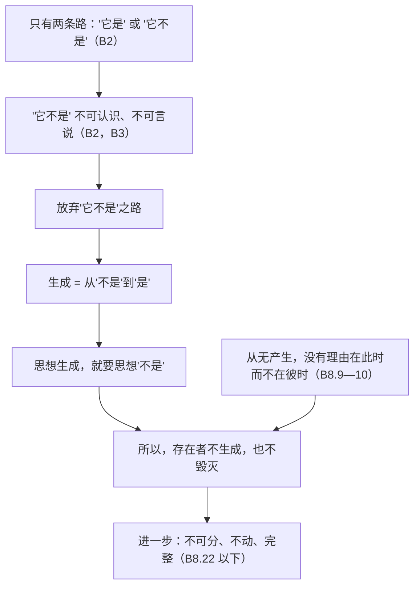

# GR1　古希腊哲学的起源：从自然到经省察的人生

*Origins of Greek Philosophy: From Nature to the Examined Life*

> **状态：课程稿第二稿。** 第二稿在第一稿基础上作了有针对性的学术核对：在第尔斯 1922 年版中核对了主要残篇的编号和古代出处，订正了巴门尼德 B8 的异读说明和亚里士多德字母例子的说明，限定了对现代研究的转述，并在第三部分末尾增加了一张对照表。本稿尚未经古典学专家审读。希腊文引文据可以公开使用的电子本，中文译文均为本课自译。哪些地方已经核对、哪些还没有核对，见文末《来源与权利说明》。

## 本章导读：从"传下来的说法"到"请给出理由"

设想一位公元前六世纪的商人，从爱琴海东岸的港口城市米利都出发，乘船去埃及、黑海沿岸或腓尼基。他在不同的港口见到不同的神庙、不同的祭礼，听到关于世界起源的不同故事。回到家乡，他还记得小时候听过的诗：最初出现的是混沌，接着是大地，诸神一代一代生出来，彼此争斗，最后宙斯取得了统治。这些诗是祖辈传下来的，诗人说自己的话来自缪斯女神。

可是，就在这座城市里，有几个人开始用另一种方式谈论世界。他们不问"哪一位神生出了大地"，而问"万物是由什么构成的""大地为什么不往下掉""雷电和地震是怎样发生的"。他们给出的答案有时在今天看来很奇怪，例如"万物出于水"。但他们的答案有一个共同特点：它们可以被别人拿来比较、批评和改进。下一代人不必接受上一代人的说法，可以说"你错了，理由是……"。

一百多年后，在雅典，一位据说是石匠之子、以相貌丑陋出名的人整天在广场上和人谈话。他不再追问天上和地下的事情，而是追问："什么是勇敢？""什么是正义？""你说你知道，那你能说清楚吗？"公元前 399 年，雅典人以不敬城邦之神、败坏青年的罪名判处他死刑。他就是苏格拉底。

这一章要讲的，就是这两百年左右的历程。它的核心问题是：**当人们不再满足于传下来的说法，而要求给出理由时，对世界的解释和对人生的追问会变成什么样子？**

这个大问题可以分成六个较小的问题，分别对应本章的六个部分：

- 自然世界能否不靠神话、而用可以讨论的原因来解释？（第一部分）
- 理性、观察和传统说法发生冲突时，应该相信哪一个？一个东西怎样才能既在变化、又仍然是它自己？（第二、三部分）
- 一个论证凭什么算是有效的、令人信服的？说服别人和证明真理是一回事吗？（第四部分）
- 美德是不是一种知识？（第五部分）
- 过一种"经过省察的人生"是什么意思，它为什么会和城邦发生冲突？（第六部分）

本课一句话：早期希腊哲学并不是"理性取代神话"的一次胜利，而是一种逐渐形成的习惯：把关于世界和人生的说法摆到公开的讨论中，要求它给出理由，并接受别人的反驳。

### 读这一章的几点提醒

第一，**几乎没有完整的书留下来。** 苏格拉底以前的希腊思想家，没有一个人的著作完整地保存下来。我们手上的材料大致有五种，读的时候要始终分清：

| 材料的种类 | 是什么 | 例子 |
|---|---|---|
| 残篇 | 后世作者引用的、被认为是原作者原话的句子 | 赫拉克利特关于河流的话，出自后来的作者转引 |
| 古代证言 | 古代作者对某人学说的转述和评论，不是原话 | 亚里士多德说泰勒斯认为"万物的本原是水" |
| 后世解释 | 古代晚期或中世纪注释家对这些材料的讨论 | 六世纪的辛普里丘在注释亚里士多德时引用巴门尼德 |
| 现代重构 | 现代学者根据残篇和证言拼合出来的学说或论证 | 把巴门尼德的诗句整理成一步一步的论证 |
| 本课的例子 | 本课为了帮助理解而设计的比方和情境 | 本章用"一艘不断更换木板的船"来说明同一性问题 |

学术界通用的编号是第尔斯（Hermann Diels）编、克兰茨（Walther Kranz）修订的《前苏格拉底哲学家残篇》（简称 DK）。在这个编号里，每位思想家有一个数字，A 组是证言，B 组是残篇。例如"DK 22 B12"指赫拉克利特（第 22 号）的第 12 号残篇。2016 年拉克斯（André Laks）和莫斯特（Glenn Most）出版了一套新的编辑本，编号和 DK 不同。本章沿用学界最通行的 DK 编号。[^1] 请注意，"B 组"并不等于"一定是原话"：有些 B 组残篇是否逐字可靠，学者有争论，本章遇到时会说明。

第二，**我们透过谁的眼睛来看。** 关于这些思想家，最早、最系统的报告来自亚里士多德和他的学生泰奥弗拉斯托斯。亚里士多德是一位伟大的哲学家，但他在介绍前人时，往往用自己的概念（例如"质料因""动力因"）去整理前人的想法，把前人看成在一步步接近他自己的理论。本章会尽量把"某某说过什么"和"亚里士多德认为某某在想什么"分开。

第三，**希腊不是一切哲学的起源。** 本章讲的是希腊这一个传统的开端。同一时期或更早，在中国、在印度，都有人提出了关于宇宙、人性和知识的深刻追问（本平台的中国哲学和印度哲学课程讲的就是这些）。希腊人自己也承认从邻近的文明学到了很多东西：希罗多德就说，几何学是从埃及传到希腊的。[^2] 本章说"希腊哲学的起源"，意思是"希腊哲学这一个传统是怎样开始的"，不是"哲学是在希腊被发明的"。不同传统之间的相似，本章也不会说成影响，除非有文献证据。

第四，**原文、译文和年代。** 希腊文引文据可以公开使用的电子本：前苏格拉底哲学家的残篇主要据希腊文维基文库，柏拉图和亚里士多德的文本据 Perseus 项目在 GitHub 上公开的数字本。电子本的来历和使用条件，见文末《来源与权利说明》。所有中文译文都是本章自己从希腊文试译的，只求帮助理解；本章没有转录任何已出版的现代中文或英文译本。这一时期的年代大多来自古代的推算，很不精确。正文中"约""大约"的意思，往往是前后二三十年都有可能。

第五，**柏拉图笔下的苏格拉底。** 苏格拉底本人什么也没有写。本章第五、六部分大量引用柏拉图的对话，但柏拉图是在写戏剧化的作品。读的时候要分清三个层次：对话里正在说话的角色；这个角色所代表的哲学立场；以及安排这一切的作者柏拉图。说"苏格拉底认为……"，严格地说常常是"柏拉图笔下的苏格拉底在这篇对话里主张……"。

第六，文中每一部分结尾有一处"想一想"，各有几道选择题。请先自己想清楚、作出选择，看过反馈和解析再往下读。有些题目没有标准答案，那是因为学者们自己也还在争论。

---

## 一、从神话到自然解释：米利都的探索者

### 赫西俄德的问题与米利都人的问题

要看清米利都人做了什么新的事情，先要看他们以前的人是怎样谈论世界的。公元前七世纪前后的诗人赫西俄德在《神谱》里讲述了世界的开端：最先出现的是混沌（Chaos），然后是宽胸的大地、幽暗的塔尔塔罗斯和爱神厄洛斯；大地生出天空，天空和大地又生出一代代的神。[^3]

这个故事回答的是"谁从谁生出来"。它是一部家谱：世界的秩序就是神的世代更替和权力分配，最后由宙斯确立。它的权威来自诗人和缪斯：赫西俄德说，是缪斯在赫利孔山下教给他这首歌的。

请注意，这并不是说赫西俄德的诗里没有"思想"。《神谱》把世界整理成一个有先后、有层次的整体，已经在追问"最初是什么"。后来的哲学家继承了这个问题。变化的是回答问题的方式。

米利都人提出的问题，可以换一种说法来表述：

- 不再问"哪一位神生出了大地"，而问"万物由什么构成，又从什么生成"；
- 不再把地震、雷电说成某位神的愤怒，而去找一个在自然中经常起作用的过程；
- 他们的答案不靠缪斯的启示，而是可以被别人拿去检验、修改和反驳的。

古希腊人把这些人称为"谈论自然（physis）的人"。physis 这个词来自动词"生长"，指一个东西本来的样子、它生长和活动的方式。后来亚里士多德把他们看作第一批"哲学家"，同时也把他们放进自己的框架：他认为这些人在寻找万物的"本原"（archē），也就是万物由之构成、最终又复归于它的那个东西。

### 泰勒斯：水，以及亚里士多德的猜测

米利都的泰勒斯（Thales）通常被称为第一位希腊哲学家。他大约活动于公元前六世纪前期，没有留下任何著作，也可能根本没有写过书。我们关于他的哲学观点的主要材料，是两百多年后亚里士多德的一段话：

> Θαλῆς μὲν ὁ τῆς τοιαύτης ἀρχηγὸς φιλοσοφίας ὕδωρ φησὶν εἶναι……λαβὼν ἴσως τὴν ὑπόληψιν ταύτην……（亚里士多德《形而上学》A 卷第 3 章，983b20—22）[^4]
>
> 本章试译：泰勒斯，这种哲学的开创者，说（本原）是水……他也许是从这样的观察得出这个看法的……

接下来，亚里士多德列出了他推测的理由：一切东西的养料都是湿的，热本身也从湿中产生，种子都有湿的本性。请特别注意"也许"（ἴσως）这个词。亚里士多德自己也不知道泰勒斯的理由是什么。他是在猜测，而且是用他自己关于"本原"和"质料"的理论去猜测。

那么，我们真正能说泰勒斯主张了什么？谨慎一点的说法只能是：古代有一个传统，把"水是本原"或"大地浮在水上"的说法归于泰勒斯。至于他是说"万物都是由水构成的"，还是说"万物都从水产生"，或者只是说"大地浮在水上"，材料不足以裁决。

亚里士多德还在《论灵魂》里转述了另外两种说法：泰勒斯认为磁石有灵魂，因为它能使铁移动；有些人说他认为"万物充满了神"。[^5] 这两条材料很有意思。它们表明，泰勒斯并不是一个把神从世界中赶走的"唯物主义者"。说万物充满了神，可能是说自然本身就有活力和推动的力量。所以，不能把米利都人简单地描述成"不信神的科学家"。

关于泰勒斯，古代还流传着很多故事：他预言了一次日食，他测量了金字塔的高度，他在看星星时掉进了井里。日食的故事出自希罗多德，现代天文学推算出的那次日食发生在公元前 585 年。但是，泰勒斯是否真的能预言日食，用的是什么方法，学者们非常怀疑：当时的希腊人没有足够的天文知识来计算日食的具体地点，他最多可能借用了巴比伦人长期记录的天象周期，而且即使如此，也只能大致推测年份。[^6] 这类故事告诉我们后来的希腊人怎样想象"第一位智者"，至于泰勒斯本人到底做过什么，它们说明不了多少。

### 阿那克西曼德：无定者与"按时间的秩序"

阿那克西曼德（Anaximander）也是米利都人，传统上说他是泰勒斯的学生或同伴，比泰勒斯年轻。据古代传统，他是最早用散文写作的希腊作者之一，而且，他的书里有一句话可能保存了下来。这句话由六世纪的辛普里丘转引，辛普里丘的材料又来自泰奥弗拉斯托斯：

> ἐξ ὧν δὲ ἡ γένεσίς ἐστι τοῖς οὖσι, καὶ τὴν φθορὰν εἰς ταῦτα γίνεσθαι κατὰ τὸ χρεών· διδόναι γὰρ αὐτὰ δίκην καὶ τίσιν ἀλλήλοις τῆς ἀδικίας κατὰ τὴν τοῦ χρόνου τάξιν, ποιητικωτέροις οὕτως ὀνόμασιν αὐτὰ λέγων.（辛普里丘《亚里士多德〈物理学〉注》24.13 起，DK 12 B1）[^7]
>
> 本章试译：存在的东西从哪里生成，也按照必然复归于那里而毁灭；因为它们按照时间的秩序，为彼此的不义相互作出补偿和赔付。——他是用这种比较诗意的语言来说这件事的。

最后一句"他是用这种比较诗意的语言来说这件事的"显然是转述者的话，不是阿那克西曼德的原话。那么，原话从哪里开始？学者们的意见不一致：有人认为只有"按照必然……按照时间的秩序"这一段是原话，前半句是泰奥弗拉斯托斯的转述；也有人认为整句都较接近原话。这是一个很好的例子，可以说明"残篇"的边界本身就是重构的结果。

这句话说的是什么？大致的读法是：世界上有彼此对立的东西，例如热和冷、干和湿。夏天热占上风，冬天冷占上风。每一方"越界"侵占对方，就是一种"不义"；随着时间的推移，它又要让出地盘，这就是"补偿"。阿那克西曼德用法庭和赔偿的语言描述自然变化，这说明他心目中的自然是一个有规律、有平衡的秩序，而不是诸神任意的行为。

根据同一段证言，阿那克西曼德认为万物的本原不是水，也不是其他任何一种元素，而是"无定者"（to apeiron），即没有边界、没有确定性质的东西。为什么不是水？一种从古代流传下来的解释是：如果本原是水这样一种有确定性质的东西（湿、冷），它就会把与它对立的东西（干、热）吞没；所以本原必须在所有对立面之外。这个推理是否属于阿那克西曼德本人，还是亚里士多德派的重构，不能确定。但无论如何，它展示了一种新的思考方式：不是讲一个故事，而是比较几种可能的答案，看哪一个能避免困难。

阿那克西曼德还提出了一些在今天看来非常大胆的想法。据亚里士多德报告，他认为大地不需要任何东西支撑，因为它处在宇宙的中心，到各个方向的距离都相等，没有理由往一个方向移动而不往另一个方向移动。[^8] 这个推理的结构值得注意：它不是说"有东西托着大地"，而是说"没有理由让它动"。另据后世的证言，他认为最早的动物生在湿处，人最初是在一种类似鱼的生物体内长成的，因为人类婴儿需要长时间的照顾，不可能一开始就独立生存。[^9] 这条材料来自很晚的转述，细节不可靠，但它表明古代传统记得他用自然过程来解释人类的起源。

### 阿那克西美尼：一个可以想象的过程

阿那克西美尼（Anaximenes）是米利都学派的第三位人物。据泰奥弗拉斯托斯的报告，他认为本原是气，而且气是"无定的"，但它不是没有性质的：一切都是通过气的稀散和凝聚产生的。气稀散就变成火；凝聚就依次变成风、云、水、土和石头。[^10]

和阿那克西曼德的"无定者"相比，阿那克西美尼的理论有一个优点：它提供了一个可以想象的机制。我们可以用同一种东西的疏密变化来解释性质完全不同的东西。古代材料还说，他用一个日常经验来支持这个想法：张开嘴哈气，气是热的；抿紧嘴唇吹气，气是冷的。他把这解释为稀散带来热、压缩带来冷。

这个例子今天看来解释错了：吹出的气觉得凉，主要是因为气流加快和与周围空气的混合，而不是压缩。但它在方法上很重要：一个关于整个宇宙的理论，第一次被人用一个任何人都能重复的小经验去支持。当然，这还不是现代意义上的"实验"：他没有控制条件，也没有尝试否证自己的理论。比较恰当的说法是：理论开始和可以共享的经验联系起来了。

### 色诺芬尼：批评神话的人也承认自己的无知

米利都人很少直接攻击传统宗教。第一个公开、系统地批评荷马和赫西俄德的人，是生于伊奥尼亚城市科洛丰的诗人色诺芬尼（Xenophanes）。据他自己的诗，他在希腊各地漂泊了六十七年，可见他活得很长，大约是公元前六世纪到前五世纪初的人。[^11]

色诺芬尼的批评有两层。第一层是道德的：荷马和赫西俄德把人间的一切可耻之事，如偷窃、通奸、互相欺骗，都加到了神的身上（DK 21 B11）。第二层更深刻，它涉及人怎样想象神：

> ἀλλ᾽ εἰ χεῖρας ἔχον βόες <ἵπποι τ᾽> ἠὲ λέοντες ἢ γράψαι χείρεσσι καὶ ἔργα τελεῖν ἅπερ ἄνδρες, ἵπποι μέν θ᾽ ἵπποισι βόες δέ τε βουσὶν ὁμοίας καί <κε> θεῶν ἰδέας ἔγραφον καὶ σώματ᾽ ἐποίουν τοιαῦθ᾽ οἷόν περ καὐτοὶ δέμας εἶχον <ἕκαστοι>.（色诺芬尼残篇，DK 21 B15）
>
> 本章试译：如果牛、马或狮子有手，能像人一样用手画画、做出作品，那么马会把神的样子画得像马，牛会画得像牛，它们各自会按照自己的身形，塑造神的身体。

> Αἰθίοπές τε <θεοὺς σφετέρους> σιμοὺς μέλανάς τε Θρῇκές τε γλαυκοὺς καὶ πυρρούς <φασι πέλεσθαι>.（色诺芬尼残篇，DK 21 B16）
>
> 本章试译：埃塞俄比亚人说他们的神是扁鼻子、黑皮肤；色雷斯人说他们的神是蓝眼睛、红头发。

尖括号里的词是现代编者补上的，原文在传抄中有残缺。这两条残篇的论证可以这样整理：

1. 不同的人群把神想象得和自己相像；
2. 如果动物能画画，它们也会这样做；
3. 所以，人们关于神的形象的想法，更多反映的是想象者自己，而不是神本身。

这是一个非常现代的论证形式：它不直接证明某个关于神的说法是错的，而是揭示这类说法产生的原因，从而动摇我们相信它的理由。请注意它的界限：说明一种信念是怎样产生的，并不等于证明它是假的。埃塞俄比亚人的神"偶然"真的长得像埃塞俄比亚人，在逻辑上也不是不可能。色诺芬尼的论证真正动摇的是：我们没有理由相信它。

色诺芬尼自己提出了一种不同的神的观念：有一位神，在形体和思想上都不像凡人；他不动，却凭心思推动一切（B23—B26）。他还用自然现象解释传统上被视为神迹的东西：人们叫作伊里斯（彩虹女神）的，其实是一种有紫、红、黄绿颜色的云（B32）。

最引人深思的，是他对人类知识的限度的反省。他的一条残篇大意是：关于神和他所说的一切事情，没有人确切地知道过，将来也不会有人知道；即使有人碰巧说出了完全正确的话，他自己也不知道那是对的；对一切事情，人们都只有意见（DK 21 B34）。另一条残篇说：神并没有从一开始就把一切显示给凡人，凡人是通过探寻，随着时间，发现更好的东西（DK 21 B18）。[^12] 这两条残篇本章只给出大意，没有给出希腊原文，因为本课没有找到可以核对原文和使用条件的电子本。

把两条残篇放在一起读，就看到一种很特别的态度：人没有确定的知识，但这不是放弃探索的理由；探索可以让人"发现更好的东西"。B34 的范围有多大，是只针对神和宇宙这样遥远的事物，还是针对一切知识，学者有争论。有人把色诺芬尼看作希腊怀疑主义的先驱，也有人认为他只是在区分"确定的知识"和"较好的意见"。无论哪种读法，他都提出了一个本章会反复回到的问题：理性能把我们带到多远？

### 这不是"从神话到理性"的一次跳跃

二十世纪中叶，有一种很流行的说法：希腊哲学的诞生是"从神话（mythos）到理性（logos）"的转变，好像有一天希腊人突然不再相信神话，开始用理性思考。[^13] 这个说法抓住了一些真实的东西，但它会在至少三个方面误导读者。

第一，神话里也有思想。赫西俄德已经在追问世界的开端和秩序，米利都人继承了这个问题。

第二，哲学家并没有把神话完全抛弃。泰勒斯说"万物充满了神"，阿那克西曼德用"正义"和"补偿"描述自然，色诺芬尼用一位新的神取代荷马的神。下一部分的巴门尼德，更是把他的论证写成一首诗，由一位女神讲出来。

第三，"理性"并不是希腊人独有的禀赋。在本平台的中国哲学和印度哲学课程里，读者会看到不同的传统以不同的方式追问世界和知识。米利都所处的伊奥尼亚地区，和吕底亚、波斯、埃及、腓尼基、巴比伦都有密切往来；希腊人从这些文明学到了天文观测、计量和书写。至于哪些具体的想法是从哪里来的，现存证据大多不足以确定。

那么，到底有什么是新的？比较稳妥的说法是：**公开的批评传统**。米利都三人的答案彼此不同，而且后一个人的答案好像是对前一个人的回应：水有确定的性质，所以改成无定者；无定者说不清怎样变成万物，所以改成可以疏密变化的气。色诺芬尼又把批评的矛头转向了整个传统。哲学的开端，与其说是某一个正确答案，不如说是一种可以被反驳、也欢迎反驳的说话方式。

**一个教学比方，以及它的限度。** 可以把这个过程想象成一个越来越热闹的讨论会：第一个人提出一个答案，第二个人站起来说"我不同意，因为……"，第三个人又修正了第二个人。这个比方抓住了"批评传统"的要点，但它会误导：这些人并不在同一个房间里，我们也不知道后一个人是否真的读过前一个人的书；他们之间的"回应"关系，有很大一部分是亚里士多德和泰奥弗拉斯托斯在整理时建立起来的。

> **想一想（一）：从神话到自然解释。** 请想一想：亚里士多德关于泰勒斯的报告，哪些部分是泰勒斯的观点，哪些是亚里士多德的推测？色诺芬尼关于"牛和马画神"的论证，证明了什么，又没有证明什么？
>
> 提示：先找出亚里士多德原话中的"也许"一词；再区分"说明一种信念从哪里来"和"证明这种信念是假的"。

---

## 二、赫拉克利特、巴门尼德与变化问题

### 赫拉克利特：不只是"万物皆流"

赫拉克利特（Heraclitus）是伊奥尼亚城市以弗所人，大约活动于公元前 500 年前后，当时以弗所处于波斯帝国的统治之下。古代流传着很多关于他的生平故事，例如他性情孤傲、把著作献给阿尔忒弥斯神庙、得了水肿病用牛粪治疗等等。第欧根尼·拉尔修在三世纪编写的哲学家传记里记录了这些故事，但现代学者普遍认为，其中很多是后人根据他的残篇编出来的。[^14] 据同一来源，他写过一本书，后人把它分成论宇宙、论政治、论神学三部分。

赫拉克利特在中文世界最出名的一句话大概是"人不能两次踏进同一条河流"，他也常常被概括为"万物皆流"的哲学家。这一部分要说明的是：这个概括至少是不完整的，而且这句最出名的话可能根本不是他的原话。

先看他的书很可能的开头：

> τοῦ δὲ λόγου τοῦδ᾽ ἐόντος ἀεὶ ἀξύνετοι γίνονται ἄνθρωποι καὶ πρόσθεν ἢ ἀκοῦσαι καὶ ἀκούσαντες τὸ πρῶτον·（赫拉克利特残篇，DK 22 B1）[^15]
>
> 本章试译：这个逻各斯（logos）虽然永远存在，人们却总是不理解它：在听到之前不理解，第一次听到之后也不理解。

这句话里的 logos 是一个非常难译的词。它的日常意思是"话语""说法""计算""比例"。在赫拉克利特这里，它既指他自己正在讲的这番话，也指他的话所揭示的、支配一切的那个道理或结构。中文常译为"逻各斯"，本章保留这个音译，读者可以先把它理解为"贯穿万物的那个道理"。

有一个细节很能说明残篇的处境。亚里士多德在《修辞学》中抱怨说，这句话很难断句："永远"（ἀεί）一词可以属于前面"这个逻各斯永远存在"，也可以属于后面"人们永远不理解"。亚里士多德把这当作文风晦涩的例子。现代学者有人认为，赫拉克利特是有意让这个词两头都能读。无论如何，一个词的位置就能改变整句话的意思，读这些残篇时需要多么小心，由此可见一斑。

### 河流残篇：哪一句是他说的？

关于河流，古代流传下来的说法至少有三种。最可能接近原话的是这一句：

> ποταμοῖσι τοῖσιν αὐτοῖσιν ἐμβαίνουσιν ἕτερα καὶ ἕτερα ὕδατα ἐπιῤῥεῖ·（赫拉克利特残篇，DK 22 B12）[^16]
>
> 本章试译：踏进同样的河流的人，有不同又不同的水流向他们。

另一种说法见于一世纪的普鲁塔克："不能两次踏进同一条河流"（DK 22 B91）。柏拉图在《克拉底鲁篇》中也让苏格拉底转述说：赫拉克利特说一切都在流动、没有什么是静止的，他把万物比作河流，说你不能两次踏进同一条河流。

很多学者认为 B12 更可能是赫拉克利特的原话，而 B91 是普鲁塔克的改写，柏拉图的转述则带有柏拉图自己的理解。理由之一是：B12 的希腊文带有赫拉克利特所用的伊奥尼亚方言形式，而且有他特有的那种对称和重复。但这不是全体学者的共识，也有学者认为 B91 一类的说法保留了原意。

为什么这个区别很重要？因为两句话的哲学意义几乎相反：

- B91 说的是：河流已经不是原来那条河了。重点在于**没有什么能保持同一**。
- B12 说的是：**同样的**河流，流着**不同的**水。重点在于：正是因为水不断流过，河才仍然是那条河。一个停止流动的"河"就成了池塘。

按照 B12 的读法，赫拉克利特的意思不是"一切都在变，所以没有什么是稳定的"，而是"有些东西的稳定，正是靠持续的变化来维持的"。河流、火焰、活的身体，都是这样的例子。学者们对此有两种主要的读法：一种（例如巴恩斯 Jonathan Barnes）认为赫拉克利特确实主张激烈的流变，甚至走到了自相矛盾的地步；另一种（例如柯克 G. S. Kirk）认为流变在他那里是维持恒常结构的条件。

**一个教学比方，以及它的限度。** 想一想一座城市的公交线路：每天的车、司机和乘客都在换，但"12 路公交车"仍然是那条线路，因为它按照同样的路线和时刻表运行。正是不断有车开过，这条线路才存在；如果一辆车也不开了，线路就只剩下一张图。这个比方有助于理解 B12 的读法，但它也有限度：公交线路是人为规定的，它的"同一"来自我们的约定；赫拉克利特所说的则是自然本身的结构，而且他很可能认为这种结构是神圣的、"人和神都不曾创造"的。

### 尺度、逻各斯与对立面的统一

如果流变不是全部，那么赫拉克利特强调的另一面是什么？看他关于宇宙和火的一条残篇：

> κόσμον τόνδε, τὸν αὐτὸν ἁπάντων, οὔτε τις θεῶν οὔτε ἀνθρώπων ἐποίησεν, ἀλλ᾽ ἦν ἀεὶ καὶ ἔστιν καὶ ἔσται πῦρ ἀείζωον ἁπτόμενον μέτρα καὶ ἀποσβεννύμενον μέτρα.（赫拉克利特残篇，DK 22 B30）[^17]
>
> 本章试译：这个宇宙秩序，对一切都是同一个的，不是任何神或任何人造的；它过去一直是、现在是、将来也是永远活着的火，按尺度燃起，按尺度熄灭。

关键词是"尺度"（metra）。火在燃烧，在变化，但它的燃烧和熄灭是有分寸的。这里说"火"，不一定是说万物都"由火构成"（像泰勒斯的水那样），更可能是在说：宇宙像一团火，它的存在本身就是一个持续的、有规律的过程。

赫拉克利特最有特色的思想，是"对立面的统一"。几条残篇说：

> ὁδὸς ἄνω κάτω μία καὶ ὡυτή.（DK 22 B60）
>
> 本章试译：向上的路和向下的路是同一条。

> ταὐτὸ ζῶν καὶ τεθνηκὸς καὶ ἐγρηγορὸς καὶ καθεῦδον καὶ νέον καὶ γηραιόν· τάδε γὰρ μεταπεσόντα ἐκεῖνά ἐστι κἀκεῖνα πάλιν μεταπεσόντα ταῦτα.（DK 22 B88）
>
> 本章试译：活着和死去、醒着和睡着、年轻和年老，是同一个东西；因为这些变过去就是那些，那些再变回来就是这些。

> οὐ ξυνιᾶσιν ὅκως διαφερόμενον ἑωυτῷ συμφέρεται· παλίντονος ἁρμονίη ὅκωσπερ τόξου καὶ λύρης.（DK 22 B51）
>
> 本章试译：他们不理解，一个与自身相异的东西怎样与自身相合：这是一种反向张紧的和谐，就像弓和竖琴那样。

"向上的路和向下的路是同一条"，最简单的理解是：同一条山路，从山脚看是上坡，从山顶看是下坡。对立的描述可以属于同一个东西，取决于观察的角度。B88 说的则是另一种情况：对立面之间互相转化，醒来的人原本是睡着的，睡着的人还会醒来。B51 最为深刻：弓和竖琴之所以能工作，正是因为弦和弓臂往相反的方向拉。如果张力消失，弓就不再是弓。

这些残篇合起来表达的，大致是这样一个想法：世界的统一不是没有差异和冲突的静止，而是对立面之间的张力和平衡。"逻各斯"就是这种结构，赫拉克利特在另一条残篇里说："不是听我，而是听这个逻各斯，同意'一切是一'才是智慧的"（DK 22 B50）。

这里要提醒一点。亚里士多德在《形而上学》中提到，有些人认为赫拉克利特说过"同一个东西既是又不是"，从而违反了矛盾律；亚里士多德接着说，一个人说出来的话，不一定是他真正相信的。[^18] 换言之，"赫拉克利特否认矛盾律"这个说法，在亚里士多德那里就已经被打上了问号。像 B60 这样的句子，看起来是矛盾的（"上"和"下"是同一个），细想一下却可以理解为"同一个东西在不同的关系里有不同的描述"，这并不违反矛盾律。不过，赫拉克利特是否自觉地作了这种区分，还是有意用悖论式的语言来逼迫读者思考，现存材料无法裁决。

### 眼睛、耳朵和理解

赫拉克利特怎样看待感官？他的残篇给出了两种似乎方向不同的说法：

> ὀφθαλμοὶ γὰρ τῶν ὤτων ἀκριβέστεροι μάρτυρες.（DK 22 B101a）
>
> 本章试译：眼睛是比耳朵更准确的见证者。

> κακοὶ μάρτυρες ἀνθρώποισιν ὀφθαλμοὶ καὶ ὦτα βαρβάρους ψυχὰς ἐχόντων.（DK 22 B107）
>
> 本章试译：对于那些拥有"野蛮"灵魂的人来说，眼睛和耳朵是糟糕的见证者。[^19]

B101a 可能是在说：亲眼所见比道听途说更可靠，诗人和传说只是"耳朵"听来的东西。B107 则补充说：感官本身并不够，如果灵魂不懂得"语言"，就无法理解感官提供的东西。这里的"野蛮"（barbaros）原意是"不说希腊语的"，在这里的意思大概是：灵魂听不懂感官所说的"语言"，就像一个外国人听不懂希腊话。

把两者合起来看，赫拉克利特既不是纯粹的经验主义者，也不排斥感官。他在 B40 中挖苦说："博学并不教人理解。"否则它早就教会了赫西俄德、毕达哥拉斯、色诺芬尼和赫卡泰乌斯。积累观察和传说不够，还需要看出它们背后的结构，而"自然喜欢隐藏自己"（B123）。下一位思想家巴门尼德，会把感官和理性的关系推到一个尖锐得多的地步。

### 巴门尼德：女神、道路与论证

巴门尼德（Parmenides）来自意大利南部的希腊殖民城市埃利亚。柏拉图在对话《巴门尼德篇》中描写他和弟子芝诺访问雅典，那时巴门尼德约六十五岁，苏格拉底还很年轻。如果这个戏剧场景大致可信，巴门尼德大约生于公元前 515 年前后。但这只是根据柏拉图的文学作品推算的，并不确定。[^20]

巴门尼德的著作是一首用六音步诗体写成的长诗，现存约一百六十行，主要靠六世纪的辛普里丘等人转引而保存。辛普里丘特意抄录了很长的段落，他说这本书在他那个时代已经很难找到了。诗分为三部分：

1. **序诗**（残篇 1）：一位年轻人乘着马车，在太阳的女儿们的引导下，穿过白昼与黑夜之门，来到一位女神面前。
2. **真理之路**（残篇 2—8.50）：女神讲述"真理"，这是一个严格的论证。
3. **意见之路**（残篇 8.50 以后）：女神讲述"凡人的意见"，一套关于宇宙结构的学说，现存部分很零碎。

这种安排本身就很值得注意。一个哲学论证，被放在一首宗教色彩浓厚的诗里，由一位女神讲出来。但女神并不要求年轻人相信她的权威，而是要求他"用理性（logos）来判断"她提出的论证（残篇 7）。这正说明了上一部分讲的"从神话到理性"不是一次性的替换：神话的形式还在，内容却是一个要求读者自己检验的推理。

### 两条道路

女神首先提出，可以设想的探究之路只有两条：

> ἡ μὲν ὅπως ἔστιν τε καὶ ὡς οὐκ ἔστι μὴ εἶναι, Πειθοῦς ἐστι κέλευθος - Ἀληθείῃ γὰρ ὀπηδεῖ -, ἡ δ᾽ ὡς οὐκ ἔστιν τε καὶ ὡς χρεών ἐστι μὴ εἶναι, τὴν δή τοι φράζω παναπευθέα ἔμμεν ἀταρπόν· οὔτε γὰρ ἂν γνοίης τό γε μὴ ἐὸν - οὐ γὰρ ἀνυστόν - οὔτε φράσαις·（巴门尼德残篇，DK 28 B2.3—8）[^21]
>
> 本章试译：一条是"它是"，并且"它不可能不是"，这是说服之路，因为它跟随着真理；另一条是"它不是"，并且"它必然不是"，我告诉你，这是一条完全无法探知的路。因为你既不能认识不是的东西（这是做不到的），也不能把它说出来。

这里马上遇到一个翻译上的根本困难。"它是"（ἔστιν）这个希腊词，没有主语。它可以理解为"它存在"（存在意义），也可以理解为"它是某某"（谓述意义，例如"它是热的"），还可以理解为"它确实如此"（真实意义）。那个没有说出来的主语"它"是什么，也不清楚：是"探究的对象"，是"一切存在者"，还是"任何可以被思考的东西"？

学者们对这个问题有很多不同的读法。粗略地说：有人把"是"读作存在，认为巴门尼德的意思是"凡可以思考的东西必定存在"（欧文 G. E. L. Owen 等）；有人把它读作"是某某"，认为巴门尼德要求真正的探究对象必须稳定地"是"它所是的东西（穆雷拉托斯 Alexander Mourelatos、柯德 Patricia Curd 等）；还有人强调其中的模态意味，即"必然是"与"不可能不是"（帕尔默 John Palmer 等）。本章下面的重构主要采用存在意义的读法，因为它最容易把论证的步骤展示清楚；但请记住，这只是读法之一。

女神接着给出了一条关键的理由：

> τὸ γὰρ αὐτὸ νοεῖν ἐστίν τε καὶ εἶναι.（DK 28 B3）
>
> 本章试译：因为思想和存在是同一的。

这句话同样有多种读法。它可以读成"能被思想的和能存在的是同一些东西"，也可以读成更强的"思想就是存在"。较为谨慎的读法是前者：凡是可以被思考的，都必定是存在的；不存在的东西，不能成为思想的对象。

接着，女神批评了第三条路，那是"一无所知的凡人"所走的路：

> οἷς τὸ πέλειν τε καὶ οὐκ εἶναι ταὐτὸν νενόμισται κοὐ ταὐτόν, πάντων δὲ παλίντροπός ἐστι κέλευθος.（DK 28 B6.8—9）
>
> 本章试译：在他们看来，"是"和"不是"既是同一回事，又不是同一回事；一切东西的道路都是往回转的。

凡人一方面说"这个东西存在"，一方面又说"它以前不存在，后来会不存在"，好像"是"和"不是"可以随意混用。有学者认为"往回转的道路"一语是在暗讽赫拉克利特（参看上文 B51 的"反向张紧"），但这只是一种推测，没有直接证据表明巴门尼德读过赫拉克利特的书。

### 一步一步重构巴门尼德的论证

残篇 8 是现存最长、最完整的一段。女神在这里列出"它是"所具有的一系列"标志"：它不生不灭、完整、不动、没有终点。我们先看论证"不生不灭"的一段：

> οὔτ᾽ ἐκ μὴ ἐόντος ἐάσσω φάσθαι σ᾽ οὐδὲ νοεῖν· οὐ γὰρ φατὸν οὐδὲ νοητόν ἔστιν ὅπως οὐκ ἔστι. Τί δ᾽ ἄν μιν καὶ χρέος ὦρσεν ὕστερον ἢ πρόσθεν, τοῦ μηδενὸς ἀρξάμενον, φῦν;（DK 28 B8.7—10）[^22]
>
> 本章试译：我不允许你说或想"它从不是的东西中产生"；因为"它不是"这件事，既不可说，也不可想。而且，如果它从无开始，是什么需要驱使它在较晚而不是较早的时候生长出来呢？

> πῶς δ᾽ ἂν ἔπειτα πέλοιτο ἐόν; πῶς δ᾽ ἄν κε γένοιτο; εἰ γὰρ ἔγεντ᾽, οὐκ ἔστι, οὐδ᾽ εἴ ποτε μέλλει ἔσεσθαι.（DK 28 B8.19—20）
>
> 本章试译：存在的东西怎么会在以后才存在？它怎么会生成？因为，如果它生成了，它就（曾经）不是；如果它将来才要存在，它也（现在）不是。

下面把这一部分的论证整理成一步一步的形式。请注意：**这是本章根据残篇所作的重构，不是巴门尼德的原文。** 巴门尼德写的是诗，不是编了号的前提和结论。

1. 只有两条可以设想的路："它是"或"它不是"。（B2）
2. 不存在的东西既不能被认识，也不能被说出或被思想。（B2.7—8，B3）
3. 所以，"它不是"这条路必须被放弃：任何研究都不能以"不存在者"为对象或起点。（由 1、2）
4. 如果某个东西生成了，那么在它生成之前，它是不存在的。（B8.19—20）
5. 说某个东西"生成"，就是说"它从不存在变成存在"，这需要思想"它不存在"的那个阶段。
6. 但第 3 步已经排除了思想"不存在"的可能。
7. 而且，即使它能从无中产生，也没有任何理由说明它为什么在这个时刻而不是另一个时刻产生，因为"无"之中没有任何东西可以做出区分。（B8.9—10）
8. 所以，存在的东西不能生成；同理，它也不能毁灭，因为毁灭就是变成不存在。（B8.13—21）

在残篇 8 的后面部分，女神用类似的方式论证：存在者是连续的、不可分的，因为如果它在某处"更多"、在某处"更少"，那么"更少"之处就有一点"不存在"；它是不动的，因为运动需要去一个它"还不在"的地方。最终的结论是，真正存在的东西，必须是完整的、统一的、不变的。

这个结论和我们的日常经验完全相反。我们每天都看到东西出生、长大、死去、移动。那么，巴门尼德要我们怎样对待这些经验？

### 理性与感官

女神的回答非常直接：

> μηδέ σ᾽ ἔθος πολύπειρον ὁδὸν κατὰ τήνδε βιάσθω, νωμᾶν ἄσκοπον ὄμμα καὶ ἠχήεσσαν ἀκουήν καὶ γλῶσσαν, κρῖναι δὲ λόγῳ πολύδηριν ἔλεγχον ἐξ ἐμέθεν ῥηθέντα.（DK 28 B7.3—6）
>
> 本章试译：不要让那由许多经验养成的习惯强迫你走上这条路，任凭你茫然的眼睛、轰鸣的耳朵和舌头摆布；而要用理性（logos）来判断我所说的这一番充满争议的检验。

这里有两个重要的词。一个是 logos，在这里的意思接近"推理""论证"；另一个是 elenchos，意思是"检验""反驳"，后来正是这个词被用来称呼苏格拉底的提问方法（见第五部分）。女神要年轻人做的，是对她的论证进行理性的检验，而不是依赖"习惯"和感官的印象。

这是西方哲学中第一次清楚地把理性推理和感官经验对立起来，并且主张：当两者冲突时，应当跟随推理。用本章开头的话说，巴门尼德把"要求理由"推到了极端：如果一个论证的每一步都站得住，那么即使结论违反我们的全部经验，我们也应当接受它，或者至少要找出论证错在哪里。

这正是巴门尼德对后来的哲学家最大的挑战。他之后的每一位自然哲学家，都必须回答：如果"从无生有"是不可能的，那么我们看到的变化到底是什么？第三部分的多元论者和原子论者，正是在这个挑战之下重新建立自然哲学的。

### 这个论证可以怎样反驳？

一个论证令人吃惊，并不说明它错了。可是，如果它的结论是"没有任何东西变化"，我们至少有理由仔细检查它的前提。后来的哲学家和现代的研究者提出了多种可能的批评，下面列出三种，供读者思考：

- **"是"的歧义。** 上面的重构在第 2 步和第 4 步之间，悄悄地从"不存在的东西不可思想"转到了"一个东西不是某某（例如'以前不在这里'）就不可思想"。如果把"存在"和"是某某"分开，一个东西"以前不是热的，现在是热的"似乎并不要求我们思想"绝对的无"。柏拉图后来在《智者篇》中就通过区分"不是"的不同意思来回应巴门尼德，那是下一门课要讲的内容。
- **思想的对象。** 我们似乎可以思考不存在的东西，例如独角兽，或者"明天的晚饭"。巴门尼德的支持者会回答：思考独角兽，其实是在思考马和角这些存在的东西。这场争论一直延续到现代的语言哲学。
- **论证的目的。** 也有学者认为，巴门尼德并不是要否认我们看到的世界，而是在规定"真正可以认识的对象"必须满足什么条件；"意见之路"则是对现象世界的一种次一级的、但并非毫无价值的说明。[^23] 如果这种读法正确，巴门尼德就不是在否认变化，而是在说：变化的东西不能成为严格知识的对象。

本章不在这些读法之间作出裁决。值得读者记住的是：巴门尼德的论证之所以重要，正是因为它很难驳倒，而且逼着后来的人把"是""不是""生成""变化"这些词的意思说清楚。

### 芝诺：为老师辩护的悖论

巴门尼德的学生芝诺（Zeno，约生于公元前 490 年）用一种不同的方式为老师辩护。柏拉图在《巴门尼德篇》中让芝诺自己解释：他的书是为巴门尼德辩护的，针对的是那些嘲笑"一切是一"的人；他要表明，如果假设"存在着多个事物"，会得出比巴门尼德的说法更荒谬的结论。[^24] 换言之，芝诺的方法是：先接受对手的假设，然后推出对手自己也不能接受的结论。这种论证方式后来被称为"归谬法"。

芝诺的书已经失传。他的运动悖论主要靠亚里士多德在《物理学》第六卷中的转述保存下来；关于"多"的悖论，辛普里丘保存了少数几段被认为接近原话的文字。也就是说，下面讲的这些悖论，大多是亚里士多德的版本，而不是芝诺本人的原话。

最有名的有三个：

**二分法。** 要从起点走到终点，必须先走到一半；要走到一半，必须先走到一半的一半；如此以至无穷。所以，你要完成无穷多个步骤，才能走完任何一段距离，而无穷多个步骤是不可能完成的。

**阿喀琉斯与乌龟。** 跑得最快的阿喀琉斯追赶跑得最慢的乌龟，乌龟先出发一段距离。阿喀琉斯要追上乌龟，必须先跑到乌龟出发的地方；但这时乌龟已经向前爬了一点；他再跑到那一点，乌龟又向前爬了一点……所以他永远追不上。

**飞矢不动。** 在任何一个瞬间，飞行中的箭都只占据一个与它自身等长的位置，也就是说，在这个瞬间它是静止的。而它飞行的全部时间都由瞬间组成。所以，飞行中的箭始终是静止的。

这些悖论的力量在于：它们使用的似乎都是我们自己承认的前提，比如空间可以无限分割，时间由瞬间组成。

古代和现代的回应可以分为几类。亚里士多德区分了"潜在的无穷"和"实际的无穷"：一段距离可以被无限分割，但这种分割只是潜在的；跑步的人并不需要实际完成无穷多次独立的动作。十九世纪发展起来的极限理论则表明：无穷多个越来越小的量相加，可以得到一个有限的和，1/2 + 1/4 + 1/8 + …… 的和正好是 1。很多人认为这就解决了二分法和阿喀琉斯悖论。

但是，问题并没有完全结束。数学上可以证明这个无穷级数的和是有限的，可是一个物理过程能否"完成"无穷多个步骤，是另一个问题；现代哲学家仍在讨论所谓"超级任务"（supertask）的问题。至于飞矢悖论，现代的回应通常把"运动"定义为"在不同时刻处于不同位置"，而不是"在一个瞬间里有某种运动的状态"；但这是否真正解释了运动，也还有争论。[^25]

**一个教学比方，以及它的限度。** 想一想把一张纸不断对折：理论上可以无限对折下去，但实际上折不了几次就折不动了。有人会说："所以芝诺错了，物理世界不能无限分割。"这个比方能帮助我们区分"数学上可以无限分割"和"物理上能否无限分割"，但它并不能解决芝诺的问题：芝诺的论证不依赖于我们实际能分割多少次，而依赖于"一段距离是否由无穷多个部分组成"。

### 证据与重构：再提醒一次

讲到这里，有必要回头看一看我们究竟知道什么。关于赫拉克利特，我们有大约一百多条残篇，但它们的顺序已经失传，原书的结构只能推测。关于巴门尼德，我们幸运地拥有一段连续的论证，但"它是"的主语和意义仍然有争议。关于芝诺，我们知道的几乎都来自亚里士多德。上面的论证图和步骤编号，都是本章的重构；读者在其他书中看到的重构，可能和这里很不一样。

这并不意味着我们对这些思想一无所知。它的意思是：**读前苏格拉底哲学，本身就是一种论证练习**，我们必须问"这条材料来自谁""它在原来的上下文中是什么意思""不同的拼合方式各自有什么证据"。这些问题和哲学问题本身一样重要。

> **想一想（二）：变化与存在。** 请比较赫拉克利特的两种河流说法（B12 和 B91），它们对"同一个东西能否在变化中保持同一"给出了怎样不同的答案？再从本章重构的巴门尼德论证中，找出你认为最值得怀疑的一步。
>
> 提示：注意 B12 中"同样的河流"和"不同的水"分别指什么；检查巴门尼德论证时，留意"不是"一词在不同步骤中的意思是否一致。

---

## 三、多元论与原子论：变化是重新组合

### 巴门尼德之后的处境

巴门尼德留下了一个难题：如果"从无生有"和"有变成无"都不可思议，那么生成、毁灭和运动又是什么？公元前五世纪的几位思想家接受了巴门尼德的一部分前提，即真正存在的东西不能从无中产生，也不能消失为无；但他们拒绝了"只有一个不变的存在"的结论。他们的策略可以概括为一句话：**真正存在的东西不止一种，它们本身不生不灭，我们所说的"生成"和"毁灭"，只是它们的混合与分离。**

要注意，"他们是在回应巴门尼德"这一判断，部分来自亚里士多德的整理。亚里士多德在《论生成和毁灭》中明确把原子论说成是对埃利亚学派的回应；对于恩培多克勒和阿那克萨戈拉，现代学者大多也认为他们熟悉巴门尼德的论证，因为他们的用语有明显的呼应。但具体谁读过谁的书，我们没有直接的证据。

### 恩培多克勒：四根与爱、恨

恩培多克勒（Empedocles）来自西西里的阿克拉伽斯（今天的阿格里真托），大约活动于公元前五世纪前期至中期。据亚里士多德的说法，他活到六十岁。关于他的传说比赫拉克利特还要多：有人说他自称是神，最后跳进了埃特纳火山。和赫拉克利特一样，这些故事多半是后人编出来的。[^26]

他用诗体写作。古代材料提到两部作品，通常称为《论自然》和《净化》，但它们究竟是两部书还是同一部书的两部分，学者们有争论。1990 年代，人们在斯特拉斯堡大学收藏的一张埃及纸草上，辨认出了此前不为人知的恩培多克勒诗句，这批新材料又使这场争论更加复杂。这是一个很好的例子：古代哲学的材料至今还在增加，我们对它的认识也还在改变。

恩培多克勒的核心学说是：万物有四个"根"（rhizōmata），即火、气（他称为"以太"）、水、土。他在诗中用四位神的名字称呼它们：宙斯、赫拉、哈得斯和涅斯提斯（DK 31 B6）。四根本身永远存在，既不生也不灭。他在一条残篇中说，凡人所说的"出生"（physis，这里取"生成"之义），其实并不存在，有的只是混合和混合物的分离；"出生"只是人们给这个过程起的名字（DK 31 B8，本章只给大意）。[^27]

推动混合和分离的，是两种力量：**爱**（Philotēs）和**恨**（Neikos）。爱使不同的东西结合，恨使它们分开。宇宙在两者之间循环：在爱完全占上风的时候，一切都融合为一个完美的"球"；在恨占上风的时候，四根完全分离；我们所在的世界，是两者交替作用之下的过渡状态。

这个理论怎样回应巴门尼德？可以这样整理：

- 接受：真正存在的东西（四根）不生不灭，"从无生有"是不可能的。
- 拒绝：只有一个存在者。存在者有四种，外加两种推动力量。
- 重新解释：生成和毁灭是四根的混合与分离；性质的不同，来自四根比例的不同。据古代的转述，恩培多克勒说骨头由两份土、两份水、四份火构成。

亚里士多德说，恩培多克勒是第一个提出"四元素"的人。[^28] 这个说法后来影响了西方的自然哲学和医学将近两千年。但要注意："元素"（stoicheion）这个词是后来才用的，恩培多克勒自己说的是"根"，而且他把四根说成神，这和后来物理学中的"元素"概念并不相同。

### 阿那克萨戈拉：一切在一切之中，以及心灵

阿那克萨戈拉（Anaxagoras）来自伊奥尼亚的克拉佐美奈，大约生于公元前 500 年，在雅典生活了二三十年，是政治家伯里克利的朋友。据后世的报告，他曾在雅典因"不敬神"受到控告，原因之一是他说太阳是一块燃烧的石头，后来离开雅典，死于兰普萨库斯。审判的时间和细节，古代材料说法不一，学者们也有争论。[^29] 柏拉图的《申辩》中有一段话，可以和这件事对照：苏格拉底说，在雅典，人们花一个德拉克马就能在市场上买到阿那克萨戈拉的书（《申辩》26d—e）。我们在第六部分还会回到这一段。

阿那克萨戈拉的回应比恩培多克勒更彻底。他接受巴门尼德的前提：没有东西从无中产生，也没有东西消失为无。他在一条残篇中说，希腊人对生成和毁灭的看法是不对的；没有东西生成或毁灭，有的只是已经存在的东西的混合和分离（DK 59 B17，本章只给大意）。

可是，四种根够不够？我们吃面包，身体却长出了肉、骨头和头发。如果肉不能从"非肉"中产生，那么面包里一定已经含有肉、骨、发的成分。阿那克萨戈拉由此得出一个惊人的结论：**一切东西之中都含有一切东西的一部分**。在世界的开端，"一切东西都在一起"（DK 59 B1）；现在，每一样东西之中仍然包含所有其他东西的成分，我们之所以把一块东西叫作"金子"，只是因为其中金子的成分占了优势。而且，没有最小的部分，任何一部分都可以继续分下去，其中仍然含有一切（DK 59 B3）。

推动这个混合物开始分离、形成有序世界的，是**心灵**（nous）。他在一条较长的残篇中说：其他一切都含有一切的一部分，唯独心灵是无限的、自主的，不与任何东西相混合；它知道一切，并且支配一切（DK 59 B12，本章只给大意）。[^30]

这是西方哲学中第一次把"心灵"放在宇宙秩序的起点上。后来柏拉图在《斐多篇》中让苏格拉底讲述了他读阿那克萨戈拉的感受：他听说这本书说心灵是一切的原因，非常兴奋，以为书中会解释为什么每样东西这样安排是最好的；可是读下去才发现，阿那克萨戈拉解释具体现象时，用的仍然是气、以太、水这类原因，心灵几乎没有起作用（《斐多篇》97b—99c）。

这段话既是一条关于阿那克萨戈拉的重要证据，又是柏拉图自己的哲学立场：他认为真正的解释应该说明"为什么这样最好"，即目的论的解释。所以，"阿那克萨戈拉的心灵没有起作用"这个评价，是柏拉图从他自己的标准出发作出的。阿那克萨戈拉的"心灵"是否具有目的论的意义，是只起一个"启动"作用，还是一直在安排世界的秩序，现代学者仍有不同读法。

### 留基伯与德谟克利特：原子与虚空

对巴门尼德最彻底、也最有远见的回应，来自原子论者。原子论的创始人是留基伯（Leucippus），他的生平几乎不为人知，古代甚至有人怀疑是否真有其人；系统地发展这个理论的是他的学生、来自色雷斯地区阿布德拉的德谟克利特（Democritus），通常认为他大约生于公元前 460 年，活了很久。德谟克利特写过大量著作，但全部失传，现存的残篇中，伦理方面的格言占了很大比例，而真实性参差不齐。[^31]

亚里士多德在《论生成和毁灭》中讲述了原子论的起源：有人（指埃利亚学派）论证说，存在者必须是一而不动的，因为虚空是不存在的，而没有虚空就不能有运动，也不能有多个事物。留基伯认为，他可以提出一种理论，既和感官经验一致，又不取消生成、毁灭、运动和多样性。他同意埃利亚学派的说法：没有虚空就不能有运动；但他主张：**虚空是"不存在者"，而"不存在者"和"存在者"一样存在。**

这句话乍听起来自相矛盾，但它的意思是这样的：

- "存在者"（"有"）是完全充实的东西，即原子（atomos，意为"不可切割的"）。每一个原子都像巴门尼德的存在者一样：不生不灭，内部没有空隙，不可分割，不变。
- "不存在者"（"无"）是虚空。它不是"东西"，但它是真实的，它是原子运动的场所。
- 原子的数目是无限的，它们在无限的虚空中不停地运动、碰撞、结合和分离。

据亚里士多德在《形而上学》中的报告，原子之间只有三种区别：形状、排列和位置。他举的例子是字母：A 和 N 在形状上不同；AN 和 NA 在排列上不同；Z 和 H 在位置上不同。最后一个例子有点费解：Ross 的牛津本印作 Ζ 和 Η，而通行的英译（例如 Tredennick 的洛布本）换成了 Z 和 N，因为把 N 转九十度就成了 Z。原文究竟用的是哪两个字母，涉及校勘问题，本章不作判断，这里的要点不受影响：同样的形状，摆放的方向不同，就成了不同的字母。[^32] 亚里士多德在《论生成和毁灭》中还用过另一个字母的比方：悲剧和喜剧是用同样的字母写成的。同样，有限几种区别的原子，也可以组成我们看到的一切东西。

### 变化即重新排列

原子论对"变化"的解释可以这样概括：**没有任何真正存在的东西生成或毁灭，所谓生成，是原子的结合；所谓毁灭，是原子的分离；所谓性质的改变，是原子排列和位置的改变。**

这个解释最激进的后果，出现在感觉性质的问题上。德谟克利特的一条残篇说：

> νόμωι γλυκὺ καὶ νόμωι πικρόν, νόμωι θερμόν, νόμωι ψυχρόν, νόμωι χροιή, ἐτεῆι δὲ ἄτομα καὶ κενόν.（德谟克利特残篇，据塞克斯都·恩披里柯《驳学问家》VII 135，DK 68 B9）[^33]
>
> 本章试译：按约定是甜的，按约定是苦的，按约定是热的，按约定是冷的，按约定是颜色；实际上只有原子和虚空。

"约定"（nomos）一词值得注意，第四部分讲智者的时候，我们会看到它是公元前五世纪最重要的争论焦点之一。德谟克利特的意思大致是：甜、苦、冷、热和颜色，不是原子本身具有的性质，而是原子作用于我们的感官时，在我们这里产生的效果；我们给这些效果起了名字，但它们不是事物"实际上"的样子。

这就产生了一个严重的知识论问题。如果感官告诉我们的都只是"按约定"的东西，那么我们凭什么知道"实际上只有原子和虚空"？原子太小，看不见；我们关于原子的知识，归根结底也要从感官出发。古代医学家盖伦保存了一段可能出自德谟克利特的话，其中感官对理智说："可怜的心灵啊，你从我们这里拿走了证据，却要用它来推翻我们吗？推翻我们，就是你自己的失败。"（DK 68 B125，本章只给大意）

这段话非常精彩：它表明德谟克利特（如果它确实出自他）自己就看到了自己理论中的困难。理性试图越过感官去认识实在，可是理性的全部材料又来自感官。巴门尼德说要用理性来判断，不要相信感官；原子论者部分地同意他，但又发现理性离不开感官。这个张力在后来的哲学中一再出现。

### 古代原子论不是现代原子论

读到这里，很多读者会觉得古代原子论"预言"了现代科学。这个想法有一部分道理：十七世纪的伽桑狄、波义耳等人复兴原子论时，确实读过古代原子论者（主要是通过伊壁鸠鲁和罗马诗人卢克莱修）的著作。但是，把两者等同起来，会造成严重的误解。[^34]

至少有四点不同：

1. **论证的方式不同。** 德谟克利特的原子是从一个哲学论证中推出来的：为了避免巴门尼德所说的"无限分割"和"从无生有"的困难，必须有不可分的最小单位。现代原子理论则来自化学和物理的定量实验，例如定比定律和布朗运动的研究。
2. **"不可分"的意思不同。** 古代原子按定义是不可分割的。现代的"原子"一词沿用了这个古老的名字，但我们早就知道原子由原子核和电子组成，原子核又由更小的粒子组成。
3. **原子的性质不同。** 古代原子只有形状、大小、排列和位置等少数性质，而且可以是任意大小的；据一些古代证言，德谟克利特甚至认为可以有很大的原子。现代原子有质量、电荷、能级等等，按元素严格分类。
4. **能否检验不同。** 古代原子论无法用实验检验，也不作定量预测。

所以，比较准确的说法是：古代原子论提出了一种**解释策略**，即用不可见的、性质简单的微小单位的组合，来解释可见的、性质复杂的现象；这个策略后来被现代科学以完全不同的方式重新采用。说"德谟克利特发现了原子"，就像说"达·芬奇发明了直升机"：它抓住了一种相似，却忽略了两者之间几乎全部的实际差异。

**一个教学比方，以及它的限度。** 用乐高积木来说明原子论很方便：同样几种积木，可以拼成房子、汽车和恐龙；拆开以后，积木本身没有变。这个比方能说明"变化即重新排列"的思路，但要注意它的两个限度：第一，乐高积木有颜色，而按照德谟克利特的理论，颜色恰恰是"按约定"的，原子本身没有颜色；第二，乐高是有人拼装的，而原子论者的原子是在虚空中自行运动、碰撞而结合的，没有设计者，也没有目的。这一点，正是原子论和阿那克萨戈拉的"心灵"最根本的分歧。

### 三种回答，放在一起看

第二部分留下的问题是：一个东西怎样才能既在变化，又仍然是它自己？如果"从无生有"不可能，变化又是什么？本部分的三种回答可以用下表对照。表格是本章的概括，每一栏都只抓住了最主要的一点。

| | 什么始终不变 | 我们所说的"变化"是什么 | 为此付出的代价 |
|---|---|---|---|
| 巴门尼德（对照） | 唯一的、完整的存在者 | 不是真正的变化，只是凡人的"意见" | 否认或贬低我们经验到的一切变化 |
| 恩培多克勒 | 四根：火、气、水、土 | 四根在爱和恨的推动下混合与分离 | 要另设两种推动的力量；为什么恰好是四种，没有论证 |
| 阿那克萨戈拉 | 无数种成分，以及心灵 | 混合物中成分的比例改变，哪一种占了优势 | "一切在一切之中"很难设想；心灵究竟做了什么，说得不清楚 |
| 原子论者 | 原子和虚空 | 原子的结合、分离和重新排列 | 要承认"不存在者"存在；颜色、冷热只是"按约定"的 |

这三种回答有一个共同的思路：**把"不变"放在组成部分上，把"变化"放在组成部分之间的关系上。** 正因为组成部分不生不灭，巴门尼德的"不能从无生有"得到了尊重；正因为关系可以改变，生成、毁灭和运动又有了位置。

和赫拉克利特对照，差别就更清楚了。按照第二部分对 B12 的读法，河之所以是同一条河，是因为水流经同一条河道、保持同样的样式，同一性在于一个持续的过程或结构。多元论者和原子论者则把同一性放在"材料"上：说到底，不变的是四根、成分或原子。这两种思路，即同一在于形式还是在于材料，后来的希腊哲学还会反复讨论。

还有一个问题，这里只能提出，不作回答：巴门尼德论证说，运动需要"去一个它还不在的地方"。原子论者正面回答了这个问题：有虚空，所以有运动。恩培多克勒和阿那克萨戈拉怎样在这一点上回应巴门尼德，现存材料零碎，学者们的解释也不一致；本课没有核对这部分材料，所以不作展开。

> **想一想（三）：多元论与原子论。** 请比较恩培多克勒、阿那克萨戈拉和原子论者，他们各自接受了巴门尼德的哪些前提，又拒绝了哪一个结论？德谟克利特说"实际上只有原子和虚空"，这句话给他自己的知识论带来了什么困难？
>
> 提示：先写下巴门尼德的两个要点："不能从无生有"和"只有一个不变的存在"；再看每位思想家保留了哪一个。关于德谟克利特，想一想"感官对理智的反驳"。

---

## 四、智者：修辞、约定与相对主义

### 从宇宙到城邦

公元前五世纪中叶，希腊世界的中心逐渐转到了雅典。希波战争胜利以后，雅典建立了海上同盟，成为一个强大而富有的城邦，它的民主政治也日益成熟。在雅典，重大的决定由公民大会投票作出，诉讼由几百名抽签选出的公民组成的陪审法庭裁决，而且没有职业律师，原告和被告都必须自己发言。在这样的城邦里，能言善辩是获得影响力、保护自己的关键。

就在这时，一批来自各地的教师来到雅典，收取学费，教授青年人演说、辩论、法律、政治以及各种知识。他们被称为"智者"（sophistai）。这个词本来只是"有智慧的人""有专长的人"的意思，诗人和七贤都曾被这样称呼。但由于柏拉图的批评，它后来带上了强烈的贬义，中文的"诡辩"一词常常和它联系在一起。

这一部分要做的第一件事，就是把"智者"这个词从这种贬义中解放出来，至少暂时地。

### 谁是"智者"？

首先，智者不是一个学派。他们没有共同的学说，没有共同的老师，彼此之间也常常竞争。普罗泰戈拉、高尔吉亚、普罗狄科、希庇亚斯、安提丰、色拉叙马霍斯……这些名字背后，是一些在兴趣和观点上很不相同的人。他们的共同点主要是职业：在各个城邦之间游走，以收费的方式教授青年人，尤其是教授在公共生活中取得成功所需要的能力。[^35]

其次，我们关于他们的材料，大多来自对他们怀有敌意的作者。柏拉图在多篇对话中把智者描绘成贩卖知识的商人、只关心说服不关心真理的人。他在《智者篇》中甚至给"智者"下了几种带有讽刺意味的定义，例如"以富家青年为猎物的、收取报酬的猎人"。亚里士多德也说，智者术是"看起来像智慧而实际上不是智慧"的东西。阿里斯托芬的喜剧则把苏格拉底本人也描绘成一个智者（见第六部分）。

这并不是说柏拉图的批评毫无道理。但我们读智者，需要像读一位只通过论敌的著作才认识的思想家那样小心：要区分他们自己的残篇、中立的报告和论敌的描绘。

### 普罗泰戈拉：人是万物的尺度

普罗泰戈拉（Protagoras）来自阿布德拉（和德谟克利特是同乡），大约生于公元前 490 年，是最早、也最有名的智者。据柏拉图的《美诺篇》，他从事这个职业四十年，活到将近七十岁。[^36] 在柏拉图以他的名字命名的对话《普罗泰戈拉篇》中，他说自己教授的是"良好的谋划"（euboulia）：怎样最好地管理自己的家事，以及怎样在城邦事务中最有能力地行动和发言；苏格拉底把这概括为"政治的技艺"，即培养好公民（《普罗泰戈拉篇》318e—319a）。

他最有名的一句话保存在柏拉图的《泰阿泰德篇》等处：

> Πάντων χρημάτων μέτρον ἄνθρωπον εἶναι, τῶν μὲν ὄντων, ὡς ἔστι, τῶν δὲ μὴ ὄντων, ὡς οὐκ ἔστιν.（普罗泰戈拉残篇，据柏拉图《泰阿泰德篇》152a，DK 80 B1）[^37]
>
> 本章试译：人是万物的尺度：是存在的东西存在的尺度，也是不存在的东西不存在的尺度。

这句话可以有好几种读法，取决于"人"指的是什么，"尺度"是什么意思：

- **个人的读法。** "人"指每一个人。柏拉图在《泰阿泰德篇》中就是这样解释的：同一阵风吹来，一个人觉得冷，另一个人觉得不冷。那么，风本身是冷的还是不冷的？按照普罗泰戈拉的说法，应该说：对觉得冷的人来说，它是冷的；对不觉得冷的人来说，它不冷。每个人的感觉对他自己来说都是真的。
- **群体的读法。** "人"指一个共同体，例如一个城邦。在《泰阿泰德篇》后面的部分，柏拉图又让苏格拉底替普罗泰戈拉辩护说：凡是一个城邦认为正义和美好的东西，只要它这样认为，对它来说就是正义和美好的。
- **人类的读法。** "人"指人类整体：我们只能用人的方式认识世界，不存在一个"神的视角"。

这几种读法的后果很不相同。个人的读法，是一种非常强的相对主义：没有任何人的判断比别人的更真。群体的读法，是一种文化相对主义或约定论。人类的读法，则和许多非相对主义的哲学都可以相容。普罗泰戈拉本人究竟持哪一种观点，我们只有这一句话和柏拉图的解释，无法确定。

### 柏拉图的反驳：相对主义会推翻自己吗？

柏拉图在《泰阿泰德篇》中提出了一个著名的反驳，常被称为"自我推翻"（peritropē）论证。[^38] 它的大意可以整理如下（这是本章的整理，不是原文）：

1. 普罗泰戈拉主张：每个人认为真的东西，对他来说就是真的。
2. 大多数人认为普罗泰戈拉的主张是假的。
3. 按照普罗泰戈拉自己的主张，大多数人的这个看法，对他们来说就是真的。
4. 所以，普罗泰戈拉必须承认：他的主张对大多数人来说是假的。
5. 而且，既然他承认反对者的看法是真的，他就承认了自己的主张是假的。

这个反驳成立吗？关键在第 5 步。普罗泰戈拉可以回答："我只承认我的主张对那些反对者来说是假的，对我来说它仍然是真的。"如果每一句话后面都加上"对某某来说"，第 5 步似乎就推不出来。现代学者对此有过很多讨论：有人认为柏拉图在这里不公平地省略了"对某某来说"这个限定；也有人认为，即使加上这个限定，相对主义者仍然有麻烦，因为他想要说服别人接受他的理论，而这似乎预设了他的理论不只是"对他来说"真。

柏拉图还提出了另一个更有力的反驳：如果每个人的判断都同样真，那么普罗泰戈拉凭什么收学费、自称比别人更有智慧？柏拉图让普罗泰戈拉回答说：智者的作用不是把假的意见变成真的意见，而是把"较坏的"意见变成"较好的"意见，就像医生用药物让病人的感觉从苦变成甜。这个回答把"真"和"好"（即有益）分开了，它本身就是一个很值得讨论的立场。

和这句名言相关的另一条材料是普罗泰戈拉关于神的话：

> Περὶ μὲν θεῶν οὐκ ἔχω εἰδέναι οὔθ᾽ ὡς εἰσίν, οὔθ᾽ ὡς οὐκ εἰσίν·（普罗泰戈拉残篇，据第欧根尼·拉尔修《名哲言行录》9.51，DK 80 B4）
>
> 本章试译：关于神，我不能知道他们是存在还是不存在……

这句话通常被看作西方最早的"不可知论"宣言之一。据古代的记载，它接着说，阻碍认识的东西很多：问题晦暗不明，人生又短促。后世有传说称他因此在雅典被控不敬神，著作被焚，但这些故事是否可信，学者们非常怀疑。[^39]

据亚里士多德的报告，普罗泰戈拉还声称能够"使较弱的论证变成较强的"（《修辞学》II.24，1402a23—26）。这句话在阿里斯托芬的喜剧中被描绘为颠倒黑白的诡辩术，后来也成为对苏格拉底的指控的一部分（《申辩》18b—c）。但它也可以有另一种理解：在一场诉讼中，较弱一方的立场未必就是错误的立场；一位好的辩护者，能让一个一开始听起来不太有力、但实际上有道理的论证得到公正的听取。

### 高尔吉亚：论不存在与海伦颂

高尔吉亚（Gorgias）来自西西里的莱昂蒂尼。据历史学家狄奥多罗斯的记载，他在公元前 427 年作为使节来到雅典，演说轰动一时。他以长寿著称，据说活了一百多岁。[^40] 他以演说术闻名，而且有两部作品相对完整地保存了下来：《海伦颂》和《为帕拉墨得斯辩护》。

他的另一部作品《论不存在》，只有古代的两份转述保存下来。在这部作品中，他依次论证了三个命题：第一，什么都不存在；第二，即使有什么存在，人也不能认识它；第三，即使能认识它，也不能把它告诉别人。这一论证的结构明显是在模仿和反转巴门尼德：巴门尼德说"它是，它可以被思想，可以被说出"，高尔吉亚则逐一否认。

这部作品是一个严肃的哲学论证，还是一篇模仿埃利亚学派论证方式的戏仿，甚至只是一次展示论辩技巧的表演？学者们的看法不一。比较稳妥的说法是：无论高尔吉亚自己是否相信这些结论，《论不存在》都表明，巴门尼德式的论证方式可以被用来证明完全相反的结论。这本身就是一个令人不安的发现：如果论证可以证明任何东西，那么论证还值得信任吗？

《海伦颂》提出了另一个问题。按照传统的说法，海伦抛弃丈夫，随帕里斯私奔到特洛伊，引发了特洛伊战争，因此一直受到谴责。高尔吉亚为她辩护说：她这样做，或者是由于命运和神意，或者是被暴力劫持，或者是被言辞说服，或者是被爱情征服；在每一种情况下，她都不应当承担罪责。在论证"被言辞说服"这一点时，他写下了一段关于言辞（logos）力量的著名文字，大意是：言辞是一位强大的统治者，它的身体极其微小、看不见，却能完成最神圣的事业，它能平息恐惧、消除痛苦、带来欢乐、增加怜悯；言辞对灵魂的作用，就像药物对身体的作用（DK 82 B11，第 8、14 节，本章只给大意）。[^41]

这段话有两个方面。一方面，它很深刻地描述了语言对人的心理作用：我们不只是用理性去"评估"别人的话，话语本身就会直接改变我们的情绪和信念。另一方面，如果言辞像药物一样能强行改变人的灵魂，那么"被说服"就和"被强迫"差不多，被说服的人似乎也就不必为自己的选择负责。这正是柏拉图最担心的地方。

柏拉图在《高尔吉亚篇》中让高尔吉亚说，演说术能使人在法庭、议事会和公民大会上说服众人；他甚至说，演说家能比医生更好地说服病人接受治疗（《高尔吉亚篇》452e，456a—c）。苏格拉底则反驳说：演说术只制造"信念"，而不传授"知识"；它像烹调术迎合口味那样迎合听众，而不是像医术那样真正使人变好。这是柏拉图对修辞术的根本批评，但它是柏拉图的批评，而不是高尔吉亚自己的立场。

### 约定与自然

公元前五世纪最重要的思想争论之一，是"约定"（nomos）和"自然"（physis）的关系。nomos 的意思包括法律、习俗、惯例，凡是人们约定俗成、可以因地因时而不同的东西都属于它；physis 则是事物本来的、不依赖人的约定的样子。

希罗多德在《历史》中讲了一个故事：波斯国王大流士问宫中的希腊人，给多少钱他们才肯吃掉自己父亲的尸体，希腊人说给多少钱都不干；他又问一些有吃父亲尸体习俗的印度人，给多少钱他们才肯火化父亲，印度人大声惊呼，请求他不要说这种不吉利的话。希罗多德由此得出结论：每个民族都认为自己的习俗是最好的，诗人品达说得对，"习俗（nomos）是万物之王"。[^42]

这个故事说明，希腊人在与其他民族的接触中，意识到了许多被认为"天经地义"的东西其实只是习俗。这种意识可以朝两个方向发展：

- **温和的方向：** 既然习俗不同，我们就应当尊重不同的习俗，不应当把自己的习俗强加给别人。
- **激进的方向：** 既然法律和道德只是约定，它们就没有真正的约束力；一个有能力的人，应当按照"自然"行事，追求自己的利益。

激进的方向在智者时代的一些文本中表现得非常尖锐。在一张纸草上保存下来的智者安提丰的文字中，有一段话大意是：一个人如果在有证人在场时遵守法律，在没有证人时遵从自然，就最符合他自己的利益；因为法律的要求是外加的，自然的要求才是必然的（DK 87 B44，本章只给大意）。柏拉图笔下的人物卡利克勒（《高尔吉亚篇》482e—484c）更进一步，他说：按照自然，强者应当比弱者拥有更多，法律是弱者为了约束强者而制定的。在《理想国》第一卷中，色拉叙马霍斯则说"正义就是强者的利益"（338c）。

请注意两点。第一，卡利克勒和色拉叙马霍斯都是柏拉图对话中的人物。卡利克勒在其他古代材料中没有出现，他可能是一个真实的人物，也可能是柏拉图塑造的；色拉叙马霍斯是一位真实的智者，但他在《理想国》中的立场是柏拉图写出来的。第二，并不是所有的智者都站在"自然"一边反对"约定"。在《普罗泰戈拉篇》中，普罗泰戈拉讲述了一个神话：人类最初没有政治技艺，彼此伤害，几乎灭绝；宙斯派赫尔墨斯把"敬畏"和"正义"分给所有的人，城邦才得以存在（《普罗泰戈拉篇》320c—328d）。按照这个故事，约定和法律不是对自然的压制，而是人类得以生存的条件。

### 美德能教吗？

普罗泰戈拉的神话引出了一个问题，它将直接把我们带到苏格拉底那里：**美德（aretē）能不能教？**

希腊语的 aretē 比中文的"美德"或"德性"宽泛得多。它的本义是"优秀"：一匹好马有马的 aretē（跑得快），一把好刀有刀的 aretē（锋利）。一个人的 aretē，就是使他成为好人、好公民的那种优秀，它包括勇敢、正义、节制、虔敬和智慧，也包括在城邦中成功地生活和行动的能力。

智者声称能教授 aretē。这在当时是一个相当大胆的主张。传统的看法是：优秀来自出身和家族，来自模仿父辈，来自城邦的风气。如果美德可以通过收费的课程获得，那么出身高贵的家族就失去了它的特权，任何付得起学费的人都可以学会领导城邦。这正是智者既受欢迎又招致怀疑的原因之一：他们的教育对传统的社会秩序构成了挑战。[^43]

普罗泰戈拉的回答很有意思：美德可以教，但每个人从小就在学习它，父母、老师、城邦的法律都在教他，就像每个人都在学说希腊语一样；智者只是比别人教得更好一点。苏格拉底在《普罗泰戈拉篇》中则提出了怀疑：如果美德可以教，为什么像伯里克利这样优秀的人，没能把自己的美德教给儿子？

而苏格拉底自己提出的问题更为根本：如果我们连"美德是什么"都说不清楚，我们又怎么能知道它能不能教？下一部分讲的就是这个问题。

### 敌意的史料

在离开智者之前，让我们再回到史料的问题。十九世纪，英国历史学家格罗特在他的《希腊史》中，对智者作了著名的辩护：他认为，柏拉图对智者的描绘是不公平的，智者实际上是希腊启蒙运动的教师，他们传播知识，推动了理性的讨论。[^44] 二十世纪以来，很多学者沿着这个方向重新评价了智者，把他们看作重要的思想家，而不只是柏拉图的陪衬。

这种重新评价也有走过头的危险。把智者看作"被冤枉的启蒙者"，和把他们看作"诡辩的骗子"一样，都是一种简化。比较稳妥的态度是：

- 智者之间差异很大，不能一概而论；
- 柏拉图的批评有他的哲学理由，值得认真对待，但它不是中立的历史报告；
- 有些立场（例如"正义是强者的利益"）出自柏拉图对话中的人物之口，不能直接当作某位历史上的智者的学说；
- 智者提出的问题，如说服与真理的关系、法律与道德的基础、教育的性质，都是真正的哲学问题，柏拉图自己的哲学在很大程度上就是对这些问题的回应。

**一个教学比方，以及它的限度。** 可以把智者想象成今天的"演讲和辩论教练"，或者商学院里教谈判和领导力的老师：他们教的是一种在公共生活中取得成功的实用能力，学生付费学习，期待回报。这个比方能帮助我们理解智者的社会角色，也能帮助我们理解为什么人们对他们既需要又怀疑。但它的限度也很明显：智者中有些人（例如普罗泰戈拉、高尔吉亚）同时也是严肃的思想家，他们对真理、存在和语言提出了深刻的理论；而且，在当时的雅典，这种教育直接关系到谁能在公民大会上影响战争与和平的决定，其政治分量是今天的职业培训无法相比的。

> **想一想（四）：智者的挑战。** 请判断：柏拉图对普罗泰戈拉"人是万物的尺度"的自我推翻式反驳，它最依赖哪一个步骤？再想一想：高尔吉亚说言辞像药物一样作用于灵魂，如果这是对的，"说服"和"强迫"还有区别吗？
>
> 提示：留意"对某某来说是真的"这个限定在反驳中是否一直保留；关于高尔吉亚，想一想被说服的人是否仍然可以对说服者的理由作出评估。

---

## 五、苏格拉底与省察

### 苏格拉底问题：我们读到的是谁的苏格拉底？

苏格拉底（Socrates）生于公元前 469 年前后，死于公元前 399 年，一生几乎都住在雅典。据传，他的父亲是一位石匠或雕刻匠，母亲是一位助产士。他曾作为重装步兵参加过伯罗奔尼撒战争中的几次战役。他娶了克珊西帕，有三个儿子。他没有写过任何东西。[^45]

关于苏格拉底的思想，我们的主要材料来自四位作者，每一位都带着自己的目的：

- **阿里斯托芬**，喜剧诗人，在公元前 423 年上演的喜剧《云》中，把苏格拉底描绘成一个在"思想所"里研究天文和地理、教人"把较弱的论证变成较强的"、不信传统神灵的怪人。这是一部喜剧，夸张和讽刺是它的本性；我们今天读到的版本，还是一个后来修改过、可能并未上演的版本。但它是苏格拉底在世时留下的唯一材料，而且告诉我们当时的雅典人可能怎样看他。
- **柏拉图**，苏格拉底最著名的学生，苏格拉底受审时大约二十五到三十岁（他的出生年份有不同的推算）。他写了几十篇对话，其中绝大多数以苏格拉底为主要发言人。但柏拉图是一位哲学家和文学家，他笔下的苏格拉底在不同的对话中常常提出不同的、甚至彼此冲突的主张；其中很多主张，学者们认为是柏拉图自己的思想。
- **色诺芬**，也是苏格拉底的追随者，军人和作家，写了《回忆苏格拉底》《苏格拉底的申辩》等作品。他笔下的苏格拉底更像一位务实的道德导师，较少讨论深奥的哲学问题。色诺芬在苏格拉底受审时不在雅典，他的很多叙述可能来自别人的转告或他自己的构想。
- **亚里士多德**，生于苏格拉底死后十几年，没有见过苏格拉底，但他在柏拉图的学园里学习了二十年。他对苏格拉底的少数几处评论，通常被认为是区分"苏格拉底的思想"和"柏拉图的思想"的重要线索。

亚里士多德最重要的一处评论是这样的：

> δύο γάρ ἐστιν ἅ τις ἂν ἀποδοίη Σωκράτει δικαίως, τούς τ᾽ ἐπακτικοὺς λόγους καὶ τὸ ὁρίζεσθαι καθόλου……ἀλλ᾽ ὁ μὲν Σωκράτης τὰ καθόλου οὐ χωριστὰ ἐποίει……（亚里士多德《形而上学》M 卷第 4 章，1078b27—30）[^46]
>
> 本章试译：有两件事可以公正地归功于苏格拉底：归纳式的论证，和普遍的定义……但苏格拉底并没有让普遍者分离存在……

亚里士多德的意思是：苏格拉底追问"什么是勇敢""什么是正义"，寻求适用于一切情况的普遍定义；他常常通过列举许多具体的例子来寻求这样的定义（"归纳式的论证"）。但他没有像柏拉图那样，主张这些普遍者（"形式"或"理念"）是独立于具体事物而存在的。这条证言之所以重要，是因为它为区分苏格拉底和柏拉图提供了一个标准。不过亚里士多德的说法本身也可能受到他自己理解的影响，并不是一个中立的历史记录。

基于这样的材料，二十世纪的很多学者（以弗拉斯托斯 Gregory Vlastos 为代表）把柏拉图的对话分为"早期""中期""晚期"，认为早期对话（例如《申辩》《克里同》《拉凯斯》《游叙弗伦》）比较接近历史上的苏格拉底：这些对话讨论伦理问题，以寻求定义为中心，往往以没有结论告终。中期对话（例如《斐多》《理想国》）则表达了柏拉图自己的理念论和灵魂学说。[^47] 但是，这个"发展论"的框架近几十年来受到了很多质疑：对话的写作顺序很难确定，"早期"对话也可能是柏拉图精心构思的文学作品，而不是历史记录。

本章的做法是：**本部分和下一部分讲的"苏格拉底"，是柏拉图早期对话中的文学形象。** 这个形象很可能保留了历史上的苏格拉底的许多特点，但我们无法把两者完全分开。当本章说"苏格拉底问……"时，严格的意思是"柏拉图笔下的苏格拉底在这篇对话中问……"。

### 什么是诘问法

苏格拉底的提问方法，学者们常称为"诘问法"（elenchus）。希腊语的 elenchos 原意是"检验""盘问""反驳"，我们在巴门尼德那里已经遇到过这个词（"用理性来判断我所说的这一番检验"）。在柏拉图的早期对话中，它通常按照这样的模式进行：

1. 苏格拉底提出一个问题，通常是"什么是 F？"，例如"什么是勇敢？"
2. 对话者给出一个回答，即一个定义。
3. 苏格拉底提出一些进一步的问题，对话者对这些问题表示同意。
4. 苏格拉底表明：对话者所同意的这些命题，和他最初的定义是矛盾的。
5. 对话者修改定义，或者提出新的定义，于是回到第 3 步。
6. 对话往往以"我们还没有找到答案"告终。这种困惑状态被称为 aporia，意为"无路可走"。

诘问法和讲课有什么不同？最重要的区别在于：**在诘问中，结论不是由提问者宣布的，而是从回答者自己同意的命题中推出来的。** 苏格拉底通常并不直接说"你错了"，而是说"你刚才同意了这个，又同意了那个，可是它们和你的定义不能同时成立"。这样，被检验的不只是一个命题，还有回答者自己的信念体系：他发现，自己相信的东西彼此冲突。

这也是为什么苏格拉底常常要求对话者"说出你真正相信的东西"。如果对话者只是为了辩论而随口应付，诘问就失去了意义。在这个意义上，诘问法不只是一种逻辑技巧，它检验的是人本身：他是不是真的知道他以为自己知道的东西。

弗拉斯托斯提出过一个著名的问题，称为"诘问法问题"：诘问只能表明对话者的一组信念彼此不一致，它怎么能证明某一个特定的命题是假的呢？毕竟，逻辑上我们可以放弃这组信念中的任何一个。据常见的介绍，弗拉斯托斯的回答大致是：苏格拉底预设，一个持有错误道德信念的人，同时总还持有一些真的信念，从这些真信念可以推出那个错误信念的否定；所以该放弃的是那个最初的、草率的定义。[^48] 这个回答是否令人满意，学者们有很多争论。

### 《拉凯斯》：一步一步地读一场诘问

下面用柏拉图的对话《拉凯斯》来看一场完整的诘问。之所以选择这篇对话，是因为它短小、清楚，而且它讨论的勇敢问题，读者可以从自己的经验出发去思考。（下一门课《柏拉图：知识、灵魂与正义之城》将从另一篇早期对话《游叙弗伦》讲起，那里的问题是"什么是虔敬"。）

**场景。** 两位雅典老人吕西马库斯和美勒西亚斯，想知道应该怎样教育自己的儿子，尤其是要不要让他们学习穿着铠甲作战的技术。他们请来了两位著名的将军：拉凯斯（Laches）和尼基阿斯（Nicias）。两位将军对这个问题意见不一，于是大家请苏格拉底来裁决。拉凯斯称赞苏格拉底在德里昂战役（公元前 424 年）撤退时表现得非常勇敢。历史上的拉凯斯死于公元前 418 年，所以对话的戏剧时间大约在这两个年份之间。[^49]

苏格拉底说：要知道怎样教育孩子获得美德，首先要知道美德是什么；美德的全体太大了，不如先讨论它的一部分，也就是和武装作战关系最密切的勇敢。于是问题变成了：**什么是勇敢？**

请注意这个转折本身。两位父亲问的是一个实际问题：要不要让孩子学这门技术？苏格拉底把它转换成一个定义问题：勇敢是什么？他的理由是：如果我们不知道我们想要培养的是什么，就无法判断哪种训练有助于培养它。这个理由本身就值得讨论：在不能给出定义的情况下，我们真的就无法识别勇敢的行为吗？我们在本部分最后还会回到这个问题。

**第一步：拉凯斯的第一个定义（190e）。** 拉凯斯毫不犹豫地回答：

> εἰ γάρ τις ἐθέλοι ἐν τῇ τάξει μένων ἀμύνεσθαι τοὺς πολεμίους καὶ μὴ φεύγοι, εὖ ἴσθι ὅτι ἀνδρεῖος ἂν εἴη.（柏拉图《拉凯斯》190e）[^50]
>
> 本章试译：如果一个人愿意坚守在队列中抵御敌人，而不逃跑，你要知道，他就是勇敢的。

**第二步：苏格拉底指出这只是一个例子（191a—e）。** 苏格拉底没有说这个回答是错的。他指出：有些人是在撤退中作战的，比如据说斯基泰人边逃边射箭，又如在普拉塔亚战役中，斯巴达的重装步兵先是后撤，等波斯人的阵线乱了再转身作战，从而取得胜利。这些人也是勇敢的。而且，勇敢不只出现在战场上：

> βουλόμενος γάρ σου πυθέσθαι μὴ μόνον τοὺς ἐν τῷ ὁπλιτικῷ ἀνδρείους, ἀλλὰ καὶ τοὺς ἐν τῷ ἱππικῷ……（191d）
>
> 本章试译：因为我想问你的，不只是重装步兵中的勇敢者，还有骑兵中的……

他接着列举了在海上遇险时、在疾病和贫穷中、在政治事务中勇敢的人，以及在面对痛苦和恐惧、抵抗欲望和快乐时勇敢的人。然后他提出了真正的问题：

> πάλιν οὖν πειρῶ εἰπεῖν ἀνδρείαν πρῶτον τί ὂν ἐν πᾶσι τούτοις ταὐτόν ἐστιν.（191e）
>
> 本章试译：所以请再试一次，先说出：勇敢是什么，它在所有这些情况中都是同一个东西？

这一步揭示了苏格拉底式定义的要求：**定义不是举出一个例子，而是说出所有例子共有的那个东西。** 苏格拉底还给了一个示范：如果有人问什么是"快"，我们不会回答"跑步时腿动得多"，而会说"在短时间内完成很多事情的能力"，这适用于跑步、说话、弹琴等一切情况。

**第三步：拉凯斯的第二个定义（192b—c）。** 拉凯斯明白了，于是给出了一个普遍的定义：

> δοκεῖ τοίνυν μοι καρτερία τις εἶναι τῆς ψυχῆς.（192c）
>
> 本章试译：那么，我认为勇敢是灵魂的某种坚忍。

这个定义比第一个好得多：它适用于战场、海上、病中，也适用于抵抗欲望。但苏格拉底接着问：勇敢是不是一种美好的（kalon）东西？拉凯斯说当然是。那么，愚蠢的坚忍呢？那是有害的、可耻的。所以，愚蠢的坚忍不可能是勇敢，勇敢只能是明智的坚忍：

> ἡ φρόνιμος ἄρα καρτερία κατὰ τὸν σὸν λόγον ἀνδρεία ἂν εἴη.（192d）
>
> 本章试译：那么，照你的说法，明智的坚忍就是勇敢了。

到这里为止，论证的结构是：

1. 勇敢是灵魂的坚忍。（拉凯斯的定义）
2. 勇敢是美好的。（双方同意）
3. 愚蠢的坚忍是有害的、可耻的，因而不是美好的。（双方同意）
4. 所以，勇敢不是任何一种坚忍，而是明智的坚忍。（修正后的定义）

**第四步：反例（192e—193d）。** 现在苏格拉底开始检验"明智的坚忍"。他举出一系列例子：

- 一个人坚持花钱，因为他明智地算出将来会赚得更多。这是勇敢吗？拉凯斯说不是。
- 一位医生，儿子患了肺炎，苦苦哀求要吃要喝，他坚持不给。这是勇敢吗？拉凯斯说也不是。
- 两个士兵都在战场上坚守。一个明智地算出援军就要到了，自己一方人数更多、地形更好；另一个在对面的阵营里，没有这些有利条件，仍然坚守。哪一个更勇敢？拉凯斯说，后一个更勇敢。
- 同样，不懂骑术而坚持骑马作战的人，比懂骑术的人更勇敢；不会潜水而跳进井里的人，比会潜水的人更勇敢。拉凯斯都表示同意。

可是，苏格拉底指出，后一种人的坚忍，正是更愚蠢的坚忍：

> ἀφρονεστέρα γε ἡ τούτου ἢ ἡ τοῦ ἑτέρου καρτερία.（193b）
>
> 本章试译：这个人的坚忍，比另一个人的更愚蠢。

**第五步：矛盾（193d）。** 于是，拉凯斯陷入了矛盾：

> ἡ δέ γε ἀνδρεία ὡμολογεῖτο καλόν τι εἶναι……νῦν δ᾽ αὖ πάλιν φαμὲν ἐκεῖνο τὸ αἰσχρόν, τὴν ἄφρονα καρτέρησιν, ἀνδρείαν εἶναι.（193d）
>
> 本章试译：我们原先同意，勇敢是一种美好的东西……可现在我们又说，那可耻的东西，即愚蠢的坚忍，是勇敢。

我们来看一下这个矛盾的结构。拉凯斯同时相信：

- （甲）勇敢是美好的；
- （乙）愚蠢的坚忍是可耻的；
- （丙）在危险的处境中，越是缺乏有利的计算和技能而仍然坚守，就越勇敢，即越"愚蠢"的坚忍往往越勇敢。

（甲）（乙）（丙）不能同时成立。拉凯斯必须放弃其中一个。但每一个他都很难放弃：（甲）和（乙）是他的道德信念，（丙）是他作为一个将军对勇敢的直觉。苏格拉底没有告诉他应该放弃哪一个，他只是说：我们的言辞和行为现在不一致了。

这一步是整个诘问的精华。它表明，问题不在于拉凯斯"不懂逻辑"，而在于他关于勇敢的几个真诚的信念彼此冲突。要解决这个冲突，就必须更深入地想清楚：勇敢和知识（或明智）到底是什么关系？

**第六步：尼基阿斯的定义（194c—195a）。** 拉凯斯认输了，尼基阿斯接过话头。他说，他记得苏格拉底常说一句话：

> ταῦτα ἀγαθὸς ἕκαστος ἡμῶν ἅπερ σοφός.（194d）
>
> 本章试译：我们每个人在他有智慧的事情上，就是好的。

既然勇敢是好的，勇敢就必定是一种智慧或知识。于是尼基阿斯提出：勇敢是"关于可怕的东西和可以放心的东西的知识"（τὴν τῶν δεινῶν καὶ θαρραλέων ἐπιστήμην，194e—195a）。

这个定义很巧妙地回应了刚才的困难：勇敢不是盲目的坚忍，而是知道什么东西真正值得害怕、什么东西不值得害怕。不会潜水而跳进井里的人，并不勇敢，他只是鲁莽，因为他不知道真正的危险。尼基阿斯进一步区分了"勇敢"和"无畏"：动物和小孩可以无所畏惧，但他们不知道什么是可怕的，所以只是"无畏"，不是"勇敢"（196e—197c）。

拉凯斯对此不以为然。他反驳说：医生最知道疾病中什么是可怕的，农夫最知道农事中什么是可怕的，难道他们因此就是勇敢的吗？尼基阿斯回答：医生只知道怎样使病人恢复健康，但他不知道对这个病人来说，活下去更好还是死去更好；勇敢的人所知道的，正是这种更深层的善恶。[^51]

**第七步：最后的诘问（198a—199e）。** 苏格拉底接着检验尼基阿斯的定义。论证分几步进行：

1. 在讨论开始时，大家同意勇敢是美德的**一个部分**，此外还有节制、正义等其他部分。（198a）
2. "可怕的东西"是什么？大家同意：可怕的东西是将来的恶，因为恐惧就是对将要来临的恶的预期。

> δέος γὰρ εἶναι προσδοκίαν μέλλοντος κακοῦ.（198b）
>
> 本章试译：因为恐惧就是对将要来临的恶的预期。

3. 所以，按照尼基阿斯的定义，勇敢是关于将来的善和恶的知识。
4. 但是，任何一种知识，都不只关于将来的事情：医学知道过去、现在和将来的健康与疾病；关于善恶的知识，也同样知道过去、现在和将来的善恶。（198d—199b）
5. 所以，勇敢就不只是关于将来的善恶的知识，而是关于**一切**善恶的知识。（199c）
6. 可是，一个知道一切善恶的人，必定也是节制的、正义的、虔敬的；他不缺少任何一种美德。所以，勇敢就成了**美德的全体**，而不是美德的一个部分：

> ……ἀλλὰ σύμπασα ἀρετή.（199e）
>
> 本章试译：……而是全部的美德。

7. 这和第 1 步的前提矛盾。所以：

> οὐκ ἄρα ηὑρήκαμεν, ὦ Νικία, ἀνδρεία ὅτι ἔστιν.（199e）
>
> 本章试译：那么，尼基阿斯，我们并没有找到勇敢是什么。

对话就在这里结束。三个人都承认自己不知道勇敢是什么，约定第二天再一起去找老师，并且让孩子们也一起学习。

### 这场诘问留下了什么？

读到这里，读者可能会觉得失望：讨论了这么久，还是没有答案。但请注意，这场诘问并不是一无所获。

**第一，几个错误的定义被排除了。** 勇敢不只是坚守阵地，不只是灵魂的坚忍，也不只是"明智"的坚忍（如果"明智"指的是对利害的精明计算）。

**第二，一个重要的问题被提了出来。** 尼基阿斯的定义虽然被驳倒，但驳倒的方式非常奇特：它不是说勇敢和知识无关，而是说，如果勇敢是关于善恶的知识，它就会变成全部的美德。这里出现了两种可能：

- 一种可能是放弃"勇敢是美德的一部分"这个前提，承认各种美德实际上是同一种知识的不同名称。这就是所谓"美德的统一性"论题。柏拉图在《普罗泰戈拉篇》中就让苏格拉底为这个论题辩护。
- 另一种可能是放弃"勇敢是知识"，或者把它修改为"勇敢**包含**知识，但不只是知识"。

很多学者认为，《拉凯斯》的结尾是柏拉图有意的安排：它把读者引向"美德的统一性"问题，而不是简单地失败。至于"美德的统一性"应该怎样理解，是说各种美德是同一个东西（彭纳 Terry Penner 的读法），还是说具有一种美德的人必然具有其他所有美德（弗拉斯托斯的读法），学者们有长期的争论。[^52]

**第三，对话者的状态改变了。** 两位将军开始时都以为自己知道勇敢是什么，毕竟他们是职业军人；结束时他们承认自己不知道。用《申辩》中的话说（见第六部分），他们至少获得了"知道自己不知道"这一点智慧。

**第四，对话的形式本身就是一种论证。** 两位将军，一个代表经验和行动（拉凯斯），一个代表反思和知识（尼基阿斯），都没能说清勇敢是什么。这似乎在提示读者：单凭经验，或者单凭一般的知识，都不足以理解美德。历史上的尼基阿斯后来在西西里远征中优柔寡断，导致雅典军队惨败，他本人被俘处死（公元前 413 年）。柏拉图写作时，读者都知道这件事。这是否构成对话中有意的反讽，我们无法确定，但它提醒我们：柏拉图的对话是有意构思的文学作品，而不是谈话的记录。

### 美德即知识？

尼基阿斯从苏格拉底那里学来的那句话，"每个人在他有智慧的事情上就是好的"，引出了通常被归于苏格拉底的一个核心论题：**美德就是知识**。和它相关的另一个论题是：**没有人自愿作恶**。如果一个人真正知道什么是善，他就必然会去做；做坏事的人，是因为他不知道那是坏事，错误地以为那对自己是好的。

这个论题乍听起来很奇怪。我们每个人都有过"明知不对，还是做了"的经验：明知道应该早睡，还是熬夜；明知道不该发火，还是发了火。希腊人把这种情况称为 akrasia（意志软弱，或"不自制"）。在柏拉图的《普罗泰戈拉篇》中，苏格拉底论证说，所谓"被快乐压倒"，实际上是一种计算错误：人们在眼前的快乐和将来的痛苦之间作了错误的衡量，就像近处的东西看起来比远处的大一样；如果有一种"衡量的技艺"，人就不会犯这种错误。[^53]

亚里士多德后来在《尼各马可伦理学》第七卷中批评说，苏格拉底的观点"显然和现象相冲突"：确实有人知道什么是对的，却因为欲望而做了错事。亚里士多德自己的解决办法，是区分"拥有知识"和"在当下运用知识"等不同的情况。这个争论一直延续到今天的伦理学和心理学。

在这里，我们只需要注意两点。第一，"美德即知识"中的"知识"，不是知道几条道德规则那样的知识，而是一种深入的、能够指导整个生活的理解，有点像一位真正懂医学的医生所具有的那种知识。第二，这个论题有一个令人振奋的后果：如果美德是知识，那么它原则上是可以学习的，每个人都有可能变得更好；而追求这种知识的方式，就是不断地省察自己和他人的信念。这把我们引向了《申辩》。

### 追问的界限

在进入《申辩》之前，我们也应该看到苏格拉底式追问可能存在的问题。下面的几点，有的是古代就有人提出的，有的是现代学者的讨论：

- **定义优先是否合理？** 苏格拉底似乎认为，不知道"什么是勇敢"，就不能知道某个行为是不是勇敢的。但拉凯斯显然能认出勇敢的行为，否则苏格拉底提出的反例就不会有效。有学者认为，苏格拉底的意思只是：不知道定义，就不能有确定的、可以辩护的知识；也有人认为这个"定义优先"的原则本身就有问题。
- **对话者的感受。** 被诘问的人常常感到羞辱和愤怒。在《美诺篇》中，美诺抱怨说，苏格拉底就像一条电鳐，碰到谁就让谁麻木（80a—b）。这种体验也许是哲学的开始，但它也解释了为什么很多雅典人对苏格拉底怀恨在心。
- **破坏而不建设？** 如果诘问只揭示矛盾而不提供答案，它会不会让人失去原有的道德信念，却没有得到新的东西？苏格拉底的追随者中，有一些人后来成了雅典政治中的争议人物，其中最著名的是亚西比德和克里底亚（见第六部分）。古代就有人认为，苏格拉底的教育对他们产生了坏影响；也有人（例如色诺芬）为他辩护，说他们离开苏格拉底以后才变坏的。[^54]
- **反讽。** 苏格拉底常常说自己什么都不知道，却总能驳倒别人。有人认为这是一种"反讽"（eirōneia），一种假装的无知；也有人认为他是真诚的，他确实不认为自己拥有关于美德的确定知识。这个问题关系到怎样理解《申辩》中的"人的智慧"，我们在下一部分会看到。

> **想一想（五）：苏格拉底的诘问。** 请复述《拉凯斯》中拉凯斯陷入矛盾的三个信念，并判断苏格拉底的反例主要针对哪一个。再想一想：尼基阿斯的定义被驳倒时，被放弃的究竟应该是哪一个前提？
>
> 提示：把（甲）（乙）（丙）三个信念写下来，看哪两个合起来与第三个冲突；关于尼基阿斯，回到第七步的第 1 步和第 6 步。

---

## 六、审判与经省察的人生：细读《申辩》

### 《申辩》是一种什么样的文本

公元前 399 年春天，七十岁的苏格拉底在雅典的民众法庭受审。审判在一天之内结束：原告发言，被告答辩，陪审员投票定罪；然后双方各自提出刑罚，陪审员再投票选择其中一种。苏格拉底被判处死刑，大约一个月后在狱中饮毒芹汁而死。

柏拉图的《申辩》（Apologia）就是以这次审判为题材写成的。这里的 apologia 不是"道歉"的意思，而是"辩护词"。全篇由苏格拉底的三段发言组成：定罪前的辩护；定罪后关于刑罚的提议；判决后对陪审员的告别。

读这篇作品之前，必须先回答一个问题：**它是审判的记录吗？** 答案几乎可以肯定是否定的。理由有以下几点：[^55]

- 古代的法庭没有速记员，我们没有证据表明有人逐字记录了苏格拉底的发言。
- 柏拉图在《申辩》里两次提到自己在场（34a，38b），但他是在审判以后才写成这部作品的，而且他是一位以文学技巧著称的作家。
- 色诺芬也写了一篇《苏格拉底的申辩》，其中的苏格拉底发言和柏拉图的版本很不相同。色诺芬说，苏格拉底之所以在法庭上态度高傲，是因为他认为对他这个年纪的人来说，死比活着更好。
- 苏格拉底死后，当时就出现了一批为他辩护和攻击他的作品。柏拉图和色诺芬的《申辩》，可能也部分地是在回应这些作品。

所以，比较恰当的说法是：《申辩》是柏拉图对苏格拉底一生的哲学辩护，借审判的场合写成。它很可能保留了苏格拉底实际发言的某些内容和风格，但我们无法知道哪些句子是苏格拉底说的，哪些是柏拉图写的。本章说"苏格拉底在《申辩》中说……"，指的是柏拉图笔下的苏格拉底。

### 两组控告者

起诉书由三个人提出：年轻的诗人梅勒图斯（Meletus），有影响力的民主派政治家安尼图斯（Anytus），以及演说家吕孔（Lycon）。据《申辩》中苏格拉底的复述，罪名大致是这样的：

> Σωκράτη φησὶν ἀδικεῖν τούς τε νέους διαφθείροντα καὶ θεοὺς οὓς ἡ πόλις νομίζει οὐ νομίζοντα, ἕτερα δὲ δαιμόνια καινά.（柏拉图《申辩》24b—c）[^56]
>
> 本章试译：（起诉书）说，苏格拉底有罪，他败坏青年，不信城邦所信的神，而信别的、新的神灵。

色诺芬的《回忆苏格拉底》开篇也记载了几乎同样的罪名；三世纪的第欧根尼·拉尔修还引二世纪学者法沃里努斯的话说，起诉书那时仍然保存在雅典的档案馆里。各个版本的措辞不完全相同，但核心内容是一致的：不敬神（asebeia）和败坏青年。

苏格拉底的辩护从一个出人意料的地方开始。他说，他要先回应"较早的控告者"，因为他们比梅勒图斯等人更危险。这些人是谁？他们从陪审员小时候起就在散布关于他的谣言：

> ἔστιν τις Σωκράτης σοφὸς ἀνήρ, τά τε μετέωρα φροντιστὴς……τὸν ἥττω λόγον κρείττω ποιῶν.（《申辩》18b—c）[^57]
>
> 本章试译：有一个叫苏格拉底的聪明人，研究天上的事情……把较弱的论证变成较强的。

他还点名提到了阿里斯托芬的喜剧：在那部喜剧里，人们看到一个叫苏格拉底的人被吊在空中，说自己在空中行走（19c）。

这一段的意义在于：苏格拉底认为，真正使他陷入危险的，不是三位原告的指控，而是长期以来雅典人对他形成的"印象"。在这种印象里，他被混同为两种人：研究天体和自然的哲学家（就像本章第一到第三部分讲的那些人，尤其是被控不敬神的阿那克萨戈拉），以及收费教授辩论术的智者（就像第四部分讲的普罗泰戈拉）。

苏格拉底否认自己是这两种人中的任何一种。他说，他从来不讨论天上和地下的事情；他也从不收费教人，他说，如果有人真能像高尔吉亚、普罗狄科、希庇亚斯那样教人美德，那倒是一件很好的事情（19d—20c）。[^58] 这句话带有明显的讽刺意味，但也表明苏格拉底和智者之间有某种共同的关心：美德能不能教，怎样教。区别在于：苏格拉底不认为自己拥有可以传授的美德知识。

这里有一个历史问题值得读者留意：苏格拉底真的从未研究过自然哲学吗？在柏拉图的《斐多篇》中，苏格拉底说自己年轻时曾经热衷于研究自然的原因，后来才失望地放弃了（见本章第三部分关于阿那克萨戈拉的讨论）。阿里斯托芬的《云》也许夸张，但未必完全凭空捏造。这两个文本是否矛盾，取决于怎样理解它们，学者们有不同的看法。

### 神谕与"人的智慧"

那么，这些谣言是怎样产生的？苏格拉底讲了一个故事。他的朋友凯瑞丰曾经去德尔斐神庙求问神谕：

> ἤρετο γὰρ δὴ εἴ τις ἐμοῦ εἴη σοφώτερος. ἀνεῖλεν οὖν ἡ Πυθία μηδένα σοφώτερον εἶναι.（《申辩》21a）[^59]
>
> 本章试译：他问，有没有人比我更有智慧。皮提亚（女祭司）回答说，没有人更有智慧。

苏格拉底说，他听到这个神谕后非常困惑：

> τί ποτε λέγει ὁ θεός, καὶ τί ποτε αἰνίττεται; ἐγὼ γὰρ δὴ οὔτε μέγα οὔτε σμικρὸν σύνοιδα ἐμαυτῷ σοφὸς ὤν.（21b）
>
> 本章试译：神到底在说什么？他到底在打什么哑谜？因为我自己心里清楚，我无论在大事还是小事上都没有智慧。

于是他开始了一场"调查"：他去找那些被认为有智慧的人，想证明神谕错了。他先找了一位政治家，交谈之后发现：

> τούτου μὲν τοῦ ἀνθρώπου ἐγὼ σοφώτερός εἰμι· κινδυνεύει μὲν γὰρ ἡμῶν οὐδέτερος οὐδὲν καλὸν κἀγαθὸν εἰδέναι, ἀλλ᾽ οὗτος μὲν οἴεταί τι εἰδέναι οὐκ εἰδώς, ἐγὼ δέ, ὥσπερ οὖν οὐκ οἶδα, οὐδὲ οἴομαι.（21d）
>
> 本章试译：我比这个人有智慧。因为我们两个人恐怕都不知道什么美好和善的东西；可是他不知道，却以为自己知道；我呢，既然不知道，也就不以为自己知道。

接着，他又去找了诗人，发现诗人写出了美好的诗，却说不清诗的意思，好像是凭灵感而不是凭智慧写的；他又去找了手艺人，发现手艺人确实懂得自己的手艺，但他们因此就以为自己在其他最重要的事情上也有智慧。最后，苏格拉底得出了他对神谕的解释：

> τὸ δὲ κινδυνεύει, ὦ ἄνδρες, τῷ ὄντι ὁ θεὸς σοφὸς εἶναι, καὶ ἐν τῷ χρησμῷ τούτῳ τοῦτο λέγειν, ὅτι ἡ ἀνθρωπίνη σοφία ὀλίγου τινὸς ἀξία ἐστὶν καὶ οὐδενός.（23a）
>
> 本章试译：诸位，恐怕真正有智慧的是神；他在这个神谕里想说的是：人的智慧价值很小，甚至毫无价值。

他还说：神只是用了苏格拉底的名字作一个例子，好像是在说："人们啊，你们之中最有智慧的，是像苏格拉底那样认识到自己的智慧其实毫无价值的人"（23b）。

这个故事有几个值得仔细思考的地方：

**第一，这是不是一个"故事"？** 神谕的事情，只有柏拉图的《申辩》和色诺芬的《申辩》提到，而且两者的版本不同：在色诺芬那里，神谕说的是没有人比苏格拉底更自由、更正义、更节制。凯瑞丰是否真的求过神谕，神谕原来是怎么说的，我们无法确定。柏拉图的苏格拉底说，凯瑞丰已经去世，他的兄弟可以作证。这至少表明，柏拉图希望读者相信这件事是可以查证的。

**第二，"知道自己不知道"是什么意思？** 中文常把这个思想概括为"我唯一知道的就是我一无所知"。但请仔细看 21d 的原文：苏格拉底并没有说"我知道我一无所知"，他说的是"我不知道，也不以为自己知道"。这两个说法有微妙的区别：前者听起来像一个悖论（如果你一无所知，你怎么知道这一点？），后者只是说他没有错误的自信。而且，他所说的"不知道"，范围是"美好和善的东西"，也就是关于美德和如何生活的知识，而不是一切知识：他承认手艺人确实懂得他们的手艺。

**第三，苏格拉底真的什么都不知道吗？** 在《申辩》后面的部分，苏格拉底很肯定地说：他知道做不义的事、不服从比自己更好的人（无论神还是人）是坏的、可耻的（29b）。这似乎是一种道德知识。那么，他怎么能同时说自己不知道"美好和善的东西"？弗拉斯托斯提出过一个影响很大的解释：苏格拉底区分了两种"知识"，一种是确定无疑、不可能出错的知识，他否认自己拥有这种知识；另一种是经过诘问检验、到目前为止没有被驳倒的信念，他承认自己拥有这种知识。[^60] 这个解释是否正确，学者们仍有争论，但它至少表明，苏格拉底的"无知"不是简单的谦虚或反讽。

**第四，这场调查为什么会引起敌意？** 苏格拉底说，他的调查使许多被他考问的人憎恨他；而一些有钱有闲的年轻人跟着他，模仿他去考问别人，被考问的人不怪自己，反而怪苏格拉底败坏了青年（23c—d）。这样，"较早的控告"就有了解释：人们把苏格拉底和智者、和自然哲学家混在一起，是因为他们不知道怎样解释这个让他们难堪的人。

### 盘问梅勒图斯

接着，苏格拉底转向正式的控告。他在法庭上当场盘问原告梅勒图斯，这是《申辩》中唯一一段诘问式的对话（24c—28a）。[^61] 我们只看其中的两个论证。

**关于败坏青年。** 苏格拉底问梅勒图斯：谁使青年变好？梅勒图斯先说是法律，然后说是陪审员、议事会成员、公民大会的成员，最后承认：除了苏格拉底，所有的雅典人都使青年变好。苏格拉底说，这就像说除了一个人以外，所有的人都能训练好马，而实际上只有少数驯马师能训练好马，大多数人只会把马弄坏。

这个论证的要点是：梅勒图斯从来没有认真想过"什么使青年变好"，他提出控告，只是因为他不喜欢苏格拉底。这是一个人身攻击吗？部分是。但它也提出了一个苏格拉底式的观点：使人变好需要专门的知识，就像训练马需要专门的知识一样；不是所有的人都同样懂得这件事。这个观点和民主制度的基本前提，即所有公民都同样有资格参与城邦事务，有某种张力。

**关于不信神。** 梅勒图斯在盘问中说，苏格拉底完全不信神，说太阳是石头、月亮是泥土。苏格拉底回答：你是把我和阿那克萨戈拉弄混了；这些观点，人们花一个德拉克马就能在市场上买到他的书读到（26d—e）。接着他指出：起诉书说我信"新的神灵"（daimonia）；可是神灵不是神的子女，就是某种神性的存在；一个人怎么可能相信神灵而不相信神呢？这就像相信有马的子女（骡子）而不相信有马一样荒谬。

这个论证在逻辑上很有力，它揭示了梅勒图斯的控告前后不一致。但我们也要注意它没有做到的事情：它没有回答苏格拉底是否信**城邦**所信的神。"相信某种神性存在"和"相信雅典城邦所供奉的那些神、参加城邦的祭祀"并不是一回事。苏格拉底的辩护巧妙地回避了后一个问题。

### 不会停止的哲学

盘问梅勒图斯之后，苏格拉底转入了全篇最重要的部分：他为自己的生活方式辩护（28b—34b）。[^62]

有人可能会问："苏格拉底，你从事这种让你陷入死亡危险的事情，难道不感到羞愧吗？"苏格拉底回答说：一个人只要有一点价值，就不应当计算生死的危险，而只应当考虑自己做的是正义还是不义。他以荷马史诗中的阿喀琉斯为例，又以自己为例：他曾在波提狄亚、安菲波利斯和德里昂坚守将军指派给他的岗位；现在，神指派给他的岗位是从事哲学，省察自己和他人，他也不能因为怕死而放弃。

他还说：怕死，就是以为自己知道自己并不知道的事情。没有人知道死是不是人的最大的好事，可是人们怕它，好像确知它是最大的恶事（29a—b）。这里，"知道自己不知道"的原则被应用到了死亡问题上。

接着，苏格拉底设想了一种情况：假如陪审员对他说，"我们这次放了你，条件是你不再从事这种探究，不再从事哲学；如果再被发现，你就要被处死。"他的回答是：

> ἐγὼ ὑμᾶς, ὦ ἄνδρες Ἀθηναῖοι, ἀσπάζομαι μὲν καὶ φιλῶ, πείσομαι δὲ μᾶλλον τῷ θεῷ ἢ ὑμῖν, καὶ ἕωσπερ ἂν ἐμπνέω καὶ οἷός τε ὦ, οὐ μὴ παύσωμαι φιλοσοφῶν……（29d）
>
> 本章试译：雅典人啊，我敬重你们，爱你们，但我宁愿服从神而不服从你们；只要我还有一口气，还有能力，我就不会停止从事哲学……

他接着说，他会继续对遇到的每一个人说：

> ……χρημάτων μὲν οὐκ αἰσχύνῃ ἐπιμελούμενος ὅπως σοι ἔσται ὡς πλεῖστα, καὶ δόξης καὶ τιμῆς, φρονήσεως δὲ καὶ ἀληθείας καὶ τῆς ψυχῆς ὅπως ὡς βελτίστη ἔσται οὐκ ἐπιμελῇ οὐδὲ φροντίζεις;（29d—e）
>
> 本章试译：……你只关心怎样获得尽可能多的钱财、名声和荣誉，却不关心、不考虑明智、真理和怎样使你的灵魂尽可能好，你不感到羞愧吗？

"关心灵魂"（epimeleia tēs psychēs）是《申辩》的中心思想之一。苏格拉底说，他的全部工作就是劝说人们，无论老少，不要首先关心身体和钱财，而要首先关心灵魂，使它尽可能地好；美德不来自钱财，而是钱财和其他一切东西之所以对人有好处，都来自美德（30a—b）。

他用一个著名的比喻描述自己和城邦的关系：雅典就像一匹高大而高贵、但因为体型庞大而有些迟钝的马，需要一只牛虻（μύωπός τινος，30e）来刺激它；神把他派到城邦来，就是要做这样一只牛虻，整天到处叮人、唤醒人、劝说人、责备人。[^63]

### 法律、良知与政治

这一部分引出了《申辩》中最尖锐的政治问题：一个人的良知（或者说他对神的服从）和城邦的法律发生冲突时，他应该怎么做？

**神灵之声。** 苏格拉底说，他从小就有一种"神灵的东西"（daimonion）伴随着他：

> ἐμοὶ δὲ τοῦτ᾽ ἔστιν ἐκ παιδὸς ἀρξάμενον, φωνή τις γιγνομένη, ἣ ὅταν γένηται, ἀεὶ ἀποτρέπει με τοῦτο ὃ ἂν μέλλω πράττειν, προτρέπει δὲ οὔποτε.（31d）
>
> 本章试译：我从小就有这样一种东西，一种声音；每当它出现，总是阻止我去做我将要做的事，却从不催促我去做什么。

正是这个声音阻止他参与政治。他说，如果他早年就从事政治，他早就死了，因为一个真正为正义而战的人，如果想多活一段时间，就必须过私人的生活，而不是公共的生活。起诉书中的"新的神灵"，很可能就和这个声音有关。

**两次抵抗。** 但苏格拉底并不是完全不参与公共事务。他举了两个例子：

- 公元前 406 年，雅典海军在阿吉纽西群岛打了胜仗，但由于风暴，没能救起落水的士兵。公民大会要求把未能救人的将军们**集体审判**（ἁθρόους κρίνειν，32b），这是违反法律的（παρανόμως），因为按照法律，每个被告都应当单独受审。苏格拉底当时恰好是轮值主席团的成员，他是唯一反对这个违法提议的人，尽管演说家们威胁要控告他、逮捕他。
- 公元前 404 年，斯巴达支持下的"三十僭主"在雅典建立了寡头统治。他们命令苏格拉底和另外四个人去萨拉米斯逮捕勒翁，以便处死他、没收他的财产。另外四个人去了，

> ἐγὼ δὲ ᾠχόμην ἀπιὼν οἴκαδε.（32d）
>
> 本章试译：我却径自回家去了。

苏格拉底说，如果三十僭主的统治没有很快垮台，他可能就为此送了命。

这两个例子很有意思：一次是在民主制下反对多数人的违法决定，一次是在寡头制下拒绝执行僭主的不义命令。苏格拉底想要表明：他既不是民主派，也不是寡头派，他只服从正义。

**政治背景。** 可是，我们也应该看到这次审判的政治背景。苏格拉底受审时，雅典刚刚经历了战败、寡头统治和内战，民主制在公元前 403 年才得以恢复，并且颁布了大赦，禁止追究此前的政治罪行。三十僭主的领袖克里底亚，曾经是苏格拉底身边的人；背叛雅典、投奔斯巴达的亚西比德，也是苏格拉底著名的追随者。原告之一安尼图斯，是恢复民主制的领袖之一。半个世纪后，演说家埃斯基涅斯在一次演说中对雅典人说："你们处死了智者苏格拉底，因为他被证明教育了克里底亚。"[^64]

由于大赦的存在，原告可能无法以政治罪名控告苏格拉底，于是选择了宗教罪名。这是一种常见的解释，但它也有争议：我们不能确定宗教指控只是"借口"，雅典人对不敬神的担忧也可能是真诚的，尤其是在城邦经历了一系列灾难之后。比较稳妥的说法是：这次审判中，宗教、政治、个人恩怨和公众印象可能都起了作用，我们无法确定哪一个是决定性的。

### 判决与量刑：未经省察的人生

陪审员以微弱的多数判苏格拉底有罪。苏格拉底说，他没想到票数如此接近：只要有三十票改投，他就会被判无罪（36a）。[^65]

按照雅典的程序，原告提议的刑罚是死刑，被告要提出另一种刑罚，由陪审员在两者之间选择。苏格拉底首先说，按照他应得的，他应当像奥林匹克竞赛的冠军那样，在市政厅享受公费用餐，因为冠军只是让雅典人看起来幸福，而他让雅典人真正幸福（36d—37a）。这个提议几乎肯定会激怒陪审员。

那么，他为什么不提议流放？他说，如果连自己的同胞都无法忍受他的谈话，别的城邦的人就更不能了。他为什么不答应保持沉默？他的回答是全篇最著名的一句话：

> ……ἑκάστης ἡμέρας περὶ ἀρετῆς τοὺς λόγους ποιεῖσθαι καὶ τῶν ἄλλων περὶ ὧν ὑμεῖς ἐμοῦ ἀκούετε διαλεγομένου καὶ ἐμαυτὸν καὶ ἄλλους ἐξετάζοντος, ὁ δὲ ἀνεξέταστος βίος οὐ βιωτὸς ἀνθρώπῳ……（38a）
>
> 本章试译：……每天谈论美德，谈论你们听我讨论过的其他事情，省察自己和他人，这是人的最大的好事；而未经省察的人生，是不值得人过的……

"未经省察的人生不值得过"（ὁ ἀνεξέταστος βίος οὐ βιωτὸς ἀνθρώπῳ）。这句话常常被单独引用，但它的上下文很重要：

- **"省察"（exetazein）指的是什么？** 不是独自冥想，而是"省察自己和他人"，即通过对话检验信念。在苏格拉底这里，省察是一种和别人一起进行的活动。
- **省察的对象是什么？** 是"美德和其他事情"：怎样生活、什么是正义、什么是勇敢。这正是第五部分《拉凯斯》中进行的那种讨论。
- **"不值得过"是什么意思？** 这是一个很强的说法。苏格拉底是在说，一个没有省察的人的生活毫无价值吗？还是在说，对他自己来说，如果被迫停止省察，活着就没有意义了？这句话是在解释他为什么不能接受保持沉默的条件，所以至少它的直接意思是关于苏格拉底自己的选择的。至于它是否适用于所有人，例如一个从未有机会接受教育、每天辛苦劳作的人，他的生活是否"不值得过"，这是一个值得认真讨论、也容易引起反感的问题。

最后，苏格拉底提议罚款一米那（他说这是他能付得起的），后来在柏拉图、克里同等朋友的要求下，改为三十米那，由他们作保（38b）。陪审员投票判处死刑，据古代的说法，赞成死刑的票数比定罪时还多。

### 告别：死亡与不确定性

判决之后，苏格拉底向陪审员作了最后的发言（38c—42a）。[^66] 他对投票判他死刑的人说：他被定罪，不是因为缺少言辞，而是因为不肯说陪审员爱听的话，不肯哭哭啼啼、做出不配他的事；而逃避死亡并不难，难的是逃避邪恶，因为邪恶跑得比死亡快。

他对投票支持他的人说：在这一天里，他的神灵之声一次也没有阻止他，这表明发生在他身上的事很可能是一件好事。他接着提出了关于死亡的两种可能：死亡或者是一种完全的无知觉，就像一场没有梦的睡眠，那就是一种了不起的收获；或者是灵魂迁移到另一个地方，在那里他可以和古代的英雄、诗人谈话，继续省察他们中谁真有智慧，那更是一件好事。

请注意这个论证的结构：苏格拉底没有说他知道死后会发生什么。他只是说，在两种可能中，无论哪一种都不是坏事。这和他在 29a—b 中的说法是一致的：怕死，就是以为自己知道自己不知道的事。

《申辩》的最后一句话是：

> 本章转述：现在是离开的时候了，我去死，你们去活；我们之中谁去的是更好的地方，除了神以外，没有人知道（42a）。

这句话以不确定结束，和《拉凯斯》以"我们没有找到勇敢是什么"结束一样。苏格拉底的哲学，到最后也没有提供一套确定的答案。它提供的是一种生活方式：在不知道的地方承认不知道，在知道的地方坚持到底。

### 走向下一门课

《申辩》给我们留下了几个尖锐的问题：

- 苏格拉底说他宁愿服从神而不服从雅典人（29d）。那么，一个公民什么时候可以不服从法律？在柏拉图的另一篇对话《克里同》中，苏格拉底的朋友劝他越狱，他却拒绝了，理由是他不能违背他与雅典法律之间的约定（《克里同》50a—54d）。这和《申辩》中"不会停止从事哲学"的说法是否矛盾？学者们对此有长期的争论。[^67]
- 如果美德是知识，而苏格拉底又说自己不知道美德是什么，那么关于美德的知识究竟是什么样的知识？我们怎样才能获得它？
- 苏格拉底的追问总是从"什么是 F"开始。那么，"F 本身"是什么样的东西？它存在于哪里？

这些问题，正是下一门课《柏拉图：知识、灵魂与正义之城》的起点。下一门课将从《游叙弗伦》开始：苏格拉底在去法庭的路上遇到了一个要控告自己父亲不敬神的人，于是问他：什么是虔敬？在那里，我们会看到柏拉图怎样从苏格拉底的问题出发，逐步建立起他自己的哲学。

回头看本章的全部历程：米利都人要求对自然给出理由；巴门尼德要求理由即使与感官相悖也要被跟随；原子论者在理性与感官之间寻找平衡；智者发现论证可以被用来说服任何事情；苏格拉底则把"给出理由"的要求转向了每一个人自己：你相信的东西，你能说清楚吗？你愿意让它接受检验吗？这个转向，就是本章副标题所说的"从自然到经省察的人生"。

> **想一想（六）：审判与省察。** 请判断：苏格拉底对神谕的解释中，"人的智慧"指的是什么？他对梅勒图斯的两个反驳，哪一个回答了起诉书中的指控，哪一个没有？再想一想："未经省察的人生不值得过"，这句话在《申辩》中的直接作用是什么？
>
> 提示：仔细比较 21d 的原话和"我唯一知道的是我一无所知"这个常见说法；关于梅勒图斯，区分"相信神性存在"和"相信城邦的神"；关于 38a，看看苏格拉底是在回答什么问题时说出这句话的。

---

## 注释

[^1]: H. Diels & W. Kranz (eds.), *Die Fragmente der Vorsokratiker*, 6th ed., 3 vols (Berlin: Weidmann, 1951—1952); A. Laks & G. W. Most (eds. and trans.), *Early Greek Philosophy*, 9 vols, Loeb Classical Library (Cambridge, MA: Harvard University Press, 2016)。**本课没有查阅 DK 第 6 版印本。** 课程定稿时查阅了第尔斯本人修订的最后一版，即 H. Diels, *Die Fragmente der Vorsokratiker*, 4. Aufl., Bd. 1—2 (Berlin: Weidmann, 1922)（公有领域，据 Internet Archive 所收扫描本 diefragmentederv01diel_0、diefragmentederv02diel_0 的文字层）。在这个版本中核对了下列条目的编号和古代出处：泰勒斯 A12、A22；阿那克西曼德 A9（含 B1）、A26、A30；阿那克西美尼 A5、B1；色诺芬尼 B11、B15、B16、B18、B23、B32、B34；赫拉克利特 B1、B12、B30、B40、B49a、B50、B51、B55、B60、B91、B101a、B107、B123；巴门尼德 B1、B6、B7、B8；芝诺 B1—B3。B 组残篇的编号在第 4 版和第 6 版之间基本相同，但思想家的章号不同（例如赫拉克利特在第 4 版中是第 12 章，第 6 版是第 22 章）；本课用的是第 6 版的章号。扫描本文字层中的希腊文识别错误很多，所以没有用它逐字核对希腊原文。残篇与证言的区别和材料的传递链条，参看 SEP "Presocratic Philosophy"（2020 年修订）。
[^2]: 希罗多德《历史》2.109。希罗多德认为几何学起源于尼罗河泛滥后的土地重新丈量，这本身是一种希腊人的推测，不能当作几何学起源的可靠历史。本章关于米利都与近东文明往来的说法只是一般性的提示，没有引用具体研究。
[^3]: 赫西俄德《神谱》116—122 行；缪斯授歌见 22—34 行。本章只给出大意，没有引用希腊原文。
[^4]: 亚里士多德《形而上学》A.3, 983b6—27（DK 11 A12，Diels 1922 年版的出处标注相同）。希腊文据 W. D. Ross 编牛津本（Oxford: Clarendon Press, 1924），经 Perseus 数字本（canonical-greekLit, tlg0086.tlg025.perseus-grc2）核对所引两处短语。省略号表示略去的文字。
[^5]: 亚里士多德《论灵魂》I.2, 405a19—21；I.5, 411a7—8（均见 DK 11 A22，Diels 1922 年版的出处标注相同）。本课没有核对希腊原文。
[^6]: 希罗多德《历史》1.74。对泰勒斯能否预言日食的怀疑，参看 SEP "Presocratic Philosophy" 中关于泰勒斯的部分；"可能借用了巴比伦的天象周期"是常见的推测，不是确定的结论。
[^7]: 辛普里丘《亚里士多德〈物理学〉注》24.13—25（H. Diels 编，*Commentaria in Aristotelem Graeca* IX, 1882），即 DK 12 A9 与 B1；辛普里丘的材料来自泰奥弗拉斯托斯（Diels 1922 年版标作 Theophr. Phys. Opin. fr. 2）。Diels 把从“ἐξ ὧν δὲ ἡ γένεσίς”开始的整句作为残篇印出；有些现代学者认为只有后半句才是原话。希腊文据希腊文维基文库“Αποσπάσματα (Αναξίμανδρος)”页面（CC BY-SA 4.0），该页没有注明所据版本，本课没有用印本逐字核对。原话起止范围的争论，参看 SEP "Presocratic Philosophy"。
[^8]: 亚里士多德《论天》II.13, 295b10—16（DK 12 A26，出处标注经 Diels 1922 年版核对）。本课没有核对希腊原文。
[^9]: DK 12 A30：艾提乌斯 V 19.4；参看肯索里努斯《论生日》4.7、普鲁塔克《席间闲谈》VIII 8.4（出处标注经 Diels 1922 年版核对）。本课没有核对这些报告的原文。
[^10]: 辛普里丘《物理学注》24.26—25.1（DK 13 A5），据泰奥弗拉斯托斯；哈气的例子见普鲁塔克《论原初的冷》7, 947f（DK 13 B1）。出处标注经 Diels 1922 年版核对。B1 是否逐字引用了阿那克西美尼，有争议。本课没有核对希腊原文。
[^11]: 色诺芬尼的年寿据他自己的诗句（DK 21 B8，第欧根尼·拉尔修《名哲言行录》9.19 引）。B11 见塞克斯都·恩披里柯《驳学问家》IX 193；B15、B16 见亚历山大里亚的克莱门《杂缀集》V 109 和 VII 22（Diels 1922 年版把 B15 标作 Strom. v 110，这是因为两种分段编号不同）。B15、B16 的希腊文据英文维基语录（Wikiquote）“Xenophanes”页面（CC BY-SA 4.0），该页没有注明所据版本；尖括号中是现代编者的补字。B16 中一处重音按通行写法作了规范。
[^12]: B34 见塞克斯都《驳学问家》VII 49、110，以及普鲁塔克《青年人应当怎样读诗》17e；B18 见斯托拜乌《文选》I 8.2（出处标注经 Diels 1922 年版核对）。两条都只给出本章的转述。英文维基文库所收 J. Burnet, *Early Greek Philosophy*（第 3 版，1920，公有领域）有这两条的英译，本章只用作理解的参考，没有转录。B23—B26、B32 也只给出大意。B34 范围的争论，参看 SEP "Presocratic Philosophy"。
[^13]: 这个说法常与 Wilhelm Nestle, *Vom Mythos zum Logos* (Stuttgart: Kröner, 1940) 联系在一起。本章只提及书名，作为这一说法的代表，没有核对该书的具体论点。下面对这个框架的三点批评，是本章自己的整理。
[^14]: SEP "Heraclitus"（Daniel W. Graham, 2023 年修订）。生平传说见第欧根尼·拉尔修《名哲言行录》9.1—17；书分三部分见 9.5。
[^15]: B1 见塞克斯都《驳学问家》VII 132。亚里士多德论此句断句之难，见《修辞学》III.5, 1407b11—18。本章所引赫拉克利特的希腊文均据希腊文维基文库所收残篇（CC BY-SA 4.0），该页没有注明所据版本。
[^16]: B12 见阿里乌斯·狄迪穆斯，经优西比乌《福音的预备》XV 20 转引；B91 见普鲁塔克《论德尔斐的 E》18, 392b；柏拉图《克拉底鲁篇》402a（DK 22 A6）。出处标注经 Diels 1922 年版核对；Diels 在那里已经指出，B91 开头的话之后是一段后人（他认为带有斯多亚派色彩）的转述，不是赫拉克利特的原话。B12 较可靠、B91 为改写的判断，以及巴恩斯与柯克等人的两种读法，参看 SEP "Heraclitus"。本课没有核对普鲁塔克和《克拉底鲁篇》的希腊原文。
[^17]: B30 见克莱门《杂缀集》V 104—105（Diels 1922 年版标作 v 105）；B50、B51、B55、B60 见希波吕托斯《驳一切异端》IX 9—10；B88 一般引作伪普鲁塔克《致阿波罗尼乌斯的慰问信》106e，这一条的出处本课在 Diels 1922 年版的扫描本中没能辨认清楚。所用电子本 B60 末词作 ωὑτή，本章按通行写法作 ὡυτή。
[^18]: 亚里士多德《形而上学》Γ.3, 1005b23—26。本课没有核对希腊原文。
[^19]: B101a 见波利比乌斯《历史》XII 27.1；B107 见塞克斯都《驳学问家》VII 126；B40 见第欧根尼·拉尔修 9.1；B123 见忒米斯提乌斯《演说集》5, 69b。
[^20]: 柏拉图《巴门尼德篇》127a—c。巴门尼德的年代和诗的结构，参看 SEP “Parmenides”（2025 年修订）。残篇 8 见辛普里丘《物理学注》144.29 以下（据 Diels 1922 年版的出处标注）；辛普里丘说明此书在他那个时代已经稀见，就在这段引文之前。
[^21]: 巴门尼德的希腊文据希腊文维基文库“Περί φύσεως (Παρμενίδης)”页面（CC BY-SA 4.0），该页没有注明所据版本。它在 B8 中有两处异读：第 1 行作 Μόνος，第 4 行作 οὐλομελές。据 Diels 1922 年版，Diels 在这两处分别印作 μοῦνος 和 οὖλον μουνογενές，后者是辛普里丘的读法，校勘记中记录 οὐλομελές 为普鲁塔克、普罗克洛斯等人的读法。本章所引的诗行不涉及这两处。关于“是”（ἔστιν）的几种读法，参看 SEP “Parmenides”；正文提到的 Owen、Mourelatos、Curd、Palmer 等人的著作，本课没有直接查阅，只依据该词条的概述。
[^22]: B8.7—10、B8.19—20。本章对电子本的标点和个别重音作了规范（例如 πέλοιτὸ 作 πέλοιτο）。正文的八步重构和论证图是本章自己的整理；B8.5—21 的解释，参看 SEP "Parmenides"。
[^23]: 意见之路的地位，参看 SEP "Parmenides"。正文所说"规定可以认识的对象必须满足什么条件"的读法，大致对应该词条所说的"元原则"（meta-principle）一类读法。柏拉图《智者篇》对"不是"的讨论（237a 以下，258b—259b）属于下一门课的内容。
[^24]: 柏拉图《巴门尼德篇》127b—128e。运动悖论见亚里士多德《物理学》VI.9, 239b5—240a18；关于“多”的悖论，辛普里丘《物理学注》139.5、140.27、140.34 保存了几段（DK 29 B1—B3，出处标注经 Diels 1922 年版核对）。参看 SEP “Zeno's Paradoxes”（Nick Huggett, 2024 年修订）。本课没有核对亚里士多德和辛普里丘的希腊原文。
[^25]: 现代回应的概述据 SEP "Zeno's Paradoxes"：柯西等人的极限理论、格伦鲍姆（Adolf Grünbaum）对连续统的分析，以及关于"超级任务"的讨论。亚里士多德区分潜在的无穷和实际的无穷，见《物理学》III.6，并在 VIII.8, 263a4—b9 重新讨论二分法。
[^26]: SEP "Empedocles"（K. Scarlett Kingsley & Richard Parry, 2024 年修订）。享年六十岁的说法，第欧根尼·拉尔修 8.74 归于亚里士多德（DK 31 A1）。斯特拉斯堡纸草首次刊布于 A. Martin & O. Primavesi, *L'Empédocle de Strasbourg* (Berlin: de Gruyter, 1999)。
[^27]: B6（四根与四神）、B8（没有"出生"，只有混合与分离）、B17（爱与恨的循环）、B96（骨头的比例）均只给出本章的转述。本课没有找到可以核对这些残篇原文并说明使用条件的电子本。
[^28]: 亚里士多德《形而上学》A.4, 985a31—33。本课没有核对希腊原文。
[^29]: SEP "Anaxagoras"（John Sisko & Patricia Curd, 2026 年修订）。审判的说法见普鲁塔克《伯里克利传》32、第欧根尼·拉尔修 2.12—14 等（DK 59 A1）。
[^30]: B1、B3、B12、B17 由辛普里丘《物理学注》等保存（DK 59）。本章只给出大意，没有引用希腊原文，理由同注 27。对心灵是否具有目的论意义的几种读法，参看 SEP "Anaxagoras"。《斐多篇》97b—99c 本课没有核对希腊原文。
[^31]: SEP "Ancient Atomism"（Sylvia Berryman, 2022 年修订）。怀疑留基伯是否存在的说法，见第欧根尼·拉尔修 10.13 所引伊壁鸠鲁的话。德谟克利特生年据第欧根尼·拉尔修 9.41 所引阿波罗多洛斯的推算。
[^32]: 亚里士多德《论生成和毁灭》I.8, 324b35—325a32（DK 67 A7）；《形而上学》A.4, 985b4—20（DK 67 A6）。字母一句的希腊文（τὸ δὲ Ζ τοῦ Η θέσει）据 Ross 牛津本，经 Perseus 数字本核对。同一数字库中 H. Tredennick 的洛布英译把这里译作“Z from N in position”，译注说明换用这几个字母是为了让英文读者看懂，并请读者参看校勘记。本课没有查阅校勘记，也没有核对各家注释。悲剧和喜剧的比方见《论生成和毁灭》I.2, 315b14—15。
[^33]: B9 的希腊文据英文维基语录"Democritus"页面所引的塞克斯都文本（CC BY-SA 4.0），该页没有标出 DK 编号，编号据通行引法和 SEP "Ancient Atomism"。原句中塞克斯都插入的"他说"（γάρ φησι）在本章引文中略去。B125 见盖伦《论医学经验》（DK 68 B125），本章只给出大意。
[^34]: 参看 SEP "Ancient Atomism"，其中讨论了原子的"不可分"是物理的还是理论的、原子是否可以很大，以及古代原子论与伽桑狄、波义耳的关系。正文的四点比较是本章自己的整理。
[^35]: SEP "The Sophists"（C. C. W. Taylor & Mi-Kyoung Lee, 2025 年修订）。柏拉图《智者篇》对智者的几种定义见 221c—231e，"以富家青年为猎物"见 223b；亚里士多德《辨谬篇》1, 165a21—23。本课没有核对希腊原文。
[^36]: 柏拉图《美诺篇》91e。
[^37]: B1 也见于塞克斯都《驳学问家》VII 60 和第欧根尼·拉尔修 9.51。希腊文据英文维基语录"Protagoras"页面（CC BY-SA 4.0）。风的例子见《泰阿泰德篇》152b；城邦的读法见 167c。本课没有核对《泰阿泰德篇》的希腊原文。
[^38]: 《泰阿泰德篇》170e—171c；把智者比作医生的说法见 166d—167c。现代讨论中常被引用的一篇是 M. F. Burnyeat, "Protagoras and Self-Refutation in Plato's *Theaetetus*", *The Philosophical Review* 85 (1976)。本章没有转述该文的具体论点。
[^39]: B4 的希腊文据英文维基语录"Protagoras"页面。被控和焚书的传说见第欧根尼·拉尔修 9.52 等，参看 SEP "The Sophists"。"使较弱的论证变成较强的"见亚里士多德《修辞学》II.24, 1402a23—26，本课没有核对希腊原文。
[^40]: 狄奥多罗斯《历史集成》XII 53。《论不存在》的两份转述：塞克斯都《驳学问家》VII 65—87；伪亚里士多德《论麦里梭、色诺芬尼和高尔吉亚》（DK 82 B3）。关于它是否为戏仿的争论，参看 SEP "The Sophists"。
[^41]: 《海伦颂》（DK 82 B11）第 8、14 节，本章只给出大意。柏拉图《高尔吉亚篇》452e、456a—c；烹调术之比见 462b—465d。本课没有核对希腊原文。
[^42]: 希罗多德《历史》3.38。安提丰的残篇见《奥克西林库斯纸草》XI 1364（DK 87 B44），本章只给出大意。《高尔吉亚篇》482e—484c；《理想国》I, 338c。卡利克勒是否历史人物，参看 SEP "The Sophists"。
[^43]: 智者教育的社会意义，参看 SEP "The Sophists"。普罗泰戈拉"人人都在教美德"的说法和学说希腊语的类比见《普罗泰戈拉篇》327e—328a；伯里克利之子的例子见 319e—320b。
[^44]: George Grote, *A History of Greece*, ch. 67（"The Sophists"）。该章所在卷次和页码，本课没有核对。现代的重新评价可参看 G. B. Kerferd, *The Sophistic Movement* (Cambridge: Cambridge University Press, 1981)。本章只指出这一研究方向，没有转述这两部书的具体论证。
[^45]: SEP "Socrates"（Debra Nails & S. Sara Monoson, 2022 年修订）。父母名字及母亲为助产士，见柏拉图《泰阿泰德篇》149a；父亲为石匠的说法出自较晚的传统（第欧根尼·拉尔修 2.18）。《云》的上演与修订本问题，以及柏拉图的生年，参看同一词条。
[^46]: 《形而上学》M.4, 1078b27—30，希腊文据 Ross 牛津本，经 Perseus 数字本核对。参看同书 A.6, 987b1—4。
[^47]: Gregory Vlastos, *Socrates: Ironist and Moral Philosopher* (Cambridge: Cambridge University Press, 1991)。对发展论的批评，可参看 Charles H. Kahn, *Plato and the Socratic Dialogue* (Cambridge: Cambridge University Press, 1996)。本章只指出这两种立场的存在，没有转述两书的具体论证。
[^48]: Gregory Vlastos, "The Socratic Elenchus", *Oxford Studies in Ancient Philosophy* 1 (1983)。本课没有重读这篇论文。正文的概括依据通行的二手介绍，十分简略；弗拉斯托斯的原始表述比这里复杂。
[^49]: 拉凯斯称赞苏格拉底在德里昂的表现，见《拉凯斯》181b。拉凯斯战死于曼提尼亚战役，见修昔底德《伯罗奔尼撒战争史》V 74。
[^50]: 《拉凯斯》的希腊文据 J. Burnet 编牛津本（*Platonis Opera*, vol. 3, Oxford: Clarendon Press, 1903），经 Perseus 数字本（tlg0059.tlg019.perseus-grc2）核对本节所引各句。斯基泰人和普拉塔亚的例子见 191a—c；"快"的示范定义见 192a—b；花钱、医生、两个士兵、骑兵和跳井的例子见 192e—193c。
[^51]: 《拉凯斯》195a—196c；尼基阿斯区分勇敢与无畏，见 196e—197c。本节对这几段只作转述。
[^52]: 《普罗泰戈拉篇》329c—333b、349e—360e。Gregory Vlastos, "The Unity of the Virtues in the *Protagoras*", *The Review of Metaphysics* 25 (1972)；Terry Penner, "The Unity of Virtue", *The Philosophical Review* 82 (1973)。正文对两种读法的概括依据通行的介绍，本课没有重读原文。
[^53]: 《普罗泰戈拉篇》352b—358d，"衡量的技艺"见 356c—357b。亚里士多德《尼各马可伦理学》VII.2, 1145b21—31。本课没有核对希腊原文。
[^54]: 美诺的电鳐之比见《美诺篇》80a—b。色诺芬的辩护见《回忆苏格拉底》I.2.12—16 等。
[^55]: 《申辩》的性质，参看 SEP "Socrates"。柏拉图在场见《申辩》34a、38b。色诺芬的说法见他的《苏格拉底的申辩》1—9。苏格拉底死后的辩护与攻击作品中，有修辞家波吕克拉底的一篇《控告苏格拉底》，原文已佚。
[^56]: 《申辩》的希腊文据 J. Burnet 编牛津本，经 Perseus 数字本（tlg0059.tlg002.perseus-grc2）核对本节所引各句。24b 苏格拉底说起诉书"大致如此"，可见这是复述，不是逐字引用。色诺芬《回忆苏格拉底》I.1.1；第欧根尼·拉尔修 2.40 引法沃里努斯。第欧根尼的这段希腊文本课没有核对。
[^57]: 《申辩》18b—c、19b—c。"被吊在空中"指《云》中苏格拉底坐在吊篮里出场的情节；《申辩》19c 本身只说他"在空中行走"。
[^58]: 《申辩》19d—20c；帕罗斯人欧埃努斯收费五米那，见 20b。
[^59]: 神谕的故事见《申辩》20e—23b；凯瑞丰已去世、由他的兄弟作证见 21a。色诺芬的版本见他的《苏格拉底的申辩》14。
[^60]: Gregory Vlastos, "Socrates' Disavowal of Knowledge", *The Philosophical Quarterly* 35 (1985)。本章只指出其区分两种"知识"的思路。
[^61]: 《申辩》24c—28a；驯马的类比见 25a—b；阿那克萨戈拉的书见 26d—e；骡子的类比见 27d—e。
[^62]: 《申辩》28b—34b；阿喀琉斯见 28c—d；三次战役见 28e；怕死见 29a—b；有条件释放的假设见 29c—d；关心灵魂见 29d—30b。
[^63]: 牛虻见《申辩》30e；神灵之声见 31c—d；阿吉纽西审判见 32b；勒翁一事见 32c—d。所引短语均经 Perseus 数字本核对。《申辩》说的是"十位将军"，实际被审判的人数各家记载不一，本章不作具体数字。
[^64]: 埃斯基涅斯《驳提马库斯》173，本课没有核对希腊原文。公元前 403 年的大赦，以及对审判政治因素的几种解释，参看 SEP "Socrates"。
[^65]: 《申辩》35e—38b；三十票见 36a；市政厅用餐的提议见 36d—37a；罚款一米那和三十米那见 38b。第二次投票的票数，古代说法（第欧根尼·拉尔修 2.42）比第一次多，本课没有核对。
[^66]: 《申辩》38c—42a；"邪恶跑得比死亡快"见 39a—b；神灵之声没有阻止他见 40a—c；两种可能见 40c—41c；结尾见 42a。42a 只给出本章的转述。
[^67]: 柏拉图《克里同》50a—54d。《申辩》与《克里同》之间是否矛盾，可参看 Richard Kraut, *Socrates and the State* (Princeton: Princeton University Press, 1984)。本章没有转述该书的具体论证。

## 来源与权利说明

### 一、希腊文引文：来源与权利，逐项说明

古代作品本身（巴门尼德、赫拉克利特、柏拉图、亚里士多德等人的原作）早已属于公有领域。需要说明权利的，是我们实际取用的那一层：后世的印本、现代的转录和数字化，以及网络平台上的编辑贡献。

| 引文 | 取自 | 这一层是什么 | 权利状况 |
|---|---|---|---|
| 巴门尼德 B2、B3、B6、B7、B8 | 希腊文维基文库 [Περί φύσεως (Παρμενίδης)](https://el.wikisource.org/wiki/Περί_φύσεως_(Παρμενίδης)) | 网络志愿者的转录（2004 年起），没有注明所据印本；B8 中有两处异读与 Diels 不同（注 21） | 网站标明 CC BY-SA 4.0 |
| 赫拉克利特 B1、B12、B30、B51、B60、B88、B101a、B107 | 希腊文维基文库 [Αποσπάσματα (Ηράκλειτος)](https://el.wikisource.org/wiki/Αποσπάσματα_(Ηράκλειτος)) | 同上（2005 年起），按 DK 编号排列，没有注明所据印本 | CC BY-SA 4.0 |
| 阿那克西曼德 B1 | 希腊文维基文库 [Αποσπάσματα (Αναξίμανδρος)](https://el.wikisource.org/wiki/Αποσπάσματα_(Αναξίμανδρος)) | 同上，没有注明所据印本 | CC BY-SA 4.0 |
| 色诺芬尼 B15、B16；德谟克利特 B9；普罗泰戈拉 B1、B4 | 英文维基语录 [Xenophanes](https://en.wikiquote.org/wiki/Xenophanes)、[Democritus](https://en.wikiquote.org/wiki/Democritus)、[Protagoras](https://en.wikiquote.org/wiki/Protagoras) | 网络平台上的引录，没有注明所据印本 | CC BY-SA 4.0 |
| 柏拉图《申辩》《拉凯斯》 | Perseus Digital Library（Tufts University）[canonical-greekLit](https://github.com/PerseusDL/canonical-greekLit)，tlg0059.tlg002.perseus-grc2、tlg0059.tlg019.perseus-grc2 | J. Burnet 编 *Platonis Opera*（Oxford: Clarendon Press）的数字化：《申辩》据第 1 卷 1905 年印本，《拉凯斯》据第 3 卷 1903 年印本 | 印本属于公有领域（Burnet 卒于 1928 年）。这两个文件本身没有写明授权；仓库说明写明，除另有说明外，仓库内容按 CC BY-SA 4.0 发布 |
| 亚里士多德《形而上学》：注 4（A.3, 983b20—22，两处短语）、注 32（A.4, τὸ δὲ Ζ τοῦ Η θέσει）、注 46（M.4, 1078b27—30） | 同上，tlg0086.tlg025.perseus-grc2 | W. D. Ross 编 *Aristotle's Metaphysics*（两卷，Oxford: Clarendon Press, 1924）的数字化。文件的来源说明写明所据为 1924 年印本，并链接到 Internet Archive 所收该版扫描本；此后的修订记录（2009—2026）只涉及标记和文件头，没有改换底本。本课没有发现所引文字来自 Ross 的后来修订本或译本 | 数字本：文件写明 CC BY-SA 4.0。1924 年印本：1924 年出版的作品在美国已于 2020 年 1 月 1 日进入公有领域；在按"作者终身加 70 年"计算的地区（Ross 卒于 1971 年），校勘本中编者的独创部分是否受保护、保护到何时，取决于当地法律，本课没有作出判断。所引三处都是亚里士多德原文的短句，用于评论 |

**署名与授权：** 维基文库和维基语录各页的文字，作者是该页的编者（见上表各页面的编辑历史）；Perseus 数字本的署名为 Perseus Digital Library, Tufts University（Trustees of Tufts University）。以上各项均按 Creative Commons 署名—相同方式共享 4.0 国际许可协议（CC BY-SA 4.0，<https://creativecommons.org/licenses/by-sa/4.0/>）提供（2026-11-07 核对各页面和文件所示的授权）。

**本课对这些引文所作的改动：** 按通行写法规范了几处重音和标点（注 11、17、22）；删去了引用者插入的"他说"（注 33）；用省略号略去了部分文字；其余照录。经过这些改动的希腊文引文，按原来的授权（CC BY-SA 4.0）提供，署名如上。网站上随课附的互动组件中出现的希腊文，是同样的引文，适用同样的说明。这一授权只适用于这些引文本身，不适用于本课的中文正文、译文、图表和互动组件，也不适用于整个网站。

**用来核对的公有领域印本（没有从中取用文字）：** H. Diels, *Die Fragmente der Vorsokratiker*, 4. Aufl.（Berlin, 1922），Internet Archive 所收扫描本，用于核对残篇编号和古代出处（注 1）。

### 二、其他参考材料

**学术参考（只用于核对事实和学术争论，没有转录其中的文字）：** 斯坦福哲学百科（SEP）以下词条：

- "Presocratic Philosophy"（2020 年修订）
- "Heraclitus"（Daniel W. Graham, 2023）
- "Parmenides"（2025）
- "Zeno's Paradoxes"（Nick Huggett, 2024）
- "Empedocles"（K. Scarlett Kingsley & Richard Parry, 2024）
- "Anaxagoras"（John Sisko & Patricia Curd, 2026）
- "Ancient Atomism"（Sylvia Berryman, 2022）
- "The Sophists"（C. C. W. Taylor & Mi-Kyoung Lee, 2025）
- "Socrates"（Debra Nails & S. Sara Monoson, 2022）

"Presocratic Philosophy" 和 "Parmenides" 两个词条的作者姓名，本课没有确认，所以只写词条名。

**理解时参考的译本（没有转录）：** J. Burnet, *Early Greek Philosophy*（第 3 版，1920，公有领域）；B. Jowett 的柏拉图英译（公有领域）；Perseus 所收 H. Tredennick 的《形而上学》洛布英译（只用于注 32 的说明）。

**图像：** 第五部分有一件古代宝石的照片，取自大都会艺术博物馆的开放获取藏品（公有领域）。来历和授权的完整记录见网站的图像来源说明（public/media/gr1/SOURCES.md）。

### 三、翻译与引用的原则

- 全部中文译文都是本章自己从希腊文试译的，标为"本章试译"。本章没有转录任何已出版的现代中文、英文或其他语言的译文。
- 希腊文引文都很短，只用于教学和评论，并且注明了出处。
- 找不到可以核对原文、又说明了使用条件的电子本的残篇，正文只给出中文大意，并明确标为"本章只给大意"。这些残篇包括：色诺芬尼 B11、B18、B23—B26、B32、B34；恩培多克勒 B6、B8、B17、B96；阿那克萨戈拉 B1、B3、B12、B17；德谟克利特 B125；安提丰 B44；高尔吉亚 B11。
- 柏拉图《申辩》42a 只给出转述。

### 四、本章自己的重构、比方和整理

下列内容是本章为了教学而作的，不是古代文本，也不是某位学者的观点：

- 导读中"五种材料"的表格；
- 色诺芬尼论证的三步整理；
- 巴门尼德论证的八步重构和论证图；
- 第三部分"三种回答"对照表；
- 柏拉图自我推翻论证的五步整理；
- 《拉凯斯》中的（甲）（乙）（丙）三个信念和第七步的七点整理；
- 对"从神话到理性"框架的三点批评；
- 古代原子论与现代原子论的四点比较；
- 各处"一个教学比方，以及它的限度"：讨论会、公交线路、对折纸、乐高积木、辩论教练；
- 网站上随课附的三个互动组件（巴门尼德论证、变化与持存、《拉凯斯》对话）。其中的示意图和动画是本课画的，不是古代材料，也不是科学模拟。

### 五、没有单设"后世批判与回应"部分的理由

本课的各个主要争论本身就是本课的正文内容：

- 亚里士多德对米利都人的整理；
- 柏拉图和后人对巴门尼德的回应；
- 现代数学对芝诺的回应；
- 柏拉图对普罗泰戈拉和高尔吉亚的批评；
- 亚里士多德对"美德即知识"的批评；
- 对诘问法的几点质疑；
- 对审判政治背景的不同解释。

按照课程大纲的规定，必不可少的争论应当放在正文中。如果再单设一个批判与回应的部分，只会重复正文的内容，所以本稿没有设立。

### 六、尚未解决的问题

- 没有查阅 DK 第 6 版印本；残篇编号和出处只在 Diels 1922 年第 4 版中核对过，而且没有用它逐字核对希腊文（注 1）。
- 希腊文维基文库和维基语录的残篇文本都没有注明所据印本，本课只在 B8 两处发现并说明了异读；其他诗行是否与标准校勘本逐字一致，没有核对。
- 有些残篇只给出了大意，以后如果找到授权清楚的原文，应当补上（见第三节）。
- 本稿引用的亚里士多德其他著作，以及柏拉图《泰阿泰德篇》《高尔吉亚篇》《普罗泰戈拉篇》《斐多篇》《美诺篇》《克里同》，本课都没有核对希腊原文，只核对了章节号的通行引法。
- 注 17 中 B88 的出处、注 44 中的卷次没有核对。
- 注 38、47、48、52、60、67 所列的现代研究，本课都没有重读原文，正文只指出它们的立场或研究方向。
- 《形而上学》1924 年印本在美国以外地区的权利状况，本课没有作出判断（见第一节表格）。
- Perseus 仓库说明还要求使用者把所作的修改提供给 Perseus。本课对 Perseus 引文只用省略号作了删节，没有改动文字，是否需要提供，尚待产品负责人决定。
- 本稿尚待古典学专家审读。
