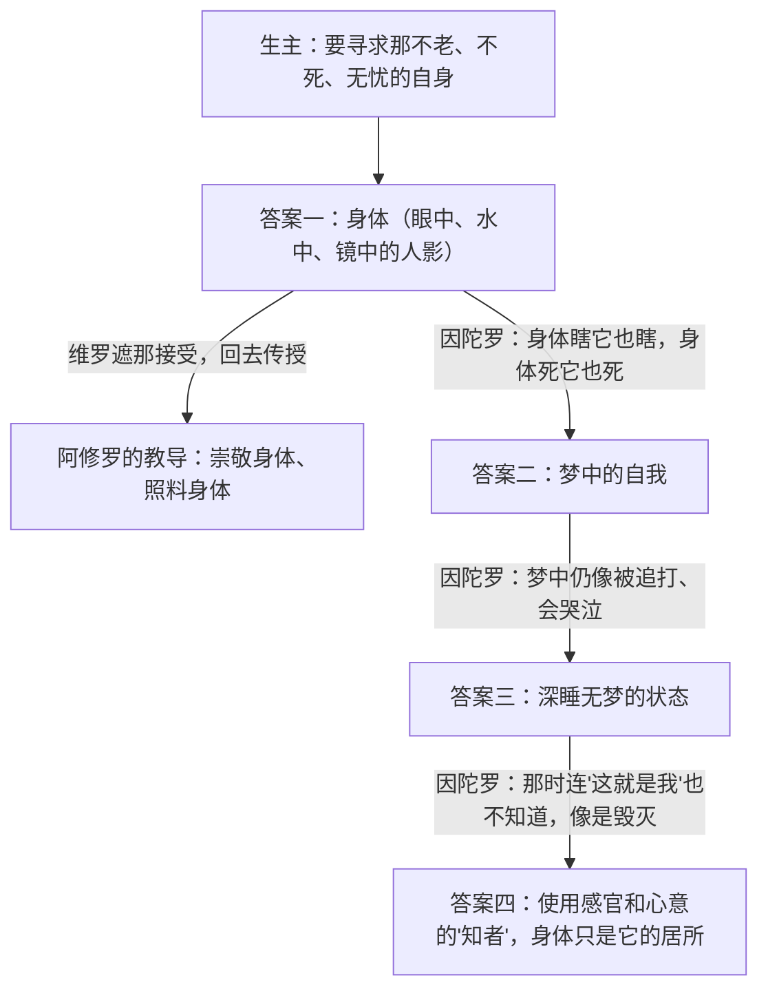
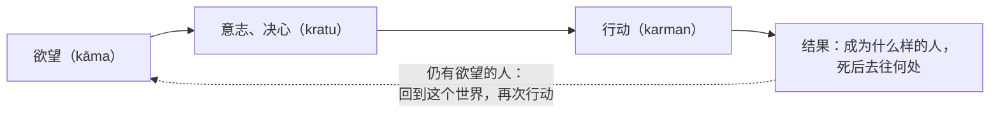
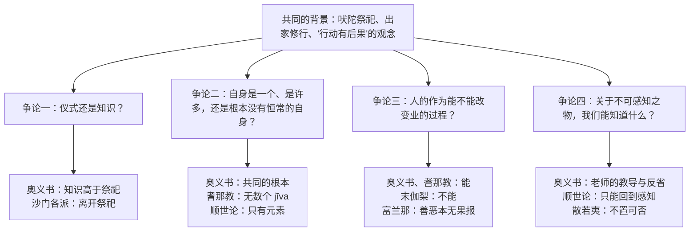

# IN1　印度哲学的起源与早期思想争论：自我、宇宙与解脱

*Origins and Early Debates: Vedic Thought, Upaniṣads and the Śramaṇa Schools*

> **状态：Phase 5B 课程稿（DRAFT），第二稿，尚未经印度学专家审读。** 第二稿在第一稿基础上作了有针对性的学术修订：区分早期唯物论、顺世论学派和论敌的重建；限定耆那教各阶段学说的归属；改用"阿耆维迦派"的译名；把没有学者出处的几种解读改写为可能的读法；补充电子文本的权利说明。此后又在第六部分之后增补了《后世批判与回应》一部分。核对范围与未核对事项见文末《来源与权利说明》。

---

## 本章导读：一个"我"，一个世界，一条出路

设想一位公元前一千年代中叶的年轻人，生活在恒河流域。他从小背诵祖传的颂诗，看过父辈花几天时间筹备一场祭祀：火坛按尺寸砌好，祭品依次投入火中，祭司一句不错地唱出古老的诗句。人们相信，这样做能让雨水按时到来，让牛群兴旺，让家族在死后也有归宿。

可是，这位年轻人可能也听说了另一些人。他们离开家，不再参加祭祀，在森林边或城镇附近游走、乞食、静坐。有人说，真正重要的不是祭祀，而是认识"自我"；有人说，人的每一个行动都会留下后果，这些后果会把人带到下一次出生；有人说，一切早已注定，努力毫无用处；还有人说，人死了就像火灭了，所谓来世、业报，都是骗人的话。

这一章要读的，就是这些声音。它的核心问题是：**"我"究竟是什么？世界的根基是什么？人的行动会带来什么后果，人能不能从这些后果中解脱出来？我们又凭什么知道这些问题的答案？**

这些问题后来成为印度哲学几乎所有学派共同的起点。可是请先记住：本章讲的不是一个统一的"印度哲学"，也不是"印度教哲学"的早期版本。它讲的是一千年左右的时间里，几种来源不同、彼此竞争、常常互相攻击的思想：

- **吠陀**中的颂诗和祭祀文献，以及从中发展出来的**奥义书**的探问；
- 一批被称为**沙门**（śramaṇa，意为"努力者、苦行者"）的出家修行者的学说，其中本章重点介绍**耆那教**，以及**阿耆维迦派**（Ājīvika）和**顺世论**（Lokāyata，又称 Cārvāka）这两个只留下零星材料的派别。

佛教也是沙门运动的一部分，而且是其中最重要的一支。但佛陀的学说是下一章《早期佛教与阿毗达磨》的主题。本章只交代佛陀出现时的思想背景，不讲佛教本身的学说。

### 读这一章的几点提醒

第一，**文本不是一时一地写成的。** 吠陀文献是在几百年间口头创作、口头传承下来的，后来才写成文字。同一部奥义书里，可能有年代和来源都不相同的段落。本章给出的年代都是学界常用的大致估计，有的误差可能达到一两百年。正文写"大约"、"通常认为"的地方，就是这个意思。

第二，**术语不能直接对译。** 本章最常出现的词是 ātman。它常被译成"自我"或"灵魂"，但这两个中文词都会把读者引向错误的方向："自我"让人想到现代心理学所说的个性、人格和自我意识，"灵魂"让人想到某些宗教中由神创造、死后受审判的个体灵魂。ātman 在梵文里本来是一个反身代词，意思接近"自身"，在不同的文本里，它可以指身体、呼吸、生命力、意识，或者世界的根本。本章一律保留 ātman 原文，必要时写作"自我（ātman）"，读的时候请把它当作一个有待弄清的问题，而不是一个已知的答案。另一个关键词 brahman（梵）也一样：在奥义书里，它常指世界的根基或终极实在，但它不是一位有人格、会听人祈祷的神，也不等于后来吠檀多派的系统学说。

第三，**材料常常来自对手。** 阿耆维迦派和顺世论自己的著作几乎全部失传，我们知道的，大多是佛教徒、耆那教徒或婆罗门学者在批驳他们时转述的话。这就像只凭一个人的论敌写的书去了解他。本章会尽量说清每一条材料出自谁的手，转述者有什么立场，以及我们因此能知道多少、不能知道多少。

第四，**比较不等于影响。** 读者会在本章看到很多相似之处：奥义书和耆那教都谈"业"，顺世论和古希腊的原子论者都把世界归结为物质元素。相似的想法可能出于共同的背景，也可能是各自独立形成的。除非有文献证据，本章不说"甲影响了乙"。同样，本章也不用后来的学派（例如八世纪的商羯罗所建立的不二论吠檀多）去"回头解读"早期文本，而是会说明后来的解读是怎样形成的。

第五，**原文、译文和引用方式。** 梵文引文据哥廷根大学梵文电子文本库 GRETIL 所收的电子本，巴利文引文据 SuttaCentral 的巴利三藏电子版；这些电子本的来历和使用条件，见文末《来源与权利说明》。正文中引文后的出处只写书名和章节号（例如《歌者奥义书》6.8.7），版本说明和学术文献的出处放在文末带编号的注释里。所有中文译文都是本章自己从原文试译的，只求帮助理解，不是权威译本。为了不复制受版权保护的现代译本，本章没有转录任何已出版中文或英文译本的译文。

第六，**人名和书名的译法。** 这一时期的人名、书名在中文里有多种译法：佛经的古译（如"阿耆多翅舍钦婆罗"）、近代学者的音译和意译各不相同。本章在第一次出现时给出梵文或巴利文原名，中文译法只是常见的选择之一。

第七，文中有几处"想一想"，每一处有几道选择题。请先自己想清楚、作出选择，看过反馈和解析再往下读。有些题目没有标准答案，那是因为学者们自己也还在争论。

---

## 一、祭祀与宇宙：吠陀世界的问题

### 吠陀不是一本书

"吠陀"（veda）一词的原意是"知识"。它指的不是某一本书，而是一大批文献，传统上分为四部：《梨俱吠陀》（Ṛgveda，颂诗）、《娑摩吠陀》（Sāmaveda，歌咏）、《夜柔吠陀》（Yajurveda，祭祀程式）和《阿闼婆吠陀》（Atharvaveda，咒语和仪式）。每一部又包括几个层次：最早的是**本集**（saṃhitā），主要是颂诗和祭祀用语；然后是**梵书**（brāhmaṇa），用散文解释祭祀的意义和做法；再后是**森林书**（āraṇyaka）和**奥义书**（upaniṣad），它们仍然以祭祀为背景，但越来越关心祭祀背后的意义，有些段落已经离开祭祀，转向对生死、身体和实在的追问。[^1]

这几个层次大致有先后，但不是整齐地一层压一层。学者通常认为《梨俱吠陀》的大部分颂诗形成于公元前第二千年后期，最古老的几部散文奥义书（包括本章细读的《大森林奥义书》和《歌者奥义书》）大约形成于公元前七至五世纪之间，早于或部分同时于佛陀和大雄的时代。这些年代都是根据语言变化、文献之间的相互引用和地理信息推断的，没有一个是确切的。[^2]

还有一点很重要：这些文献在很长时间里只靠口头传承。祭司家族一代一代地背诵，背诵的精确程度令人惊叹，但这并不意味着文本从一开始就是完整固定的。我们今天读到的奥义书，可能是不同时期、不同学派的材料编在一起的结果。因此，"吠陀思想"不是一个统一的体系，正如"先秦思想"也不是。

### 祭祀为什么重要：一个"对应"的世界

要理解奥义书在问什么，得先理解它们从哪里出发。吠陀祭祀不只是向神献礼。在梵书的解释里，祭祀是一套精确的技术：祭坛的形状、祭品的种类、诗句的音节，都和宇宙的某个部分相对应。祭司知道这些对应关系，按规矩操作，就能影响宇宙的运行。

学者把这种对应关系称为 bandhu（"联系、亲缘"）：祭祀中的东西、祭主的身体和宇宙的各部分之间，有一种隐秘的等同。[^3] 《大森林奥义书》开篇就是一个例子。它谈的是马祭（aśvamedha），一种只有国王才能举办的盛大祭祀：

> uṣā vā aśvasya medhyasya śiraḥ | sūryaś cakṣur vātaḥ prāṇo …（《大森林奥义书》1.1.1）[^4]
>
> 本章试译：黎明，确实就是祭马的头；太阳是它的眼睛，风是它的呼吸……

这段话接着把马的背、腹、四肢一一对应到天空、空中、大地、季节和月份。今天的读者可能觉得这只是诗意的比喻，但在当时的祭祀思想里，它是一种知识：懂得马和宇宙的对应，就懂得了宇宙的结构，甚至能借助祭祀掌握它。

这里已经出现了一个后来贯穿全章的想法：**知道对应关系的人，和不知道的人，结果不一样。** 奥义书中反复出现一句话，ya evaṃ veda，"知道这样的人"。这句话本来属于祭祀知识：知道祭祀的意义，祭祀才有效。到了奥义书里，"知道"本身越来越重要，最后甚至被认为比祭祀行动更重要。第二节会看到这一转变。

**一个教学比方，以及它的限度。** 可以把祭祀想成一台精密的仪器：按说明书一步步操作，就能得到预期的结果；说明书背后有一套原理，懂原理的人比只会照做的人更能掌握这台仪器。这个比方抓住了梵书思想中"技术"和"知识"两个方面，但它也会误导：吠陀祭祀并不是一种冷冰冰的机械操作，它离不开神、诗歌、社会身份和对神圣力量的敬畏；而且"原理"在这里不是可以用实验检验的自然规律，而是祭司传统所传授的对应关系。

### 《原人歌》：一个身体，一个社会

《梨俱吠陀》第十卷是全书中较晚的一卷，其中有几首颂诗已经在追问世界的来源。第一首是著名的《原人歌》（Puruṣasūkta，《梨俱吠陀》10.90）。它讲述众神以一个巨大的"原人"（puruṣa，人、宇宙巨人）作为祭品举行祭祀，从原人身体的各部分生出了世界的各部分：月亮、太阳、天空、大地，以及人类社会的四个等级。

> yat puruṣaṃ vy adadhuḥ katidhā vy akalpayan | mukhaṃ kim asya kau bāhū kā ūrū pādā ucyete ||
>
> brāhmaṇo 'sya mukham āsīd bāhū rājanyaḥ kṛtaḥ | ūrū tad asya yad vaiśyaḥ padbhyāṃ śūdro ajāyata ||（《梨俱吠陀》10.90.11—12）[^5]
>
> 本章试译：当他们分解原人时，把他分成了多少份？他的嘴是什么？两臂是什么？两腿、两脚叫作什么？
>
> 婆罗门是他的嘴，两臂成了王族（rājanya），他的两腿就是吠舍，从两脚生出了首陀罗。

这首颂诗有两点哲学上的意义。

第一，它用**祭祀**来解释**起源**：世界不是凭空出现的，而是从一场原初的祭祀中分化出来的。人间的祭祀，就是对这场原初祭祀的重演。这是梵书"对应"思想的一个源头。

第二，它把**社会等级**写进了宇宙的结构。婆罗门、王族、吠舍、首陀罗四个等级（varṇa，通常译作"种姓"），被说成是同一个身体的不同部分，有高有低，各有职能。这段诗后来常被用来为社会等级辩护。也正因为如此，本章后面要介绍的沙门派别，包括耆那教和佛教，对婆罗门的特权提出过尖锐的质疑。

需要提醒的是：这首颂诗属于《梨俱吠陀》较晚的部分，不能代表整部《梨俱吠陀》的社会观；而"种姓制度"作为一套复杂的社会制度，是在之后很长时间里逐渐形成的，不能简单地说它"来自"这一首诗。这首诗是一种意识形态的表达，我们不能把它当作当时社会实际状况的记录。

### 《有无歌》：在起源处提问

《原人歌》讲的是一个有确定情节的故事。同在第十卷，另一首颂诗的语气却完全不同。它通常被称为《有无歌》（Nāsadīyasūkta，《梨俱吠陀》10.129），得名于它的头两个词 nāsad āsīt，"那时没有'无'"：

> nāsad āsīn no sad āsīt tadānīṃ nāsīd rajo no vyomā paro yat |
> kim āvarīvaḥ kuha kasya śarmann ambhaḥ kim āsīd gahanaṃ gabhīram ||（《梨俱吠陀》10.129.1）[^6]
>
> 本章试译：那时，既没有"无"，也没有"有"；没有空域，也没有空域之外的天。是什么在翻动？在哪里？在谁的庇护之下？是水吗，那深不可测的水？

颂诗接着描写了一种连死与不死、昼与夜都还没有分开的状态，只有"那一个"（tad ekam）靠自身的力量呼吸。然后，从热力（tapas）中生出了"那一个"，最初出现的是欲望（kāma），"心意的最初种子"。诗人们说，智者"在心中探求，在无中找到了有的联系"。

可是，颂诗的最后两节忽然转向了怀疑：

> ko addhā veda ka iha pra vocat kuta ājātā kuta iyaṃ visṛṣṭiḥ |
> arvāg devā asya visarjanenāthā ko veda yata ābabhūva ||
>
> iyaṃ visṛṣṭir yata ābabhūva yadi vā dadhe yadi vā na |
> yo asyādhyakṣaḥ parame vyoman so aṅga veda yadi vā na veda ||（《梨俱吠陀》10.129.6—7）
>
> 本章试译：谁真正知道？谁能在这里宣说？它从哪里生出，这个创造从哪里来？众神是在这个世界被创造之后才出现的。那么，谁知道它从哪里来？
>
> 这个创造从哪里来，是它自己造成的，还是不是？那在最高天上俯视它的，他也许知道，也许他也不知道。

**字面意思与哲学意义。** 这里有三个层次的追问。第一，"有"和"无"这样的概念，能不能用于万物出现之前？如果说"那时什么都没有"，"没有"本身好像也成了一种状态。所以诗人说，那时连"无"也没有。第二，谁能知道起源？众神不能，因为他们本身是被创造的，比世界出现得晚。第三，就连那位"最高天上的监视者"也可能不知道。这最后一句是整首诗的转折：诗人没有用一位全知的神来结束问题，而是把问题留在那里。

**几种可能的读法。** 这首诗至少可以有三种读法。下面是本章整理的三种可能，不是对某几位学者观点的转述。第一种，把它读成一种早期的哲学怀疑：在人类知识的边界上，诚实的回答是"不知道"。第二种，把它和吠陀中关于神圣知识的问答竞赛（brahmodya，见第六节）联系起来读：提问本身可能是一种仪式化的表演，不一定意味着诗人真的怀疑。第三种，强调它描述的"那一个"靠自身呼吸、由热力和欲望而生，把它读成一种从混沌到有序的宇宙生成论，最后两节的疑问是谦逊的修辞，而不是对整个生成论的否定。[^7] 本章不在这几种读法中作出裁决。不过，无论采取哪一种，这首诗都表明：在吠陀传统内部，已经有人意识到关于起源的知识可能没有可靠的来源。这个"我们凭什么知道"的问题，到第五节的顺世论那里，会变成一个尖锐的哲学挑战。

### 从"做什么"到"知道什么"

把这一节放在一起看，可以整理出吠陀世界留给奥义书的三个问题。下表是本章为了教学做的整理，不是吠陀文献自己的分类：

| 吠陀文献中的做法 | 留下的问题 | 奥义书怎样接过这个问题 |
|---|---|---|
| 祭祀与宇宙相对应，正确操作带来好结果 | 祭祀之所以有效，靠的是行动，还是靠对对应关系的知识？ | 越来越强调"知道"，有时把知识放在祭祀之上 |
| 用原人、"那一个"等解释世界的起源 | 万物有没有一个共同的根基？它是什么？ | 追问"有"（sat）、梵（brahman）、自我（ātman） |
| 《有无歌》的怀疑：谁能知道？ | 关于终极问题的知识从哪里来？ | 老师与学生的对话、辩论，以及对"认识者本身"的反省 |

这张表有一个简化：它让人觉得思想是沿着一条直线"进步"的，从祭祀走向哲学。实际情况更复杂。奥义书并没有抛弃祭祀，很多段落仍然在解释祭祀；而在奥义书之后，祭祀传统也没有消失，后来的弥曼差派（Mīmāṃsā）还专门为祭祀的权威作哲学辩护。所以，更准确的说法是：奥义书在祭祀传统**内部**开辟了一个新的问题方向。

> **想一想（一）：祭祀、起源与知识。** 请判断《有无歌》最后一节对"知识"提出了什么问题；再想一想，"知道这样的人"一语为什么能把祭祀和后来的哲学追问连接起来。
>
> 提示：先区分《有无歌》问的是"世界是怎样开始的"还是"谁能知道世界是怎样开始的"。两者不同：前者是宇宙论问题，后者是知识论问题。

---

## 二、奥义书的探问：从一块泥土到"认识者"

### "奥义书"这个词

"奥义书"（upaniṣad）一词，常被解释为"坐在（老师）近旁"，即师徒之间秘密传授的教导。这个解释来自对词的拆分（upa-ni-ṣad），但学者指出，在最早的文本里，这个词并不是这样用的。它更常见的意思接近前面讲过的 bandhu：事物之间隐秘的、最根本的联系，因而也指揭示这种联系的"秘传教导"。[^8] 奥义书反复强调，这种知识不能随便传授，要在合适的老师和合适的学生之间传递。

本章细读的两部奥义书是《大森林奥义书》（Bṛhadāraṇyaka Upaniṣad）和《歌者奥义书》（Chāndogya Upaniṣad，属于《娑摩吠陀》的歌者传统）。它们通常被认为是现存最早的两部奥义书，篇幅也最长。两部书都不是一位作者的系统论著，而是由许多独立的段落组成：创世故事、对祭祀的解释、师徒谱系、对话和辩论。书中的老师各有各的教导，有时互相矛盾。所以，说"奥义书认为……"往往是不准确的，更好的说法是"某部奥义书中的某位老师认为……"。[^9]

下面我们读四组对话。它们都在问"自我（ātman）是什么"，但问法和答案并不一样。

### 乌达拉迦与白净：从一块泥土开始

《歌者奥义书》第六章是一位父亲给儿子上的一课。父亲叫乌达拉迦·阿鲁尼（Uddālaka Āruṇi），是奥义书中最常出现的婆罗门老师之一；儿子叫白净（Śvetaketu，音译"室维多凯杜"）。

故事开头，白净被父亲送去拜师学习吠陀。他十二岁拜师，二十四岁学完所有吠陀回到家，自以为很有学问，态度傲慢（6.1.1—2）。父亲问了他一个问题：

> śvetaketo yan nu somyedaṃ mahāmanā anūcānamānī stabdho 'si | uta tam ādeśam aprākṣyaḥ yenāśrutaṃ śrutaṃ bhavaty amataṃ matam avijñātaṃ vijñātam iti |（《歌者奥义书》6.1.3）[^10]
>
> 本章试译：白净啊，亲爱的，你现在这样心高气傲，自以为学问渊博，态度倨傲。那么，你有没有问过那一种教导：靠着它，没听过的成了听过的，没想过的成了想过的，没认识的成了认识的？

白净问这是什么样的教导。于是父亲举了三个例子：

> yathā somyaikena mṛtpiṇḍena sarvaṃ mṛnmayaṃ vijñātaṃ syāt | vācārambhaṇaṃ vikāro nāmadheyaṃ mṛttikety eva satyam ||（《歌者奥义书》6.1.4）
>
> 本章试译：亲爱的，正如凭一块泥土，一切泥做的东西都可以被认识：变化（vikāra）只是言语的把握，只是名称；"泥土"才是真实的。

接下来两个例子结构相同：凭一块铜，一切铜器都可以被认识；凭一把指甲刀，一切铁器都可以被认识（6.1.5—6）。

**字面意思。** 罐子、碗、灯盏，各有各的形状、名称和用途，但它们都是泥土做的。认识了泥土，就在某种意义上认识了一切泥器。形状和名称只是"言语的把握"（vācārambhaṇa，这个复合词很难译，字面上大约是"凭言语抓住的东西"，学者的理解也不一致），而泥土本身才是 satya（真实、实在）。

**论证重构。** 这段话的论证可以整理如下。这是本章的整理，不是原文的形式：

1. 许多不同的东西（罐、碗、灯盏）由同一种材料（泥土）构成。
2. 它们之间的差别，只在于形状和名称。
3. 形状和名称依赖于我们的言语和使用；材料则不依赖于此。
4. 所以，认识了材料，就认识了这些东西中真实的部分。
5. （类推）如果整个世界也由某种根本的东西构成，那么认识了它，就认识了世界中一切真实的部分。

前四步说的是泥土；第五步是关键的类推。乌达拉迦接着就给出了那个"根本的东西"：

> sad eva somyedam agra āsīd ekam evādvitīyam | tad dhaika āhur asad evedam agra āsīd ekam evādvitīyam | tasmād asataḥ saj jāyata ||
>
> kutas tu khalu somyaivaṃ syād iti hovāca | katham asataḥ saj jāyeta | sat tv eva somyedam agra āsīd ekam evādvitīyam ||（《歌者奥义书》6.2.1—2）
>
> 本章试译：亲爱的，起初，这个世界就是"有"（sat），唯一，没有第二个。有些人说：起初，这个世界是"无"（asat），唯一，没有第二个；于是从"无"生出了"有"。
>
> 可是，亲爱的，这怎么可能呢？他说。"有"怎么能从"无"中生出来？不，亲爱的，起初，这个世界就是"有"，唯一，没有第二个。

这是早期奥义书中少有的一段明确的反驳。乌达拉迦先引述对手的观点（"有些人说"），再用一个反问驳倒它：从无中不能生出有。读者也许会在古希腊的巴门尼德那里看到相似的说法。但相似不等于影响，本章没有证据说明两者有任何联系。另外请注意，"有些人"是谁，原文没有说；我们不能把它和某个已知的学派对上号。

乌达拉迦接着讲，"有"想到"愿我变多，愿我繁衍"，于是生出了火（tejas），火生出水，水生出食物（6.2.3 以下）。世界是从"有"中一步步分化出来的。学者常指出，后来一些学派（如数论派）发展出"结果已经存在于原因之中"的系统因果理论，乌达拉迦的说法常被看作这种思路的先声；但这是后来的发展，乌达拉迦本人并没有提出一套因果理论。[^11]

### 种子与盐水：看不见，却无处不在

乌达拉迦的教导接下来转向了生命和人。在第六章的后半部分，他让儿子做了两个小实验。

第一个实验：父亲让儿子取来一颗榕树（nyagrodha）的果实，剖开。"你看见什么？""一些很细小的种子。""剖开其中一颗。""剖开了。""你看见什么？""什么也看不见。"父亲说：正是从这个你看不见的细微之物（aṇiman）中，这棵大榕树才得以挺立。"要相信，亲爱的。"（《歌者奥义书》6.12.1—2）

第二个实验更有名：

> lavaṇam etad udake 'vadhāyātha mā prātar upasīdathā iti | sa ha tathā cakāra | taṃ hovāca | yad doṣā lavaṇam udake 'vādhā aṅga tad āhareti | tad dhāvamṛśya na viveda ||（《歌者奥义书》6.13.1）
>
> 本章试译："把这些盐放进水里，明天早上再来见我。"他照做了。父亲对他说："你昨晚放进水里的盐，去拿来吧。"他摸了摸，没有找到。

父亲让他从水的表面、中间和底部各尝一口。每一处都是咸的。父亲说："你在这里看不见它，可它确实就在这里。"（6.13.2）然后是本章最著名的一句话：

> sa ya eṣo 'ṇimaitad ātmyam idaṃ sarvam | tat satyam | sa ātmā | tat tvam asi śvetaketo iti ||（《歌者奥义书》6.13.3）
>
> 本章试译：这个最细微的东西，整个世界都以它为自身（ātman）。它是真实的。它就是自身（ātman）。那就是你，白净。

这句话在第六章第八至十六节中共出现九次，几乎每一个例子之后都重复一次（例如 6.8.7、6.12.3、6.13.3）。

**字面意思与翻译的困难。** tat tvam asi 三个词的字面意思是"那（tat）你（tvam）是（asi）"，即"那就是你"或"你就是那"。aitad ātmyam 的意思大约是"以此为其自身"，即整个世界的"自身"或本质就是这个细微之物。这里的 ātman 不是"你的个性"或"你的心理"，而更接近"使一个东西成为它自己的那个内在本质"。

**它在说什么？** 至少有三种读法。

- **同一性读法：** "那"（世界的细微本质）和"你"（白净的真正自身）是同一个东西。八世纪的商羯罗把这句话当作 ātman 与 brahman 同一的重要证据，并在此基础上发展出不二论吠檀多（Advaita Vedānta）。
- **本质读法：** 这句话说的是，你的本质和世界的本质是同一种细微之物，就像不同的泥器有相同的材料。这种读法不要求"你"和"世界"在数目上完全同一，只要求它们有共同的本质。
- **生命力读法：** 有学者强调，乌达拉迦的例子（种子、盐水，以及第六章中的蜂蜜、河流、树木）大多和生命有关，他所说的细微之物更像是贯穿一切生命的"生命精髓"，而不是一个抽象的形而上学实体。

值得注意的一个事实是：乌达拉迦在这段教导中**从来没有用过 brahman（梵）这个词**。学者布莱恩·布莱克（Brian Black）指出，乌达拉迦在奥义书中多次出现，却从未把 ātman 等同于 brahman；把 tat tvam asi 读成 ātman 与 brahman 的同一，是后来商羯罗的解读。[^12] 这并不是说商羯罗的解读一定错了，而是说：如果我们想知道这段文本本身说了什么，就不能直接把后来的体系读进去。

**乌达拉迦的方法及其缺口。** 从方法上看，乌达拉迦用可以观察的东西（泥土、种子、盐水）类推看不见的东西。盐水实验尤其巧妙：盐"看不见"但"尝得到"，说明"看不见"不等于"不存在"。可是这个类推有一个缺口：盐可以用另一种感官（味觉）检验，而乌达拉迦所说的细微本质，却没有任何感官可以直接检验它。所以，类推最多表明"看不见的东西可能存在"，而不能证明"这个看不见的东西存在，而且就是你"。父亲在榕树一段最后说"要相信"（śraddhatsva），或许表明类推在这里需要信任来补足。这是本章的一个分析，不是文本自己的说法。

**一个教学比方，以及它的限度。** 现代读者也许会想到：不同的物体都由相同的原子构成。这个比方能帮助理解"多种多样的东西有共同的构成"这一思路，但它在两个地方会误导。第一，原子论说的是物质的构成，而乌达拉迦的"有"首先是使事物成为它自己的"本质"，不是一堆微小的颗粒。第二，原子论不会说"那就是你"，它不认为认识原子能改变一个人；而在奥义书里，这种知识是要改变认识者本人的。

### 耶若婆佉与弥勒依：为什么一切是"可爱的"？

《大森林奥义书》的主角是另一位老师：耶若婆佉（Yājñavalkya）。他在书中以辩才出众、性格鲜明著称。书中有两段大体相同的对话（2.4 和 4.5），讲他决定离家时与妻子弥勒依（Maitreyī）的谈话。两个版本并存，本身就说明这部书是由不同的传本编成的。在第二个版本的开头，书中介绍说，耶若婆佉有两位妻子，"其中弥勒依是谈论梵的人（brahmavādinī），而迦旃延尼（Kātyāyanī）那时只有女人的见识"（4.5.1）。这句话既把弥勒依写成一位哲学对话者，也带着明显的性别偏见。

对话是这样开始的：

> maitreyīti hovāca yājñavalkyaḥ -- udyāsyan vā are 'ham asmāt sthānād asmi | hanta te 'nayā kātyāyanyāntaṃ karavāṇīti ||
>
> sā hovāca maitreyī -- yan nu ma iyaṃ bhagoḥ sarvā pṛthivī vittena pūrṇā syāt kathaṃ tenāmṛtā syām iti | neti hovāca yājñavalkyaḥ | yathaivopakaraṇavatāṃ jīvitaṃ tathaiva te jīvitaṃ syāt | amṛtatvasya tu nāśāsti vitteneti ||（《大森林奥义书》2.4.1—2）[^13]
>
> 本章试译："弥勒依！"耶若婆佉说，"我要离开这个地方了。来，让我在你和迦旃延尼之间把事情了结。"
>
> 弥勒依说："尊者，假如这整个大地连同它所有的财富都属于我，我会因此不死吗？""不会，"耶若婆佉说，"你的生活会像那些家资丰厚的人一样。可是，靠财富，没有希望得到不死。"

弥勒依接着说："不能让我不死的东西，我要它做什么？请把您所知道的告诉我吧。"（2.4.3）这句话是整段对话的哲学起点：她拒绝了财产，提出了一个更根本的问题。

耶若婆佉的回答，是一段一再重复的句子：

> na vā are patyuḥ kāmāya patiḥ priyo bhavaty ātmanas tu kāmāya patiḥ priyo bhavati | … na vā are sarvasya kāmāya sarvaṃ priyaṃ bhavaty ātmanas tu kāmāya sarvaṃ priyaṃ bhavati | ātmā vā are draṣṭavyaḥ śrotavyo mantavyo nididhyāsitavyo maitreyi |（《大森林奥义书》2.4.5）
>
> 本章试译：啊，丈夫之所以可爱，不是因为对丈夫的欲求，而是因为对自身（ātman）的欲求……啊，一切之所以可爱，不是因为对一切的欲求，而是因为对自身的欲求。弥勒依啊，应当看见、听闻、思考、沉思的，是自身。

在"丈夫"和"一切"之间，原文依次列举了妻子、儿子、财富、婆罗门身份、王族身份、诸世界、众神和众生，结构完全相同。

**这句话是在劝人自私吗？** 初读时，很多人会觉得耶若婆佉在说："你爱丈夫，其实是爱你自己。"这听起来像一种心理学上的自私论。但这样读，会把 ātman 误解成现代意义上的"我自己"。另一种读法是：这里的 ātman 不是个人的私我，而是使一切成为可爱的那个根本的东西；一切事物之所以可爱，是因为它们都以 ātman 为根基，所以真正值得追求的不是一件件可爱的东西，而是它们共同的根基。这也解释了为什么下一句立即转到"应当看见、听闻、思考、沉思的，是自身"：要得到不死，就要认识这个根基，而不是占有更多的东西。紧接着的一段（2.4.6）也支持这个读法：谁把婆罗门身份、王族身份、众神、众生看作在自身之外的东西，这些东西就会抛弃他；"这一切，就是这个自身"。

不过，"自私论"的读法也不是完全没有根据：原文用的确实是"为了对自身的欲求"（ātmanas kāmāya）这样的说法。所以，这段话有一种双关：它从人人熟悉的经验（人总是因为某种"为了自己"的理由而爱）出发，再把"自身"的意思推向更深的层次。这种从熟悉的意思推向陌生意思的写法，在奥义书里很常见。

### 认识者能被认识吗？

对话的最后一部分，是哲学上最深的一段。耶若婆佉先用盐来作比喻（和乌达拉迦用的是同一个意象，但用法不同）：一块盐投入水中就溶解了，再也捞不出来，但无论从哪里取水，都是咸的；同样，这个伟大的存在无边无际，是一团纯粹的认识（vijñānaghana）。它从这些元素中升起，又随它们消失。然后他说："死后就没有意识（saṃjñā）了。"（2.4.12）

弥勒依说："尊者说死后没有意识，正是在这里让我迷惑了。"耶若婆佉回答：

> na vā are 'haṃ mohaṃ bravīmi | alaṃ vā ara idaṃ vijñānāya ||
>
> yatra hi dvaitam iva bhavati tad itara itaraṃ jighrati tad itara itaraṃ paśyati … tad itara itaraṃ vijānāti | yatra vāsya sarvam ātmaivābhūt tat kena kaṃ jighret … tat kena kaṃ paśyet … tat kena kaṃ vijānīyāt | yenedaṃ sarvaṃ vijānāti taṃ kena vijānīyāt | vijñātāram are kena vijānīyād iti ||（《大森林奥义书》2.4.13—14）[^14]
>
> 本章试译：啊，我说的并不让人迷惑。这已经足以让人明白了。
>
> 因为，在仿佛有二元的地方，一个嗅另一个，一个看另一个……一个认识另一个。可是，当对他来说一切都成了自身的时候，他凭什么去嗅谁？……凭什么去看谁？……凭什么去认识谁？凭着它，人认识这一切，那么，又凭什么去认识它呢？啊，凭什么去认识那认识者呢？

**论证重构。** 这段话可以整理成一个论证。这仍然是本章的整理：

1. 一般的认识，都需要"认识者"和"被认识者"两方面：一个看，一个被看。
2. 我们所说的"意识"（saṃjñā），就是这种一方对另一方的认识。
3. 如果一切都成了自身（ātman），就没有"另一方"了。
4. 所以，在那种状态中，没有一般意义上的意识，也就是说，"死后没有意识"。
5. 而且，认识者本身不能被认识：一切认识都要通过它进行，它就不可能成为认识的对象。

第 5 步是整段话的核心。它指出了一个非常普遍的困难：每当我们试图认识"认识者"时，我们所抓到的，已经是一个被认识的对象，而那个正在认识的东西又退到了后面。读者可以自己试一试：试着去"看见"你正在看的那个"看"。

**一个教学比方，以及它的限度。** 可以想一想照相机：它能拍下一切摆在镜头前的东西，却拍不到正在拍摄的那个镜头本身。用镜子把镜头照出来也不行，照片上的只是镜头的像，而不是正在拍这张照片的那个"拍"。这个比方能帮助理解"认识的条件不能成为认识的对象"。但它也会误导：照相机是一个物体，原则上可以被另一台照相机拍到；而耶若婆佉所说的认识者，按他的说法，任何认识都不能把它当作对象。

在对话的第二个版本中，"凭什么去认识那认识者"之后接着有这样一段（同样的说法也见于 3.9.26 等处）：

> sa eṣa neti nety ātmā | agṛhyo na hi gṛhyate | aśīryo na hi śīryate | asaṅgo na hi sajyate | asito na vyathate na riṣyati |（《大森林奥义书》4.5.15）
>
> 本章试译：这个自身，只能说"不是这样，不是这样"（neti neti）。它不可把握，因为它不被把握；它不可毁坏，因为它不被毁坏；它不粘附，因为它不附着于任何东西；它不受束缚，不会动摇，不受伤害。

**几个问题。** 这段话常被看作印度思想中"否定式描述"的一个重要源头：既然自身不能成为对象，任何正面的描述都会把它变成对象，所以只能说它"不是"什么。但这里也有几个值得追问的问题：

- 如果认识者不能被认识，耶若婆佉又凭什么知道它存在，还能对弥勒依说出这么多关于它的话？一种可能的回答是：他说的大多是否定的话。另一种回答是：这里的"认识"指的是把某物当作对象的认识，而对自身的知道是另一种方式的知道。哪一种回答成功，是一个开放的问题。
- "死后没有意识"是什么意思？是说解脱者死后彻底消失了，还是说他进入了一种没有主客对立的状态？弥勒依的困惑是完全合理的，而耶若婆佉的回答只说那种状态里没有"另一方"，并没有直接回答"那时还有没有什么"。

### 伽尔吉的追问："那么，它又织在什么上面？"

《大森林奥义书》第三章记载了一场在毗提诃国王遮那迦（Janaka）宫廷中的辩论。遮那迦举行了一场布施丰厚的祭祀，俱卢和般遮罗地区的婆罗门都聚集在那里。国王想知道谁是其中学问最深的人，就圈了一千头牛，每头牛的两角上各系着十个"巴陀"（pāda，一种金子的计量单位）。他宣布：最懂梵的人可以把牛赶走。别人都不敢动，耶若婆佉却让自己的学生把牛赶回家。其余的婆罗门大怒，于是一个接一个地向他发问（《大森林奥义书》3.1.1—2）。

这段叙述告诉我们，奥义书中的哲学不是在书斋里产生的。它是在国王的赞助之下、当着众人的面进行的公开竞赛，胜负关系到名声和财富。被问到"你真是我们之中最懂梵的人吗"时，耶若婆佉回答："我们向最懂梵的人致敬。我们只是想要这些牛罢了。"（3.1.2）

在挑战者中，有一位女性：伽尔吉·瓦恰揆维（Gārgī Vācaknavī）。她两次发问。第一次（3.6.1），她问的是一个层层递进的问题："这一切都纵横交织（otaṃ ca protaṃ ca，像织物的经线和纬线）在水上，那么水又织在什么上面？"耶若婆佉回答：风。"风又织在什么上面？"……她一路追问下去，从风到空中世界、乾闼婆世界、太阳世界、月亮世界、星宿世界、众神世界、因陀罗世界、生主世界，一直问到梵的世界。这时，耶若婆佉打断了她：

> gārgi mātiprākṣīḥ | mā te mūrdhā vyapaptat | anatipraśnyāṃ vai devatām atipṛcchasi | gārgi mātiprākṣīr iti | tato ha gārgī vācaknavy upararāma ||（《大森林奥义书》3.6.1）[^15]
>
> 本章试译："伽尔吉，别问得太过了，免得你的头掉下来！你是在追问一个不容再追问的神格。伽尔吉，别问得太过了。"于是，伽尔吉·瓦恰揆维沉默了。

**这里发生了什么？** 伽尔吉的问题有一个哲学上非常重要的结构：如果每一层都需要一个更深的根基，追问就会没有尽头。要么它在某处停下，要么它无穷后退。耶若婆佉的回答，是用一种警告（"你的头会掉下来"）来制止追问。这种说法在奥义书的辩论里多次出现，似乎是辩论中的一种诅咒或赌注。在第三章稍后，一位名叫夏迦利耶（Śākalya）的挑战者没能回答耶若婆佉的问题，书中就说他的头真的掉了下来（3.9.26）。

对这一段，可以有两种很不同的读法。下面两种是本章为讨论而整理的可能读法，不是对具体学者观点的转述。一种读法是，耶若婆佉指出的是一条原则：对根基的追问必须在某处停下，最终的根基不能再用"它在什么之上"来追问，因为它不是一个"在别的东西之上"的东西。另一种读法是，耶若婆佉在这里以势压人，用禁令代替论证，而伽尔吉的问题是对的。本章不替读者作出选择，但请注意这个问题本身的形式：**无穷后退**。它后来在印度哲学的许多辩论中一再出现。

伽尔吉第二次发问时（3.8），书中的写法变了。她先向在场的婆罗门宣布："我要问他两个问题。如果他能回答，你们谁也别想在关于梵的辩论上胜过他。"然后她用一个武士的比喻来形容自己："就像迦尸或毗提诃的勇士，给弓重新上好弦，手持两支能射穿敌人的箭站起来，我也带着两个问题站到了你面前。"（3.8.2）

她的问题是：天之上、地之下、天地之间的一切，以及人们所说的过去、现在和将来，这一切织在什么上面？耶若婆佉回答：在虚空（ākāśa）上。她接着问：那么，虚空又织在什么上面？这一次，耶若婆佉没有制止她，而是作出了回答：

> etad vai tad akṣaraṃ gārgi brāhmaṇā abhivadanty asthūlam anaṇv ahrasvam adīrgham … na tad aśnāti kiṃ cana | na tad aśnāti kaś cana ||（《大森林奥义书》3.8.8）
>
> 本章试译：伽尔吉，这就是婆罗门们所说的那"不灭者"（akṣara）。它不粗不细，不短不长……它什么也不吃，也没有谁吃它。

在省略的部分，原文用一连串否定词描写"不灭者"：不红、不湿、无影、无暗、无风、无虚空、无粘著、无味、无香、无眼、无耳、无语、无意……。接着，耶若婆佉说，在这不灭者的号令之下，日月、天地、时间、河流各守其位；它不被看见却是看者，不被听见却是听者（3.8.9—11）。于是伽尔吉对众人说：你们能向他行个礼脱身，就该知足了，你们谁也不会在关于梵的辩论上胜过他。然后她沉默了（3.8.12）。

**伽尔吉和弥勒依在书中的形象。** 这两段常被用来说明，古代印度有女性参与最高层次的哲学讨论。这个说法有文本根据，但需要两点谨慎。第一，我们读到的是一部经过多次编纂的文献中的人物形象，不是可靠的历史记录。伽尔吉、弥勒依和耶若婆佉是否真有其人，这场辩论是否真的发生过，我们无从确认。第二，书中的伽尔吉一方面是一位敢于追问、能设定辩论条件的辩论者，另一方面，她最终的作用是确认耶若婆佉的胜利；弥勒依有"谈论梵的人"的称号，却也处在丈夫与家产分配的框架之中。对这种双重形象，可以有两种读法：一种强调她们作为女性思想者的意义，另一种强调文本借她们之口来抬高耶若婆佉的地位。与第二种读法相关的，是 IEP 作者的一个观察：奥义书的自我教导大体是用男性的语言、面向男性听众说的。[^16] 这两种读法可以并存。

### 因陀罗与维罗遮那：四个答案，三次回头

《歌者奥义书》第八章讲了另一个故事。主角是两位神话人物：天神之王因陀罗（Indra）和阿修罗之王维罗遮那（Virocana）。故事开始时，生主（Prajāpati，梵书中的创造之神）宣布：

> ya ātmā apahatapāpmā vijaro vimṛtyur viśoko vijighatso 'pipāsaḥ satyakāmaḥ satyasaṃkalpaḥ so 'nveṣṭavyaḥ sa vijijñāsitavyaḥ |（《歌者奥义书》8.7.1）[^17]
>
> 本章试译：那个自身（ātman），它摆脱了罪恶，不老、不死、无忧、不饥、不渴，所愿皆真，所想皆真。应当寻求它，应当认识它。

因陀罗和维罗遮那各自来到生主面前，作为学生住了三十二年。生主给了他们第一个答案：在眼睛里看见的那个人，就是自身；在水中、在镜中显现的，也是它。然后让他们打扮整齐、穿上好衣服，再到一盆水里照一照。两人看到盛装的自己，心满意足地离开了（8.7.4—8.8.3）。

维罗遮那回到阿修罗那里，宣布了这个教导：在这世上应当崇敬的是自身，应当照料的是自身（8.8.4）。在这里，"自身"已经被理解为身体。书中评论说，阿修罗的这种教导，就是人们给死者的身体装饰衣服和饰物，以为这样就能赢得另一个世界的原因（8.8.5）。

因陀罗却在回去的路上看到了一个问题：

> yathaiva khalv ayam asmiñ charīre sādhvalaṃkṛte sādhvalaṃkṛto bhavati … evam evāyam asminn andhe 'ndho bhavati srāme srāmaḥ parivṛkṇe parivṛkṇaḥ | asyaiva śarīrasya nāśam anv eṣa naśyati | nāham atra bhogyaṃ paśyāmīti ||（《歌者奥义书》8.9.1）
>
> 本章试译：正如身体打扮得漂亮，它也就漂亮……同样，身体瞎了，它也就瞎了；身体跛了，它也就跛了；身体残缺，它也就残缺。身体毁灭，它也就随之毁灭。我看不出这有什么好处。

于是他回去再学。生主给了他第二个答案：在梦中受人尊崇、四处游荡的那个，就是自身（8.10.1）。因陀罗又发现了问题：梦中的自我虽然不随身体变瞎变跛，可是在梦里它仍然像是被人追打，像是经历不愉快的事，甚至像是在哭泣（8.10.2）。第三个答案是：在深睡中、安然无梦的那个，就是自身。因陀罗又一次回头：

> nāha khalv ayam evaṃ saṃpraty ātmānaṃ jānāty ayam aham asmīti | no evemāni bhūtāni | vināśam evāpīto bhavati | nāham atra bhogyaṃ paśyāmīti ||（《歌者奥义书》8.11.1）
>
> 本章试译：在这种状态里，他实在不知道自己"这就是我"，也不知道这些存在物。他简直进入了毁灭。我看不出这有什么好处。

最后，生主告诉他：身体是会死的，它被死亡所掌握，却是那不死的、无身体的自身的居所。有身体的时候，人就被喜欢和不喜欢所掌握；没有身体的时候，喜欢和不喜欢就触不到它（8.12.1）。那个知道"让我闻一闻"的，是自身，鼻子是为了闻；那个知道"让我想一想"的，是自身，心意是它神圣的眼睛（8.12.4—5）。也就是说，自身是一切感知和思考背后的那个"知者"，眼、耳、鼻、心是它的工具。

**这个故事的结构。** 下面的图把四个答案和三次反驳画了出来。图是本章的整理，原文是叙事，不是论证图。

这张图说明，因陀罗的每一次反驳，都是在检验答案是否符合生主一开始提出的标准：不老、不死、无忧。身体不符合，因为它会衰老和毁坏；梦中的自我不符合，因为它仍有忧苦；深睡状态虽然没有忧苦，却也没有自我意识，于是"不死"变成了一种近乎毁灭的东西。图的简化之处在于：它让人觉得第四个答案已经解决了所有问题。可是原文对第四个答案说得很简略，"知者"和深睡状态的关系、"知者"离开身体以后是什么样子，书中都没有展开。另外，生主对前三个答案都说了"这是不死的、无畏的，这就是梵"。他是在有意考验学生，还是这个故事吸收了不同时期的教导？两种读法都说得通，本章没有核对这方面的专门研究。

**一个值得注意的对照。** 耶若婆佉在《大森林奥义书》中把一种无二的、像水一样纯一的状态描写为"最高的归宿"、"最高的喜乐"（4.3.32），这一段的上下文是深睡。而在这里，因陀罗恰恰认为深睡状态"像是毁灭"，没有好处。布莱克指出，生主的教导似乎拒绝了耶若婆佉的某些立场。[^18] 这正好说明，"奥义书的自我观"不是一个统一的学说。

### 自我（ātman）与梵（brahman）：几种关系，几种读法

读到这里，读者可能已经注意到，同样一个 ātman，在不同的段落里指的东西并不完全一样。下表把本节读过的几种说法放在一起。表格是本章的整理，列出的只是本节读过的段落，不代表奥义书的全部：

| 老师（文本） | 自身（ātman）被描述为 | 主要方法 | 与梵（brahman）的关系 |
|---|---|---|---|
| 乌达拉迦（《歌者》6） | 一切事物和生命共同的细微本质 | 用可观察的事物类推（泥土、种子、盐水） | 这段教导中没有使用"梵"这个词 |
| 耶若婆佉（《大森林》2.4、3.7、4.5） | 内在的认识者，"内在的控制者"（antaryāmin）；不能成为认识的对象 | 反省认识的结构；否定描述（neti neti） | 在 4.4.5 等处明确说"这个自身就是梵" |
| 生主对因陀罗（《歌者》8.7—12） | 使用感官和心意的"知者"，不是身体、梦中的自我或深睡状态 | 提出答案，再用标准检验、排除 | 每个答案都被宣称为"这就是梵"，但只有最后一个经受住了检验 |
| 香提利耶（Śāṇḍilya，《歌者》3.14） | 心中的自身，比米粒还小，又比天地更大 | 宣示，而不是论证 | "这就是我心中的自身，这就是梵"（3.14.4） |

香提利耶那一行，正文没有展开，这里补一句：他的教导以"这一切都是梵"（sarvaṃ khalv idaṃ brahma，3.14.1）开始，以"这就是我心中的自身，这就是梵"（eṣa ma ātmā antarhṛdaye etad brahma，3.14.4）结束，是奥义书中把 ātman 和 brahman 明确联系在一起的著名段落。[^19]

即使在明确说"自身就是梵"的段落里，"就是"的意思也不完全清楚。它可能是完全的同一，也可能是说自身是梵的一部分或一个方面。后来吠檀多派内部的分歧，正好就落在这里：商羯罗（约八世纪）认为两者完全同一，罗摩奴阇（约十一世纪）认为自身是梵的一个方面、并不与梵等同，摩陀婆（约十三世纪）则认为梵是独立的神，自身是有限的、依赖于梵的存在。[^20] 这些都是后来的体系化解读，它们各自从奥义书中挑选、组织文本。读早期奥义书时，应当把"文本说了什么"和"后来的学派怎样读它"分开。

还有一个常见的误解需要澄清：**早期奥义书中的梵，通常不是一位人格神。** brahman 一词最早和言语的力量有关，指真实而有力的言辞；在奥义书里，它越来越多地指世界的根基或终极实在。[^21] 在本章读过的段落里，它不被描写为会发怒、会施恩、可以向之祈祷的神。奥义书里当然也有神，生主、因陀罗、众神都出现在故事中，但他们不是梵。学者也指出，较晚的奥义书（如《白骡奥义书》）带有更明显的有神论色彩。[^22] 把早期奥义书的梵等同于一位创世的上帝，或者等同于后来印度教中的某位大神，都是把后来的、不同的思想读进了早期文本。

> **想一想（二）：自我是什么？** 请判断乌达拉迦、耶若婆佉和生主三位老师对 ātman 的说法有哪些不同；再想一想，"认识者不能被认识"这个论证是否成功。
>
> 提示：比较时，先看每位老师用的方法：类推、反省，还是"提出答案再检验"。至于"认识者不能被认识"，可以先问：耶若婆佉自己是怎样知道认识者存在的？

---

## 三、行动、再生与解脱

### 一个秘密的话题

在国王遮那迦宫廷的那场辩论中，有一位挑战者名叫阿多跋伽（Jāratkārava Ārtabhāga）。他问了耶若婆佉一个关于死亡的问题：人死的时候，他的言语进入火，呼吸进入风，眼睛进入太阳，心意进入月亮，耳朵进入方位，身体进入大地，自身（ātman）进入虚空，体毛进入草，头发进入树，血和精液进入水，那么，这个人那时在哪里？

耶若婆佉的回答很特别：

> āhara saumya hastam ārtabhāga | āvām evaitasya vediṣyāvo na nāv etat sajana iti | tau hotkramya mantrayāṃ cakrāte | tau ha yad ūcatuḥ karma haiva tad ūcatuḥ | atha ha yat praśaṃsatuḥ karma haiva tat praśaśaṃsatuḥ | puṇyo vai puṇyena karmaṇā bhavati pāpaḥ pāpeneti | tato ha jāratkārava ārtabhāga upararāma ||（《大森林奥义书》3.2.13）[^23]
>
> 本章试译："阿多跋伽，亲爱的，把手给我。这件事只有我们两人知道，不能在人群中谈。"于是两人离开，私下商议。他们所谈的，就是业（karman）；他们所称颂的，也就是业。"人确实因善业而成为善的，因恶业而成为恶的。"于是，阿多跋伽沉默了。

这一段的哲学内容只有一句话，但它的写法很值得注意。在一场公开的辩论中，耶若婆佉把这个问题带到了人群之外。也就是说，在书中的世界里，"业"在这时还是一种不宜公开的、新颖的教导，而不是人人皆知的常识。

### karman：从祭祀行动到道德因果

karman（中文通常译作"业"）的原意就是"行动、做事"。在吠陀祭祀的语境中，它首先指祭祀行动：做得对，就带来好结果；做错了，就带来坏结果。[^24] 奥义书中的一些段落把这个词的意思扩大了：不只是祭祀，人的一般行为也会带来后果，而这些后果会延续到死后，决定一个人下一次以什么样的方式出生。

《大森林奥义书》第四章中，耶若婆佉向国王遮那迦讲述了人死后发生的事情，其中有一段关于欲望、意志和行动的话：

> yathākārī yathācārī tathā bhavati | sādhukārī sādhur bhavati | pāpakārī pāpo bhavati | puṇyaḥ puṇyena karmaṇā pāpaḥ pāpena | atho khalv āhuḥ | kāmamaya evāyaṃ puruṣa iti | sa yathākāmo bhavati tatkratur bhavati | yatkratur bhavati tat karma kurute | yat karma kurute tad abhisaṃpadyate ||（《大森林奥义书》4.4.5）[^25]
>
> 本章试译：一个人怎样做、怎样行事，就会成为怎样的人。做善事的成为善的，做恶事的成为恶的。人因善业而成为善的，因恶业而成为恶的。不过，人们也说：人是由欲望构成的。他有什么样的欲望，就有什么样的意志（kratu）；有什么样的意志，就做什么样的行动；做什么样的行动，就得到什么样的结果。

**论证重构。** 这段话给出了一条链条，下面是本章的整理：

这张图的虚线表示原文紧接着说的内容：一个人带着行动的痕迹去往另一个世界，在那里耗尽了行动的果报之后，"又从那个世界回到这个世界，为了行动"（4.4.6）。图的简化之处在于：原文没有用"循环"这个词，"轮回"（saṃsāra）一词在最早的奥义书中也还没有用来指这个循环。学者指出，saṃsāra 作为术语，要到较晚的《羯陀奥义书》和《白骡奥义书》中才出现。[^26]

这段话中有两点值得注意。

第一，**业的链条从欲望开始。** 行动不是孤立的事件，它源自意志，意志源自欲望。所以，问题的根子不在行动本身，而在推动行动的欲望。这一点决定了奥义书指出的出路：

> iti nu kāmayamānaḥ | athākāmayamāno yo 'kāmo niṣkāma āptakāma ātmakāmo na tasya prāṇā utkrāmanti | brahmaiva san brahmāpyeti ||
>
> yadā sarve pramucyante kāmā ye 'sya hṛdi śritāḥ | atha martyo 'mṛto bhavaty atra brahma samaśnuta iti ||（《大森林奥义书》4.4.6—7）
>
> 本章试译：以上说的，是有欲望的人。至于没有欲望的人，那无欲、离欲、欲望已经满足、只以自身为所欲的人，他的生命气息不会离开。他本就是梵，于是归于梵。
>
> 当盘踞在他心中的一切欲望都被解开时，有死的人就成为不死的，就在此处达到了梵。

第二，**"成为"是一个关键的词。** 原文反复说一个人"成为"（bhavati）善的或恶的，而不只是"得到"好的或坏的回报。这意味着，业不只是一种外在的奖惩，它塑造了做事的人本身。今天说"一个人会变成他所做的事"，与此有某种相似之处。但这只是一个帮助理解的现代说法：原文所说的"成为"还包括死后的去处和再生，远远超出了性格养成的意思。

**业是一种命定论吗？** 初学者常把"业"理解成"命中注定"：我今天的处境是前世的行为决定的，我无能为力。但在上面这段话里，链条是向前的：现在的欲望和意志决定现在的行动，现在的行动决定将来的结果。布莱克指出，耶若婆佉的说法更像是在鼓励人做善事，而不是一种未来完全被决定的命定论。[^27] 记住这一点，对理解第五节的阿耆维迦派非常重要：他们恰恰主张一种不同的、更彻底的命定论。

### 五火与两条道路

《歌者奥义书》第五章（和《大森林奥义书》第六章第二节的平行文本）讲了一个故事：白净来到般遮罗人的集会，国王波罗婆诃那·耆婆利（Pravāhaṇa Jaivali）问了他五个问题：人死后去往哪里？怎样回来？"天神之道"和"祖先之道"在哪里分开？为什么那个世界不会被死者填满？第五次献祭时，水怎样变成有人声的人？白净一个也答不上来（《大森林奥义书》6.2.2）。他回去问父亲乌达拉迦，父亲也不知道，于是父亲亲自去向国王求教。

国王在传授之前说了一句意味深长的话：

> yatheyaṃ na prāk tvattaḥ purā vidyā brāhmaṇān gacchati | tasmād u sarveṣu lokeṣu kṣatrasyaiva praśāsanam abhūd iti |（《歌者奥义书》5.3.7）[^28]
>
> 本章试译：在你之前，这种知识从来没有传到过婆罗门那里。因此，在一切世界中，统治权都只属于王族（kṣatra）。

**这句话说明了什么？** 在吠陀传统中，婆罗门是神圣知识的守护者。可是在这里，关于死亡与再生的关键知识，却被写成属于王族、由国王传授给婆罗门的东西。这是不是反映了历史上王族在新思想中的作用？可以有两种读法：一种把它当作王族确实参与新思想的痕迹；另一种认为它可能只是一种文学手法，用来强调这种知识的新奇和珍贵。[^29] 我们不能把这个故事直接当作历史证据。

国王传授的内容，叫"五火说"（pañcāgnividyā）。它把人的死亡和再生描述为五次"献祭"：死者被火化后，经过天界、雨云、大地、男人、女人这五"火"，最后成为胎儿而再次出生。在《歌者奥义书》的版本中，这个说法和两条道路联系在一起：

> tad ya itthaṃ viduḥ | ye ceme 'raṇye śraddhā tapa ity upāsate | te 'rciṣam abhisaṃbhavanti | …… eṣa devayānaḥ panthā iti ||
>
> atha ya ime grāma iṣṭāpūrte dattam ity upāsate | te dhūmam abhisaṃbhavanti | …… naite saṃvatsaram abhiprāpnuvanti ||（《歌者奥义书》5.10.1—3，有省略）
>
> 本章试译：那些这样知道的人，以及那些在森林中以信仰和苦行（tapas）为修持的人，他们进入火焰……这就是"天神之道"（devayāna）。
>
> 而那些在村落中以祭祀、善举和布施为修持的人，他们进入烟……他们达不到"年"。

按照这段话，走"天神之道"的人，经过火焰、白天、月亮渐盈的半月、太阳北行的六个月、年、太阳、月亮、闪电，最后被一位"非人"带到梵那里。走"祖先之道"的人，经过烟、夜晚、月亮渐亏的半月、太阳南行的六个月，到达祖先的世界，再到月亮；在那里住到（善业的果报）耗尽，然后沿着原路回来，变成虚空、风、烟、雾、云，降为雨，长成稻、麦、草木、芝麻、豆子，被人吃下，再成为精液，再次出生（5.10.1—6）。

接下来是一句关于"再生到哪里"的话：

> tad ya iha ramaṇīyacaraṇā abhyāśo ha yat te ramaṇīyāṃ yonim āpadyeran brāhmaṇayoniṃ vā kṣatriyayoniṃ vā vaiśyayoniṃ vā | atha ya iha kapūyacaraṇā abhyāśo ha yat te kapūyāṃ yonim āpadyerañ śvayonim vā sūkarayoniṃ vā caṇḍālayoniṃ vā ||（《歌者奥义书》5.10.7）
>
> 本章试译：在这里行为令人喜悦的人，很快就会进入令人喜悦的母胎：婆罗门的、王族的或吠舍的母胎。而在这里行为污浊的人，很快就会进入污浊的母胎：狗的、猪的或旃陀罗（caṇḍāla，被排斥在四等级之外的人）的母胎。

最后，原文还提到了"第三处"：那些既不走这条路、也不走那条路的微小生物，"生吧，死吧"，一再往返（5.10.8）。

**哲学意义与需要警惕的地方。** 这段文本有三层意义。

- 它提供了一个**自然化的再生机制**：再生不是靠神的审判，而是沿着自然的循环（烟、云、雨、植物、食物、精液）进行的。行动（"行为令人喜悦"或"污浊"）决定再生的去处，这个过程没有说由哪一位神来主持。
- 它区分了**两种修持的结果**：村落中的祭祀和布施，只能带来暂时的好果报，最后还要回来；森林中的知识、信仰和苦行，才能通向不再回来的"天神之道"。这再次体现了"知识高于祭祀"的方向，也预示了后来出家修行者的生活方式。
- 它把**社会等级写进了再生的结果**：好的行为带来高等级的出生，坏的行为带来狗、猪或"旃陀罗"的出生。这段话把被排斥的人群和动物并列，反映了一种严酷的社会偏见。今天读它，需要同时看到它的哲学结构和它所承载的社会不平等。

还要注意，在《大森林奥义书》的平行版本（6.2）中，五火说并没有和"行为令人喜悦或污浊"这样的业报说法明确联系起来。[^30] 这说明，业、再生和解脱这几个观念，在早期奥义书中还没有结合成一个完整的、标准的学说，而是在不同的段落中以不同的方式组合在一起。

### 知识能超越善恶吗？

如果业决定再生，人怎样才能摆脱再生？前面已经看到，耶若婆佉的回答是：去除欲望，认识自身。他还进一步说，认识了自身的人，连善业和恶业都触不到他。他在描写一种"超越欲望、没有恐惧"的状态时（4.3.21，上下文通常被理解为深睡），说了这样一段话：

> atra steno 'steno bhavati bhrūṇahābhrūṇahā cāṇḍyālo 'caṇḍyālaḥ paulkaso 'paulkasaḥ śramaṇo 'śramaṇas tāpaso 'tāpasaḥ | ananvāgataṃ puṇyenānanvāgataṃ pāpena |（《大森林奥义书》4.3.22，有省略）[^31]
>
> 本章试译：在这里，窃贼不是窃贼，杀害胎儿的人不是杀害胎儿的人，旃陀罗不是旃陀罗，布卡沙（paulkasa）不是布卡沙，沙门（śramaṇa）不是沙门，苦行者不是苦行者。善业追不上他，恶业也追不上他。

在同一章稍后，他说自身"不因善业而增大，也不因恶业而减小"（4.4.22）。

**这是否意味着认识了自身的人可以为所欲为？** 这是一个很自然的担心。布莱克认为，耶若婆佉并不是这个意思：在 4.4.23 中，他接着说，"这样知道的人"变得平静、自制、安定、忍耐、专注，在自身中看见自身，罪恶不能胜过他。也就是说，真正的知识会改变人的品性，这样的人不会再去作恶。[^32] 但这个回答也引出了新的问题：如果善行是知识的结果，而不是获得知识的条件，那么一个还没有知识的人，应当怎样生活？后来许多学派都把伦理修养看作获得知识的前提，与这里的说法有所不同。

**顺便注意一个词。** 上面那段话中出现了 śramaṇa（沙门）一词，和窃贼、苦行者等并列。这说明在《大森林奥义书》编成时，"沙门"已经是一类可以辨认的人。这正好把我们引向下一节。

### 小结：三个观念，尚未成为一个学说

把这一节放在一起看，可以整理出三个观念：

| 观念 | 在本节读过的文本中的形态 | 尚未确定的地方 |
|---|---|---|
| 业（karman） | 行动塑造人，并决定死后的去处；链条始于欲望 | 业怎样"附着"在人身上？由谁、按什么规律兑现？ |
| 再生 | 沿着自然循环回到这个世界；"祖先之道"与"天神之道" | "轮回"一词尚未出现；再生的主体是什么，文本说法不一 |
| 解脱 | 去除欲望、认识自身，达到梵，"成为不死的" | "不死"是什么意思？解脱者死后还"存在"吗？ |

最后一栏的问题，正是奥义书之后各派思想家争论的焦点。下一节的耆那教、第五节的阿耆维迦派和顺世论，都对这些问题给出了与奥义书很不相同的回答。还要补充一点：学者指出，早期奥义书并不普遍认为"人生就是苦"，它们追求的"不死"（amṛta）也有多种含义，包括长寿、死后升天、与万物的本质合一等；把"人生是苦，因此要从轮回中解脱"当作一切印度思想的共同前提，是对早期材料的简化。[^33]

> **想一想（三）：业是命运吗？** 请判断耶若婆佉所说的"业"是不是一种命定论，并想一想："认识了自身的人，善业和恶业都追不上他"这一说法会引出什么伦理问题。
>
> 提示：看看《大森林奥义书》4.4.5 中链条的方向：是从过去指向现在，还是从现在指向将来？

---

## 四、沙门的另一条路：耆那教与"多面性"

### 沙门：离开家的人

大约在公元前五世纪前后，恒河中下游地区（大致相当于今天印度的比哈尔邦和北方邦东部）出现了许多城镇和新兴的王国，其中摩揭陀（Magadha）国逐渐强大。在这一带，有一类人越来越引人注目：他们离开家庭，不再参加吠陀祭祀，以乞食为生，四处游走或在固定的地方修行，各自带着一批追随者。他们被称为**沙门**（梵文 śramaṇa，巴利文 samaṇa），字面意思是"努力者"或"勤劳者"，指致力于苦行和修持的人。[^34] 第三节已经看到，《大森林奥义书》4.3.22 中出现了这个词。

沙门不是一个统一的派别。在当时的文献中，沙门常常和婆罗门（brāhmaṇa）并称，"沙门和婆罗门"几乎成了"一切宗教导师"的统称。但沙门内部的学说差异极大：有人主张严格的苦行，有人否认行为有任何果报，有人认为一切都已注定，有人对一切问题都不给确定的回答。

关于这些沙门导师，最常被引用的一份材料，是巴利文佛经中的《沙门果经》（Sāmaññaphala Sutta，《长部》第 2 经）。经中说，摩揭陀国王阿阇世（Ajātasattu）向佛陀提了一个问题：各行各业的人，都能在今生看到自己职业的成果；出家做沙门的人，能不能也在今生看到一种看得见的成果（sandiṭṭhikaṁ sāmaññaphalaṁ）？[^35] 国王说，他曾向另外六位著名的导师问过同样的问题，然后一一复述了他们的回答。

这份材料对本章非常重要，但它的性质需要先说清楚：

- 它是**佛教的**文本，目的是展示佛陀的回答优于其他六位导师。六位导师的学说，是借国王之口、在佛教文献的框架中转述的。
- 它是**口头传承、后来才写定**的文献。它的编成时间晚于它所描写的事件，具体晚多少，学者没有一致的看法。
- 六位导师的学说，每一种都只有一小段，而且有些说法与其他来源（包括耆那教自己的文献）对不上。

所以，《沙门果经》告诉我们的，首先是"早期佛教徒怎样看待和概括这些对手"，其次才是这些对手本人可能主张过什么。本节和下一节都会用到它，每次都会说明这一点。

本节先讲六位导师中留下传统最完整的一位：尼乾陀·若提子（巴利文 Nigaṇṭha Nātaputta），也就是耆那教传统所尊奉的**大雄**（Mahāvīra）。

### 大雄与耆那教的基本图景

"耆那"（Jina）意为"胜者"，指战胜了自身一切欲望和执著的人；耆那教徒（Jaina）就是胜者的追随者。按照耆那教自己的传统，耆那教的教导是永恒的，在每一个宇宙周期中都由二十四位"渡津者"（tīrthaṅkara）重新宣示；大雄是本周期的最后一位，在他之前的第二十三位是巴湿伐那陀（Pārśva）。传统给出的大雄生卒年是公元前 599—527 年，但这只是传统的说法，学者一般认为他与佛陀大致同时，具体年代仍有争议。[^36] "尼乾陀"（巴利文 nigaṇṭha）意为"离系者"，即"没有束缚的人"，是早期佛教文献对耆那教出家人的称呼。

耆那教的基本图景，可以从后来的系统论著《谛义证得经》（Tattvārthasūtra，传统上归于乌摩斯伐蒂 Umāsvāti 或乌摩斯伐敏 Umāsvāmin，学者认为它可能由多人编成，年代约在公元二至五世纪之间）中看到。[^37] 请注意，这部书比大雄晚了好几百年，它是对耆那教学说的一种系统整理，不能直接当作大雄本人的话。它的开头几句是：通往解脱之路，由正见、正知和正行构成；正见就是对"诸谛"（tattva）的信解；而诸谛是**命**（jīva，有意识的自身）、**非命**（ajīva，无意识的东西）、**漏入**（业的物质流入自身）、**系缚**（业与自身结合）、**遮止**（阻止业的流入）、**灭除**（逐渐去除已经结合的业）和**解脱**（mokṣa）。[^38]

这张清单里有几个和奥义书很不一样的地方。下面四点描述的是耆那教在经典和后来的系统论著中呈现的图景。其中哪些已经是大雄本人的教导，哪些是后来逐步整理出来的，现存材料很难分清，读的时候请不要把它们直接归到大雄名下。

**第一，自身是许多个，不是一个。** 在耆那教的图景中，每一个生命都有一个自己的 jīva，它的根本特征是"觉知"（upayoga）。这些 jīva 数目无限，彼此不同，各自走自己的解脱之路。这与乌达拉迦"那就是你"或香提利耶"这就是梵"所指向的方向截然不同。

**第二，业是一种物质。** 在奥义书中，业是行动及其后果，它怎样附着在人身上，文本没有说清楚。耆那教的系统论著给出了一个非常具体的回答：业是一种充满宇宙的细微物质。人在行动时，特别是在被欲望、愤怒等激情推动时，这种物质就流入自身，并像被胶水粘住一样附着在 jīva 上，遮蔽了它本来就有的无限的认识能力。斯坦福哲学百科（SEP）的作者用了一个比喻来说明：就像一个人照一面红色的镜子，看到的自己总是带着红色；梵文 rāga 一词既指"红色"，也指"贪著"。[^39] 不过，"激情是胶水"这一点本身也有一段历史。据 SEP 转述的研究，在较早的经典里，直接造成束缚的只是伤害性的行为本身；到了较晚的经典，激情和"想要伤害"的意图才变得重要，无意中造成的伤害因此可以得到宽恕。[^40] 也就是说，耆那教的业论不是一开始就定型的。

**第三，非暴力处在中心。** 既然一切生命都有 jīva，而伤害它们的行动会让业物质流入自身，不伤害（ahiṃsā）就成了修行的核心。耆那教把生命分成从"一根"（只有触觉）到"五根"的不同等级，地、水、火、风中都有最微小的一根生命，植物也是。现存最古老的耆那教经典之一《阿迦朗伽经》（Ācārāṅga，"关于行为的经"，SEP 认为它大约成书于公元前四至三世纪）的开头，就详细讨论了对"地身"生命的伤害：为了生存、名誉、甚至为了解脱而伤害地中的生命，本身就是束缚之结，是迷惑，是死亡。[^40] 由此产生了耆那教出家人极为严格的戒律：不吃肉，过滤饮用水，走路时小心不踩伤微小生命，有的出家人甚至不穿衣服，以免拥有任何财物。

**第四，解脱是认识的完全显现。** 当一切业物质都被去除时，jīva 就恢复了它本来的状态：无碍的认识，也就是全知（kevala）。这里，伦理修行和认识是同一件事的两面：去除激情、停止伤害，同时也就是去除对认识的遮蔽。

下面这张表把奥义书中的几种说法和耆那教的说法放在一起，帮助读者看出差异。表格是本章的整理，奥义书一栏只代表第二、三节读过的段落：

| 问题 | 奥义书中的若干说法 | 耆那教（据《谛义证得经》等后来的系统整理） |
|---|---|---|
| 自身有几个？ | 常指向一个共同的根本（"那就是你"、"自身就是梵"），但说法不一 | 无数个，各自独立 |
| 业是什么？ | 行动及其后果，源于欲望 | 一种细微的物质，因激情而附着在自身上 |
| 怎样解脱？ | 去除欲望、认识自身 | 停止新业流入，靠苦行去除旧业 |
| 解脱后的状态 | 达到梵，"成为不死的"；细节不清楚 | jīva 的无碍认识（全知）完全显现 |
| 对吠陀祭祀的态度 | 在传统内部重新解释，有时把知识置于祭祀之上 | 不承认吠陀的权威，反对祭祀中的杀生 |

这张表有两个简化。第一，"奥义书"一栏是从不同老师的说法中拼出来的，不是一个统一的立场。第二，"耆那教"一栏依据的是几百年后的系统整理，早期耆那教的学说未必已经如此完整。

### 佛经中的大雄：一份带着偏见的记录

《沙门果经》中，国王这样复述尼乾陀·若提子的回答：

> idha, mahārāja, nigaṇṭho cātuyāmasaṁvarasaṁvuto hoti. … Idha, mahārāja, nigaṇṭho sabbavārivārito ca hoti, sabbavāriyutto ca, sabbavāridhuto ca, sabbavāriphuṭo ca.（《长部》第 2 经《沙门果经》）[^41]
>
> 本章试译：大王，在这里，尼乾陀受四重禁制的约束。……大王，在这里，尼乾陀以一切水来防护，与一切水相应，以一切水来涤除，被一切水所充满。

这段话很难懂，本章的试译也没有把握。关键的词 vāri，字面上是"水"，但也可以联系到动词 vṛ（"阻挡、防护"）来理解。SuttaCentral 所载的苏嘉多（Sujato）英译把它理解为"应当禁制的事"，于是整句的意思是"在一切应当禁制的事上都受到禁制"。这几个复合词究竟是什么意思，是不是在玩文字游戏或者带有讽刺，学者的理解不一，本章没有核对相关研究。[^42] 无论怎样理解，国王在复述完之后的评论，和他对其他五位导师的评论一模一样：他问的是"今生看得见的成果"，对方回答的却是别的东西，"就像问芒果，回答的却是面包果"。

更值得注意的是：耆那教自己的传统认为，"四重禁制"是第二十三位渡津者巴湿伐那陀的教导，而大雄教导的是五大誓（不杀生、不妄语、不偷盗、不淫、不执著财物）。[^43] 这里要分清三件事。第一，这是耆那教**传统**的说法，记录它的经典本身也比大雄晚了几百年。第二，巴湿伐那陀是否是一位历史人物，传统归给他的教导有多少能追溯到大雄之前，现存材料都难以确定。第三，佛经与耆那教传统在这一点上对不上，这是可以确认的事实；但对不上的原因是什么，只能推测。一种可能是佛经的作者接触的是某个早期阶段的耆那教，另一种可能是佛经只作了一个笼统的概括，还有一种可能是"四重"与"五誓"的区分本身是后来才形成的。本章不在这几种可能中作出判断。无论哪一种，这个例子都提醒我们：对手的记录，即使提到了真实的人和真实的术语，也不一定准确地反映了对方的学说。

### 多面性（anekāntavāda）：一个东西有很多面

耆那教在哲学上最有名的学说，叫 anekāntavāda。这个词由 an-（不）、eka（一）、anta（边、端）和 vāda（说、学说）组成，字面意思是"不是只有一边的学说"，中文常译为"非一端论"或"多面论"，英文常译为 many-sidedness。本章译作"多面性学说"。

这个学说的成熟形式，是在大雄之后几百年甚至一千年间才逐渐形成的。我们分三步来看：早期经典中的做法、《谛义证得经》中的原则，以及后来的"七种谓述"。

**第一步：区分问题的不同方面。** SEP 的作者指出，在大雄的时代，许多游方导师都有一种做法：面对一个哲学问题，不直接回答"是"或"不是"，而是先**分析**（vibhajya）这个问题，指出它可能有的不同意思和前提。[^44] 耆那教经典《至尊释经》（Bhagavatīsūtra，又名 Vyākhyāprajñapti；SEP 认为其中较早的部分可能早到公元前五至二世纪）中有一个例子。经中写道，大雄的弟子因陀罗部底·乔达摩（Indrabhūti Gautama）问一位名叫贾马利（Jamāli）的出家人："世界是永恒的，还是不永恒的？自身是永恒的，还是不永恒的？"贾马利答不上来。经中的大雄于是回答说：世界是永恒的，因为它过去存在、现在存在、将来也存在；世界又是不永恒的，因为它时而衰退、时而上升。自身是永恒的，因为它从来没有不存在过；自身又是不永恒的，因为它一会儿生为地狱众生，一会儿生为动物、人或天神。[^45]

这段话看上去像是在说"既是 A，又不是 A"。但仔细看，大雄每一次都给出了**理由**，而且两个回答的"理由"是不同的：说"永恒"，是就它始终存在而言；说"不永恒"，是就它的状态不断变化而言。也就是说，他并没有在**同一个方面**既肯定又否定，而是指出问题本身混淆了两个方面。这里的"大雄"是经典中的大雄：这段对话所在的经典是耆那教团在大雄之后传承、编定的（SEP 给出的较早部分的年代跨度是公元前五至二世纪），它记录的是教团怎样回忆和表述老师的方法，不能直接当作大雄本人的原话。这个"分析问题"的做法，在当时的游方导师中也不是耆那教独有的。还要注意，这一步还谈不上"多面性学说"：这里只有对一个问题的分析，没有一套关于实在和判断的理论。

**第二步：存在即生、灭、住。** 《谛义证得经》第五章把这个思路变成了一个一般原则：

> utpādavyayadhrauvyayuktaṃ sat（《谛义证得经》白衣派传本 5.29，空衣派传本 5.30）[^46]
>
> 本章试译："存在"（sat）具有生起、消逝和持续（三者）。

SEP 的作者用陶罐作例子来解释这句话：当陶工做出一个罐子时，就它的**实体**（dravya，即泥土）而言，罐子在做出之前已经存在；就它的**样态**（paryāya，即形状、用途等）而言，罐子在做出之前并不存在。所以，罐子的产生既是"新东西的生起"（新的样态），又是"旧东西的消逝"（泥团的样态），又是"同一个东西的持续"（泥土）。[^47] 前面第二节读过，乌达拉迦也用泥土和泥器来说明问题，但他得出的结论是"只有泥土是真实的，形状只是名称"。耆那教的结论则不同：实体和样态**同样真实**，哪一方面都不能被取消。这个对照很有意思，但请注意，本章没有证据表明耆那教的思想家是在回应《歌者奥义书》的这段话。这是一个结构上的比较，不是一个影响关系。

**第三步：七种谓述（saptabhaṅgī）。** 再往后，耆那教的逻辑学家发展出了一套更精细的说法。据 SEP，萨曼塔跋陀罗（Samantabhadra）的《论可信者》（Āptamīmāṃsā）是最早系统讲述这套学说的著作之一，它的年代比《谛义证得经》更晚。[^48] 这套学说认为，对任何一个东西，都可以作出七种形式的谓述：

1. 在某种意义上，它存在；
2. 在某种意义上，它不存在；
3. 在某种意义上，它存在又不存在；
4. 在某种意义上，它不可言说；
5. 在某种意义上，它存在，且不可言说；
6. 在某种意义上，它不存在，且不可言说；
7. 在某种意义上，它存在又不存在，且不可言说。

"在某种意义上"，梵文是 syāt，字面意思是"可能是"，在这里用作一个限定词，大约相当于"从某一方面来说"。所以这套学说也叫 syādvāda，"从某方面说"的学说。第一句为什么是真的？因为一个红色的罐子，就它自己的材料、位置、时间和状态而言，是存在的。第二句为什么也是真的？因为就别的材料、别的位置而言，例如作为一个蓝色的罐子，它是不存在的。第四句"不可言说"，是说如果要求同时、在同一个方面既说存在又说不存在，那就没有任何语言能做到。[^49]

后来的耆那教思想家还发展出一套"观点论"（nayavāda），把认识一个东西的角度分成若干种，认为其他学派的错误，都在于把某一个角度绝对化了。六世纪的布遮跋陀（Pūjyapāda）用了一个比喻：就像一块布，只有把许多线织在一起才能派上用场，各种观点也只有合在一起才有意义，单独拿出来，连一点可信度都没有。[^50] 这些都是大雄之后很久才出现的学说，本章只是为了说明"多面性"后来发展成什么样子而提到它们，不把它们当作早期耆那教的内容。

### 多面性是不是相对主义？

听到"从某方面说，它存在；从另一方面说，它不存在"，很多人的第一反应是："这不就是相对主义吗？每个人说的都对，没有什么是绝对真的。"这是对多面性学说最常见的误解。它至少在四个地方不是相对主义。

**第一，多面性是关于对象的，不是关于说话人的。** 相对主义常说"这对你来说是真的，对我来说是假的"，真假取决于说话的人。耆那教的说法完全不同：一个东西之所以可以从多方面说，是因为**这个东西本身就有多个方面**。SEP 的作者强调，耆那教的思想家是实在论者，他们认为人认识的是一个独立于认识而存在的世界，我们的判断之所以可以从多方面来说，只能是因为被认识的对象本身有许多方面。[^51]

**第二，每一句话在它的范围内是确定的。** "就材料而言，这个罐子存在"这句话，不是"对某些人来说是真的"，而是**确定地为真**。syāt 的作用不是削弱判断，而是标明判断的范围。用一个日常的例子来说：说"这杯水是热的"和说"这杯水是凉的"，看似矛盾；但如果说清楚"和冰块比，它是热的；和刚烧开的水比，它是凉的"，两句话就都确定地为真，而且不再矛盾。这个例子是本章设想的，它只能说明"标明范围"这一点，耆那教的学说关心的主要是实体与样态、存在与非存在这样的形而上学问题，而不是冷热这种比较性的形容词。

**第三，耆那教并不认为所有观点都对。** 恰恰相反，耆那教的思想家批评其他学派**错了**：他们的错误在于把某一个方面当作全部。在后来成熟的观点论中，各个对手学派被解释为把某一个观点绝对化的结果，因而被看作错误。[^52] 一个认为"一切观点同样正确"的人，不会这样做。

**第四，耆那教有自己确定的学说。** jīva 存在，业是物质，伤害生命会带来束缚，解脱是可能的，这些都是耆那教明确主张为真的，而不是"从某方面说"才成立的意见。当然，耆那教的思想家也会说，这些学说本身也可以从不同的角度来理解。

**一个常见的比喻，以及它的限度。** 讲多面性的时候，人们常引用"盲人摸象"的故事：摸到象牙的说大象像犁头，摸到象腿的说大象像柱子，摸到尾巴尖的说大象像扫帚，每个人都只摸到了一部分。这个故事的一个早期版本，其实出现在佛教的巴利文经典《自说经》（Udāna）6.4 中，佛陀用它来批评那些各执一词、互相争吵的外道。[^53] 这个比喻能说明"一个对象有许多方面，每个人只抓住了一部分"，但它也有两个限度。第一，在故事里，盲人们说的都是**错的**（大象并不像犁头），而在耆那教的学说中，"就材料而言，罐子存在"这样的话是**对的**，只是不完整。第二，故事中有一个看得见整头大象的国王，这让人以为有一个可以看到全貌的位置。耆那教确实认为全知者能认识对象的一切方面，但对尚未解脱的人来说，问题恰恰在于我们不能站到国王的位置上，只能学着把各种部分的判断恰当地组合起来。

### 一个留给读者的难题

多面性学说面对一个著名的难题：**这个学说本身，是不是也只是"从某方面说"才成立？** 如果是，那么从另一方面说，多面性学说就是错的，也就是说，存在某个只有一个方面的东西。如果不是，那么至少有一个判断（多面性学说本身）是不受限定、绝对为真的，这又似乎违背了这个学说自己。

对此可以设想几种回应。一种是：多面性学说是一个关于判断形式的"高阶"主张，它本身不属于它所描述的那些"低阶"判断，因此不必受同样的限定。另一种是：多面性学说本身也有两个方面，从一般原则看它是确定的，从具体运用看它要依情况而定。还有一种回应会说：这个难题预设了"要么绝对为真，要么只在某方面为真"这种二分，而这种二分本身就是耆那教所批评的"一端之见"。这几种回应都是本章为了讨论而设想的。耆那教思想家自己的一种回答，以及商羯罗从这个角度提出的批评，见本章末的《后世批判与回应》。读者可以想一想，哪一种最有说服力，它们各自又付出了什么代价。

> **想一想（四）：多面性是相对主义吗？** 请判断"从某方面说，这个罐子存在；从另一方面说，它不存在"是不是相对主义的说法；再想一想，多面性学说能不能用在它自己身上。
>
> 提示：先问一个问题：在耆那教的说法中，"从某方面说"指的是说话人的立场，还是对象本身的某个方面？

---

## 五、挑战者：唯物论、命定论与怀疑论

### 只凭论敌的书去了解一个人

这一节要介绍的几种思想，有一个共同的处境：**它们自己的著作几乎全部失传了。** 我们知道的，几乎都来自它们的论敌。这就好像我们今天只能通过批评者的文章去了解一位思想家：批评者会挑出对方最容易反驳的说法，可能会简化、夸大，甚至张冠李戴；但批评者也必须让对方的观点看起来像一回事，否则反驳就没有意义。

下表列出本节用到的几类材料。表格是本章的整理：

| 材料 | 出自谁 | 大致年代 | 需要注意的地方 |
|---|---|---|---|
| 《沙门果经》（《长部》第 2 经）等巴利文佛经 | 佛教徒 | 口头传承，写定较晚；内容描写的是佛陀时代 | 目的是展示佛陀的学说更高明；每位导师只有一小段 |
| 耆那教经典中关于末伽梨·拘舍罗的记载 | 耆那教徒 | 年代难定 | 同样是论敌的记录，本章没有核对原文 |
| 印度各派哲学论著中引用的"顺世论经"（Cārvākasūtra）及其注释的片段 | 佛教、耆那教、正理派等的批评者 | 引用者大多在公元六世纪以后 | 原经已失传；现存约三十条注释片段，散见于各家著作 |
| 《摄一切见论》（Sarvadarśanasaṅgraha）第一章 | 不二论吠檀多传统的学者（通常归于摩陀婆 Mādhava） | 约十四世纪 | 是一部"各派学说概览"，以顺世论为最低的一派，从反驳的立场来介绍 |

最后一项值得特别说明。今天很多教科书对顺世论的介绍，主要依据的就是这部十四世纪的概览。它离顺世论最活跃的时期已经很远，而且作者的目的，是把各派学说按照从低到高的顺序排列，最后以不二论吠檀多为最高。学者罗摩克里希纳·巴塔恰里亚（Ramkrishna Bhattacharya）专门搜集、研究顺世论的片段，他的一个重要结论是：后来的批评者为了把顺世论说成"只承认感知"的极端立场，可能歪曲了它的真实主张（下文会细说）。[^54]

所以，本节的每一段介绍都要读成"某个来源说某派主张……"。我们能重建的，是这些派别**可能**提出过的论证，而不是它们完整的学说。

### 阿耆多：人由四大元素构成

《沙门果经》中，阿耆多·翅舍钦婆罗（Ajita Kesakambala，"披发毯的阿耆多"）的回答，是现存印度文献中较早、也较完整的唯物论陈述之一：

> natthi, mahārāja, dinnaṁ, natthi yiṭṭhaṁ, natthi hutaṁ, natthi sukatadukkaṭānaṁ kammānaṁ phalaṁ vipāko, natthi ayaṁ loko, natthi paro loko … Cātumahābhūtiko ayaṁ puriso, yadā kālaṁ karoti, pathavī pathavikāyaṁ anupeti anupagacchati, āpo āpokāyaṁ … tejo tejokāyaṁ … vāyo vāyokāyaṁ anupeti anupagacchati, ākāsaṁ indriyāni saṅkamanti. … Bāle ca paṇḍite ca kāyassa bhedā ucchijjanti vinassanti, na honti paraṁ maraṇā’ti.（《长部》第 2 经《沙门果经》）[^55]
>
> 本章试译：大王，布施没有（意义），祭祀没有（意义），供奉没有（意义），善行恶行没有果报，没有这个世界，没有另一个世界……这个人是由四大元素构成的。他死的时候，地归于地的聚合，水归于水的聚合，火归于火的聚合，风归于风的聚合，诸根（感官能力）散入虚空。……愚人和智者，身体坏灭之后，都断灭了、毁灭了，死后就不存在了。

经中还有几句形象的描写：四个人抬着尸架把死者运走，脚印一直延伸到火葬场；骨头变成鸽灰色，供品化为灰烬；"布施是蠢人的说法"（dattupaññattaṁ yadidaṁ dānaṁ）；国王听后的评语是，他回答的是"断灭论"（uccheda）。

**这里有几点要说明。** "没有这个世界"（natthi ayaṁ loko）一句很奇怪：唯物论者为什么要否认这个世界？学者对此有不同的解释，有人认为这一串否定是一种套语，原意是否认关于这个世界和另一个世界的宗教学说，不一定是字面意义上的否定。本章没有核对相关研究，只能指出这个困难。同样，"没有母亲，没有父亲"（原文中也有这一句）大概是说没有对父母的道德义务会带来果报，而不是说人没有父母。这些地方都说明，佛经的转述可能有意让对手的观点显得荒谬，读的时候需要小心。

**论证的核心。** 撇开这些修辞，阿耆多的主张可以整理为：

1. 人由地、水、火、风四种元素构成，此外没有别的东西。
2. 人死时，这些元素各自回到自然界中。
3. 因此，死后没有任何东西存留下来，没有再生，也没有另一个世界。
4. 因此，善恶行为在死后没有果报，祭祀和布施也不会带来来世的好处。

从第 1 步到第 3 步，论证是有效的：如果人**只**由四大元素构成，元素散了，人就没了。所以，真正的问题在第 1 步：凭什么说人只由四大元素构成？后来的顺世论在知识论上要回答的，正是这一类问题。但请注意，阿耆多和后来的顺世论之间有没有直接的师承关系，现存材料说明不了；把阿耆多叫作"顺世论者"，是用后来的学派名称去称呼一位早期人物。

### 顺世论：只有感知，还是感知优先？

这里需要先分清三层材料，它们常常被混在一起，统称为"顺世论"：

1. **早期的唯物论声音。** 《沙门果经》中的阿耆多是一例。巴塔恰里亚还举出史诗《摩诃婆罗多》中的一段：一位唯物论者说，推理和传统的结论都以感知为根，灵魂离开身体而存在的主张并没有得到证明。巴塔恰里亚用这段话说明，以感知为根本的立场，"在斫婆迦派登场之前"就是古代印度唯物论者的看法。[^56] 这些材料说明唯物论的想法很早就有，但它们还不是一个有经典、有注释传统的学派。
2. **有经有注的学派。** 后来出现了一个被称为**顺世论**（Lokāyata）或**斫婆迦派**（Cārvāka）的学派。两个名称的原意和它们何时开始专指唯物论，都有争议，本章不展开。这个学派有一部经（sūtra），即《顺世论经》，传统上归于神话人物布哈斯帕蒂（Bṛhaspati），还有几位注释者为它作过注，但这些都已失传，只在其他学派的著作中留下了引文。巴塔恰里亚整理出了约三十条注释片段，并确认了至少四位注释者的名字：坎巴拉湿伐多罗（Kambalāśvatara）、布兰陀罗（Purandara）、阿维达卡尔纳（Aviddhakarṇa）和乌德跋多（Udbhaṭa）。据他转述的研究，其中阿维达卡尔纳被定在六世纪末到七世纪初；保存这些片段的引用者，有不少是八世纪的佛教学者，例如寂护（Śāntarakṣita）和莲花戒（Kamalaśīla）。经本身的年代，本章没有可靠的依据。
3. **论敌的重建。** 佛教、耆那教、正理派和吠檀多的作者，在批驳这个学派时概括了它的主张，十四世纪的《摄一切见论》就是其中之一。今天流行的"顺世论"形象，大多来自这一层。

本节下面说"顺世论"时，指的是第二层；引到第三层的说法时，会特别注明。

**意识从何而来？** 后来的转述把顺世论的宇宙观概括为：世界由地、水、火、风四种元素构成，意识是从这些元素的某种组合中产生的。顺世论经中有一句经文常被引用：

> tebhyaś caitanyam（顺世论经文，据后来的引述）[^57]
>
> 本章试译：从它们（四元素）中，（产生）意识。

这句经文只有两个词，缺少动词。巴塔恰里亚指出，早在布兰陀罗和乌德跋多之前，注释者们就对这里该补什么动词产生了分歧：一派补"产生"（utpadyate），意思是意识由元素**生出**，这是彻底的唯物论；另一派补"显现"（abhivyajyate），意思是意识借助元素**显现**出来，这就为"意识另有来源"留下了余地。[^58] 一个只有两个词的句子，可以读出两种相反的哲学，这本身就是一个关于"如何从残缺的文献重建学说"的好例子。

后来的转述中还常见一个比喻：就像某些原料混合发酵后会产生出原料本身所没有的醉人力量，四元素组合起来也会产生出元素本身所没有的意识。这个比喻今天常被用来说明顺世论的"突现"思想，但本章没有找到可以核对的早期出处，只在这里作为一个常见的转述提到它。

**只有感知是可靠的知识来源吗？** 顺世论最有名、也最常被批评的主张，是在知识论上。印度哲学各派都讨论"量"（pramāṇa），即可靠的知识来源，例如感知（pratyakṣa）、推理（anumāna）和可信的言说（śabda，包括吠陀的权威）。按照后来的通行说法，顺世论**只承认感知**，否认推理和经典的权威。这个说法有一个文本上的依据，巴塔恰里亚把下面这一句列为顺世论经的一条：

> pratyakṣam (ekam) eva pramāṇam（顺世论经文，据后来的引述）[^59]
>
> 本章试译：感知（实在）是（唯一的）量。

问题在于怎样读这一句。括号里的 ekam（"唯一的"）是不是原文的一部分，eva 是"唯一"还是"首要"的意思，都会影响结论。巴塔恰里亚的读法是：注释者们所说的，是感知在诸量中**居首**，其他的量都要以感知为根据，而不是说除了感知之外什么都不算。他还指出，有些批评者为了证明顺世论只承认一种量，引用的竟是语法学家伐致呵利（Bhartṛhari）的话，而伐致呵利认为唯一可靠的量是圣典，这与顺世论毫无关系。[^59]

后来的批评者（例如《摄一切见论》）重建了顺世论反对推理的论证，大意如下。这是本章根据二手介绍的概括，本章没有直接读过《摄一切见论》的原文：

1. 推理依赖于一种普遍的联系（vyāpti），例如"凡有烟处必有火"。
2. 这种普遍联系不能靠感知来确立：感知只能看到个别的场合，看不到"一切"有烟的地方。
3. 它也不能靠推理来确立：那样就要用另一个普遍联系，于是陷入无穷后退或循环。
4. 它也不能靠可信的言说来确立：言说本身的可靠性又要靠推理来证明。
5. 所以，推理没有可靠的基础，不能给出确定的知识，尤其不能给出关于来世、神、业报这类不可感知之物的知识。

这个论证，读者也许会联想到十八世纪苏格兰哲学家休谟对归纳问题的讨论。相似之处是真实的，两者都在追问"从观察过的场合推到没观察过的场合，凭的是什么"。但这只是一个结构上的比较，二者之间没有任何历史联系。

**批评者的反驳和顺世论可能的回答。** 各派的批评者对顺世论最常见的反驳是：**你否认推理，可你自己的论证就是一个推理。** 而且在日常生活里，看到烟就去找火，听到雷声就准备避雨，没有人能离开推理过日子。

巴塔恰里亚认为，这个反驳打中的，很可能只是批评者为顺世论制造的一个"稻草人"。他根据八世纪佛教学者莲花戒（Kamalaśīla）的引述指出，注释者布兰陀罗承认一种"世间公认的推理"（lokaprasiddham anumānam），即那种以感知为基础、可以通过反复观察来检验的推理，例如由烟推火；他所反对的，只是关于来世、神灵这类原则上无法感知的东西的推理。有一种流行的看法说，布兰陀罗在这一点上背离了更早的顺世论者，早期的顺世论者只承认感知。巴塔恰里亚认为，这种看法主要来自莲花戒引述布兰陀罗时加上的一个小词 tu（"但是"），并不可靠。他认为，各位注释者在这一点上是一致的：他们都承认感知和以感知为基础的推理，只是不承认两者有同等的地位，推理是"次一等的"（gauṇa）。他还指出，正理派学者阇衍多（Jayanta Bhaṭṭa）的批驳，针对的主要是乌德跋多这位不代表主流传统的注释者。[^60] 如果这个重建正确，那么顺世论的立场就不是"只信眼见"，而是一种更温和、也更有力的经验论：**一切知识都要能回到感知来检验，凡是原则上不能检验的主张，都不能算作知识。**

**这两种读法的差别**，可以用一张表来看。表格是本章根据巴塔恰里亚的研究所作的整理：

| | 批评者笔下的顺世论 | 巴塔恰里亚重建的顺世论 |
|---|---|---|
| 承认的知识来源 | 只有感知 | 感知，以及以感知为基础、可以检验的推理 |
| 对"由烟推火"的态度 | 不承认（因此显得荒谬） | 承认 |
| 否认的东西 | 一切推理 | 对原则上不可感知之物（来世、神、业报）的推理 |
| "你自己也在推理"这一反驳 | 有效 | 基本落空 |

当然，即使接受温和的读法，顺世论也还要面对一个困难：它怎样划出"可以检验"和"不可检验"的界线？例如，由星象推测季节、由足迹推测走过的动物，都是推理，它们的根据都是过去的观察；那么，像"人的意识依赖于身体"这样的唯物论主张，它本身是可以用感知检验的，还是同样超出了感知？

还要补充一位人物：八世纪前后的贾耶罗湿（Jayarāśi Bhaṭṭa）写过一部《摧毁一切原理的狮子》（Tattvopaplavasiṃha），它通常被说成是现存唯一一部与这一传统有关的完整著作。但他在书中连感知的可靠性也加以摧毁，立场比一般所说的顺世论更为激进。他与顺世论的关系，学者看法不一，本章不展开。[^61]

### 末伽梨·拘舍罗：一切早已注定

《沙门果经》中，末伽梨·拘舍罗（Makkhali Gosāla）的回答，是现存关于**阿耆维迦派**（Ājīvika）学说最重要的材料之一。ājīvika 一词与 ājīva（"生计、谋生方式"）有关，这个名称最初是自称还是论敌的称呼，有不同的说法。本章用音译"阿耆维迦派"来称呼这一派。读者在汉译佛经里会遇到另一个名称"邪命外道"：这是佛教文献中的历史用语，"邪命"在佛教用语里指不正当的谋生方式，"外道"指佛教以外的派别，两个词都带着佛教一方的评价。它说明的是佛教徒怎样看这一派，不是这一派对自己的描述，所以本章只在讨论佛教文献的用语时提到它。[^62] 一般的介绍说，阿耆维迦派曾是一个有相当规模、延续了很长时间的出家团体，本章没有核对这方面的研究；可以确定的是，它自己的经典没有流传下来。下面读到的，是佛经借国王之口对它的一位导师的转述，不是这一派自己的文献。

> natthi, mahārāja, hetu natthi paccayo sattānaṁ saṅkilesāya, ahetū apaccayā sattā saṅkilissanti. Natthi hetu, natthi paccayo sattānaṁ visuddhiyā, ahetū apaccayā sattā visujjhanti. Natthi attakāre, natthi parakāre, natthi purisakāre, natthi balaṁ, natthi vīriyaṁ … Sabbe sattā sabbe pāṇā sabbe bhūtā sabbe jīvā avasā abalā avīriyā niyatisaṅgatibhāvapariṇatā chasvevābhijātīsu sukhadukkhaṁ paṭisaṁvedenti.（《长部》第 2 经《沙门果经》）[^63]
>
> 本章试译：大王，众生的染污没有因，没有缘；众生无因无缘而受染污。众生的清净没有因，没有缘；众生无因无缘而得清净。没有自己的作为，没有他人的作为，没有人的作为；没有力量，没有精进……一切众生、一切有息者、一切生物、一切生命，都没有自主，没有力量，没有精进；他们被命运（niyati）、境遇（saṅgati）和本性（bhāva）所转变，在六种生类中感受苦乐。

接着是一长串精确的数字：一百四十万种主要的生处，五百种业，六十二种道，八百四十万大劫……愚人和智者都要在这些之中流转，然后才能终结苦。这里有两句话特别重要：

> Tattha natthi “imināhaṁ sīlena vā vatena vā tapena vā brahmacariyena vā aparipakkaṁ vā kammaṁ paripācessāmi, paripakkaṁ vā kammaṁ phussa phussa byantiṁ karissāmī”ti hevaṁ natthi. … Seyyathāpi nāma suttaguḷe khitte nibbeṭhiyamānameva paleti; evameva bāle ca paṇḍite ca sandhāvitvā saṁsaritvā dukkhassantaṁ karissantī’ti.
>
> 本章试译：在这里，没有这样的事："我要靠这种戒律、誓愿、苦行或梵行，使未成熟的业成熟，或者通过一再承受，把已成熟的业了结。"……就像抛出一个线团，它一边散开一边滚走；同样，愚人和智者都要流转、轮回，然后才能终结苦。

国王的评语是：他回答的是"通过轮回而清净"（saṁsārasuddhi）。

**论证重构。** 按照佛经的转述，这一段可以整理为一种彻底的命定论。下面是本章的整理。请记住，它重构的是"佛经所记的末伽梨"，阿耆维迦派自己是否这样论证，现存材料无法独立证实：

1. 众生的处境（染污或清净）没有原因，或者说，它不由众生自己的作为决定。
2. 人没有真正的力量和自主，一切都由命运、境遇和本性决定。
3. 每个众生都要经过一个固定的、数目确定的轮回过程，才能终结苦。
4. 苦行和戒律不能加快或改变这个过程。
5. 就像线团滚到线放完为止，众生也要流转到过程结束为止。

**它和奥义书的业说有什么不同？** 第三节读过，耶若婆佉的业说是"向前看"的：现在的欲望和意志决定现在的行动，现在的行动决定将来的结果。人的作为是有效的。耆那教也是如此：苦行可以"烧掉"旧业。而末伽梨（至少在佛经的转述中）否认的，恰恰是人的作为的有效性。这不是"没有业"，而是"业的过程是固定的，人无法插手"。

**一个困难，以及它说明了什么。** 读到这里，读者会有一个问题：如果苦行毫无用处，阿耆维迦派为什么还要出家苦行？据一般的介绍，阿耆维迦派的出家人恰恰以严格的苦行著称；本章没有核对《沙门果经》以外的记载，但即使只看这部经，末伽梨也是作为一位出家的沙门导师出现的。这个矛盾可能有几种解释：也许他们认为，苦行本身也是命定的一部分，修行者"命中注定"会修行；也许佛经的转述夸大或扭曲了他们的学说，把一种复杂的命运观简化成了"一切努力都无用"；也许"不能靠苦行使业成熟"只是针对某些具体的修行理论（例如耆那教的理论）而说的。研究阿耆维迦派的经典著作是巴沙姆（A. L. Basham）1951 年出版的《阿耆维迦派的历史与学说》，本章没有阅读，以上几种解释是本章为讨论而设想的。[^64] 这个例子再次说明：当一个学说只通过论敌的记录流传下来时，它看起来的"荒谬"，可能是学说本身的问题，也可能是记录方式造成的。

### 另外三位导师：一组简短的记录

《沙门果经》中另外三位导师的学说也很简短，这里只作概括。

**富兰那·迦叶（Pūraṇa Kassapa）** 主张"无作"（akiriya）：杀人、偷盗、说谎，都不是作恶；布施、自制、说真话，也没有功德。他说，即使用一个边缘锋利如剃刀的轮子把大地上的众生都绞成一堆肉，也没有罪恶，也不会有罪恶的果报。

**婆浮陀·迦旃延（Pakudha Kaccāyana）** 主张有七种"身"（kāya）：地、水、火、风、乐、苦，以及第七种，命（jīva）。它们不是被造的，不变动，不相互妨碍。因此，即使有人用利剑砍下别人的头，也没有夺去任何人的生命，"剑只是穿过了七种身之间的空隙"。国王说，他的回答"答非所问"（aññena aññaṁ）。

**散若夷·毗罗梨子（Sañjaya Belaṭṭhaputta）** 对一切问题都不作确定的回答。问他"有没有另一个世界"，他说："如果我认为有，我就会说有。但我不说是这样，不说是那样，不说是别样，不说不是，也不说不是不是。"对"既有又没有"、"既不是有也不是没有"，他都给出同样的回答。国王称之为"游移不定"（vikkhepa）。[^65]

婆浮陀的说法有一个值得注意的地方：他和阿耆多一样，用元素来解释人，但他得出的结论正好相反。阿耆多说，元素散了，人就没了；婆浮陀说，元素是永恒不变的，所以"杀死"一个人什么也没有改变。同样的元素论，可以支持"死后什么也不剩"，也可以支持"根本没有什么会死"。

散若夷的回答，读者可能会联想到耆那教的七种谓述，两者都列出了"有"、"无"、"既有又无"、"既非有也非无"几种可能。但两者的态度恰恰相反：散若夷对每一种可能都不置可否；耆那教则对每一种（在限定的意义上）都作出肯定的判断。这又是一个"形式相似、意思不同"的例子。这几种可能后来被称为"四句"，在佛教和其他学派中也被广泛使用，但这已经超出本章的范围。

### 六位导师：一张总表

下表把《沙门果经》中的六位导师放在一起。"国王的概括"一栏是经中的原词，"本章的说明"一栏是本章的整理：

| 导师 | 国王的概括 | 核心主张（据《沙门果经》） | 本章的说明 |
|---|---|---|---|
| 富兰那·迦叶 | 无作（akiriya） | 善恶行为都没有果报 | 否认道德行为的后果 |
| 末伽梨·拘舍罗 | 通过轮回而清净 | 一切由命运决定，苦行无用，众生都要经过固定的轮回 | 承认轮回，否认人的作为能改变它 |
| 阿耆多·翅舍钦婆罗 | 断灭（uccheda） | 人由四大构成，死后断灭，没有来世 | 唯物论；否认来世和业报 |
| 婆浮陀·迦旃延 | 答非所问 | 七种不变的"身"，杀人也没有改变什么 | 永恒元素论 |
| 尼乾陀·若提子 | 四重禁制 | （见第四节，转述可能不准确） | 耆那教的大雄 |
| 散若夷·毗罗梨子 | 游移不定（vikkhepa） | 对一切问题都不作确定的回答 | 怀疑论或回避判断 |

这张表最大的局限在于：它让六位导师看起来像是在同一场讨论中、就同一个问题各自发言。实际上，这个"同台"的格局是佛经编者安排的。每位导师的回答都被压缩成一小段，而且被放在一个事先设定好的问题（"今生看得见的成果"）之下。六位导师本人是否真的这样回答过国王，我们无从知道。

> **想一想（五）：从论敌的记录中重建学说。** 请判断：关于顺世论"只承认感知"的说法，最主要的来源是什么？再想一想，"你否认推理，可你自己也在推理"这一反驳是否成功。
>
> 提示：先分清"顺世论经的片段"、"注释者的说法"和"后来批评者的概括"这三层材料。反驳是否成功，取决于顺世论到底否认的是哪一种推理。

---

## 六、辩论的文化：在对手面前讲理

### 哲学是在众人面前进行的

回头看本章读过的场景，会发现一个共同点：这些思想几乎都是在**他人面前**、通过**问与答**表达出来的。

- 在国王遮那迦的祭祀上，一千头牛作为奖品，婆罗门们一个接一个地向耶若婆佉发问，答不上来的人沉默，甚至"头掉了下来"（《大森林奥义书》第三章）。
- 波罗婆诃那国王用五个问题难住了白净，又把一种"从未传到婆罗门那里"的知识传授给乌达拉迦（《歌者奥义书》第五章）。
- 阿阇世国王遍访六位沙门导师，问同一个问题，再拿他们的回答去问佛陀（《沙门果经》）。
- 在耆那教的经典中，大雄回答一位答不上问题的出家人，指出问题本身混淆了不同的方面。

这些场景告诉我们，早期印度的哲学有很强的**公共性和竞争性**。学者布莱克指出，奥义书虽然没有专门反省"辩论"本身，但许多最重要的教导都是在师徒对话或婆罗门之间的争论中提出的，这对后来印度哲学中辩论传统的形成有重要影响。[^66] 奥义书中有一个专门的词 brahmodya（字面意思是"关于梵的言说"），指一种关于神圣知识的问答竞赛，伽尔吉在第二次发问时就用了这个词（3.8.1）。[^67]

国王的角色也值得注意。在这些场景中，国王既是赞助者（提供奖品、供养出家人），又是裁判或提问者。思想家需要赢得国王和公众的支持，这既促使他们把观点说清楚、为它辩护，也可能促使他们把对手说得比实际上更弱。这种处境，与古希腊城邦中智者和哲学家的处境有某些可比之处，也与中国战国时期诸子游说诸侯有某些可比之处；但这些都只是结构上的比较，三者的社会制度和思想内容差别很大，本章不作进一步的推断。

**一个提醒：文本中的辩论不是会议记录。** 《大森林奥义书》第三章的辩论，结构非常整齐：挑战者一个接一个出场，每人提出一个问题，最后都被耶若婆佉折服。《沙门果经》中六位导师的回答也被整齐地排列，每一段后面都跟着同一句"就像问芒果，回答的却是面包果"。这种整齐，说明这些文本是经过编排的文学作品，目的是展示某一位老师（耶若婆佉、佛陀）的高明。它们反映了当时存在辩论的文化，但不能当作某一场具体辩论的记录。

### 同一组问题，不同的回答

本章开头提出了四个问题：自我是什么？世界的根基是什么？行动有什么后果，能否从中解脱？我们凭什么知道？下表把本章读过的主要立场放在一起。表格是本章的整理，每一格都只是一个极简的概括，详细的说明和保留意见请看前面各节：

| 立场（主要来源） | 自我 | 业与再生 | 解脱或人生目标 | 知识的来源 |
|---|---|---|---|---|
| 乌达拉迦（《歌者》6） | 一切事物和生命共同的细微本质 | 本段教导中不是主题 | 认识"那就是你" | 由可观察的事物类推；老师的教导与信任 |
| 耶若婆佉（《大森林》） | 不能成为对象的认识者 | 行动塑造人，决定死后去处 | 去除欲望，认识自身，达到梵 | 对认识结构的反省；否定描述 |
| 五火说（《歌者》5） | 不是主题 | 沿自然循环再生；行为决定去处 | "天神之道"，不再回来 | 国王传授的秘密知识 |
| 耆那教（后来的系统整理） | 无数个独立的 jīva，本性是觉知 | 业是物质，因激情附着于自身 | 去除一切业，恢复全知 | 感知、推理与全知者的教导；多面性 |
| 阿耆多（据佛经） | 四大元素的组合，死后断灭 | 没有来世，没有业报 | 今生的生活 | 本段转述中没有说明 |
| 顺世论（据后来引述的经文和注释片段） | 意识由四大元素产生，或借四大元素显现（注释者有分歧） | 没有来世，没有业报 | 今生的生活 | 感知居首；以感知为基础、可检验的推理（据巴塔恰里亚的重建） |
| 末伽梨 / 阿耆维迦派（据佛经） | 承认有 jīva | 固定不变的轮回过程 | 流转到过程结束，努力不能改变 | 本章材料中没有说明 |
| 富兰那、婆浮陀、散若夷（据佛经） | 婆浮陀：命（jīva）是七种不变的"身"之一 | 富兰那：善恶都没有果报 | 散若夷：不作确定的回答 | 散若夷：对一切问题都不置可否 |

这张表有一个很大的风险：它让七种立场看起来像是在同一张桌子上、用同一套术语回答同一组问题。实际上，这组问题是本章为了比较而提出的。有些立场根本没有回答其中某个问题（表中写"不是主题"的地方），有些立场的回答只是本章从极少的材料中推出来的。印度思想后来确实形成了一种各派用共同的术语互相辩论的局面，但那是本章所讲的时期之后的事。

下面这张图从另一个角度来看这些争论：它不按派别，而按**争论的焦点**来组织。图是本章的整理：

图中"根本没有恒常的自身"这一选项，本章的材料中没有一派明确提出。之所以留着它，是因为下一章要讲的佛陀，恰恰会以"无我"（anattā）的教导参与这场争论。这里只指出这个位置，不讲它的内容。

### 怎样公平地呈现对手？

这一章反复遇到同一个难题：我们读到的许多立场，都是对手转述的。那么，怎样才能公平地对待它们？从本章的阅读中，可以总结出几条做法。这是本章的方法建议，不是任何古代学派自己的规则：

1. **先问材料出自谁。** 是这一派自己的文献，还是论敌的转述？转述者的目的是什么？
2. **分清层次。** 原始的片段、注释者的解释、后来批评者的概括，是三种不同的材料（顺世论就是最好的例子）。
3. **找出最强的版本。** 如果一个立场在转述中显得荒谬，先问一问：它有没有一种更合理的读法？（例如顺世论的"只承认感知"，阿耆维迦派的"苦行无用"。）
4. **把论证写成前提和结论。** 这样能看出真正的分歧在哪一个前提上（例如阿耆多的论证，关键在"人只由四大构成"这一前提）。
5. **区分比较和影响。** 两种学说相似，不等于一方影响了另一方；没有文献证据，就只说"相似"。
6. **不用后来的体系回头读早期文本。** 例如，不把商羯罗的"梵我同一"直接当作乌达拉迦的意思，不把后来耆那教的七种谓述当作大雄的原话。
7. **承认不知道。** 有些问题，现存的材料不足以回答。说"我们不知道"，比编造一个完整的学说更诚实。

这几条做法，并不是现代人才有的。耆那教的观点论，至少在原则上要求把各种观点放在它们各自的范围内来理解；奥义书中乌达拉迦对"从无生有"的反驳，也是先引述对手、再说明理由。不过，古代的辩论者同时也是竞争者，他们并不总是公平地对待对手。今天读这些材料，我们既要向他们学习"在对手面前讲理"，也要对他们的转述保持警惕。

### 这一章没有讲什么

为了不让读者以为本章已经讲完了"早期印度哲学"，这里列出几件本章有意没有展开的事：

- **佛陀的学说。** 佛陀是《沙门果经》中真正的主角，他对阿阇世国王的回答占了这部经的大部分篇幅。本章只读了国王对六位导师的复述。佛陀关于苦、无我和缘起的教导，是下一章《早期佛教与阿毗达磨》的主题。
- **后来的系统学派。** 奥义书后来被吠檀多派系统地解释，吠陀祭祀的权威由弥曼差派作哲学辩护，数论和瑜伽发展了关于意识与物质的学说，正理派和佛教的逻辑学家发展了关于推理与辩论的精密理论。本章提到这些学派，只是为了说明早期文本后来被怎样解读，它们本身是后续课程的内容。本章末的《后世批判与回应》选读了其中与本章文本直接相关的几场争论。
- **更多的早期文本。** 本章只细读了两部最早的奥义书中的若干段落，以及《梨俱吠陀》的两首颂诗。其他奥义书（例如《羯陀奥义书》、《白骡奥义书》）、大量的梵书材料，以及耆那教经典的原文，本章都没有展开。

### 结论：回到核心问题

本章开头问：自我是什么？世界的根基是什么？行动有什么后果，人能否从中解脱？我们凭什么知道？

读完这一章，我们得到的不是一个答案，而是一张争论的地图。在吠陀的祭祀世界里，人们相信事物之间有隐秘的对应，知道这些对应的人能影响世界。奥义书的老师们把"知道"推到了中心：乌达拉迦从一块泥土出发，指向一切事物共同的细微本质；耶若婆佉追问认识者本身，发现它不能成为认识的对象；生主和因陀罗的故事则一步步排除了身体、梦和深睡，寻找真正不死的自身。在这些探问中，"业"从祭祀行动扩展为塑造人、决定再生的力量，解脱则被理解为去除欲望、认识自身。

沙门们从祭祀和家庭中走出来，给出了完全不同的回答。耆那教认为自身有无数个，业是附着在自身上的物质，非暴力和苦行能使自身恢复全知；它的多面性学说主张，一个东西本身有许多方面，每一个判断都要标明它的范围，这是一种实在论，而不是"怎么说都对"的相对主义。阿耆多和后来的顺世论把人归结为物质元素，否认来世和业报，并追问一切关于不可感知之物的知识从何而来。末伽梨则主张，一切都由命运决定，人的努力不能改变轮回的过程。

本章反复提醒读者：这些立场来自不同的时代，由不同的人记录下来，其中许多只留下论敌的转述。所以，这张地图上的每一个位置，都要标明它的来源和可信程度。也正因为如此，阅读这些材料本身，就是一种哲学训练：在不完整的证据面前，公平地重建对手的论证，分清文本、解释和推测，并且诚实地说出我们不知道的东西。

下一章，我们将看到佛陀怎样进入这场争论：他接受了"行动有后果"的观念，却拒绝了恒常的自身；他反对命定论，也反对断灭论。他的回答会让这张地图变得更加复杂。

> **想一想（六）：比较与影响。** 请判断下面几种说法中，哪些只是"比较"，哪些暗含了"影响"的主张；再想一想，在本章读过的立场中，你认为哪一种对"我们凭什么知道"这个问题给出了最好的回答。
>
> 提示：说"甲和乙相似"是比较；说"乙是从甲那里来的"、"乙是在回应甲"是影响。后一种说法需要文献证据。

---

## 后世批判与回应（Critiques & Responses）

前面六个部分读的，是早期文本自己的说法，以及它们彼此之间的争论。这些文本后来并没有停止被争论：佛教徒反对恒常自身的学说；吠檀多各派为同一部奥义书写出了互相冲突的注释；耆那教的多面性学说遭到婆罗门和佛教哲学家的反驳，耆那教的思想家又作出了回答。这一部分选读其中三场有文献可查的争论。目的不是讲一部后来的哲学史，而是借后人的批评和再解释，回头看清本章读过的文本留下了哪些没有解决的问题。

佛陀的学说是下一章《早期佛教与阿毗达磨》的主题，吠檀多各派是后续课程的内容。这里只读与本章文本直接相关的少数段落，不展开这些学派的整个体系。

**先分清四种关系。** 读后世的批评时，最容易犯的错误，是把"相似"说成"回应"，把一位注释家的读法说成文本本身的意思。下面四种说法的强度不同，这一部分会在每一处标明属于哪一种：

| 说法 | 意思 | 需要的证据 | 这一部分的例子 |
|---|---|---|---|
| 有文献的直接批评 | 一位作者明确反驳另一派的学说或另一位作者的解释 | 批评者自己的文本，而且能确认它针对的对象 | 商羯罗批评七种谓述；罗摩奴阇批评不二论对"那就是你"的读法；阿迦楞迦回答法称 |
| 学派之间的分歧 | 两派的学说互相冲突，但现存文本中没有一方回应另一方的某一段话 | 两派各自的文本 | 早期佛经的无我论证与奥义书的自身学说 |
| 后来学者的解释 | 现代学者根据措辞、结构或历史背景，推断两者之间有某种关系 | 学者的论证，以及它遇到的反对意见 | 学者在《蛇喻经》中听到的奥义书"回声" |
| 本章的教学比较 | 本章为了帮助理解，把两种说法并排放在一起 | 不需要历史证据，但不能当作历史关系 | 把无我论证的标准与因陀罗故事的标准放在一起 |

### "这不是我的自身"：佛教的无我论证与奥义书的自身

**被反对的是哪一种自身？** 第二部分已经看到，奥义书里没有一个统一的"自身学说"：乌达拉迦讲一切事物共同的细微本质，耶若婆佉讲不能成为对象的认识者，生主讲使用感官和心意的"知者"，香提利耶讲"这就是我心中的自身，这就是梵"。早期佛经也从来没有点名批评哪一部奥义书。研究这个问题的琼斯（Dhivan Thomas Jones）指出，在巴利文三藏中，佛陀没有在任何地方直接讨论或批评奥义书；今天称为奥义书的那些教导，只是佛陀所处思想环境中一个隐含的部分。[^68] 所以，下面首先是一场**学派之间的分歧**：佛经反对的是"有一个恒常、不变、可以称为'我'的东西"这一类主张，而奥义书中的某些段落恰好属于这一类。

**论证。** 最常被引用的无我论证，见于《相应部》22.59，传统上称为《无我相经》（Anattalakkhaṇa Sutta）。据经中的叙述，佛陀在波罗奈附近的鹿野苑，对最早的五位弟子说：

> Rūpaṁ, bhikkhave, anattā. Rūpañca hidaṁ, bhikkhave, attā abhavissa, nayidaṁ rūpaṁ ābādhāya saṁvatteyya, labbhetha ca rūpe: ‘evaṁ me rūpaṁ hotu, evaṁ me rūpaṁ mā ahosī’ti. Yasmā ca kho, bhikkhave, rūpaṁ anattā, tasmā rūpaṁ ābādhāya saṁvattati, na ca labbhati rūpe: ‘evaṁ me rūpaṁ hotu, evaṁ me rūpaṁ mā ahosī’ti.（《相应部》22.59《无我相经》）[^69]
>
> 本章试译：比丘们，色（rūpa，身体和物质）不是自身（anattā）。比丘们，假如色是自身，色就不会带来病苦，人也就能够对色说："让我的色这样，让我的色不要那样。"比丘们，正因为色不是自身，所以色会带来病苦，人也不能对色说："让我的色这样，让我的色不要那样。"

经中接着对受（感受）、想（知觉）、行（意志活动）、识（意识）作了同样的论证。这五项合称"五蕴"（khandha），是佛经对一个人的经验所作的分类。然后，佛陀转而向弟子们提问：

> Taṁ kiṁ maññatha, bhikkhave, rūpaṁ niccaṁ vā aniccaṁ vā”ti? “Aniccaṁ, bhante”. “Yaṁ panāniccaṁ dukkhaṁ vā taṁ sukhaṁ vā”ti? “Dukkhaṁ, bhante”. “Yaṁ panāniccaṁ dukkhaṁ vipariṇāmadhammaṁ, kallaṁ nu taṁ samanupassituṁ: ‘etaṁ mama, esohamasmi, eso me attā’”ti?（《相应部》22.59《无我相经》）
>
> 本章试译："比丘们，你们怎么想：色是恒常的，还是无常的？""无常的，尊者。""无常的东西，是苦，还是乐？""苦，尊者。""无常、苦、会变坏的东西，把它看作'这是我的，我是这个，这是我的自身'，恰当吗？"

弟子们回答说不恰当。经文的结尾说，五位比丘听了这番话，心从烦恼中得到了解脱。

**论证重构。** 这里有两个论证。整理如下，这是本章的整理：

*论证一（支配论证）*

1. 如果某个东西是自身，它就不会给人带来病苦，而且人能够随自己的意愿支配它（"让它这样，不要那样"）。
2. 色（以及受、想、行、识）会带来病苦，人不能随意支配它。
3. 所以，色（以及受、想、行、识）不是自身。

*论证二（无常论证）*

1. 色等是无常的。
2. 无常的东西是苦的，也就是不能令人满足的。
3. 无常、苦、会变坏的东西，不应被看作"这是我的，我是这个，这是我的自身"。
4. 所以，色等都不应被看作自身。

两个论证都依赖一个没有明说的标准：配得上"自身"这个名字的东西，必须恒常、不受苦，而且在自己的支配之下。论证本身并没有证明"根本没有自身"，它证明的是：经验中被检查的每一项，都不符合这个标准。早期佛教究竟是否定任何自身的存在，还是只说"在经验中找不到符合标准的自身"，学者有不同的看法。据琼斯的转述，温恩（Alexander Wynne）区分了两种说法：形而上学地否认有一个作为人的恒常本质的自身（"无我"），和经验地否认人身上有任何东西具有自身的特征（"非我"）；他认为《蛇喻经》这样的早期经典，更多是在说后一种。[^70]

**一个教学比较：检验自身的标准。** 第二部分读过的因陀罗故事中，生主一开头就给出了"自身"的标准：摆脱罪恶，不老、不死、无忧、不饥、不渴，所愿皆真，所想皆真（《歌者奥义书》8.7.1）。因陀罗用这个标准，一次次排除了身体、梦中的自我和深睡。《无我相经》的标准与此相近：真正的自身应当不受病苦，而且能"如我所愿"。两者用的是同一类标准，结论却相反。生主和因陀罗认为，排除了身体、梦和深睡之后，还剩下一个符合标准的"知者"；《无我相经》逐一检查五蕴，认为没有一项符合标准，也没有说五蕴之外还有什么。这是本章的教学比较，不是说《无我相经》在回应《歌者奥义书》。不过，下面会看到，确实有学者提出过相近的历史推测。

**学者推测的历史关联：《蛇喻经》中的"回声"。** 《中部》第 22 经《蛇喻经》（Alagaddūpama Sutta）列举了六种"见处"（diṭṭhiṭṭhāna），即人们据以认定"这是我的，我是这个，这是我的自身"的六种立足点。经中最后这样评论第六种：

> Attani ca, bhikkhave, attaniye ca saccato thetato anupalabbhamāne, yampi taṁ diṭṭhiṭṭhānaṁ: ‘so loko so attā, so pecca bhavissāmi nicco dhuvo sassato avipariṇāmadhammo, sassatisamaṁ tatheva ṭhassāmī’ti—nanāyaṁ, bhikkhave, kevalo paripūro bāladhammo”ti?（《中部》第 22 经《蛇喻经》）[^71]
>
> 本章试译：比丘们，既然自身和属于自身的东西，实实在在、确确实实都找不到，那么这个见处——"那是世界，那是自身；死后我将成为那，恒常、坚固、永久、不会变坏，我将永远像这样存在"——难道不是彻头彻尾的愚人之法吗？

一些学者在这段话和前一种见处中听到了奥义书的回声。下表据琼斯 2020 年的论文整理，表中前人的看法都是经琼斯转述读到的：[^72]

| 佛经中的说法 | 学者联系的奥义书段落 | 提出者 | 性质 |
|---|---|---|---|
| 《蛇喻经》第六见处："那是世界，那是自身；死后我将成为那" | 《歌者奥义书》3.14：香提利耶说"这一切都是梵"（3.14.1），"这就是我心中的自身，这就是梵；从这里离开之后，我将成为它"（etam itaḥ pretyābhisaṃbhavitā asmi，3.14.4） | 诺曼（K. R. Norman，1981），他称之为"实际的词语回声" | 措辞的相似；学者的推断 |
| 《蛇喻经》第五见处：把"所见、所闻、所觉、所知"看作"这是我的自身" | 耶若婆佉对弥勒依说，应当看见、听闻、思考、沉思的是自身（《大森林奥义书》4.5.6，与本章读过的 2.4.5 一句相同） | 贡布里希（Richard Gombrich，1990）；更早有贾亚提勒克（K. N. Jayatilleke，1963） | 同上 |
| 《蛇喻经》中提到因陀罗和生主寻找已解脱者而找不到的一段，以及"寻求"等用词 | 因陀罗寻求自身的故事（《歌者奥义书》8.7—12） | 琼斯（2020）；他自己称这些回声是"被闷住的"（muffled），是一个推测 | 较弱的推测 |
| 《大因缘经》（Mahānidāna Sutta）中分三步批评关于自身的看法 | 同一个因陀罗故事的几个阶段 | 温恩（2010） | 推测 |

第一行中 pecca 和 pretya（"离开之后，死后"）是同一个词的巴利文和梵文形式，这是诺曼的看法最有力的地方。

**反对的意见。** 这些都是后来学者的解释，而且遇到过反对：

- 布朗克霍斯特（Johannes Bronkhorst，2007）认为，《蛇喻经》没有提到"梵"，这说明早期佛教徒熟悉的未必是我们今天读到的《歌者奥义书》，而可能是当时恒河中下游一带流传的某种教导。琼斯不同意，他把诺曼所说的"世界的自身"理解为梵的另一种说法。
- 迦摩列湿伐·巴塔恰里亚（Kamaleswar Bhattacharya）认为，佛陀所教的"绝对者"与奥义书的并无不同；把这些话读成对奥义书的批评，是对奥义书的误读，因为奥义书说的是对一个超越主客对立的"绝对者"的体证，不是一种可以执取的"见"。贡布里希和琼斯都不同意他的读法；琼斯的回答是，佛陀批评的是用类似奥义书的话表达出来的"见处"，而不是"绝对者的体证"本身。
- 琼斯本人也说明了限度：经中的奥义书思想不是以某个人的主张出现的，更像是佛陀身边的婆罗门和出家人口耳相传的说法；编集和背诵这部经的人很可能生活在佛陀之后，未必了解原来的哲学背景。

所以，这里能确认的只有两点：第一，《无我相经》和《蛇喻经》反对一类"恒常、不变的自身"的主张；第二，《蛇喻经》第六见处的措辞，与《歌者奥义书》3.14 有相当具体的相似。至于佛陀或编经者是否读过、听过这部奥义书的某种形式，是学者的推断，而且有争议。

**评价：这个论证打中了谁？** 把无我论证放到第二部分读过的几种自身观面前，结果并不一样。下面的分析是本章的整理：

- **维罗遮那的"身体就是自身"**：论证直接打中。其实因陀罗自己已经提出过同样的反驳：身体瞎了它也瞎，身体死了它也死。
- **香提利耶的"死后我将成为它"**：如果"它"是一个恒常不变的世界自身，无常论证就要问：我们在经验中找到的哪一样东西是恒常的？第二部分的表格已经指出，香提利耶的段落是宣示，不是论证，所以在这一点上，无我论证向它提出了一个它自己没有回答的问题。
- **耶若婆佉的"认识者"**：这里情况最复杂。耶若婆佉自己就说，自身"不可把握"，只能说"不是这样，不是这样"（《大森林奥义书》4.5.15），认识者不能成为认识的对象（2.4.14）。所以，当无我论证逐一检查五蕴，说"这不是我的自身"时，耶若婆佉很可能会同意：他所说的自身本来就不是五蕴中的任何一项。双方真正的分歧，就转移到了另一个问题上：在一切被找到的东西之外，还要不要承认一个"找不到却不可缺少"的认识者？

对这个问题，可以替双方各设想一个回答。无我论证一方可以说：一个原则上找不到的东西，凭什么承认它存在？耶若婆佉一方可以说：每一次"找"，都已经预设了一个在找的认识者；找不到它，恰恰因为它是找的条件，而不是找的对象（"凭什么去认识那认识者呢？"）。这两个回答都是本章的重构，早期文本中没有这样一场对话。前一个回答和第五部分顺世论对"不可感知之物"的追问在形式上相近，但两者的动机和结论都不同，这也只是比较。据一般的介绍，后来的印度哲学中，自身是否存在成了正理派、弥曼差派、不二论吠檀多与佛教哲学家长期争论的题目；那些争论是后续课程的内容。

**留下的问题。** 无我论证依赖的标准（真正的自身必须恒常、不受苦、能被支配）从哪里来？如果对手不接受这个标准，例如认为自身可以是变化的，论证还成立吗？反过来，"认识的条件"是一个东西，还是经验的一种结构？如果是后者，所谓"自身"还剩下什么？

### 同一句话，三种读法：吠檀多派怎样重新解释奥义书

**回到原文。** 第二部分读过《歌者奥义书》第六章的几句话：泥土一例（6.1.4），"起初只有'有'，唯一，没有第二个"（6.2.1—2），"有"想"愿我变多"（6.2.3），以及反复出现的 tat tvam asi。那里已经指出 tat tvam asi 至少有三种读法，而且乌达拉迦在这段教导中没有用"梵"这个词。这里要看的是另一件事：后来的吠檀多各派怎样为自己的读法**论证**，它们的争论又暴露了原文中哪些没有说定的地方。

吠檀多各派大多通过注释《梵经》（Brahmasūtra，传为跋达罗衍那所作，年代不确定）来解释奥义书。下面读的是商羯罗和罗摩奴阇两部注释的英译（Thibaut 的译本，已进入公有领域），以及关于摩陀婆的二手介绍。

**商羯罗：只有泥土是真实的。** 商羯罗（约八世纪）注释《梵经》2.1.14 时，用的正是 6.1.4 的泥土一例。据 Thibaut 的英译，他的读法是：泥做的东西只是起源于言语的名称，真实的只是泥土；同样，整个世界离开梵就没有存在。[^73] 他立即面对一个反驳：这样一来，感知、经典中的种种命令、老师和学生的区别，岂不都成了假的？他的回答是：在认识到"一"之前，有差别的世界照常有效，正如梦中的事物在醒来之前被当作真实；认识到"一"之后，差别才被取消。他在这里也引用"那就是你"，说个体灵魂以梵为自身，这是本来就成立的事，不是靠努力达到的。他还认为，作为主宰的神之所以是主宰，只是相对于"名和色"这些由无明构成的限制条件而言。[^74]

这一读法认真对待了"只有泥土是真实的"的字面，也认真对待了"凭一个而认识一切"的许诺（6.1.3）。它的代价是：原文说"有"想"愿我变多"，然后生出火、水、食物，看起来是在讲一个真实的生成过程；商羯罗必须把这个过程解释为只在"认识之前"的层次上成立。

**罗摩奴阇：两个词，一个对象。** 罗摩奴阇（约十一世纪）在他的《梵经》注释《圣注》（Śrībhāṣya）开头部分，直接批评了不二论对 tat tvam asi 的读法。这是有文献的直接批评，但它批评的是不二论者的解释，而不是奥义书。据 Thibaut 的英译，他的论证可以整理为：[^75]

1. 在"那就是你"中，"那"接续的是这一章前面说过的、想着"愿我变多"的全知的梵；"你"与它构成同位关系（sāmānādhikaraṇya）。
2. 同位关系表达的是"一个东西以两种方式存在"：两个词各有自己的意思，指向同一个对象。
3. 如果这句话要说的是一个没有任何差别的纯一实体，"那"和"你"就都不能取本义，只能取一种"引申义"（lakṣaṇā）；这样读，同位关系本身就落空了。
4. 所以，"你"指的是以个体灵魂为身体的梵：梵是一切个体的内在主宰，个体是它的身体，不是它的幻相。
5. 也只有这样读，"凭一个而认识一切"的许诺才能兑现：世界是梵的身体由精微状态转为粗显状态的结果，认识了作为原因的梵，就认识了它的一切结果。

IEP 的罗摩奴阇条目还介绍了他对不二论的一个更一般的反驳：说个体是由无明造成的幻相，可是"无明"必须先有一个无明的主体，所以个体在逻辑上先于无明。[^76]

这一读法保住了两个词的本义，也保住了"愿我变多"的真实性。它要付出的代价是解释另外两句话："唯一，没有第二个"，以及"变化只是名称"。本章没有读到罗摩奴阇对这两句的具体处理。

**摩陀婆：也可以读成"你不是那"。** 摩陀婆（约十三世纪）走得更远。据 IEP 的介绍，他主张五种区别：神与个体灵魂、神与无知觉的物质、灵魂与物质、灵魂与灵魂、物质与物质，彼此都有区别。梵（他认为就是毗湿奴）是唯一独立的存在，其他一切都依赖于它；正是这种依赖，使个体与梵根本不同。他还把日常经验中的分别看作不可否认的事实，所以吠陀不可能教导自身与梵没有区别。[^77]

在 tat tvam asi 上，摩陀婆提出了一个著名的读法。梵文连写时，sa ātmā tat tvam asi（"它就是自身。那就是你"）和 sa ātmā atat tvam asi（"它就是自身。你不是那"）写出来完全一样，因为 ātmā 末尾的长音 ā 与 atat 开头的 a 按连音规则合成一个 ā。据 IEP 和布瑞尔顿（Joel Brereton）的论文，摩陀婆在注释《歌者奥义书》6.8.7 时采用了后一种读法。[^78] 布瑞尔顿说，这个读法有一种"讨人喜欢的不可能"；他还提到，摩陀婆派的一部后期著作列举了二十种不含"同一"之意的解释，例如"你像那个"、"你依赖于那个"。[^79]

**现代语文学的一个提醒。** 布瑞尔顿 1986 年的论文提出了一个三派都没有提出的语法问题。[^80] 在 sa ya eṣo 'ṇimā……tat tvam asi 这一句里，"最细微的东西"（aṇiman）和"你"（tvam）都是阳性，tat 却是中性。如果这句话的意思是"你就是那个最细微的东西"，按语法应当说 sa tvam asi，而不是 tat tvam asi。他因此认为，这里的 tat 是副词性的，意思是"那样、在那种情形下"，最后一句应当理解为"你就是那样的，白净"：正如榕树和整个世界都以这个细微之物为自身，白净也处在同样的情形中。他还指出，各派吠檀多学者虽然争论"那"与"你"是什么关系，却都认为"那"指的是梵；他认为这一点本身就没有根据，因为这一章讨论的是"有"，而不是梵。

这是一位学者的论证，本章没有核对学界对它的接受程度，不能说它已经取代了传统的读法。但它至少说明：这句话是否在说"同一"，单从语法上就不是不言自明的。

下表把三派的读法放在一起。表格是本章的整理，每一格都只是概括：

| | 商羯罗（不二论） | 罗摩奴阇（限定不二论） | 摩陀婆（二元论） |
|---|---|---|---|
| 泥土一例（6.1.4） | 只有原因（梵）是真实的，结果只是名称 | 结果是原因的另一种状态；世界是梵的真实身体 | 本章没有读到他对这一句的解释 |
| tat tvam asi | 个体以梵为自身；按罗摩奴阇的概括，不二论要把两个词都读成引申义 | 两个词各取本义，同指以个体为身体的梵 | 可读作"你不是那"，或解释为依赖、相似等关系 |
| 自身与梵 | 同一；差别只属于认识之前的层次 | 个体是梵的身体，与梵不同而又不可分离 | 个体依赖于梵，永远与梵有别 |
| 主要的支撑 | 讲"一"的经文；梦的类比 | 同位关系的语义；"愿我变多" | 日常经验中的分别；五种区别 |

**评价：争论暴露了原文中的什么？** 三派的分歧，恰好落在原文三个没有说定的地方：

1. "变化只是言语的把握，只是名称；'泥土'才是真实的"：依赖于泥土的形状，是"不真实"，还是只是"不独立"？第二部分已经指出 vācārambhaṇa 一词很难理解，这正好给了两种读法余地。
2. "唯一，没有第二个"和"愿我变多"：一个怎样变成多？如果变多是真实的，"没有第二个"是什么意思？如果不是真实的，"愿我变多"又在说什么？
3. tat tvam asi 的语法和指称：tat 指什么，asi 表达的是同一、同位、依赖还是相似？

为了作出选择，每一派都要从原文之外补充前提：商羯罗需要"两个层次的真实"，罗摩奴阇需要"身体与灵魂"的模型和一套关于同位关系的语义学，摩陀婆需要"经验中的分别不可否认"这一知识论原则。原文本身没有替它们作出选择。这正好印证了第二部分的读书方法：后来的读法不是"文本的意思"，而是"文本加上一个体系"。但也不应反过来认为这些注释都是任意的。它们都在设法同时照顾同一章中彼此有张力的几句话，而这种张力确实存在于原文之中。

**留下的问题。** 有没有一种读法，能够不借助任何后来的体系，同时满足"只有泥土是真实的"、"唯一，没有第二个"和"愿我变多"这三句话？如果没有，这是原文的缺陷，还是它本来就不打算回答后来的人提出的问题？

### 既有又无，是不是矛盾？对多面性学说的批评与辩护

**原来的立场。** 第四部分区分了三层：早期经典中"分析问题"的做法，《谛义证得经》的"生、灭、住"，以及后来的七种谓述和观点论。下面的批评针对的都是第三层，也就是系统化的多面性学说，而且都出现在七、八世纪前后，比大雄晚了一千年以上。

**商羯罗的批评：同一个东西不能既有又无。** 《梵经》2.2.33 只有两个词：

> naikasminn asaṃbhavāt（《梵经》2.2.33）[^81]
>
> 本章试译：不（能成立），因为在同一个东西上（这）不可能。

经文本身没有说它针对谁，商羯罗和罗摩奴阇都把它解释为对耆那教的批评，这是注释者的读法。据 Thibaut 的英译，商羯罗的论证可以整理为以下几步：[^82]

1. **矛盾。** 存在与不存在这样相反的属性，不能同时属于同一个东西，正如一个东西不能同时既热又冷。
2. **不确定，就和怀疑一样。** 耆那教列出的范畴，要么确实是这么多、这个样子，要么不是；如果说"既是又不是"，得到的就是一种不确定的认识，它和怀疑一样不能算作知识。
3. **学说用到自己身上。** 如果耆那教回答说，"一切事物都是多面的"这个认识本身是确定的，那么按照他们自己的方法，这个普遍的命题也要受七种谓述的限定，于是它也不再确定。
4. **无法教导，无法行动。** 说话的人、说出的话、它的结果，认识的手段、对象、主体，都成了"既有又无"。一个内容不确定的学说，不能以任何权威来教导，听的人也无法据以行动，因为人只为确定的结果而行动。商羯罗在这里说，这样的人说话像醉汉或疯子。
5. **范畴的数目。** 同样，耆那教的五个"实在体"（astikāya），从一个角度说是五个，从另一个角度说就不是五个；说它们"不可言说"，又和它们已经被说了出来相矛盾。
6. **天界与解脱。** 如果天界和解脱既存在又不存在，既恒常又不恒常，就没有人会为了得到它们而努力。

这是一份有文献的直接批评，语气相当激烈。读它的时候，要分开两个问题：商羯罗是否准确地描述了耆那教的学说？他的论证在耆那教的学说上是否成立？

**评价。** 第一步的"冷热"之例，恰恰是同一个方面的情形。第四部分已经看到，七种谓述的要点正在于"存在"和"不存在"不落在同一个方面，syāt 的作用是标明范围。如果把 syāt 理解为"也许"，七种谓述就变成了七种猜测，第二步"和怀疑一样"的批评就是对的；如果 syāt 是标明范围的限定词，"就材料而言，罐子存在"就是一个确定的判断，第一、二步都没有打中。从译文看，商羯罗是把七种谓述当作关于同一对象的不确定判断来处理的。

第三到第六步更有力量，因为它们针对的不是某一个判断，而是整个学说的地位：用来限定判断的那些"方面"本身是否确定？多面性学说自己是否确定？人能不能依据一个处处有限定的学说来行动？这几步，正是第四部分末尾留给读者的那个难题的不同说法。

**法称的批评与阿迦楞迦的回答：凡是"有"的都一样吗？** 另一组批评来自佛教的知识论学者法称（Dharmakīrti，约 600—660 年）。本章没有读到法称和阿迦楞迦的原文，下面的转述依据耆那教学者的二手概括和一次学术报告的摘要。[^83] 所以，法称一方的论证是经过对手一方的学者转述的，这和第五部分遇到的情况相同。

据这些材料，耆那教主张一切事物都兼有"共相"（sāmānya）和"别相"（viśeṣa）两种性质，在某种意义上同一，在某种意义上不同。法称反驳说：如果是这样，酸奶和骆驼也就在某种意义上同一了；那么，一个被吩咐"吃酸奶"的人，为什么不冲着骆驼跑过去？人的实际行为表明，事物彼此是排斥的。

耆那教的逻辑学家阿迦楞迦（Akalaṅka，约 720—780 年）作了回答。据同一份材料，他诉诸共相的定义：他的注释者婆提罗阇（Vādirāja）把共相定义为"相似的转变"（sadṛśapariṇāma），也就是一个东西在它的各种样态中保持的相似。酸奶和骆驼没有这种相似的样态，所以不能混同；所谓同一，只在酸奶自己的各种状态之间成立。他还反过来问：如果过去曾经有过的某种同一就足以让两个东西混同，那么佛教徒承认佛陀前生曾经是一头鹿，难道佛陀也就是鹿吗？酸奶是用来吃的，骆驼是用来骑的，人对它们有不同的行为，依据的正是它们不同的样态。

法称的反驳有力的地方，在于它把一个抽象的形而上学主张拉回到行动上：说"一切在某种意义上同一"，如果不说明是哪一种意义，就无法解释我们为什么区别对待事物。阿迦楞迦的回答，等于承认了这一点：多面性不是"一切与一切在任何方面都同一"，每一种同一都要说明是在哪一个方面、根据什么。这和回答商羯罗时需要的东西是一样的：限定判断的那些方面，必须由对象本身决定，而不是随意选取。

**耆那教对"自我适用"难题的回答。** 第四部分问：多面性学说本身，是不是也只是"从某方面说"才成立？那里设想的三种回应是本章的整理。耆那教思想家自己确实讨论过这个问题。萨曼塔跋陀罗的《自在者赞》（Svayambhūstotra）第 103 颂常被引用：

> anekānto 'py anekāntaḥ pramāṇanayasādhanaḥ | anekāntaḥ pramāṇāt te tadekānto 'rpitān nayāt ||（《自在者赞》103）[^84]
>
> 本章试译：多面性本身也是多面的，它借"量"和"观点"而成立：从量（pramāṇa）来说，你的（教导）是多面的；从所选取的观点（naya）来说，它是一面的。

"你"指颂赞的对象，即渡津者。这一颂的意思是：多面性学说并不把自己当作一个不受限定、绝对为真的命题。从完整的认识（量）来看，它是多面的；选取某一个观点来看，它就呈现为"一面"（ekānta）的判断，而在这个观点之内，一面的判断是正当的。这接近第四部分设想的第二种回应。

这里有两点限定。第一，这不是对商羯罗的回答。萨曼塔跋陀罗的年代很不确定，本章见到的估计从公元二世纪到五世纪不等，但都早于商羯罗。所以这一颂说明的是，耆那教传统在商羯罗之前已经考虑过"自我适用"的问题，而不是一场一问一答的辩论。本章没有读到耆那教一方针对商羯罗这段注释的逐条回应。第二，也有学者认为，最早提出"把多面性绝对化，它就成了一面之见"的是悉达塞那（Siddhasena Divākara），而不是萨曼塔跋陀罗。[^85]

还有一个相关的细节。商羯罗第五步说，耆那教把范畴说成"不可言说"，却又把它们说了出来。耆那教的逻辑学家自己也用过这个论证，只是用来反对别人：据塔蒂亚（Nathmal Tatia）的引述，萨曼塔跋陀罗在《论可信者》第 13 颂中说，如果主张一个东西**绝对**不可言说，那么连"不可言说"这句话也不能成立。[^86] 所以在耆那教看来，第四句"不可言说"只能是"从某方面说"的不可言说，也就是不能同时、在同一个方面既说有又说无，而不是绝对的不可言说。

**评价。** 耆那教的辩护要成功，至少需要两个条件。第一，限定判断的那些方面是由对象本身决定的，而不是说话人随意选取的。这正是第四部分所说的实在论，也是回答法称时所需要的东西。第二，"从量来说，它是多面的"这句二阶的话，本身要被允许是确定的。可是，如果"从量来说"本身也是一个"方面"，那么它是否也需要进一步的限定？限定要在哪里停下来？一个可能的回答是：它停在全知者的认识上，全知者能把一切方面一起认识。但这样一来，辩护就要依赖一种关于全知的学说，而商羯罗和法称都不接受这种学说。这是本章的分析，本章没有核对耆那教思想家对这一追问的回答。

**留下的问题。** 商羯罗的批评，有多少是针对耆那教真正的学说，有多少是针对一个被简化了的版本？如果耆那教承认至少有一些二阶的判断是确定的，多面性学说还剩下多少独特的内容？

### 回头看：三场争论留下了什么

这三场争论，帮助我们从三个角度重新看本章读过的文本。

**第一，批评常常揭示出文本没有说明的标准。** 无我论证把"自身必须恒常、不受苦、能被支配"这个标准说了出来，而这个标准，生主在因陀罗故事的开头也用过。双方的分歧不在标准，而在于：在一切能被找到的东西之外，还有没有别的东西。

**第二，再解释揭示出文本本身的张力。** 吠檀多三派能从同一章《歌者奥义书》读出同一、不同而不可分离、根本有别这三种关系，原因之一在于这一章本身就包含几句彼此有张力的话。后来的体系帮我们看见了这些张力，但它们给出的答案，不能直接当作乌达拉迦的意思。

**第三，批评迫使一个学说说明自己的地位。** 商羯罗和法称的反驳，迫使多面性学说说明：限定判断的方面由什么决定，学说本身是否确定。耆那教的回答（萨曼塔跋陀罗的第 103 颂、阿迦楞迦对共相的定义）说明，这个学说不是"怎么说都对"；但它也留下了"限定在哪里停止"的问题。

最后还要记住证据的强弱。三场争论中，只有商羯罗对七种谓述的批评、罗摩奴阇对不二论的批评、阿迦楞迦对法称的回答是有文献的直接批评；佛经与奥义书之间，是学派之间的分歧，加上学者对措辞相似的推断；文中把无我论证和因陀罗故事并排放在一起，则是本章的教学比较。

---

## 注释

**缩写与引用方式。** 正文中的古代文本都写出书名和章节号，这里补充版本和学术出处。"《大森林》"即《大森林奥义书》（Bṛhadāraṇyaka Upaniṣad，甘婆派传本），"《歌者》"即《歌者奥义书》（Chāndogya Upaniṣad），章节号按"章.节.段"标出，例如《歌者奥义书》6.8.7。《梨俱吠陀》按"卷.颂诗.节"标出，例如 10.129.1。《长部》（Dīgha Nikāya）第 2 经即《沙门果经》，SuttaCentral 版的段落编号写作 dn2:20.2 这样的形式。"GRETIL"指哥廷根大学的梵文电子文本库（Göttingen Register of Electronic Texts in Indian Languages）。"SEP"指《斯坦福哲学百科》（*Stanford Encyclopedia of Philosophy*），"IEP"指《互联网哲学百科》（*Internet Encyclopedia of Philosophy*），两者都是由学者撰写、经过审阅的网络哲学百科。本章引用的 SEP 条目是 Marie-Hélène Gorisse 的 *Jaina Philosophy*（2023 年首次发表），以下简称"SEP《耆那哲学》"；引用的 IEP 条目是 Brian Black 的 *The Upaniṣads*，以下简称"IEP《奥义书》"。两个条目的网址见《来源与权利说明》。

[^1]: 吠陀文献的四部和四个层次，据 IEP《奥义书》第 1a 节。

[^2]: 年代据 IEP《奥义书》：《梨俱吠陀》约公元前 1200 年（第 3 节）；最早一批奥义书（《大森林》、《歌者》、《泰帝利耶》、《爱多列雅》、《考史多基》）一般定在公元前 700—500 年之间，并被认为早于佛教、耆那教和阿耆维迦派的兴起（第 1a 节，该处引 Olivelle 1998: 12—13，本章没有核对 Olivelle 原书）。正文所说"第二千年后期"和"公元前七至五世纪"，都是在这一估计的基础上留出的余地。

[^3]: bandhu 与宏观宇宙、祭主身体、祭场之间的对应，据 IEP《奥义书》第 2 节。

[^4]: 《大森林奥义书》1.1.1。梵文据 GRETIL 本（见《来源与权利说明》），下同。IEP《奥义书》第 2 节也以这一段作为 bandhu 的例子。

[^5]: 《梨俱吠陀》10.90.11—12。梵文据 Theodor Aufrecht 编 *Die Hymnen des Rigveda*，第二版，第二部分（Bonn: A. Marcus, 1877），按该本的分词转写为国际梵语转写（IAST），省去重音符号；已对照 Internet Archive 所藏该书扫描本（diehymnendesrig01aufrgoog，标为不受版权限制）的文字识别结果，并与 GRETIL 的电子本逐词相同。本章不再沿用 GRETIL 本的连写（如 mukhamāsīd、ūrūtadasya）。rājanya 即后来所说的 kṣatriya（刹帝利、王族）。

[^6]: 《梨俱吠陀》10.129.1、6、7。梵文据 Aufrecht 本，转写和省去重音的做法同注 5；已对照 Internet Archive 所藏 Aufrecht 第一版（*Indische Studien* 第 7 卷，1863 年；india.history.resource.111307）扫描本的文字识别结果，三节与 GRETIL 本逐词相同，本章不再沿用 GRETIL 本的连写（如 iyaṃvisṛṣṭiḥ、yataābabhūva、naveda）。Aufrecht 第二版（1877）的扫描本中，本章所见的那一份到第 98 首为止，所以这三节没有用第二版核对。第 1 节的 āvarīvaḥ 一词，译法不一，可以理解为"什么在翻动"，也可以理解为"什么覆盖着"，本章取前者，只是一种选择。正文转述第 2—4 节的内容（"那一个"靠自身的力量无风而呼吸，因热力而生，欲望是心意的最初种子，诗人们在心中探求，在无中找到有的联系），也已对照 GRETIL 本，但没有逐句引出。第 5 节在 GRETIL 本中有一处文字残缺，本章没有引用。

[^7]: 正文介绍的三种读法，是本章为教学整理的可能读法，没有对应到具体的学者，也不表示学界的意见分布就是这样。本章没有核对研究《有无歌》的专门文献。第二种读法用到的 brahmodya 一词，在本章读过的材料中见于《大森林奥义书》3.8.1（见注 67），本章没有核对它是否用于《梨俱吠陀》本身。这一段在出版前应请专家补充出处或修订。

[^8]: "upaniṣad"一词的含义，据 IEP《奥义书》第 2 节。该处列出了文本中"秘传教导"意义的用例（如《歌者》1.1.10、8.8.4 等），本章没有逐一核对。

[^9]: 奥义书的复合性质及不同老师之间的竞争，据 IEP《奥义书》第 2 节和第 9 节。

[^10]: 《歌者奥义书》6.1.3。梵文据 GRETIL 本，下同。白净十二岁拜师、二十四岁学成，见 6.1.2（dvādaśavarṣa upetya caturviṃśativarṣaḥ）。

[^11]: 乌达拉迦的说法"常被认为"影响了数论、瑜伽、吠檀多所接受的 satkāryavāda（"果在因中"说），据 IEP《奥义书》第 3 节。该条目自己的措辞是"often assumed"，本章据此只说"常被看作先声"。三种"色"（火红、水白、食物黑）与后来数论三德说的相似，见同一条目第 7 节，正文没有展开。

[^12]: IEP《奥义书》第 4 节。三种读法中的"生命力读法"，与 IEP《奥义书》第 3 节把乌达拉迦的 ātman 概括为一种"有机的"、使一切生物有生命的力量的说法相近；"本质读法"是本章的概括。

[^13]: 《大森林奥义书》2.4.1—2。平行文本见 4.5.1—15。2.4.1 中的 antaṃ karavāṇi，字面意思是"了结、作一个结束"，本章译为"把事情了结"，指分配家产。

[^14]: 《大森林奥义书》2.4.13—14。GRETIL 本 2.4.14 前半句中 jighrati 一词重复出现了两次（tad itara itaraṃ jighrati 出现在列举的首尾），平行的 4.5.15 则没有这个重复，列举的顺序也不同。本章引用时以省略号略去了列举的中间部分。

[^15]: 《大森林奥义书》3.6.1。GRETIL 本中有几处拼写不规则（如 adityalokeṣu、otaś ca protaś ca 与 otāś ca protāś ca 混用），本章引用的部分没有涉及这些地方。

[^16]: IEP《奥义书》第 6 节提到，奥义书中的自我教导是用男性的语言、面向男性听众表达的，同时也描写了伽尔吉和弥勒依参与哲学讨论，该处引 Black 2007: 48—67 和 Lindquist 2008。正文所说的两种读法，是本章为讨论而整理的，IEP 没有这样分；本章没有阅读 Black 2007 和 Lindquist 2008 原书，不知道这两部书各自持什么看法。

[^17]: 《歌者奥义书》8.7.1。正文对 8.7—8.12 的转述已逐段对照 GRETIL 本。生主对前三个答案都说"etad amṛtam abhayam etad brahma"（"这是不死的、无畏的，这就是梵"），见 8.7.4、8.8.3、8.10.1、8.11.1。

[^18]: IEP《奥义书》第 3 节。《大森林奥义书》4.3.32 的原文（salila eko draṣṭādvaito bhavati … eṣo 'sya parama ānandaḥ）已对照 GRETIL 本；把这一段的上下文理解为深睡，依据的是 IEP 的介绍和 4.3.19—21 的文本。

[^19]: 《歌者奥义书》3.14.1、3.14.3、3.14.4，原文已对照 GRETIL 本。IEP《奥义书》第 4 节把香提利耶的这段教导称为最著名的 ātman 与 brahman 等同的表述之一。

[^20]: 三位吠檀多思想家的年代和立场，据 IEP《奥义书》第 8 节。这些概括非常简略，后续关于吠檀多的课程会详细讨论。

[^21]: brahman 一词与言语力量的关系，据 IEP《奥义书》第 2 节。

[^22]: 较晚的奥义书，尤其是《伊莎奥义书》和《白骡奥义书》更带有神论色彩，据 IEP《奥义书》第 1a 节。

[^23]: 《大森林奥义书》3.2.13。IEP《奥义书》第 5 节也引用了这一段。

[^24]: karman 从祭祀行动扩展到一般的道德因果，据 IEP《奥义书》第 5 节。

[^25]: 《大森林奥义书》4.4.5—7。GRETIL 本 4.4.5 开头作 manomayo prāṇamayaś（manomayo 应为 manomayaḥ），本章引用的部分不涉及这一处。

[^26]: IEP《奥义书》第 5 节：saṃsāra 一词见于较晚的《羯陀奥义书》3.7 和《白骡奥义书》6.16；mokṣa 作"解脱"义，也是在较晚的文本中（如《白骡奥义书》6.16）才出现的。本章没有核对这两部奥义书的原文。

[^27]: IEP《奥义书》第 5 节。

[^28]: 《歌者奥义书》5.3.7。白净被国王问倒的五个问题，正文依据的是平行文本《大森林奥义书》6.2.2，原文已对照 GRETIL 本。

[^29]: 关于这句话是否反映了王族在新思想中的历史作用，正文所说的两种读法，是本章为讨论而整理的可能读法，没有对应到具体的学者。IEP《奥义书》的参考文献中列有 Olivelle 2012 "Kings, Ascetics and Brahmins"，从题目看与这个问题有关，本章没有阅读。

[^30]: IEP《奥义书》第 5 节。

[^31]: 《大森林奥义书》4.3.22、4.4.22，原文已对照 GRETIL 本。IEP《奥义书》第 6 节也讨论了这两段。

[^32]: IEP《奥义书》第 6 节。《大森林奥义书》4.4.23 的原文（tasmād evaṃvic chānto dānta uparatas titikṣuḥ samāhito bhūtvātmany evātmānaṃ paśyati … nainaṃ pāpmā tarati）已对照 GRETIL 本。

[^33]: IEP《奥义书》第 5 节。

[^34]: śramaṇa 来自动词词根 śram（"努力、劳苦"），这是一般的词源说明。关于这一时期恒河流域的社会背景，正文只作了最简略的交代，本章没有核对专门的历史研究。

[^35]: 《长部》第 2 经，SuttaCentral 段落 dn2:14.5。正文对国王问题的转述，参考了 SuttaCentral 所载苏嘉多（Bhikkhu Sujato）的英译（以 CC0 方式发布）。本章的中文译文是从巴利文试译的。

[^36]: 大雄的传统年代，据 SEP《耆那哲学》开头部分（"traditional dates 599–527/510 BCE"）；SEP 第 3.4.1 节说大雄的时代"约在公元前五至六世纪"。正文"学者一般认为他与佛陀大致同时"是本章的概括。二十四位渡津者和巴湿伐那陀的说法，是耆那教传统的一般内容，本章没有核对耆那教原典。

[^37]: SEP《耆那哲学》第 1.3 节：《谛义证得经》与乌摩斯伐敏（Umāsvāmin）之名相联系，"可能由多位作者在公元 150—400 年间写成"，是现存最早的梵文耆那教论著。该条目第 1.4 节另说，《谛义证得经注》（Tattvārthasūtrabhāṣya）的作者乌摩斯伐蒂（Umāsvāti）生活在公元 400—450 年。传统上作者的归属以及两个名字的关系，在空衣派和白衣派之间有争议，正文只作了简略的交代。

[^38]: 《谛义证得经》1.1、1.2、1.4，据 SEP《耆那哲学》第 1.3 节的英译转述。本章没有核对梵文原文。

[^39]: SEP《耆那哲学》第 1.4 节。jīva 的根本特征是 upayoga（觉知），见《谛义证得经》2.8，同样据该节。

[^40]: SEP《耆那哲学》第 1.2 节。该节引述了《阿迦朗伽经》1.1.21—25 的英译，本章只作了转述，没有复制该译文，也没有核对阿尔达摩揭陀语原文。同一节还说，在较早的经典中，伤害性的行为是束缚的唯一直接因素，在较晚的经典中，激情才变得重要，因而无意的伤害可以得到宽恕；该节为此引 Johnson 1995，本章没有阅读该书。

[^41]: 《长部》第 2 经，dn2:29.2—4。巴利文据 SuttaCentral 所载的摩诃僧祇（Mahāsaṅgīti）本，下同。

[^42]: 苏嘉多的英译见 SuttaCentral dn2:29.4。关于 vāri 一词的其他理解，本章没有核对学术文献，这一段在出版前应请专家补充。

[^43]: 巴湿伐那陀的"四重禁制"与大雄的"五大誓"之别，通常被认为见于耆那教经典《后分》（Uttarādhyayana）第 23 章计尸（Keśi）与乔达摩的对话。本章没有核对这一原文，也没有核对讨论《沙门果经》这段记载的学术文献。SEP《耆那哲学》第 1.1 节把《后分》定在公元前二世纪至公元一世纪，但没有讨论巴湿伐那陀；本章读过的来源都没有讨论巴湿伐那陀的历史性，正文因此只把它当作传统的说法。

[^44]: SEP《耆那哲学》第 3.4.1 节。

[^45]: SEP《耆那哲学》第 3.4.1 节。该节引用了《至尊释经》中这段对话的英译，本章只作了转述，没有复制该译文，也没有核对原文。贾马利的身份和这段对话的上下文，正文没有展开。

[^46]: 编号。《谛义证得经》有两个传本：白衣派（Śvetāmbara）传本，与《谛义证得经注》（Bhāṣya）一起流传；空衣派（Digambara）传本，即布遮跋陀（Pūjyapāda）的注释《一切义成就》（Sarvārthasiddhi）所依据的经文。两本的经数和个别经文不同。在第五章，空衣派本在这一句之前多出一句 sad dravyalakṣaṇam（"有是实体的特征"，空衣派本 5.29），所以这一句在白衣派本是 5.29，在空衣派本是 5.30；在这一章此后的部分，两本的编号也相差一号。本章引用的英译出自 SEP《耆那哲学》第 3.4.2 节，编作 5.29；SEP 所依据的是 Tatia 的英译本 *That Which Is*（1994）。从 SEP 的编号（这一句作 5.29，"时间也是实体"作 5.38）看，它采用的是白衣派本的编号；Tatia 的书本章没有见到，这一点是推断。本章正文中《谛义证得经》的其他编号（1.1、1.2、1.4、2.8）也都据 SEP。梵文写法 utpādavyayadhrauvyayuktaṃ sat 和两本的编号差异，据网上所载的经文本和相关论著（经网络检索得知），本章没有核对校勘本。正式出版前应据校勘本核对梵文和编号。

[^47]: SEP《耆那哲学》第 3.4.2 节。

[^48]: SEP《耆那哲学》第 3.4.3 节。该节以英译引用了《论可信者》第 14、15 颂，并说明萨曼塔跋陀罗是最早讲述这种多重谓述的作者之一。《论可信者》晚于《谛义证得经》，是一般的看法，SEP 没有给出萨曼塔跋陀罗的年代，本章也没有核对。

[^49]: 七种谓述的列举和"红色的罐子不是蓝色的"一例，据 SEP《耆那哲学》第 3.4.3 节；正文对 syāt 一词的解释，是本章的说明。

[^50]: SEP《耆那哲学》第 3.4.4 节。该节给出布遮跋陀的年代为公元 540—600 年。

[^51]: SEP《耆那哲学》第 3.4.2 节末尾。

[^52]: SEP《耆那哲学》第 3.4.4 节：各种观点被绝对化后，分别对应正理—胜论、不二论吠檀多与数论、顺世论、佛教、语法学家等学派。SEP 把这种成熟形式的观点论放在悉达塞那·摩诃摩提（Siddhasena Mahāmati，SEP 给出的年代是公元 710—780 年）、阿迦楞迦（Akalaṅka）及其注释传统之中，主要依据九至十一世纪的注释（悉达利希·伽尼、钵罗跋旃陀罗）。这种对应是这一传统的整理，不是早期耆那教的说法；本章没有核对原文。

[^53]: 《自说经》6.4，据 SuttaCentral 所载苏嘉多英译（ud6.4）核对了故事的内容：盲人们摸到象头的说大象像水罐，摸到象牙的说像犁头，摸到象腿的说像柱子，摸到尾巴尖的说像扫帚，然后互相争吵。耆那教文献中是否也使用这个故事，本章没有核对。

[^54]: Ramkrishna Bhattacharya, "Commentators on the Cārvākasūtra: A Critical Survey", *Journal of Indian Philosophy* 38 (2010): 419—430，摘要。本章读到的是该文的公开 PDF（见《来源与权利说明》），由于该 PDF 的文字无法正常提取，本章只读到了文字可以辨认的部分。

[^55]: 《长部》第 2 经，dn2:23.2—9；国王的评语见 dn2:24.1。

[^56]: Bhattacharya 2010，摘要及正文。《摩诃婆罗多》一段，该文引作 12.211.26—27（精校本；通行本 218.27—28），并附英译；正文的转述据该英译，本章没有核对梵文原文。"在斫婆迦派登场之前"是该文的说法（"even before the Cārvākas appeared on the scene"）。阿维达卡尔纳的年代，该文转述的是 Solomon 1970 的看法，并说明 Solomon 后来修正了其中的部分论据。寂护提到坎巴拉湿伐多罗、莲花戒又提到阿维达卡尔纳和布兰陀罗，也据该文。寂护和莲花戒是八世纪人，是一般的说法。

[^57]: Bhattacharya 2010，正文（具体页码未能从损坏的 PDF 文字中确认）。该文所引的出处是莲花戒的《真实摄论细疏》（Tattvasaṅgrahapañjikā）第二卷第 634—635 页，本章没有核对。

[^58]: 同上。

[^59]: Bhattacharya 2010，第 422 页。该文说这是顺世论经的第三章第一条（III.1），写作 pratyakṣam (ekam) eva pramāṇam，括号中的 ekam 是该文的标记；该文同时指出，正理派学者阇衍多（Jayanta Bhaṭṭa）的《正理花簇》（Nyāyamañjarī）中对顺世论的说法前后不一致。本章没有核对阇衍多的原文。"感知居首"的读法，以及批评者引伐致呵利《句词论》（Vākyapadīya）来说明顺世论只承认一种量的做法，据该文第 420 页前后；该文称后一种做法"荒谬"（absurd），理由是伐致呵利本人只承认圣典为量。正文所述后来批评者对顺世论反对推理的论证的重建，依据的是一般介绍，本章没有读过《摄一切见论》的原文，这一段在出版前应据原文核对。

[^60]: Bhattacharya 2010，摘要及正文。lokaprasiddham anumānam 一语，该文所引出处为《真实摄论细疏》第二卷第 528 页。莲花戒所加的 tu 一词，以及"布兰陀罗背离前人"这一看法的来历，该文在此引 Franco and Preisendanz（第 180 页第 1 栏，本章没有阅读），随即说"这一点值得商榷"。阇衍多主要针对乌德跋多，也据该文。本章没有核对莲花戒和阇衍多的原文。

[^61]: 贾耶罗湿的《摧毁一切原理的狮子》（Tattvopaplavasiṃha），Bhattacharya 2010 的参考文献中列有 Sanghavi 1941 年的校订本。贾耶罗湿的年代和他与顺世论的关系，正文的说法是一般的介绍，本章没有核对原书或相关研究。

[^62]: ājīvika 一词的来历，本章没有核对专门研究。

[^63]: 《长部》第 2 经，dn2:20.2—11；国王的评语见 dn2:21.1。

[^64]: A. L. Basham, *History and Doctrines of the Ājīvikas: A Vanished Indian Religion*（London: Luzac, 1951）。本章只提供书目信息，没有阅读该书。

[^65]: 《长部》第 2 经：富兰那见 dn2:17.2—5、国王的评语见 dn2:18.1；婆浮陀见 dn2:26.2—10、评语见 dn2:27.1；散若夷见 dn2:32.2—19、评语见 dn2:33.1。苏嘉多把 vikkhepa 英译为"flip-flopping"。

[^66]: IEP《奥义书》第 9 节。该处引 Black 2015，本章没有阅读。

[^67]: 《大森林奥义书》3.8.1（na vai jātu yuṣmākam imaṃ kaścid brahmodyaṃ jeteti）。

[^68]: Dhivan Thomas Jones, "Upaniṣadic Echoes in the Alagaddūpama Sutta", *Journal of the Oxford Centre for Buddhist Studies* 19 (2020)。本章读到的是期刊网站上的公开 PDF（见《来源与权利说明》），页码从略。"佛陀在巴利文三藏中没有直接讨论或批评奥义书"一语见该文结论部分。

[^69]: 《相应部》22.59，SuttaCentral 编号 sn22.59:2.1—2.5；下一段引文为 sn22.59:6.1—6.7。巴利文据 SuttaCentral 所载摩诃僧祇本。地点和听众见 sn22.59:1.1—1.5，五位比丘心得解脱见 sn22.59:12.3。受、想、行三项的同样论证，本章核对了 sn22.59:3.1—4.6；识的一段和弟子们的回答没有逐字核对。

[^70]: Alexander Wynne, "The Ātman and Its Negation: A Conceptual and Chronological Analysis of Early Buddhist Thought", *Journal of the International Association of Buddhist Studies* 33 (2010): 103—171。本章没有阅读，据 Jones 2020 注 30 的转述。"无我"（no-self）和"非我"（not-self）是本章对这两个英文说法的译名。

[^71]: 《中部》第 22 经，mn22:25.5—25.7，据 SuttaCentral 所载摩诃僧祇本。第五、第六种见处首次列出，见 mn22:15.8—15.10。

[^72]: 据 Jones 2020 的正文和注释。表中提到的前人著作本章都没有阅读，只据该文转述：K. R. Norman, "A Note on Attā in the Alagaddūpama-sutta"（1981）；Richard Gombrich, "Recovering the Buddha's Message"（1990）；K. N. Jayatilleke（1963）；Alexander Wynne（2010，关于《大因缘经》的推测）；Johannes Bronkhorst, *Greater Magadha*（2007），第 217—218 页；Kamaleswar Bhattacharya（1980、1989、1998 等）。"实际的词语回声"（actual verbal echoes）是 Jones 引述的诺曼的说法。《歌者奥义书》3.14.4 的短语照录 GRETIL 本（该本写作 pretyābhisaṃbhavitā asmīti）；3.14.1 和 3.14.4 的另外两句，正文第二部分已经引过。

[^73]: George Thibaut 译，*The Vedânta-Sûtras with the Commentary by Sankarâkârya*, Part I（Sacred Books of the East 34, Oxford 1890），《梵经》2.1.14 注，第 320—321 页。本章读到的是网上转载的 Thibaut 译文（见《来源与权利说明》），没有核对商羯罗注释的梵文原文。《梵经》的编号依商羯罗注本；罗摩奴阇注本把同一条编为 2.1.15。

[^74]: 同上，第 322—329 页。"梦中的事物"一喻见第 324 页，"名和色"的限制条件见第 329 页。

[^75]: George Thibaut 译，*The Vedânta-Sûtras with the Commentary of Râmânuja*（Sacred Books of the East 48, Oxford 1904），《圣注》1.1.1 中讨论 tat tvam asi 的一节，第 130—134 页。本章读到的是网上转载的 Thibaut 译文，没有核对梵文原文。"引申义"是本章对 lakṣaṇā 的译名，Thibaut 译作 implied sense。

[^76]: Shyam Ranganathan, "Rāmānuja", *Internet Encyclopedia of Philosophy*，第 2.c.iii 节；同位关系的说明见第 2.d.ii 节，"梵与个体的关系如同灵魂与身体"见第 2.d.iii 节。

[^77]: Valerie Stoker, "Madhva", *Internet Encyclopedia of Philosophy*。本章没有阅读摩陀婆的著作；摩陀婆的年代是一般的说法。

[^78]: 摩陀婆的这一读法，IEP 的 Stoker 条目有介绍；Joel P. Brereton, "'Tat Tvam Asi' in Context", *Zeitschrift der Deutschen Morgenländischen Gesellschaft* 136 (1986): 98—109 的一条注释，指出它见于摩陀婆对《歌者奥义书》6.8.7 的注释。本章没有核对摩陀婆注释的原文。正文对连音规则的说明，是本章的说明。

[^79]: Brereton 1986 的同一条注释；那部后期著作是毗湿奴达萨阿阇梨（Viṣṇudāsācārya）的《论辩宝串》（Vādaratnāvalī），书名的中文译法是本章的选择。"讨人喜欢的不可能"是本章对 appealing improbability 的翻译。

[^80]: Brereton 1986。本章读到的是网上流传的 PDF 扫描本，文字是从扫描本中提取的，有个别字符损坏，所以只采用了能够确认的内容；他对这一句的译法（"In that way are you, Svetaketu"）见原文第 109 页。该文把这句叠句的本来位置定在 6.12，也讨论了 aitadātmyam 与 etadātmyam 两种写法，正文没有展开。学界对此文的接受程度，本章没有核对。

[^81]: 经文和编号依商羯罗注本。梵文是本章根据 wisdomlib 网站所载 Vireshwarananda（1936）版的天城体经文转写的；"不能成立"和"这"是本章按注释传统补出的意思，经文本身只有"不""在同一个东西上""因为不可能"三个成分。

[^82]: Thibaut 译，Sacred Books of the East 34，《梵经》2.2.33 注，第 429—431 页。"醉汉或疯子"一语见第 430 页。罗摩奴阇对同一条经文的注释，见 Sacred Books of the East 48；本章只确认了他把这一条解释为对耆那教的批评，没有阅读他的论证。

[^83]: 法称与阿迦楞迦的论辩，依据：Sagarmal Jain 等编，*Multidimensional Application of Anekantavada*（Varanasi: Parshwanath Vidyapith），第 134 页（据 jainqq.org 所载的电子本，该页没有显示章节作者，脚注的出处也无法读出）；以及 Shree Nahata 在牛津印度学研究中心的报告 "Eat Curd, Not Camel! Dharmakīrti and Akalaṅka on anekāntavāda"（2023 年 5 月 10 日）的摘要，法称和阿迦楞迦的年代即据此摘要。法称的这一论证见于《量评释》（Pramāṇavārttika），但本章没有找到可以核对的颂次，也没有阅读阿迦楞迦和婆提罗阇的原文。sadṛśapariṇāma 一词据该书所引的写法规范化。

[^84]: 颂文据 Shashiprajna Samani, *Applied Philosophy of Anekanta*（Ladnun: Jain Vishva Bharati Institute, 2012）中的引文（据 jainqq.org 所载的电子本，该本有文字识别错误）；颂的大意又对照了 Vijay K. Jain 的《自在者赞》英译本（2015）中的释文。正文的梵文是本章按通行的转写规则规范化的，没有核对校勘本。萨曼塔跋陀罗的年代，本章见到的说法有公元二世纪和公元五世纪两种，都没有核对。

[^85]: Samani 2012，同上。该书作者认为历史上的首创之功应归于悉达塞那，并说多数学者把这一想法归于萨曼塔跋陀罗。

[^86]: Nathmal Tatia, 载 *Tulsi Prajñā* 第 4 卷第 7—8 期（Ladnun: Jain Vishva Bharati, 1979），第 233 页（据 jainqq.org 所载的电子本）。本章没有核对《论可信者》第 13 颂的原文。

## 来源与权利说明

**本稿的性质。** 本文件是课程稿第二稿，用来检验深度课程的写法能否处理一个多元、材料残缺、年代不确定的早期思想传统。它不是最终课程，没有经过印度学专家审读。第二稿已作为样章草稿接入网站，网站中的互动图示是在正文之外附加的教学材料，正文没有因此改动。

**原典的版本与读取方式。** 本章引用的原文，都是 2026-11-06 从下列公开电子文本中读取并逐段核对的。读取时使用标明用途的用户代理，每次请求之间有间隔，没有绕过任何访问限制，文件只保存在本地的临时工作目录中，用于核对，没有放入项目：

- 《大森林奥义书》（甘婆派传本）的原文：GRETIL 所收 "Brhadaranyaka-Upanisad, Kanva recension, with the commentary ascribed to Samkara: Mula text extracted from the commented version"（<https://gretil.sub.uni-goettingen.de/gretil/1_sanskr/1_veda/4_upa/brup___u.htm>）。GRETIL 的说明称，此本由 Sansknet 项目录入，已对照 V. P. Limaye 与 R. D. Vadekar 编 *Eighteen Principal Upaniṣads*（vol. 1, Poona 1958）和 TITUS 电子本核对；因从一种自定义天城体编码转换而来，分词不完全规则。
- 《歌者奥义书》：GRETIL 所收同类电子本（<https://gretil.sub.uni-goettingen.de/gretil/1_sanskr/1_veda/4_upa/chup___u.htm>）。
- 《梨俱吠陀》第十卷：GRETIL 所收电子本（<https://gretil.sub.uni-goettingen.de/gretil/1_sanskr/1_veda/1_sam/1_rv/rv_10_u.htm>），只用于查找和初步核对。正文引用的三段，已改据 Aufrecht 的公有领域印本（见注 5、注 6 和下文《版权说明》）。
- 《长部》第 2 经《沙门果经》的巴利文：SuttaCentral 所载摩诃僧祇（Mahāsaṅgīti）本，通过 SuttaCentral 在 GitHub 上公开的 bilara-data 数据读取（root/pli/ms/sutta/dn/dn2_root-pli-ms.json）。
- 同经的苏嘉多英译（translation/en/sujato/sutta/dn/dn2_translation-en-sujato.json）和《自说经》6.4 的苏嘉多英译（ud6.4），只用于帮助理解和核对内容，没有复制。
- 《后世批判与回应》中《相应部》22.59 和《中部》第 22 经的巴利文：SuttaCentral 所载摩诃僧祇本，通过 SuttaCentral 的公开接口读取（sn22.59、mn22）。

**引文核对。** 正文中的梵文和巴利文引文，除《梨俱吠陀》的三段以外，都是从上述电子本中复制的；《梨俱吠陀》的三段按 Aufrecht 本的分词录入（见注 5、注 6）。引文中的省略号（……或 …）是本章所加；GRETIL 本自身的拼写不规则之处，本章照录或在注释中说明，没有自行校改。中文的复述（例如因陀罗故事的各个阶段、五火说的路线、伽尔吉第一次发问的各层世界）也已对照原文。只通过 SEP 或其他二手来源读到、没有核对原文的材料，注释中都已逐一注明，主要包括：《谛义证得经》各条（编号据 SEP；只有"生、灭、住"一句（白衣派本 5.29，空衣派本 5.30）的梵文经网络检索得到，未据校勘本核对）、《阿迦朗伽经》1.1.21—25、《至尊释经》中的贾马利对话、《论可信者》第 14—15 颂、布遮跋陀的织布比喻、《后分》第 23 章、顺世论经的全部片段（tebhyaś caitanyam、pratyakṣam eva pramāṇam 等，据 Bhattacharya 2010）、莲花戒的《真实摄论细疏》，以及《摄一切见论》。

**译文决定。** 正文中所有中文译文，都是本章从梵文或巴利文试译的，不是任何已出版译本的转录。主要的译名选择：ātman 保留原文，必要时译为"自身"或"自我"，并说明其限度；brahman 译"梵"；karman 译"业"；sat 译"有"；akṣara 译"不灭者"；anekāntavāda 译"多面性学说"；syāt 译"从某方面说"；niyati 译"命运"。书名译法：Bṛhadāraṇyaka 译《大森林奥义书》（也有译作《广林奥义书》、《大林间奥义书》的），Chāndogya 译《歌者奥义书》，Tattvārthasūtra 译《谛义证得经》，Sāmaññaphala Sutta 译《沙门果经》（与汉译《长阿含经》中的同名经相当，本章没有核对汉译本）。六位沙门导师的中文名，采用了中文佛经中常见的古译（如"末伽梨·拘舍罗"、"阿耆多·翅舍钦婆罗"），各种汉译本的用字不完全一致。奥义书人物名的中文音译（耶若婆佉、伽尔吉、弥勒依、乌达拉迦等）是常见的选择之一，并无定译。

**版权说明。** 吠陀文献、奥义书和巴利文佛经都是古代作品，早已进入公有领域。SuttaCentral 声明其 bilara-data 中的译文以 CC0 方式贡献到公有领域（据该数据仓库的 LICENSE.md）；它的《授权说明》页面（<https://suttacentral.net/licensing>）还说明，巴利文、汉文、梵文、藏文等佛教原典属于公有领域，不在版权范围之内（两处均读取于 2026-11-06）。所以本章引用的巴利文段落没有权利上的疑问。本章没有复制苏嘉多的英译，只是在理解时参考。GRETIL 的三个文件都在文件头声明"THIS GRETIL TEXT FILE IS FOR REFERENCE PURPOSES ONLY! COPYRIGHT AND TERMS OF USAGE AS FOR SOURCE FILE"，即本身不授予任何使用许可，权利以各录入来源为准。这里要分开两件事：

- **古代文本本身**（吠陀颂诗和奥义书的词句）是公有领域的作品，任何版本都不能对这些词句本身主张权利。
- **现代的录入本和电子本**可能另有权利或使用条件。《大森林奥义书》和《歌者奥义书》的录入者是 Sansknet 项目，该项目的网站已经不存在，本章找不到它的使用条件；录入时核对的印本是 Limaye 与 Vadekar 1958 年的校订本。《梨俱吠陀》第十卷的电子本据 Aufrecht 1877 年的印本（早已进入公有领域），但 GRETIL 转录的说明称它是一个"仅供研究"（research-only）的文本。

由于这些使用条件无法确认，本章采取保守的做法：只把电子本当作核对原文的依据，不转载、不提供下载。正文中的梵文引文共 25 段，逐段与电子本核对的结果如下（按空格计词，不含省略号）：

- 《大森林奥义书》11 段，约 390 个词：1.1.1、2.4.1—2、2.4.5、2.4.13—14、3.2.13、3.6.1、3.8.8、4.3.22、4.4.5、4.4.6—7、4.5.15。录自 GRETIL（Sansknet 录入本）。
- 《歌者奥义书》11 段，约 300 个词：5.3.7、5.10.1—3、5.10.7、6.1.3、6.1.4、6.2.1—2、6.13.1、6.13.3、8.7.1、8.9.1、8.11.1。录自 GRETIL（Sansknet 录入本）。
- 《梨俱吠陀》3 段，约 80 个词：10.90.11—12、10.129.1、10.129.6—7。GRETIL 的电子本标为"仅供研究"，所以这三段已改据 Aufrecht 的公有领域印本（第一版 1861—1863，第二版 1877），按 Aufrecht 的分词录入，并与 Internet Archive 所藏扫描本的文字识别结果逐词对照（见注 5、注 6）。这三段因此不再依赖 GRETIL 的电子本。

此外，正文中还有三段很短的梵文，不是录自 GRETIL：《谛义证得经》"生、灭、住"一句（见注 46），以及顺世论经文的两个片段 tebhyaś caitanyam 和 pratyakṣam (ekam) eva pramāṇam（据 Bhattacharya 2010 的引述）。巴利文 4 段（约 150 个词）录自 SuttaCentral，属于公有领域（见上文）。

《后世批判与回应》另有以下原文：巴利文 3 段（约 100 个词，《相应部》22.59 两段、《中部》第 22 经一段），录自 SuttaCentral，属于公有领域；梵文 2 段，即《梵经》2.2.33 的两个词（见注 81）和《自在者赞》第 103 颂（据二手文献中的引文规范化，见注 84），都不是录自 GRETIL；表格中《歌者奥义书》3.14.4 的一个短语（约 4 个词），照录 GRETIL 本。商羯罗和罗摩奴阇的注释，只据 Thibaut 的英译转述（1890、1904 年出版，已进入公有领域），没有复制译文。

两部奥义书的 22 段仍然录自 GRETIL。每段只截取讨论所需的一两句或一个小节（最长的两段，《大森林奥义书》3.2.13 和 2.4.13—14，各约五十个词），合计约七百个词，只占两部奥义书很小的一部分；每段都注明出处，并且都附有本章的分析和翻译，属于为评论和教学所作的简短引用。这些词句本身是古代作品；录入本可能带有的权利，只涉及录入和校订的形式。本章曾考虑改据公有领域的印本：Böhtlingk 1889 年的《歌者奥义书》校订本可以在网上看到，但本章无法可靠地读取其中的梵文；Böhtlingk 同年的《大森林奥义书》是摩昼颇陀派（Mādhyandina）传本，而本章引用的是甘婆派（Kāṇva）传本。所以这一点仍未解决，见下文第 8 条。受版权保护的现代译本，例如 Patrick Olivelle 的英译奥义书、Maurice Walshe 和 Bhikkhu Bodhi 的英译《长部》，以及中文的现代译本（如黄宝生译《奥义书》、徐梵澄译《五十奥义书》），本章都没有查阅或复制。SEP 和 IEP 中引用的现代英译（如《阿迦朗伽经》、《至尊释经》、《论可信者》的译文），本章只作转述。

**实际阅读的学术来源。**

- Marie-Hélène Gorisse, "Jaina Philosophy", *Stanford Encyclopedia of Philosophy*（2023 年首次发表，<https://plato.stanford.edu/entries/jaina-philosophy/>）：下载全文，阅读了开头部分、第 1 节（1.1—1.4）和第 3.4 节（3.4.1—3.4.4）及结论；第 2 节（形而上学）和第 3.1—3.3 节（知识论）只看了标题。
- Brian Black, "The Upaniṣads", *Internet Encyclopedia of Philosophy*（<https://iep.utm.edu/upanisad/>）：下载全文，阅读了第 1—10 节。
- Ramkrishna Bhattacharya, "Commentators on the Cārvākasūtra: A Critical Survey", *Journal of Indian Philosophy* 38 (2010): 419—430。读取了台湾大学佛学数位图书馆所载的公开 PDF（<https://dlbs.liberal.ntu.edu.tw/FULLTEXT/JR-NX012/nx012376929.pdf>）。由于本机没有可用的 PDF 文字提取工具，本章用一个简单的脚本从 PDF 中提取文字，提取结果没有空格、部分字符损坏，所以只采用了能够确定的内容，页码也只能大致推断。
- 另外下载了 IEP 的 "Jainism"（Mark Owen Webb）和 "Indian Materialism"（Abigail Turner-Lauck Wernicki）两个条目，只浏览了开头。后者的一些说法（例如把顺世论的创立归于两位"创始人"、关于年代的说法）与 Bhattacharya 的研究不一致，本章没有采用它作为依据。

《后世批判与回应》另外阅读了以下来源（2026-11-06 读取）：

- Dhivan Thomas Jones, "Upaniṣadic Echoes in the Alagaddūpama Sutta", *Journal of the Oxford Centre for Buddhist Studies* 19 (2020)：期刊网站上的公开 PDF（<https://jocbs.org/index.php/jocbs/article/view/226>），用 pdftotext 提取文字后阅读了正文和注释。
- Joel P. Brereton, "'Tat Tvam Asi' in Context", *Zeitschrift der Deutschen Morgenländischen Gesellschaft* 136 (1986): 98—109：网上流传的扫描本（<https://www.ahandfulofleaves.org/documents/Articles/Tat%20Tvam%20Asi%20in%20Context_Brereton.pdf>），文字是从扫描本中提取的，阅读了开头和讨论 tat 一词的部分（第 98—99、107—109 页前后）。这份扫描本是否经过授权转载，本章无法确认，只把它当作阅读来源。
- George Thibaut 的两部英译（Sacred Books of the East 34、48），通过 ibiblio.org 上的转载读取：商羯罗注 2.1.14（SBE 34，第 320—329 页）和 2.2.33（同书，第 429—431 页）；罗摩奴阇《圣注》中讨论 tat tvam asi 的一节（SBE 48，第 130—134 页）。读取时借助网页摘要工具，本章只采用了摘要中带页码、能与原文对应的内容。
- IEP 的 "Rāmānuja"（Shyam Ranganathan）和 "Madhva"（Valerie Stoker）两个条目，只读了与 tat tvam asi、同位关系、五种区别和依赖有关的部分。
- 关于法称与阿迦楞迦、萨曼塔跋陀罗和悉达塞那：jainqq.org 所载 *Multidimensional Application of Anekantavada* 第 134 页、Samani 2012 和 Tatia 1979 的相关页面，以及牛津印度学研究中心网站上 Nahata 2023 年报告的摘要。这些都是耆那教一方学者的二手文献或报告摘要，正文已经说明。

**只通过二手文献了解、没有阅读原文的材料。** Olivelle 1998 关于奥义书年代的论证；Black 2007、Black 2015、Lindquist 2008（关于奥义书中的女性和辩论）；Basham 1951（阿耆维迦派研究）；耆那教经典（《阿迦朗伽经》、《至尊释经》、《后分》）和《谛义证得经》的原文；萨曼塔跋陀罗、布遮跋陀等后期耆那教著作；顺世论的全部片段及其引用者（莲花戒、阇衍多等）的原文；《摄一切见论》；贾耶罗湿的《摧毁一切原理的狮子》；吠檀多各派著作的梵文原文（商羯罗和罗摩奴阇只读了上面列出的英译段落，摩陀婆的著作没有读）。《后世批判与回应》中经他人转述读到的有：Norman 1981、Gombrich 1990、Jayatilleke 1963、Wynne 2010、Bronkhorst 2007、Kamaleswar Bhattacharya 的几篇论文（均据 Jones 2020）；法称《量评释》、阿迦楞迦和婆提罗阇的著作；萨曼塔跋陀罗的《自在者赞》和《论可信者》；毗湿奴达萨阿阇梨的《论辩宝串》（据 Brereton 1986）。

**本章自己的整理和比喻（不是原典的说法）。** 第一节的"精密仪器"比方和"吠陀留给奥义书的三个问题"表；第二节的泥土论证重构、"认识者不能被认识"的论证重构、原子比方、照相机比方、因陀罗故事的结构图和"几种 ātman 说法"表；第三节的"欲望—意志—行动"链条图和"三个观念"表；第四节的奥义书与耆那教对照表、冷水和热水的例子，以及关于"多面性学说能否用在自身"的三种回应；第五节的材料来源表、阿耆多论证与末伽梨论证的重构、对阿耆维迦派"苦行悖论"的几种解释，以及六位导师总表；第六节的立场总表、"四个争论焦点"图和"公平呈现对手的七条做法"；《后世批判与回应》中的"四种关系"表、两个无我论证的重构、无我论证与因陀罗故事的比较、对"这个论证打中了谁"的分析和双方的设想回答、吠檀多三派对照表、对商羯罗论证的分步整理和评价，以及对耆那教辩护所需条件的分析。正文对《有无歌》的三种读法、对伽尔吉一段和伽尔吉、弥勒依形象的两种读法、对王族知识一句的两种读法，都是本章为讨论而整理的可能读法，不是对具体学者观点的转述，正文和注释中都已说明。

**仍不确定或需要后续核对的事项。**

1. 所有年代（《梨俱吠陀》、早期奥义书、大雄、《沙门果经》的编成）都只是大致估计。
2. 《谛义证得经》"生、灭、住"一句的编号：白衣派本 5.29，空衣派本 5.30（见注 46）。梵文写法和这一编号差异，以及 SEP（Tatia 1994）采用白衣派编号的推断，仍需据校勘本和 Tatia 的书核对。
3. 《沙门果经》中尼乾陀·若提子一段的 vāri 一词，"四重禁制"与巴湿伐那陀的关系，以及巴湿伐那陀的历史性，需要专家意见和文献依据。第二稿已把这些都写成传统的说法或可能的解释。
4. 顺世论的片段：第二稿据 Bhattacharya 2010 区分了早期唯物论、顺世论学派和论敌的重建，并修正了"顺世论只承认感知"的笼统说法；但本章仍然完全依赖这一篇论文，而且是从文字损坏的 PDF 中读取的；应当阅读他的 *Studies on the Cārvāka/Lokāyata*（2009/2011）和 "Cārvāka Fragments: A New Collection"（2002），并核对莲花戒和《摄一切见论》的原文。正文中的"发酵"比喻，没有找到可以核对的早期出处。
5. 《有无歌》的几种读法、伽尔吉形象的两种读法、王族知识一句的历史意义：第二稿已改写为"本章整理的可能读法"，不再暗示它们是某些学者的观点；但仍应补充具体的学术文献，或请专家确认这些读法确有代表性。
6. 阿耆维迦派：只用了《沙门果经》一种材料，没有核对耆那教经典中关于末伽梨的记载，也没有阅读 Basham 1951。
7. 课程大纲中列出的"梵书"一项，本章只用了《大森林奥义书》开头的马祭段落作为例子，没有直接阅读梵书原文（如《百道梵书》）。
8. 《梨俱吠陀》的三段已改据 Aufrecht 的公有领域印本，不再依赖标为"仅供研究"的电子本；核对依据的是扫描本的文字识别结果，没有对照印本原页。两部奥义书的 22 段仍录自 GRETIL 所收的 Sansknet 录入本，它的使用条件仍然无法确认，本章的依据是简短引用、注明出处并附有分析。出版前应该做以下两件事之一：确认这一做法可以接受；或者对照公有领域的印本重新录入这 22 段，例如《歌者奥义书》用 Böhtlingk 1889 年的校订本，《大森林奥义书》甘婆派传本用 Bibliotheca Indica 本。《后世批判与回应》表格中的《歌者奥义书》3.14.4 短语也应一并处理。
9. 《后世批判与回应》：（1）佛经与奥义书之间的历史关联，完全依据 Jones 2020 对前人研究的综述，诺曼、贡布里希、温恩、布朗克霍斯特和巴塔恰里亚的原文都没有读；（2）商羯罗和罗摩奴阇只读了 Thibaut 英译中的有关段落，没有核对梵文，也没有读到罗摩奴阇对"唯一，没有第二个"和"变化只是名称"两句的处理；（3）摩陀婆的读法只据 IEP 和 Brereton 的一条注释；Brereton 对 tat 的解释是一位学者的看法，学界的接受程度没有核对；（4）法称与阿迦楞迦的论辩，只据耆那教一方学者的二手概括和一份报告摘要，法称的颂次没有找到；（5）《自在者赞》第 103 颂和《论可信者》第 13 颂都据二手文献，萨曼塔跋陀罗的年代说法不一；（6）本章没有读到耆那教一方对商羯罗 2.2.33 注的逐条回应。这一部分应当请印度学和佛教研究的专家审读。
